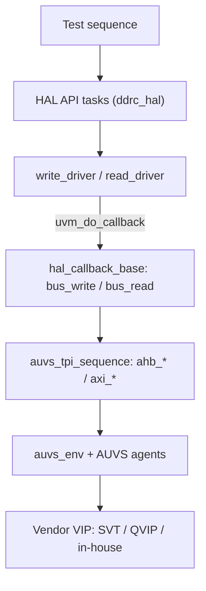

<!-- generated by yt-paper; edits will be overwritten -->
[DVCon](../dvcon/index.md) › [US](../dvcon/us.md) › [2017](../dvcon/by-year.md#2017) › [Verification](../dvcon/by-topic.md#verification)

# PRACTICAL SCHEMES TO ENHANCE VERTICAL, HORIZONTAL AND PLATFORM REUSABILITY OF VERIFICATION COMPONENTS IN AMBA BASED SOC DESIGN

<figure class="rep-fig" markdown>
{ loading=lazy }
<figcaption>Figure 2 shows the overall architecture of AMBA Unified Verification System (AUVS), composed of AUVS TPI sequence, AUVS environment, and AUVS harness. AUVS can be considered a pre-built UVM based verification platform which provides users with a reusable AMBA transaction generation mechanism. Three major components — from the original paper (Ieryung Park et al.)</figcaption>
</figure>

[:material-open-in-new: Original paper](https://dvcon-proceedings.org/wp-content/uploads/practical-schemes-to-enhance-vertical-horizontal-and-platform-reusability-of-verification-components-in-amba-based-soc-design.pdf){ .md-button .md-button--primary target=_blank }

| | |
|---|---|
| Authors | Ieryung Park (SK Hynix), Nara Cho (SK Hynix), Yonghee Im (SK Hynix); SK Hynix, SoC IP&DV, Bundang, Sungnam, Korea |
| Venue | DVCon US 2017 |
| Topic | Verification |
| Type | PAPER |
| ID | `ref-20261018-0299` |

## Summary

**Proposes AUVS, a pre-built UVM AMBA verification platform with a vendor-independent TPI sequence API to cut testbench build time and enable VIP platform reuse, and FLS, a HAL-based sequence layer whose bus operations are bound through callbacks so test sequences survive SFR protocol changes (vertical and horizontal reuse).**

**AMBA 기반 SoC 검증에서 testbench 구축 시간을 줄이고 VIP를 바꿔도 시퀀스를 재사용할 수 있도록, 벤더 독립 TPI API를 갖춘 사전 구성 UVM 플랫폼 AUVS와 HAL 콜백으로 버스 동작을 연결하는 FLS를 제안한다. FLS를 통해 SFR 프로토콜이 바뀌어도 테스트 시퀀스를 유지할 수 있다(vertical, horizontal 재사용).**

## Key Insights

- AUVS pre-instantiates AXI/AHB/APB agents from one environment: the VIP vendor is chosen by a compile-time `define (AUVS_USE_SVT_AXI, AUVS_USE_QVIP_AXI, or in-house default) and agent counts by AUVS_*_AGT_MAX, removing per-IP agent, config, and connection boilerplate (Problem 1). The paper does not quantify the resulting build-time saving.

- AUVS는 하나의 환경에서 AXI/AHB/APB agent를 미리 인스턴스화한다. VIP 벤더는 컴파일 시 `define(AUVS_USE_SVT_AXI, AUVS_USE_QVIP_AXI, 기본값 in-house)으로, agent 개수는 AUVS_*_AGT_MAX로 선택하여 IP별 agent, config, 연결 보일러플레이트를 없앤다(Problem 1). 논문은 build 시간 절감 효과를 수치로 제시하지 않는다.

- auvs_tpi_sequence exposes agt_id-indexed axi_write/axi_read, ahb_*, and apb_* tasks, so test sequences inheriting TPI are claimed to run unchanged when the underlying VIP changes (Problem 2). Vendor-specific item creation and timing is hidden inside each TPI task.

- auvs_tpi_sequence는 agt_id로 지정하는 axi_write/axi_read, ahb_*, apb_* 태스크를 제공한다. TPI를 상속한 테스트 시퀀스는 기반 VIP가 바뀌어도 수정 없이 동작한다고 주장한다(Problem 2). 벤더별 아이템 생성과 타이밍은 각 TPI 태스크 내부에 숨겨져 있다.

- FLS HAL API tasks (e.g., ddrc_hal::init) use only write_driver/read_driver, which invoke virtual bus_write/bus_read via uvm_do_callback. Changing the SFR port from AHB to AXI means replacing only the callback tasks (Snippet 13), not the sequence, targeting vertical and horizontal reuse (Problem 3).

- FLS HAL API 태스크(예: ddrc_hal::init)는 write_driver/read_driver만 사용하며, 이 태스크들은 uvm_do_callback을 통해 가상 태스크 bus_write/bus_read를 호출한다. SFR 포트를 AHB에서 AXI로 바꿀 때는 시퀀스가 아니라 콜백 태스크(Snippet 13)만 교체하면 된다. 이는 vertical 및 horizontal 재사용을 겨냥한다(Problem 3).

- The motivating figures (22% testbench build-up, 23% test scenario coding, 36% debugging; 45% prep vs 36% verification) are cited from an external Mentor 2014 source [1], not measured by the authors. No speedup or project measurement is reported, so benefits must be validated in your own flow.

- 동기로 든 수치(testbench 구축 22%, 시나리오 코딩 23%, 디버그 36%, 준비 45% 대 검증 36%)는 외부 Mentor 2014 자료 [1]에서 인용한 것이며 저자가 측정한 값이 아니다. 속도 향상이나 프로젝트 측정 결과도 보고되지 않았으므로 자신의 flow에서 직접 검증해야 한다.

- Snippets are illustrative: QVIP and in-house AXI bodies are elided with '...', and Snippet 11's mr_read() calls write_driver() instead of read_driver(), which looks like a copy-paste error that should be checked before reuse.

- 스니펫은 예시 코드다. QVIP와 in-house AXI 본문은 '...'으로 생략되어 있으며, Snippet 11의 mr_read()는 read_driver() 대신 write_driver()를 호출한다. 복사-붙여넣기 오류로 보이므로 재사용 전에 확인해야 한다.

## Detailed Summary

### Background and Problem

- The authors cite a 2014 Mentor study [1]: 22% of verification time goes to testbench build-up, 23% to test scenario coding, and 36% to debugging. Preparation (45%) therefore exceeds the 36% spent on actual verification work. These figures are quoted, not measured by the paper.

- 저자들은 2014년 Mentor 자료 [1]을 인용한다. 검증 시간의 22%는 testbench 구축, 23%는 테스트 시나리오 코딩, 36%는 디버깅에 쓰인다. 따라서 준비 작업(45%)이 실제 검증 작업(36%)보다 많다. 이 수치들은 인용된 것이며 논문 저자가 측정한 값이 아니다.

- SystemVerilog and UVM supply reusable components but do not guarantee reuse; reuse depends on how engineers build components. The paper classifies reuse into three types: vertical, horizontal, and platform.

- SystemVerilog와 UVM은 재사용 가능한 컴포넌트를 제공하지만 재사용을 보장하지는 않는다. 재사용은 엔지니어가 컴포넌트를 어떻게 만드는지에 달려 있다. 논문은 재사용을 vertical, horizontal, platform 세 가지로 분류한다.

- Problem 1 (testbench build): IP-level verification needs nearly one testbench per IP block. Agent and interface creation, configuration, connection, and sequence creation are repeated each time.

- Problem 1 (testbench 구축): IP 수준 검증에는 IP 블록마다 거의 하나씩 testbench가 필요하다. agent 및 interface 생성, 설정, 연결, sequence 작성이 매번 반복된다.

- Problem 2 (platform reuse): Multiple AMBA VIP vendors are used because of license limits, co-emulation synthesizability, simulator compatibility, and in-house VIPs. Test sequences are then tied to each VIP.

- Problem 2 (platform 재사용): 라이선스 제약, co-emulation 합성 가능성, 시뮬레이터 호환성, in-house VIP 등의 이유로 여러 AMBA VIP 벤더를 사용한다. 이때 테스트 시퀀스가 VIP마다 묶이게 된다.

- Problem 3 (vertical and horizontal reuse): An AHB driver used at IP level cannot be reused at subsystem level when the bus is AXI. Across projects, an SFR access port can change from AHB to AXI, which breaks sequences.

- Problem 3 (vertical 및 horizontal 재사용): IP 수준의 AHB driver는 버스가 AXI인 subsystem 수준에서 재사용할 수 없다. 프로젝트 간에는 SFR 접근 포트가 AHB에서 AXI로 바뀔 수 있으며, 이로 인해 시퀀스가 깨진다.

### Architecture and Methodology

The paper proposes two schemes. AUVS addresses Problems 1 and 2, and FLS addresses Problem 3.

논문은 두 가지 방식을 제안한다. AUVS는 Problem 1과 2를, FLS는 Problem 3을 해결한다.

**AUVS (AMBA Unified Verification System)**: a pre-built UVM platform with master and slave interfaces per protocol.

**AUVS (AMBA Unified Verification System)**: 프로토콜별 master 및 slave interface를 갖춘 사전 구성 UVM 플랫폼이다.

- `auvs_axi_master_interface` holds the vendor VIP selected at compile time (`AUVS_USE_SVT_AXI`, `AUVS_USE_QVIP_AXI`, or in-house by default). Protocol parameters such as addr_width and data_width default to 32 and can be overridden in tb_top.

- `auvs_axi_master_interface`는 컴파일 시 선택된 벤더 VIP를 포함한다(`AUVS_USE_SVT_AXI`, `AUVS_USE_QVIP_AXI`, 기본값은 in-house). addr_width, data_width 같은 프로토콜 파라미터는 기본값 32를 가지며 tb_top에서 덮어쓸 수 있다.

- `auvs_harness` (included with `` `include ``, because interfaces cannot be inherited) instantiates interface arrays sized by `AUVS_AXI_MST_AGT_MAX` and registers the virtual interfaces in the UVM config DB.

- `auvs_harness`는 `` `include ``로 포함된다(interface는 상속할 수 없기 때문이다). `AUVS_AXI_MST_AGT_MAX`로 크기가 정해진 interface 배열을 인스턴스화하고 가상 interface를 UVM config DB에 등록한다.

- `auvs_env` build_phase fetches the VIFs, creates `auvs_axi_master_agent` and its config, and copies the widths. connect_phase binds each agent's sequencer into the virtual sequencer `auvs_sequencer`.

- `auvs_env`의 build_phase는 VIF를 가져오고 `auvs_axi_master_agent`와 config를 생성하며 폭 정보를 복사한다. connect_phase는 각 agent의 sequencer를 가상 sequencer `auvs_sequencer`에 연결한다.

- `auvs_axi_master_agent` is a placeholder wrapper. It instantiates the chosen vendor agent in build_phase and sets `seqr.target_seqr` in connect_phase.

- `auvs_axi_master_agent`는 대리(placeholder) 래퍼다. build_phase에서 선택된 벤더 agent를 인스턴스화하고, connect_phase에서 `seqr.target_seqr`를 설정한다.

- `auvs_tpi_sequence` (extends uvm_sequence) provides vendor-neutral tasks such as `axi_write(agt_id, axi_id, addr, burst, size, data)`. Each task creates a vendor-specific item with `uvm_create_on`, sets its fields and delays, then calls `finish_item`.

- `auvs_tpi_sequence`(uvm_sequence 상속)는 `axi_write(agt_id, axi_id, addr, burst, size, data)`와 같은 벤더 중립 태스크를 제공한다. 각 태스크는 `uvm_create_on`으로 벤더별 아이템을 만들고, 필드와 delay를 설정한 뒤 `finish_item`을 호출한다.

- A test sequence extends TPI and fetches `auvs_seqr` from the config DB in pre_body(). Its body then uses only TPI tasks.

- 테스트 시퀀스는 TPI를 상속하고 pre_body()에서 config DB로부터 `auvs_seqr`를 가져온다. 이후 body는 TPI 태스크만 사용한다.

**FLS (Firmware-Like Sequences) with HAL**: a Hardware Abstraction Layer sits between the test sequence and the agents.

**FLS (Firmware-Like Sequences)와 HAL**: 테스트 시퀀스와 agent 사이에 Hardware Abstraction Layer를 둔다.

- `hal_base` (uvm_object) provides `write_driver(addr, data)` and `read_driver(addr, data)`. Each calls `uvm_do_callback` into the virtual tasks `bus_write`/`bus_read` of `hal_callback_base`.

- `hal_base`(uvm_object)는 `write_driver(addr, data)`와 `read_driver(addr, data)`를 제공한다. 두 태스크는 `uvm_do_callback`을 통해 `hal_callback_base`의 가상 태스크 `bus_write`/`bus_read`를 호출한다.

- The HAL API (`ddrc_hal`: mr_write, set_address, set_phy_delay, set_ddrc_start with read-modify-write, init) is written only with driver tasks and is protocol-independent.

- HAL API(`ddrc_hal`: mr_write, set_address, set_phy_delay, read-modify-write를 사용하는 set_ddrc_start, init)는 driver 태스크만으로 작성되며 프로토콜에 독립적이다.

- `ddrc_hal_callback#(T)` binds the bus tasks to AUVS TPI (`ahb_write`/`ahb_read`). Moving to AXI means replacing only these callback tasks (Snippet 13). RAL operations can be used the same way.

- `ddrc_hal_callback#(T)`는 bus 태스크를 AUVS TPI(`ahb_write`/`ahb_read`)에 연결한다. AXI로 바꿀 때는 이 callback 태스크만 교체하면 된다(Snippet 13). RAL 연산도 같은 방식으로 사용할 수 있다.

### Results and Conclusions

- The paper contains no simulation data, benchmark, or measured build-time reduction. Its claims are qualitative, such as "reducing testbench build-up time dramatically."

- 논문에는 시뮬레이션 데이터, 벤치마크, 측정된 build 시간 단축 결과가 없다. "testbench 구축 시간을 획기적으로 줄인다"와 같은 주장은 정성적인 수준이다.

- Conclusion: AUVS reduces build-up time (Problem 1) and removes sequence dependence on VIPs (Problem 2). FLS keeps sequences reusable when SFR port protocols change (Problem 3). The authors expect that using both together covers vertical, horizontal, and platform reuse.

- 결론: AUVS는 testbench 구축 시간을 줄이고(Problem 1), 시퀀스의 VIP 의존성을 제거한다(Problem 2). FLS는 SFR 포트 프로토콜이 바뀌어도 시퀀스를 재사용하게 한다(Problem 3). 저자들은 두 방식을 함께 쓰면 vertical, horizontal, platform 재사용을 모두 달성할 수 있다고 본다.

- Caveats: the code is illustrative. Vendor bodies are elided, the agent index `agt_id=0` is hardcoded in the HAL callback, and Snippet 11's `mr_read()` calls `write_driver()`, which appears to be a typo.

- 유의점: 코드는 예시다. 벤더 본문은 생략되어 있고, HAL callback에서는 agent 인덱스 `agt_id=0`이 하드코딩되어 있다. Snippet 11의 `mr_read()`는 `read_driver()` 대신 `write_driver()`를 호출하는데, 이는 오타로 보인다.

## Videos

<iframe src="https://www.youtube-nocookie.com/embed/kdJTvnCGU0Q" title="[DVCON2017]PRACTICAL SCHEMES TO ENHANCE VERTICAL HORIZONTAL AND PLATFORM REUSABILITY OF VERIFICATION" loading="lazy" allow="accelerometer; clipboard-write; encrypted-media; gyroscope; picture-in-picture; web-share" referrerpolicy="strict-origin-when-cross-origin" allowfullscreen></iframe>

**[DVCON2017]PRACTICAL SCHEMES TO ENHANCE VERTICAL HORIZONTAL AND PLATFORM REUSABILITY OF VERIFICATION** — [Watch on YouTube](https://www.youtube.com/watch?v=kdJTvnCGU0Q) · [Video page](../videos/kdJTvnCGU0Q.md)
