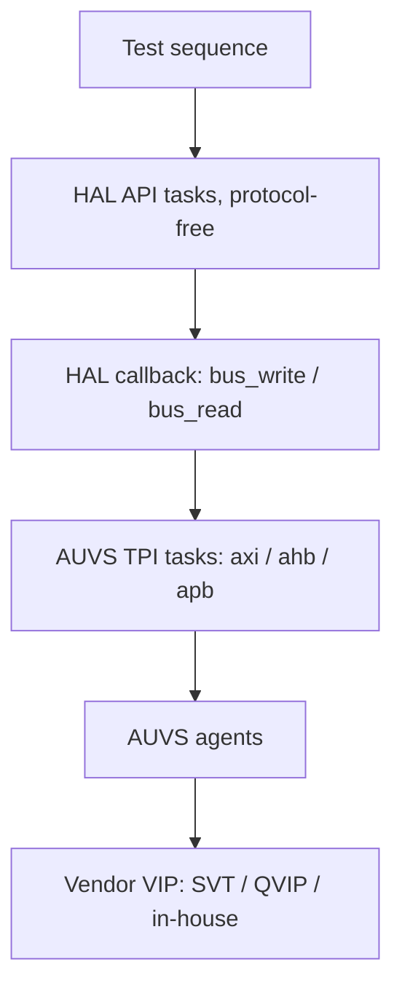

<!-- generated by yt-paper; edits will be overwritten -->
[DVCon](../dvcon/index.md) › [US](../dvcon/us.md) › [2017](../dvcon/by-year.md#2017) › [Verification](../dvcon/by-topic.md#verification)

# PRACTICAL SCHEMES TO ENHANCE VERTICAL, HORIZONTAL AND PLATFORM REUSABILITY OF VERIFICATION COMPONENTS IN AMBA BASED SOC DESIGN

<figure class="rep-fig" markdown>
{ loading=lazy }
<figcaption>Figure 2. AUVS architecture — from the original paper (Ieryung Park et al.)</figcaption>
</figure>

[:material-open-in-new: Original paper](https://dvcon-proceedings.org/wp-content/uploads/practical-schemes-to-enhance-vertical-horizontal-and-platform-reusability-of-verification-components-in-amba-based-soc-design.pdf){ .md-button .md-button--primary target=_blank }

| | |
|---|---|
| Authors | Ieryung Park (SK Hynix), Nara Cho (SK Hynix), Yonghee Im (SK Hynix) |
| Venue | DVCon US 2017 |
| Topic | Verification |
| Type | PAPER |
| ID | `ref-20261018-0299` |

## Summary

**The paper proposes AUVS, a pre-built UVM platform with per-protocol wrapper agents and a VIP-independent TPI sequence API, and FLS, a HAL-callback scheme that lets test sequences survive SFR bus protocol changes, to improve vertical, horizontal and platform reuse in AMBA-based SoC verification.**

**AUVS는 프로토콜별 래퍼 에이전트와 VIP 독립 TPI 시퀀스 API로 testbench 구축과 VIP 종속성을 줄이고, FLS는 HAL 콜백으로 SFR 버스 프로토콜이 바뀌어도 테스트 시퀀스를 재사용하게 하여 AMBA 기반 SoC 검증 컴포넌트의 수직, 수평, 플랫폼 재사용성을 높이는 UVM 기법을 제안한다.**

## Key Insights

- Cited industry data attribute 22% of verification time to testbench build-up and 23% to test scenario coding (45% total preparation) versus 36% to debugging, which motivates reuse as the target.

- 인용된 산업 데이터에 따르면 검증 시간의 22%가 testbench 구축, 23%가 테스트 시나리오 코딩에 쓰여 준비 작업이 45%로, 디버그 36%보다 많아 재사용이 핵심 목표로 제시된다.

- AUVS selects the vendor AMBA VIP (SVT, QVIP or in-house) at compile time via `define, and an AUVS harness publishes all interfaces through uvm_config_db so the environment is instantiated with user configuration only.

- AUVS는 컴파일 시점에 `define으로 VIP(SVT, QVIP 또는 in-house)를 선택하며, AUVS harness가 모든 interface를 uvm_config_db에 등록해 사용자 설정만으로 환경을 인스턴스화한다.

- Test sequences written against AUVS TPI tasks (axi_write/read, ahb_*, apb_*, selected by agt_id) are claimed to run unchanged when the underlying VIP changes, addressing platform reuse.

- AUVS TPI 태스크(agt_id로 선택하는 axi_write/read, ahb_*, apb_*)에 맞춰 작성된 테스트 시퀀스는 VIP가 바뀌어도 수정 없이 동작한다고 주장되며, 이는 플랫폼 재사용성 문제를 다룬다.

- FLS writes sequences using only address/data driver tasks in a HAL; bus operations are bound through uvm_callback, so an AHB-to-AXI SFR port change needs only the callback bus tasks replaced.

- FLS는 주소와 데이터만 쓰는 드라이버 태스크로 HAL 시퀀스를 작성하고, 버스 동작은 uvm_callback으로 바인딩하므로 AHB에서 AXI로 SFR 포트가 바뀌면 콜백 버스 태스크만 교체하면 된다.

- The paper reports no quantitative results (no measured build-time or effort reduction); benefits are argued qualitatively, and examples cover only AHB and AXI with APB and QVIP bodies elided.

- 논문은 정량적 결과(구축 시간이나 공수 감소 측정치)를 제시하지 않으며 효과는 정성적으로 주장된다. 예시는 AHB와 AXI에 한정되고 APB와 QVIP 본문은 생략되어 있다.

## Detailed Summary

### Background and Problem

- Cites a prior study [1]: testbench build-up is 22% and test scenario coding 23% of verification time (45% preparation) versus 36% for debugging.

- 선행 연구 [1]를 인용: testbench 구축이 검증 시간의 22%, 테스트 시나리오 코딩이 23%를 차지해 준비 작업이 45%이며, 디버그(36%)보다 많다.

- Three reuse problems: (1) repeated testbench construction for each IP block; (2) platform reuse of sequences across multiple AMBA VIP vendors (licensing, co-emulation synthesizability, simulator compatibility, in-house VIP); (3) vertical reuse (IP to subsystem, e.g., AHB driver to AXI bus) and horizontal reuse (SFR port protocol change across projects).

- 세 가지 재사용 문제: (1) IP 블록마다 testbench를 반복 구축하는 문제, (2) 여러 AMBA VIP 벤더에 걸친 시퀀스 플랫폼 재사용 문제(라이선스, co-emulation 합성 가능성, 시뮬레이터 호환성, in-house VIP), (3) 수직 재사용(IP에서 서브시스템으로, 예: AHB 드라이버를 AXI 버스로 이전)과 수평 재사용(프로젝트 간 SFR 포트 프로토콜 변경).

### Architecture and Methodology

- **AUVS**: pre-built UVM platform with AXI/AHB/APB wrapper agents, each wrapping a compile-time-selected VIP. A harness instantiates interface arrays and registers virtual interfaces in the config DB; the environment builds agents and connects them to a virtual sequencer. Protocol parameters (addr_width, data_width) live in the interface and can be overridden.

- **AUVS**: AXI/AHB/APB 래퍼 에이전트로 구성된 사전 구축 UVM 플랫폼이며, 각 에이전트는 컴파일 시점에 선택된 VIP를 감싼다. harness가 interface 배열을 인스턴스화하고 virtual interface를 config DB에 등록하며, 환경은 에이전트를 생성해 가상 sequencer에 연결한다. 프로토콜 파라미터(addr_width, data_width)는 interface에 있으며 외부에서 덮어쓸 수 있다.

- **TPI**: a uvm_sequence base class exposing VIP-independent read/write tasks that take `agt_id`, so test sequences need no edits when the VIP changes.

- **TPI**: VIP에 독립적인 읽기/쓰기 태스크를 제공하는 uvm_sequence 기반 클래스이며, `agt_id`로 대상 에이전트를 지정한다. 따라서 VIP가 바뀌어도 테스트 시퀀스를 수정할 필요가 없다.

- **FLS**: `hal_base` provides `write_driver`/`read_driver` (address and data only), which call virtual `bus_write`/`bus_read` in a callback (`hal_callback_base`). The DDR controller example implements its init sequence through HAL API tasks, with AHB via TPI, and AXI swapped in by callback replacement.

- **FLS**: `hal_base`는 `write_driver`/`read_driver`(주소와 데이터만 사용)를 제공하며, 이들은 `hal_callback_base`의 가상 `bus_write`/`bus_read`를 콜백으로 호출한다. DDR 컨트롤러 예시는 HAL API 태스크로 초기화 시퀀스를 구현하며, AHB는 TPI를 통해 쓰고 AXI는 콜백 교체로 적용한다.

### Results and Conclusions

- No quantitative measurements are reported; time savings and reuse gains are asserted, supported by code snippets only.

- 정량적 측정 결과는 보고되지 않으며, 시간 절감과 재사용 효과는 코드 스니펫으로만 뒷받침되는 주장이다.

- Claimed outcomes: AUVS reduces testbench build-up (Problem 1) and removes sequence dependence on VIPs (Problem 2); FLS enables sequence reuse across SFR protocol changes (Problem 3). Combined, the authors expect coverage of all three reuse axes.

- 주장된 성과: AUVS는 testbench 구축 시간을 줄이고(문제 1) 시퀀스의 VIP 종속성을 제거하며(문제 2), FLS는 SFR 프로토콜 변경에도 시퀀스 재사용을 가능하게 한다(문제 3). 두 기법을 결합하면 세 가지 재사용 축을 모두 다룬다고 저자들은 기대한다.

- Scope limits: AHB and AXI examples only, APB and QVIP bodies elided, and a short industrial practice paper rather than a validated benchmark.

- 범위 한계: AHB와 AXI 예시만 있고 APB와 QVIP 본문은 생략되었으며, 검증된 벤치마크가 아닌 짧은 산업 실무 논문이다.

## Videos

<iframe src="https://www.youtube-nocookie.com/embed/kdJTvnCGU0Q" title="[DVCON2017]PRACTICAL SCHEMES TO ENHANCE VERTICAL HORIZONTAL AND PLATFORM REUSABILITY OF VERIFICATION" loading="lazy" allow="accelerometer; clipboard-write; encrypted-media; gyroscope; picture-in-picture; web-share" referrerpolicy="strict-origin-when-cross-origin" allowfullscreen></iframe>

**[DVCON2017]PRACTICAL SCHEMES TO ENHANCE VERTICAL HORIZONTAL AND PLATFORM REUSABILITY OF VERIFICATION** — [Watch on YouTube](https://www.youtube.com/watch?v=kdJTvnCGU0Q) · [Video page](../videos/kdJTvnCGU0Q.md)
