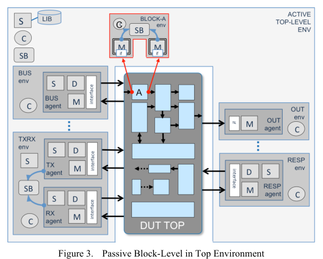
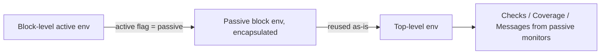

<!-- generated by yt-paper; edits will be overwritten -->
[DVCon](../dvcon/index.md) › [US](../dvcon/us.md) › [2013](../dvcon/by-year.md#2013) › [Verification](../dvcon/by-topic.md#verification)

# Pragmatic Verification Reuse in a Vertical World

<figure class="rep-fig" markdown>
{ loading=lazy }
<figcaption>Figure 3. Passive Block-Level in Top Environment — from the original paper (Mark Litterick et al.)</figcaption>
</figure>

[:material-open-in-new: Original paper](https://dvcon-proceedings.org/wp-content/uploads/pragmatic-verification-reuse-in-a-vertical-world.pdf){ .md-button .md-button--primary target=_blank }

| | |
|---|---|
| Authors | Mark Litterick (Verilab GmbH, Munich, Germany) |
| Venue | DVCon US 2013 |
| Topic | Verification |
| Type | PAPER |
| ID | `ref-20261018-04d2` |

## Summary

**The paper gives pragmatic guidelines for vertical reuse of block-level UVM/SystemVerilog and e environments in top-level testbenches, centered on passive-mode operation, monitor-based checking and coverage, and environment encapsulation.**

**이 논문은 블록 레벨 UVM/SystemVerilog 및 e 환경을 탑 레벨 테스트벤치에서 재사용(vertical reuse)하기 위한 실용적 가이드라인을 제시하며, passive 모드 동작, 모니터 기반 체크·커버리지, 환경 캡슐화를 핵심으로 한다.**

## Key Insights

- Scoreboards must be fed only from passive monitors that decode observed bus traffic, not from driver-side sequence items; the paper calls this the most common block-level violation and the hardest to fix when retrofitting reuse.

- 스코어보드는 드라이버 측 sequence item이 아니라 관찰된 버스 트래픽을 디코딩해 analysis port로 전달하는 passive 모니터에서만 입력을 받아야 한다. 저자는 이를 가장 흔한 블록 레벨 위반이자 재사용을 뒤늦게 적용할 때 고치기 가장 어려운 결함으로 꼽는다.

- The active/passive flag must be applied to the whole block-level environment, not only to the interface agents. Active components (sequencers, drivers) must not be constructed in passive mode, and nothing may connect to them.

- active/passive 플래그는 인터페이스 에이전트뿐 아니라 블록 레벨 환경 전체에 적용해야 한다. passive 모드에서는 sequencer와 driver 같은 active 컴포넌트를 생성하지 않으며, 이들에 대한 연결도 하지 않는다.

- Functional checks, coverage, configuration updates and informative messages belong in passive monitors so they survive reuse. Driver-only stimulus coverage cannot be reused at top level.

- 기능 체크, 커버리지, configuration 갱신, 정보성 메시지는 passive 모니터에 두어야 재사용 시 살아남는다. 드라이버에서만 수집하는 stimulus 커버리지는 탑 레벨에서 재사용할 수 없다.

- Encapsulation is central to integration: one environment component shared by the block base-test and the top-level, one hierarchical interface and one configuration object per block, and SVA checks placed inside the interface so they stay active in passive mode.

- 통합의 핵심은 캡슐화다. 블록 base-test가 아닌 단일 environment 컴포넌트를 블록 테스트와 탑 레벨 모두에서 사용하고, 블록당 하나의 hierarchical interface와 하나의 configuration 객체를 제공하며, SVA 체크는 interface 내부에 두어 passive 모드에서도 동작하게 한다.

- The paper gives no quantitative experimental results. Its guidelines are qualitative and drawn from the author's experience across many projects.

- 논문에는 정량적 실험 결과가 없다. 제시된 가이드라인은 정성적이며, 저자의 여러 프로젝트 경험을 바탕으로 한다.

## Detailed Summary

### Background and Problem

- Reusing block-level verification environments at the top level (vertical reuse) adds checks, coverage and messages, and improves bug isolation and debug speed. The author reports that consistent, efficient vertical reuse is still rarely achieved across companies.

- 블록 레벨 검증 환경을 탑 레벨에서 재사용(vertical reuse)하면 체크, 커버리지, 메시지가 추가되어 버그 검출과 원인 격리, 디버그 속도가 향상된다. 저자는 여러 회사에서 일관되고 효율적인 vertical reuse가 여전히 드물다고 보고한다.

- Horizontal reuse keeps the abstraction level and functional role. Vertical reuse changes the role, for example from stimulus generator at block level to passive observer at chip level.

- Horizontal reuse는 추상화 수준과 기능적 역할을 유지한다. Vertical reuse는 역할이 바뀐다. 예를 들어 블록 레벨에서는 stimulus 생성기였던 것이 칩 레벨에서는 passive 관찰자가 된다.

- The real world does not follow the ideal bottom-up flow for three reasons: top-level environments have different requirements (constrained-random scenarios, directed tests, software, analog behavioral models); they are on the critical path and built in parallel with block-level environments; and block-level environments vary widely in quality.

- 실제 환경은 이상적인 bottom-up 흐름을 따르지 않는다. 세 가지 이유가 있다. 첫째, 탑 레벨 환경은 요구사항이 다르다(constrained-random 시나리오, directed 테스트, 소프트웨어, 아날로그 behavioral 모델). 둘째, 탑 레벨은 critical path에 있어 블록 레벨 환경과 병행 개발된다. 셋째, 블록 레벨 환경의 품질이 제각각이다.

- Top-level requirements include functional correctness, subsystem interaction, shared resources, clock and power domains, performance and connectivity. Closure requires internal checks and coverage, not only external pin observation.

- 탑 레벨 요구사항에는 기능 정확성, 서브시스템 상호작용, 공유 자원, 클록·전원 도메인, 성능, 연결성이 포함된다. 외부 핀만 관찰해서는 closure가 불가능하므로 내부 체크와 커버리지가 필요하다.

### Architecture and Methodology

The core model is the switch between active mode (stimulus from sequencers and drivers, with checks, coverage and messages from monitors and scoreboards) and passive mode (no stimulus; checks, coverage and messages retained). In a top-level testbench, the passive block-level environment is instantiated on the embedded DUT block and driven by top-level active components.

핵심 모델은 active 모드(sequencer와 driver에서 stimulus 생성, monitor와 scoreboard에서 체크·커버리지·메시지 수집)와 passive 모드(stimulus 없음, 체크·커버리지·메시지 유지) 사이의 전환이다. 탑 레벨 테스트벤치에서는 passive 블록 레벨 환경을 내장 DUT 블록에 인스턴스화하고, 탑 레벨의 active 컴포넌트가 구동한다.

The guidelines, grouped by section:

섹션별로 묶은 가이드라인은 다음과 같다.

- **Active/passive mode:** the flag must be set at build or generate time across the complete environment. Active components are not constructed in passive mode, and nothing may connect to their TLM ports or pointers.

- **Active/passive 모드:** 플래그는 build 또는 generate 단계에서 전체 환경에 설정한다. passive 모드에서는 active 컴포넌트를 생성하지 않으며, 이들의 TLM 포트나 포인터에 연결하지 않는다.

- **Scoreboards:** monitors must decode the resolved interface signals and publish through analysis ports. Feeding scoreboards from sequence items is prohibited.

- **스코어보드:** 모니터가 해석된 인터페이스 신호를 디코딩해 analysis port로 전달해야 한다. Sequence item을 스코어보드에 보내는 방식은 금지된다.

- **Functional checks and coverage:** protocol and content checks, including SVA bound in the interface, and most functional coverage belong in passive components. Coverage measures what was observed on the bus, not what was requested.

- **기능 체크와 커버리지:** 프로토콜·내용 체크(인터페이스에 바인딩된 SVA 포함)와 대부분의 기능 커버리지는 passive 컴포넌트에 둔다. 커버리지는 요청된 트랜잭션이 아니라 버스에서 관찰된 내용을 측정한다.

- **Configuration and messages:** configuration is updated only from passive components. Important messages come from passive components. Warnings for illegal injected traffic may be promoted to errors in passive mode, with the monitor using the flag only to set severity.

- **Configuration과 메시지:** configuration은 passive 컴포넌트에서만 갱신한다. 중요한 메시지도 passive 컴포넌트에서 생성한다. 잘못된 주입 트래픽에 대한 경고는 passive 모드에서 에러로 승격할 수 있으며, 모니터는 플래그를 심각도 결정에만 사용한다.

- **End-of-test:** passive components, including monitors and scoreboards, must not raise objections. Partial transactions or DMA transfers may be terminated by the top-level test.

- **테스트 종료:** 모니터와 스코어보드를 포함한 passive 컴포넌트는 objection을 걸지 않는다. 부분 트랜잭션이나 DMA 전송은 탑 레벨 테스트에 의해 종료될 수 있다.

- **Stimulus reuse:** user constraints go in sequences, while sequence items keep only legality constraints. Provide a comprehensive sequence library, low-level and high-level, registered with the highest-level virtual sequencer.

- **Stimulus 재사용:** 사용자 제약은 sequence에 두고, sequence item에는 legality 제약만 둔다. 저수준과 고수준 sequence를 모두 포함한 포괄적 sequence 라이브러리를 최상위 virtual sequencer에 등록한다.

- **Scale and encapsulation:** encapsulate all sub-components in one environment component, not in the base-test. Encapsulate configuration into a single object exposing only flexible fields. Combine signal interfaces into one hierarchical interface. Place SVA in the interface. Prefix package-scope names (class, constant, macro, type and enum literal) to avoid collisions under wildcard imports.

- **규모와 캡슐화:** 모든 하위 컴포넌트를 base-test가 아닌 단일 environment 컴포넌트로 캡슐화한다. Configuration은 유연한 필드만 노출하는 단일 객체로 캡슐화한다. 여러 signal interface는 하나의 hierarchical interface로 묶는다. SVA는 interface 내부에 둔다. Wildcard import 시 충돌을 피하도록 패키지 범위 이름(class, constant, macro, type, enum literal)에 접두사를 붙인다.

- **Additional concerns:** formal assume statements should be reused as simulation assertions. Verification components need power-state indicators for power-aware simulation. RTL and AMS assertions must be selectively enabled because of performance cost. CDC assertions should be reused, and bottom-up CDC waiver reuse needs caution. Transaction-level reuse requires separating protocol and physical layers. Emulation and multi-language topics are out of scope and referenced to [6] and [7].

- **추가 고려사항:** 형식 검증의 assume 문은 시뮬레이션 assertion으로 재사용해야 한다. 검증 컴포넌트는 전원 상태 indicator를 가져야 power-aware 시뮬레이션이 가능하다. RTL과 AMS assertion은 성능 비용 때문에 선택적으로 활성화해야 한다. CDC assertion은 재사용하고, bottom-up CDC waiver 재사용에는 주의가 필요하다. Transaction-level 재사용을 위해서는 프로토콜 계층과 물리 신호 계층을 분리해야 한다. 에뮬레이션과 다중 언어 주제는 범위 밖이며 각각 [6], [7]을 참조한다.

- **Tuning coverage:** block-level coverage groups usually need modification at top level. In e, AOP redefines classes. In SystemVerilog/UVM, factory-based class substitution overrides coverage groups. Top-level inter-block coverage is layered on the block-level mechanisms.

- **커버리지 튜닝:** 블록 레벨 커버리지 그룹은 탑 레벨에서 보통 수정이 필요하다. e에서는 AOP로 클래스를 재정의하고, SystemVerilog/UVM에서는 factory 기반 클래스 치환으로 커버리지 그룹을 오버라이드한다. 블록 간 탑 레벨 커버리지는 블록 레벨 메커니즘 위에 추가한다.

The text is truncated in the middle of Section IX (Tuning Reuse, coverage). Later topics are not present and are not summarized.

본문은 Section IX(Tuning Reuse, 커버리지) 중간에서 잘려 있다. 그 이후 주제는 본문에 없으므로 요약하지 않았다.

### Results and Conclusions

- The paper presents no experimental data, benchmarks or quantitative measurements. Its contribution is a set of pragmatic guidelines (marked with a ð symbol in the source) and a retrofit direction, based on the author's experience across many projects.

- 논문은 실험 데이터, 벤치마크, 정량 측정 결과를 제시하지 않는다. 기여는 실용적 가이드라인(원문에서 ð 기호로 표시)과 retrofit 방향을 정리한 것이며, 저자의 여러 프로젝트 경험에 기반한다.

- The central conclusion is that block-level environments must be designed from the start for passive operation: scoreboard and checker connectivity must come from monitors, configuration and messages must be preserved in passive mode, and the environment must be encapsulated for single-point integration.

- 핵심 결론은 블록 레벨 환경을 처음부터 passive 동작을 고려해 설계해야 한다는 것이다. 스코어보드와 체커의 연결은 모니터에서 나와야 하고, passive 모드에서도 configuration과 메시지가 유지되어야 하며, 환경은 단일 지점 통합이 가능하도록 캡슐화되어야 한다.

- The author notes that scoreboard connectivity violations are the hardest defect to recover from when retrofitting, which makes early architectural discipline the key recommendation.

- 저자는 retrofit 시 스코어보드 연결 위반이 복구하기 가장 어려운 결함이라고 지적한다. 따라서 초기 아키텍처 단계의 엄격한 설계 원칙이 핵심 권고다.

## Videos

<iframe src="https://www.youtube-nocookie.com/embed/5lzMBOmdQkQ" title="[DVCON2013]Pragmatic Verification Reuse in a Vertical World" loading="lazy" allow="accelerometer; clipboard-write; encrypted-media; gyroscope; picture-in-picture; web-share" referrerpolicy="strict-origin-when-cross-origin" allowfullscreen></iframe>

**[DVCON2013]Pragmatic Verification Reuse in a Vertical World** — [Watch on YouTube](https://www.youtube.com/watch?v=5lzMBOmdQkQ) · [Video page](../videos/5lzMBOmdQkQ.md)
