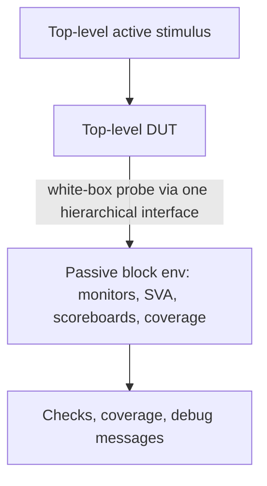

<!-- generated by yt-paper; edits will be overwritten -->
[DVCon](../dvcon/index.md) › [US](../dvcon/us.md) › [2013](../dvcon/by-year.md#2013) › [Verification](../dvcon/by-topic.md#verification)

# Pragmatic Verification Reuse in a Vertical World

<figure class="rep-fig" markdown>
{ loading=lazy }
<figcaption>Figure 3. Passive Block-Level in Top Environment — from the original paper (Mark Litterick et al.)</figcaption>
</figure>

[:material-open-in-new: Original paper](https://dvcon-proceedings.org/wp-content/uploads/pragmatic-verification-reuse-in-a-vertical-world.pdf){ .md-button .md-button--primary target=_blank }

| | |
|---|---|
| Authors | Mark Litterick (Verilab GmbH, Munich, Germany) |
| Venue | DVCon US 2013 |
| Topic | Verification |
| Type | PAPER |
| ID | `ref-20261018-04d2` |

## Summary

**The paper analyzes why block-level verification environments are often poorly reused at the top level, and gives pragmatic guidelines (passive-mode correctness, monitor-based checking, encapsulation, namespace hygiene) plus retrofit advice, with no quantitative experiments.**

**블록 레벨 검증 환경을 탑 레벨에서 passive 모드로 재사용할 때 생기는 구조적 문제를 분석하고, passive 모드 정합성, 모니터 기반 체킹, 캡슐화, 네임스페이스 관리 등 실용적 가이드라인과 기존 환경 retrofit 방법을 제시한 논문입니다.**

## Key Insights

- Scoreboards must be fed by passive monitors that decode resolved interface signals, not by sequence items sent to drivers; the paper calls this the biggest single block-level violation and the hardest to retrofit.

- 스코어보드는 드라이버로 보낸 시퀀스 아이템이 아니라, 실제 인터페이스 신호(resolved signal)를 디코딩하는 passive 모니터에서 입력받아야 합니다. 논문은 이를 블록 레벨 아키텍처에서 가장 큰 단일 위반이자 retrofit하기 가장 어려운 결함이라고 설명합니다.

- The active/passive flag must govern the entire block environment, not just the interface VIP: active sequencers and drivers are not constructed in passive mode, so nothing may connect to them.

- active/passive 플래그는 인터페이스 VIP만이 아니라 블록 환경 전체에 적용되어야 합니다. passive 모드에서는 sequencer와 driver 같은 active 컴포넌트를 생성하지 않으며, 이들에 연결하는 것도 허용되지 않습니다.

- Encapsulate SVA protocol checks in the interface and expose one hierarchical interface and one configuration object, so the top-level integrator makes a single virtual-interface assignment and a single HDL path for white-box probing.

- SVA 프로토콜 체커는 인터페이스 내부에 캡슐화하고, 하나의 계층형 인터페이스와 하나의 configuration object를 제공해야 합니다. 그래야 탑 레벨 통합자는 virtual interface 할당을 한 번만 하고, white-box probing용 HDL 경로도 하나만 갖게 됩니다.

- Prefix all package-scope names (classes, constants, macros, enum literals) with a component-unique string; generic names like IDLE or BUS_WIDTH collide once many packages are wildcard-imported at top level.

- 패키지 스코프의 모든 이름(클래스, 상수, 매크로, enum 리터럴)에 컴포넌트 고유 문자열 prefix를 붙여야 합니다. 탑 레벨에서 많은 패키지를 와일드카드로 import하면 IDLE이나 BUS_WIDTH 같은 일반적인 이름이 충돌합니다.

- The paper reports no quantitative experiments; its guidance is qualitative, drawn from projects at many clients, so the claimed benefits should be validated in your own flow.

- 논문은 정량적 실험 결과를 제시하지 않으며, 여러 고객사 프로젝트에서 얻은 정성적 가이드라인입니다. 제시된 이점은 자신의 플로우에서 직접 검증해야 합니다.

## Detailed Summary

### Background and Problem

- Reusing block-level environments at top level adds checks, coverage and debug messages, but the author reports that vertical reuse is inconsistently achieved across many projects.

- 블록 레벨 환경을 탑 레벨에서 재사용하면 체크, 커버리지, 디버그 메시지가 추가되지만, 저자는 여러 프로젝트에서 수직 재사용(vertical reuse)이 일관되게 달성되지 않는다고 보고합니다.

- Top-level environments have different requirements (constrained and directed tests, software, analog behavioral models), are on the critical path and are built in parallel with block environments, and block environments are heterogeneous, so bottom-up composition is rarely feasible.

- 탑 레벨 환경은 요구사항이 다르고(제약 랜덤과 directed 테스트, 소프트웨어, 아날로그 behavioral 모델), 크리티컬 패스에 있어 블록 환경과 병렬로 개발되며, 블록 환경 자체도 품질과 기능이 제각각이라 bottom-up 구성이 현실적으로 어렵습니다.

- The paper distills pragmatic guidelines on passive reuse, encapsulation and retrofitting, written in UVM terms and largely language-independent.

- 논문은 passive 재사용, 캡슐화, retrofit에 관한 실용적 가이드라인을 UVM 용어로 정리하며, 내용은 대体로 언어에 독립적입니다.

### Architecture and Methodology

- Core concept: a passive block environment (no sequencers or drivers; checks, coverage and messages retained) is instantiated in the top-level testbench, which supplies stimulus through its own active components.

- 핵심 개념: passive 블록 환경(sequencer와 driver 없이 체크, 커버리지, 메시지는 유지)을 탑 레벨 테스트벤치에 인스턴스화하고, 자체 active 컴포넌트로 탑 레벨 stimulus를 제공합니다.

- Guidelines: active/passive flag across the full environment; scoreboards and functional checks in passive monitors; coverage, configuration updates and important messages from passive components; no end-of-test objections from passive components; user constraints in sequences; SVA inside interfaces; single environment, configuration object and hierarchical interface; unique package prefixes.

- 가이드라인: 전체 환경에 걸친 active/passive 플래그 적용, 스코어보드와 기능 체크는 passive 모니터에서 수행, 커버리지와 configuration 업데이트, 중요 메시지는 passive 컴포넌트에서 생성, passive 컴포넌트는 test 종료를 objection으로 막지 않음, 사용자 제약은 sequence에 배치, SVA는 인터페이스 내부에 배치, 단일 환경, configuration object, 계층형 인터페이스 제공, 고유 패키지 prefix 사용.

- Surveyed concerns: reuse of formal assumptions as assertions, power-aware simulation, RTL/AMS assertion cost, CDC waivers, transaction-level abstraction, emulation and multi-language operation.

- 함께 검토한 추가 이슈: 형식 검증 가정을 assertion으로 재사용, 전력 인지(power-aware) 시뮬레이션, RTL/AMS assertion의 비용, CDC waiver, transaction-level 추상화, 에뮬레이션, 다중 언어 동작.

### Results and Conclusions

- No quantitative experiments or measured results are presented; conclusions are qualitative.

- 정량적 실험이나 측정 결과는 제시되지 않으며, 결론은 정성적입니다.

- Encapsulation and passive-mode-correct design are argued to make integration less error-prone and to maximize top-level bug detection and debug isolation.

- 캡슐화와 passive 모드에서 올바르게 동작하는 설계는 통합 오류를 줄이고, 탑 레벨의 버그 검출과 디버그 격리를 극대화한다고 주장합니다.

- The provided text is truncated inside Section IX (Tuning Reuse, coverage tuning via e AOP or UVM factory overrides); later content is not available.

- 제공된 본문은 Section IX(Tuning Reuse, 커버리지 튜닝: e의 AOP 또는 UVM factory override 사용)의 중간에서 잘려 있어, 그 이후 내용은 확인할 수 없습니다.

## Videos

<iframe src="https://www.youtube-nocookie.com/embed/5lzMBOmdQkQ" title="[DVCON2013]Pragmatic Verification Reuse in a Vertical World" loading="lazy" allow="accelerometer; clipboard-write; encrypted-media; gyroscope; picture-in-picture; web-share" referrerpolicy="strict-origin-when-cross-origin" allowfullscreen></iframe>

**[DVCON2013]Pragmatic Verification Reuse in a Vertical World** — [Watch on YouTube](https://www.youtube.com/watch?v=5lzMBOmdQkQ) · [Video page](../videos/5lzMBOmdQkQ.md)
