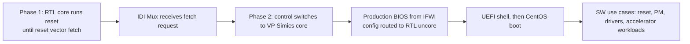

<!-- generated by yt-paper; edits will be overwritten -->
[DVCon](../dvcon/index.md) › [US](../dvcon/us.md) › [2022](../dvcon/by-year.md#2022) › [Emulation](../dvcon/by-topic.md#emulation)

# Pre-Silicon Validation of Production BIOS, Software Use Cases and Accelerator IP Workloads using Hybrid System Level Emulation SoC Platform

<figure class="rep-fig" markdown>
{ loading=lazy }
<figcaption>Figure 1 : Hybrid SLE Platform — from the original paper (Neeraj Gupta et al.)</figcaption>
</figure>

[:material-open-in-new: Original paper](https://dvcon-proceedings.org/wp-content/uploads/Pre-Silicon-Validation-of-Production-BIOS-Software-Use-Cases-and-Accelerator-IP-Workloads-using-Hybrid-System-Level-Emulation-SoC-Platform.pdf){ .md-button .md-button--primary target=_blank }

| | |
|---|---|
| Authors | Neeraj Gupta (Intel Technology India Pvt Ltd), Reddaiah Yedoti (Intel Technology India Pvt Ltd), Dixit Sethi (Intel Technology India Pvt Ltd), Sarvesh Kumar Pandey (Intel Technology India Pvt Ltd) |
| Venue | DVCon US 2022 |
| Topic | Emulation |
| Type | PAPER |
| ID | `ref-20261018-05e4` |

## Summary

**The paper presents a Hybrid SLE pre-silicon platform that runs the cores in VP Simics and the uncore as RTL on an emulator, enabling production BIOS, CentOS, reset, and accelerator IP workload validation before A0 PRQ, with production BIOS boot reduced to about 45 minutes from 75+ hours on pure emulation.**

**이 논문은 코어는 VP Simics에서, 언코어는 에뮬레이터 상의 RTL로 실행하는 Hybrid SLE 프리실리콘 플랫폼을 제시한다. 이를 통해 A0 PRQ 이전에 프로덕션 BIOS, CentOS, 리셋, 가속기 IP 워크로드를 검증할 수 있으며, 프로덕션 BIOS 부팅 시간은 순수 에뮬레이션의 75시간 이상에서 약 45분으로 줄어든다.**

## Key Insights

- Splitting the core (VP Simics) from the uncore (RTL emulation) over IDI, with an IDI Mux that hands control to the VP Simics core at the reset vector fetch, lets the production BIOS from IFWI program the real RTL memory controller, PM IP, IO, and PCIe configurations.

- 코어(VP Simics)와 언코어(RTL 에뮬레이션)를 IDI로 연결하고, 리셋 벡터 fetch 시점에 IDI Mux가 제어권을 VP Simics 코어로 넘기는 구조 덕분에, IFWI에서 로드한 프로덕션 BIOS가 실제 RTL의 메모리 컨트롤러, PM IP, IO, PCIe 설정을 프로그래밍할 수 있다.

- Production BIOS boot takes about 45 minutes on Hybrid SLE versus 75+ hours on pure emulation (roughly 100x), pure simulation is not feasible, and OS boot takes about 60 minutes.

- 프로덕션 BIOS 부팅은 Hybrid SLE에서 약 45분, 순수 에뮬레이션에서 75시간 이상이 걸려 약 100배 차이가 나며, 순수 시뮬레이션은 불가능하고, OS 부팅은 약 60분이다.

- About 15 bugs were found across RTL, BIOS, VP Simics, and the validation environment; the paper states that the 9 SW/BIOS bugs would be very hard to reproduce on pure emulation or simulation because of missing acceleration and the limited synthetic BIOS.

- RTL, BIOS, VP Simics, 검증 환경 전반에서 약 15개의 버그가 발견되었으며, 논문은 그중 SW/BIOS 버그 9건이 가속 부재와 제한적인 synthetic BIOS 때문에 순수 에뮬레이션이나 시뮬레이션에서는 재현하기 매우 어렵다고 서술한다.

- Accelerator IP workloads run end to end from an SDK application on CentOS: the SW configures memory and DMA, the IP reads and writes memory, and the SW checks the output against expected data, exercising both data and control paths.

- 가속기 IP 워크로드는 CentOS 상의 SDK 애플리케이션으로 종단간 실행된다. SW가 메모리와 DMA를 설정하면 IP가 메모리를 읽고 쓰며, SW가 출력을 기대값과 비교하여 데이터 경로와 제어 경로를 모두 검증한다.

## Detailed Summary

### Background and Problem

- Pre-Si validation mostly relies on pure RTL simulation or emulation with a synthetic BIOS (a bare-minimum BIOS). Because these platforms do not easily support full-stack software, production BIOS, OS, full-stack drivers, and real accelerator workloads (5G, AI) are rarely exercised.

- 프리실리콘 검증은 주로 synthetic BIOS(최소 기능만 가진 BIOS)를 사용한 순수 RTL 시뮬레이션이나 에뮬레이션에 의존한다. 이런 플랫폼은 풀스택 SW를 쉽게 올리지 못하므로 프로덕션 BIOS, OS, 풀스택 드라이버, 실제 가속기 워크로드(5G, AI)는 거의 실행되지 않는다.

- Bugs that surface only in Post-Si are costly to debug and can affect silicon quality or force a respin. The authors want to shift SW and use-case validation left so it completes before tape-out and targets A0 PRQ.

- Post-Si 단계에서만 드러나는 버그는 디버그 비용이 크고 실리콘 품질에 영향을 주거나 재스핀을 강요할 수 있다. 저자들은 SW 및 유스케이스 검증을 왼쪽으로 옮겨 tape-out 이전에 끝내고 A0 PRQ를 목표로 하고자 한다.

- Stated objectives: an accelerated platform; validation of production BIOS, CentOS, and production fuses; SoC reset at BIOS and OS level; OS-level power management; SW stack and drivers; and critical core and accelerator IP workloads.

- 제시된 목표는 다음과 같다. 가속 플랫폼 구축, 프로덕션 BIOS·CentOS·프로덕션 Fuse 검증, BIOS 및 OS 레벨 SoC 리셋 검증, OS 레벨 전력 관리 검증, SW 스택 및 드라이버 검증, 핵심 코어 및 가속기 IP 워크로드 검증이다.

### Architecture and Methodology

- The Hybrid SLE platform combines the RTL design mapped on emulator hardware with the VP Simics system simulator, which is the official release model of the design and supports the Intel core ISA. The core is mostly active in VP Simics and the uncore mostly in RTL.

- Hybrid SLE 플랫폼은 에뮬레이터 하드웨어에 매핑된 설계 RTL과 VP Simics 시스템 시뮬레이터를 결합한다. VP Simics는 설계의 공식 릴리스 모델이며 Intel 코어 ISA를 지원한다. 코어는 주로 VP Simics에서, 언코어는 주로 RTL에서 동작한다.

- The two sides connect at the IDI (Intra Die Interconnect) through a hybrid bridge with configurable transaction routing and an IDI transactor (xtor). An IDI Mux switches between the RTL core and the VP Simics core at runtime.

- 두 측은 IDI(Intra Die Interconnect)에서 연결된다. 설정 가능한 트랜잭션 라우팅을 가진 hybrid bridge와 IDI transactor(xtor)가 사용되며, IDI Mux는 런타임에 RTL 코어와 VP Simics 코어를 전환한다.

- Boot runs in two phases. In Phase 1, the testbench configures VP Simics, the bridge, and the mux while the RTL core runs reset like pure RTL emulation, up to the reset vector fetch. In Phase 2, the mux hands control to the VP Simics core, which executes the production BIOS loaded from the official IFWI. BIOS and FW configuration is routed through the bridge to the RTL uncore (memory controller, PM IP, IO, PCIe), and the flow ends at a UEFI shell.

- 부팅은 두 단계로 진행된다. Phase 1에서는 testbench가 VP Simics, bridge, mux를 설정하고 RTL 코어는 리셋 벡터 fetch까지 순수 RTL 에뮬레이션과 같은 방식으로 리셋을 수행한다. Phase 2에서는 mux가 제어권을 VP Simics 코어로 넘겨 공식 IFWI에서 로드한 프로덕션 BIOS를 실행한다. BIOS 및 FW의 설정은 bridge를 거쳐 RTL 언코어(메모리 컨트롤러, PM IP, IO, PCIe)로 전달되며, 흐름은 UEFI shell에서 끝난다.

- CentOS boots on the VP Simics core. It loads the Linux kernel and configures memory, network, and peripherals that live in RTL, then gives the user a shell.

- CentOS는 VP Simics 코어에서 부팅된다. Linux 커널을 로드하고 RTL에 있는 메모리, 네트워크, 주변장치를 설정한 뒤 사용자에게 shell을 제공한다.

- Platform reset (warm or cold, selected by the user) was validated from both the UEFI shell and the Linux shell, with the production BIOS driving the reset flow.

- 플랫폼 리셋(사용자가 선택한 warm 또는 cold)은 UEFI shell과 Linux shell 양쪽에서 검증되었으며, 리셋 흐름은 프로덕션 BIOS가 구동한다.

- Accelerator IP workload flow: (1) an SDK on CentOS creates, compiles, and runs SW tests against the RTL memory and accelerator; (2) the application configures memory pages and writes data; (3) it configures the accelerator for DMA and its operating mode; (4) the IP issues DMA reads; (5) the IP processes the data and writes output back to memory; (6) it acknowledges the application; (7) the application compares the output with expected data, and a match marks the workload as passed.

- 가속기 IP 워크로드 흐름은 다음과 같다. (1) CentOS 위의 SDK로 RTL 메모리와 가속기를 대상으로 하는 SW 테스트를 생성, 컴파일, 실행한다. (2) 애플리케이션이 메모리 페이지를 설정하고 데이터를 기록한다. (3) 가속기를 DMA와 동작 모드용으로 설정한다. (4) IP가 DMA read를 발행한다. (5) IP가 데이터를 처리하고 출력을 메모리에 기록한다. (6) IP가 애플리케이션에 완료를 알린다. (7) 애플리케이션이 출력을 기대값과 비교하며, 일치하면 워크로드가 통과한 것으로 판정된다.

### Results and Conclusions

- About 15 bugs were found across RTL, BIOS, VP Simics, and the validation environment. The paper says 9 of them were SW and BIOS bugs that would be very hard to reproduce on pure emulation or simulation because of the lack of acceleration and the limited synthetic BIOS.

- RTL, BIOS, VP Simics, 검증 환경 전반에서 약 15개의 버그가 발견되었다. 논문은 그중 9건이 SW 및 BIOS 버그이며, 가속 부재와 제한적인 synthetic BIOS 때문에 순수 에뮬레이션이나 시뮬레이션에서는 재현이 매우 어려웠을 것이라고 서술한다.

- Table I reports production BIOS boot at about 45 minutes on Hybrid SLE versus 75+ hours on pure emulation (about 100x), and pure simulation as not feasible. OS boot takes about 60 minutes on Hybrid SLE and is not feasible on either pure emulation or pure simulation.

- Table I에 따르면 프로덕션 BIOS 부팅은 Hybrid SLE에서 약 45분, 순수 에뮬레이션에서 75시간 이상으로 약 100배 차이가 나며, 순수 시뮬레이션은 불가능하다고 기재되어 있다. OS 부팅은 Hybrid SLE에서 약 60분이며, 순수 에뮬레이션과 순수 시뮬레이션 모두 불가능하다.

- Qualitative outcomes: OS bring-up moved from Post-Si to Pre-Si; executing production BIOS gives significantly better code coverage than synthetic BIOS; the shorter run time let the SW team extensively validate drivers and end-to-end use cases; and the SW-driven reset flow caught global clock, reset, and power management issues.

- 정성적 성과는 다음과 같다. OS bring-up이 Post-Si에서 Pre-Si로 앞당겨졌고, 프로덕션 BIOS 실행은 synthetic BIOS보다 코드 커버리지를 크게 높였으며, 단축된 실행 시간 덕분에 SW 팀이 드라이버와 종단간 유스케이스를 폭넓게 검증할 수 있었다. 또한 SW 주도 리셋 흐름으로 글로벌 클록, 리셋, 전력 관리 이슈를 포착했다.

- The authors conclude that the methodology speeds up SW collateral and use-case validation before tape-out, so RTL and SW fixes can be made in time, and that SW validation can track RTL milestones toward A0 PRQ.

- 저자들은 이 방법론이 tape-out 이전의 SW 콜래터럴 및 유스케이스 검증을 가속하고, RTL 및 SW 수정을 tape-out 전에 반영할 수 있게 하며, SW 검증을 RTL 마일스톤에 맞춰 A0 PRQ까지 진행하게 한다고 결론짓는다.

- Future scope: run SPEC benchmarks on the core and validate power management flows from SW applications.

- 향후 과제로는 코어에 대한 SPEC 벤치마크 실행과 SW 애플리케이션에서의 전력 관리 흐름 검증이 제시되었다.

- Limitations of the text: it gives no per-category bug breakdown beyond the 9 SW/BIOS bugs, no accelerator throughput numbers, and no details on the emulator or hardware configuration or on how the speedup was measured.

- 본문의 한계: Bug 9건 외의 분류별 버그 분포, 가속기 처리량 수치, 에뮬레이터 및 하드웨어 구성 세부사항, 속도 향상 측정 방법이 제공되지 않는다.

## Videos

<iframe src="https://www.youtube-nocookie.com/embed/cslJpCPj7GU" title="[DVCON2022]Pre-Silicon Validation of Production BIOS, Software Use Cases and Accelerator IP...Hybrid" loading="lazy" allow="accelerometer; clipboard-write; encrypted-media; gyroscope; picture-in-picture; web-share" referrerpolicy="strict-origin-when-cross-origin" allowfullscreen></iframe>

**[DVCON2022]Pre-Silicon Validation of Production BIOS, Software Use Cases and Accelerator IP...Hybrid** — [Watch on YouTube](https://www.youtube.com/watch?v=cslJpCPj7GU) · [Video page](../videos/cslJpCPj7GU.md)
