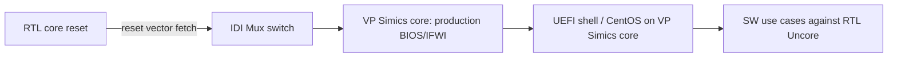

<!-- generated by yt-paper; edits will be overwritten -->
[DVCon](../dvcon/index.md) › [US](../dvcon/us.md) › [2022](../dvcon/by-year.md#2022) › [Emulation](../dvcon/by-topic.md#emulation)

# Pre-Silicon Validation of Production BIOS, Software Use Cases and Accelerator IP Workloads using Hybrid System Level Emulation SoC Platform

<figure class="rep-fig" markdown>
{ loading=lazy }
<figcaption>Figure 1 : Hybrid SLE Platform — from the original paper (Neeraj Gupta et al.)</figcaption>
</figure>

[:material-open-in-new: Original paper](https://dvcon-proceedings.org/wp-content/uploads/Pre-Silicon-Validation-of-Production-BIOS-Software-Use-Cases-and-Accelerator-IP-Workloads-using-Hybrid-System-Level-Emulation-SoC-Platform.pdf){ .md-button .md-button--primary target=_blank }

| | |
|---|---|
| Authors | Neeraj Gupta (Intel Technology India Pvt Ltd), Reddaiah Yedoti (Intel Technology India Pvt Ltd), Dixit Sethi (Intel Technology India Pvt Ltd), Sarvesh Kumar Pandey (Intel Technology India Pvt Ltd) |
| Venue | DVCon US 2022 |
| Topic | Emulation |
| Type | PAPER |
| ID | `ref-20261018-05e4` |

## Summary

**Intel presents a Hybrid SLE platform that pairs VP Simics cores (running production BIOS, UEFI, and CentOS) with RTL Uncore on an emulator, enabling pre-silicon validation of SW use cases and accelerator IP workloads that pure emulation cannot practically run.**

**Intel은 VP Simics 코어(프로덕션 BIOS, UEFI, CentOS 실행)와 에뮬레이터 상의 RTL Uncore를 결합한 Hybrid SLE 플랫폼을 제시하여, 순수 에뮬레이션으로는 현실적으로 실행이 어려운 SW use case와 가속기 IP 워크로드의 pre-silicon 검증을 가능하게 했습니다.**

## Key Insights

- Production BIOS boots in about 45 minutes on the Hybrid SLE platform versus 75+ hours on pure emulation (the paper cites ~100x), with OS boot at about 60 minutes.

- Hybrid SLE 플랫폼에서 프로덕션 BIOS 부팅은 약 45분으로, 순수 에뮬레이션의 75시간 이상 대비 (논문 인용 기준 약 100배) 빠르며, OS 부팅은 약 60분입니다.

- An IDI Mux switches core ownership from RTL core to VP Simics core at the reset-vector fetch, so production IFWI BIOS runs while BIOS/FW configurations are applied to real RTL Uncore IP (memory controller, PM, IO, PCIe).

- IDI Mux가 reset vector fetch 시점에 RTL 코어에서 VP Simics 코어로 제어권을 넘겨, IFWI의 프로덕션 BIOS가 실행되는 동시에 BIOS/FW 설정이 실제 RTL Uncore IP(메모리 컨트롤러, PM, IO, PCIe)에 적용됩니다.

- The paper reports about 15 bugs found across RTL, BIOS, VP Simics, and validation environment, of which 9 are SW/BIOS bugs that the authors judge hard to reproduce on pure emulation or simulation.

- 논문은 RTL, BIOS, VP Simics, 검증 환경 전반에서 약 15개의 버그가 발견되었다고 보고하며, 그 중 9개는 순수 에뮬레이션이나 시뮬레이션에서 재현하기 어려운 SW/BIOS 버그라고 설명합니다.

- Accelerator IP workloads are validated end-to-end via an SDK-built application: memory setup, DMA configuration, IP DMA read/write, acknowledgment, and output comparison, exercising both data and control paths at SoC level.

- 가속기 IP 워크로드는 SDK로 빌드한 SW 애플리케이션을 통해 end-to-end로 검증됩니다. 메모리 설정, DMA 구성, IP의 DMA read/write, 응답 확인, 출력 비교 과정을 거치며 SoC 수준의 데이터 경로와 제어 경로를 모두 검증합니다.

- The paper is a short industry report: it gives no detailed coverage metrics, and SPEC core benchmarks and SW-driven power management flows are deferred to future scope.

- 본 논문은 짧은 산업 보고서로, 정량적 커버리지 데이터는 제시되지 않았고 SPEC 코어 벤치마크와 SW 기반 전력 관리 흐름은 향후 과제로 남겨져 있습니다.

## Detailed Summary

### Background and Problem

- Pre-Si validation typically relies on synthetic BIOS and bare-metal tests, because pure RTL emulation/simulation cannot easily deploy production BIOS, OS, full-stack drivers, or real 5G/AI accelerator workloads.

- Pre-Si 검증은 보통 synthetic BIOS와 bare-metal 테스트에 의존합니다. 순수 RTL 에뮬레이션/시뮬레이션에서는 프로덕션 BIOS, OS, 풀스택 드라이버, 5G/AI 가속기 실제 워크로드를 실행하기 어렵기 때문입니다.

- SW/BIOS bugs found only in Post-Si are costly to debug and can force re-spins; the goal is shift-left validation toward A0 PRQ.

- Post-Si에서야 발견되는 SW/BIOS 버그는 디버그 비용이 크고 re-spin을 유발할 수 있어, A0 PRQ를 목표로 검증을 앞당기는 것이 목표입니다.

- Pure emulation needs 75+ hours to boot production BIOS, and pure simulation is infeasible.

- 순수 에뮬레이션으로 프로덕션 BIOS를 부팅하는 데 75시간 이상이 걸리며, 순수 시뮬레이션은 현실적으로 불가능합니다.

### Architecture and Methodology

- Cores run in VP Simics (official system simulator executing production binaries), while the Uncore runs as RTL on an emulator. They connect via a hybrid bridge and IDI transactor; an IDI Mux switches core ownership at runtime.

- 코어는 VP Simics(프로덕션 바이너리를 실행하는 공식 시스템 시뮬레이터)에서 동작하고, Uncore는 에뮬레이터 상의 RTL로 동작합니다. 두 부분은 hybrid bridge와 IDI transactor로 연결되며, IDI Mux가 런타임에 코어 소유권을 전환합니다.

- Boot is two-phase: the RTL core handles reset until the reset-vector fetch, then the IDI Mux hands control to the VP Simics core, which runs production BIOS from IFWI. BIOS/FW configuration is routed to RTL memory controller, PM, IO, and PCIe IP.

- 부팅은 두 단계로 이루어집니다. RTL 코어가 reset vector fetch까지 리셋을 처리한 뒤, IDI Mux가 제어권을 VP Simics 코어로 넘겨 IFWI의 프로덕션 BIOS를 실행합니다. BIOS/FW 설정은 RTL의 메모리 컨트롤러, PM, IO, PCIe IP로 전달됩니다.

- Validated use cases include warm/cold reset from UEFI and Linux shells, plus accelerator workloads via an SDK application (memory setup, DMA configuration, IP processing, acknowledgment, output compare).

- 검증된 use case에는 UEFI 셸과 Linux 셸에서의 warm/cold reset, 그리고 SDK 애플리케이션을 통한 가속기 워크로드(메모리 설정, DMA 구성, IP 처리, 응답 확인, 출력 비교)가 포함됩니다.

### Results and Conclusions

- Production BIOS boot takes about 45 minutes (cited as ~100x faster than pure emulation); OS boot takes about 60 minutes.

- 프로덕션 BIOS 부팅은 약 45분이 걸리며(순수 에뮬레이션 대비 약 100배로 인용), OS 부팅은 약 60분입니다.

- About 15 bugs were found across RTL, BIOS, VP Simics, and the validation environment; 9 were SW/BIOS bugs.

- RTL, BIOS, VP Simics, 검증 환경 전반에서 약 15개의 버그가 발견되었으며, 그 중 9개는 SW/BIOS 버그입니다.

- The authors conclude the method enables SW validation before tape-out. Limitations: no quantitative coverage data, and SPEC core workloads and SW-driven power management are listed as future scope.

- 저자들은 이 방법이 tape-out 이전 SW 검증을 가능하게 한다고 결론짓습니다. 한계로는 정량적 커버리지 데이터가 없고, SPEC 코어 워크로드와 SW 기반 전력 관리 검증은 향후 과제로 남아 있습니다.

## Videos

<iframe src="https://www.youtube-nocookie.com/embed/cslJpCPj7GU" title="[DVCON2022]Pre-Silicon Validation of Production BIOS, Software Use Cases and Accelerator IP...Hybrid" loading="lazy" allow="accelerometer; clipboard-write; encrypted-media; gyroscope; picture-in-picture; web-share" referrerpolicy="strict-origin-when-cross-origin" allowfullscreen></iframe>

**[DVCON2022]Pre-Silicon Validation of Production BIOS, Software Use Cases and Accelerator IP...Hybrid** — [Watch on YouTube](https://www.youtube.com/watch?v=cslJpCPj7GU) · [Video page](../videos/cslJpCPj7GU.md)
