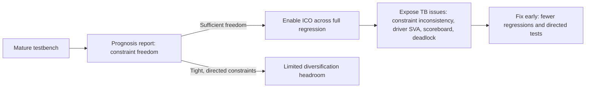

<!-- generated by yt-paper; edits will be overwritten -->
[DVCon](../dvcon/index.md) › [US](../dvcon/us.md) › [2023](../dvcon/by-year.md#2023) › [Verification](../dvcon/by-topic.md#verification)

# Accelerating Functional Verification Through Stabilization of Testbench Using AI/ML

<figure class="rep-fig" markdown>
{ loading=lazy }
<figcaption>Figure 7: L2 Cache Test Bench Environment — from the original paper (Srikanth Vadanaparthi et al.)</figcaption>
</figure>

[:material-open-in-new: Original paper](https://dvcon-proceedings.org/wp-content/uploads/1137-Accelerating-Functional-Verification-through-Stabilization-of-Testbench-Using-AIML.pdf){ .md-button .md-button--primary target=_blank }

| | |
|---|---|
| Authors | Srikanth Vadanaparthi (Qualcomm), Pooja Ganesh (Qualcomm), Dharmesh Mahay (Synopsys), Malay Ganai (Synopsys) |
| Venue | DVCon US 2023 |
| Topic | Verification |
| Type | PAPER |
| ID | `ref-20261018-0879` |

## Summary

**Applies Synopsys VCS Intelligent Coverage Optimization (ICO) early in the verification cycle to diversify constrained-random stimuli, exposing hidden testbench issues and reaching coverage closure in fewer regressions on GPU blocks without rewriting functional coverage models.**

**VCS Intelligent Coverage Optimization(ICO)을 검증 초기 단계에 적용해 제약 랜덤 자극을 다양화함으로써, 기능 커버리지 모델을 수정하지 않고도 숨은 테스트벤치 이슈를 드러내고 GPU 블록에서 더 적은 regression으로 커버리지 클로저를 달성한 방법론이다.**

## Key Insights

- On a testbench already deemed stable (about 98% pass rate, about 95% code/functional coverage), ICO exposed about 30% more testbench and DUT issues; over four L2 Cache regressions the UVM error total rose from 273 (default) to 360 (ICO), with inconsistent-constraint errors going from 89 to 0 and scoreboard mismatches from 7 to 0.

- 약 98% pass rate, 약 95% code/functional coverage의 안정화된 테스트벤치에서도 ICO는 테스트벤치 및 DUT 이슈를 약 30% 더 노출했다. L2 Cache 4회 regression에서 UVM error 총합은 기본 273에서 ICO 360으로 증가했고, inconsistent constraint 오류는 89에서 0, scoreboard mismatch는 7에서 0으로 줄었다.

- Coverage closure was faster: 95% functional coverage was reached in 6 regressions with ICO versus 10 without (40% fewer). Project B reached the same coverage in 6-7 iterations versus 10.

- 커버리지 클로저가 빨라졌다. 95% functional coverage를 ICO 사용 시 6회 regression, 미사용 시 10회에 달성했다(40% 감소). Project B도 동일 커버리지를 10회 대신 6-7회 iteration으로 달성했다.

- Eligibility is gated by a prognosis report: ICO only helps where constraints leave enough freedom to bias random variables. Tight, directed constraints limit the achievable diversity, which is measured as Shannon entropy as a percentage of maximum possible diversity.

- 적용 가능성은 prognosis report로 판단한다. ICO는 제약이 랜덤 변수를 편향시킬 여지를 충분히 남길 때만 효과적이다. 엄격한 directed 제약은 달성 가능한 다양성을 제한하며, 다양성은 최대 가능 다양성 대비 Shannon entropy 백분율로 측정한다.

- Resource savings were measured per block: Project B's block used 162K time units with ICO versus 198K default (about 18% reduction), and the paper reports a 10-15% grid-resource reduction per block overall, plus about 2 weeks of saved manual directed-test effort.

- 블록별 자원 절감: Project B 블록은 ICO 사용 시 162K time unit, 기본 198K로 약 18% 감소했다. 논문은 블록당 grid 자원 10-15% 절감과 약 2주의 수동 directed test 공수 절감을 보고한다.

- On the Render Block (about 350K coverage bins), ICO shifted functional closure earlier by 1.5 weeks, and remaining manual constraint or delay-profile tweaking dropped to under about 100 bins. Caveat: the paper's evidence is vendor-coauthored, from three internal projects, and the Project B default and ICO runs used different run-management scripts.

- 약 350K coverage bin 규모의 Render Block에서 ICO는 기능 클로저를 1.5주 앞당겼고, 남은 수동 제약·delay profile 조정은 약 100 bin 미만으로 줄었다. 주의: 근거는 벤더 공저 논문의 사내 프로젝트 3건이며, Project B의 기본 실행과 ICO 실행은 서로 다른 실행 스크립트를 사용했다.

## Detailed Summary

### Background and Problem

- Constrained-random testbenches are central to sign-off, but tuning stimulus constraints is laborious and risky. A mismatch between the implemented and intended stimulus space causes illegal or missing stimuli, over- or under-bias, over- or under-constraint, and possible bug escapes through omitted scenarios.

- 제약 랜덤 테스트벤치는 sign-off의 핵심이지만, 자극 제약을 튜닝하는 작업은 노동집약적이고 위험이 크다. 구현된 제약 자극 공간과 의도한 자극 공간이 어긋나면 illegal/missing 자극, over- 또는 under-bias, over- 또는 under-constraint가 발생하고, 누락된 시나리오로 인해 버그가 escape할 수 있다.

- The paper classifies bugs into three types: Type 1 (easy, swept by systematic inputs), Type 2 (corner or hard-to-hit, needing long action sequences or rare conditions, typically found late in random regression), and Type 3 (deep latent RTL bugs needing months of regression).

- 논문은 버그를 세 유형으로 분류한다. Type 1(쉬운 버그, 체계적인 입력 sweep으로 발견 가능), Type 2(corner 또는 hard-to-hit 버그, 긴 action 시퀀스나 희귀 조건이 필요하며 보통 랜덤 regression 후반에 발견), Type 3(깊숙이 숨은 latent RTL 버그, 수개월의 regression 필요).

- GPU parallelism makes corner-case discovery and code/functional closure hard. Teams spend significant manual effort writing semi-directed tests at block and cluster level.

- GPU의 병렬성 때문에 corner case 발견과 code/functional 커버리지 클로저가 어렵다. 팀은 block 및 cluster 수준에서 semi-directed 테스트를 작성하는 데 상당한 수동 노력을 투입한다.

- The stated adoption criteria were: (a) shift-left discovery of corner-case RTL, testbench, and constraint issues; (b) automatic coverage acceleration; (c) less manual directed-test writing; (d) no rewrite of functional coverage models.

- 채택 기준은 다음과 같다. (a) corner-case RTL, 테스트벤치, 제약 이슈를 shift-left로 발견, (b) 커버리지 자동 가속, (c) directed 테스트 수동 작성 감소, (d) 기능 커버리지 모델 재작성 불필요.

### Architecture and Methodology

The approach uses VCS ICO, which diversifies the constrained stimulus space without modifying functional coverage models. The workflow is:

이 접근법은 VCS ICO를 사용하며, 기능 커버리지 모델을 수정하지 않고 제약 자극 공간을 다양화한다. 워크플로는 다음과 같다.

- **Eligibility:** A prognosis report indicates whether the testbench has enough freedom to bias its random variables. Less-directed constraints have more freedom and benefit more.

- **적용 가능성:** Prognosis report는 테스트벤치가 랜덤 변수를 편향시킬 자유도를 충분히 갖는지 나타낸다. 덜 directed된 제약일수록 자유도가 커서 이득이 크다.

- **Analytics:** Variable randomness (%), value randomness (%), and constraint density (average constraints per variable) are reported per testbench (Cache in Figure 3, Render Block in Figure 4). Higher values indicate better ICO candidates.

- **분석 지표:** 테스트벤치별(Figure 3의 Cache, Figure 4의 Render Block)로 variable randomness(%), value randomness(%), constraint density(변수당 평균 제약 수)를 보고한다. 값이 높을수록 ICO 적용에 적합하다.

- **Diversity metric:** Value diversity is the Shannon entropy percentage over the maximum possible diversity. Constraint tightness can cap achievable diversity.

- **다양성 지표:** 값 다양성은 최대 가능 다양성 대비 Shannon entropy 백분율이다. 제약의 타이트함이 달성 가능한 다양성을 제한할 수 있다.

- **Case studies:**
  - Project A (L2 Cache, graphics IP): ICO applied late, when the testbench was mature (>98% pass rate, about 95% code and functional coverage). A total of 10 regressions were compared with and without ICO.
  - Project B (Modified L2 Cache, time-critical): ICO was enabled at week 6, after feature bring-up and scoreboard had stabilized. Daily random regressions had been finding 2-3 design bugs per week.
  - Project C (Render Block): run as a parallel setup on the same block version. The block has about 350K bins across color, depth, and tile-packing combinations. Previously, closing the last 200-500 bins required a week or more of manual tweaking.

- **사례 연구:**
  - Project A (L2 Cache, graphics IP): 테스트벤치가 성숙한 후반 단계(pass rate >98%, code 및 functional coverage 약 95%)에 ICO를 적용. ICO 사용/미사용 각 10회 regression을 비교했다.
  - Project B (Modified L2 Cache, 시간 제약 프로젝트): feature bring-up과 scoreboard가 안정된 6주차에 ICO를 활성화했다. 기존 일일 랜덤 regression에서는 주당 2-3개의 design 버그가 발견되고 있었다.
  - Project C (Render Block): 동일 block 버전에서 병렬 구성으로 실행. 이 block은 color, depth, tile packing 조합에 걸쳐 약 350K bin을 가진다. 기존에는 마지막 200-500 bin을 닫기 위해 1주 이상의 수동 튜닝이 필요했다.

### Results and Conclusions

**Project A (L2 Cache):**

**Project A (L2 Cache):**

- Exposed issues not captured by functional coverage: constraint inconsistency failures, design SVA failures caused by UVM driver issues, scoreboard checker issues, and design deadlocks.

- 기능 커버리지로 포착되지 않던 이슈를 노출했다. 제약 불일치 실패, UVM driver 이슈로 인한 design SVA 실패, scoreboard checker 이슈, design deadlock.

- UVM error counts per regression (Figure 1): default 67, 64, 70, 72 (total 273); ICO 84, 86, 79, 111 (total 360). Inconsistent-constraint errors fell from 89 to 0, and scoreboard mismatches from 7 to 0.

- Regression별 UVM error 수(Figure 1): 기본 67, 64, 70, 72(총 273); ICO 84, 86, 79, 111(총 360). Inconsistent constraint 오류는 89에서 0으로, scoreboard mismatch는 7에서 0으로 감소했다.

- 95% functional coverage in 6 regressions versus 10 (40% fewer).

- 95% functional coverage를 6회 regression으로 달성(10회 대비 40% 감소).

**Project B (time-critical, ICO enabled at week 6, Table 1):**

**Project B (시간 제약 프로젝트, 6주차에 ICO 활성화, Table 1):**

| Week | Pass % | ICO | TB bugs | RTL bugs |
|---|---|---|---|---|
| 1 | 55% | no | 13 | 3 |
| 2 | 75% | no | 10 | 2 |
| 3 | 85% | no | 11 | 3 |
| 4 | 90% | no | 11 | 1 |
| 5 | 98% | no | 7 | 1 |
| 6 | 88% | yes | 18 | 6 |
| 7 | 96% | yes | 7 | 5 |
| 8 | 98.5% | yes | 5 | 1 |
| 9 | 98.5% | yes | 5 | 0 |

| 주차 | Pass % | ICO | TB 버그 | RTL 버그 |
|---|---|---|---|---|
| 1 | 55% | no | 13 | 3 |
| 2 | 75% | no | 10 | 2 |
| 3 | 85% | no | 11 | 3 |
| 4 | 90% | no | 11 | 1 |
| 5 | 98% | no | 7 | 1 |
| 6 | 88% | yes | 18 | 6 |
| 7 | 96% | yes | 7 | 5 |
| 8 | 98.5% | yes | 5 | 1 |
| 9 | 98.5% | yes | 5 | 0 |

- Shift-left by about 30% in functional coverage once coverage exceeded 90%; the same coverage was reached in 6-7 iterations versus 10.

- Coverage가 90%를 넘은 이후 functional coverage에서 약 30% shift-left. 동일 커버리지를 10회 대신 6-7회 iteration으로 달성.

- Grid runtime for the same coverage (Figure 9): 198K time units default versus 162K with ICO, about 18% lower. The authors note that the default runs were automated while the ICO runs were ad hoc scripts executed by multiple users.

- 동일 커버리지에 필요한 grid 실행 시간(Figure 9): 기본 198K time unit, ICO 162K time unit으로 약 18% 감소. 저자들은 기본 실행은 자동화 스크립트로, ICO 실행은 여러 사용자가 실행한 ad hoc 스크립트로 수행되었다고 명시한다.

**Project C (Render Block, Table 2):**

**Project C (Render Block, Table 2):**

- Code/functional coverage with versus without ICO: line 88064 to 89231, branch 66888 to 69931, condition 356836 to 359019, FSM 855 to 885; functional coverpoints 1757 to 1804; total bins 347984 to 349661 (+1677).

- ICO 사용/미사용 code/functional coverage: line 88064에서 89231, branch 66888에서 69931, condition 356836에서 359019, FSM 855에서 885; functional cover point 1757에서 1804; total bin 347984에서 349661(+1677).

- Functional closure was shifted earlier by 1.5 weeks. Remaining manual directed or delay-profile tweaking fell to under about 100 bins.

- 기능 클로저가 1.5주 앞당겨졌다. 남은 수동 directed 또는 delay-profile 튜닝은 약 100 bin 미만으로 줄었다.

**Overall conclusions:**

**종합 결론:**

- Across projects, the authors report a 10-15% per-block grid-resource reduction, about 2 weeks of saved manual effort, and a consistent shift-left of several weeks.

- 프로젝트 전반에서 저자들은 block당 10-15% grid 자원 절감, 약 2주의 수동 작업 절감, 수 주 규모의 일관된 shift-left를 보고한다.

- The paper's evidence is limited to three internal projects from a vendor-coauthored study. Some figures (such as Figure 2 and Figure 8) are not quantified in the text, and no independent baseline is provided.

- 근거는 벤더 공저 논문의 사내 프로젝트 3건으로 제한된다. 일부 결과(예: Figure 2, Figure 8)는 본문에서 수치화되지 않았고, 독립적인 baseline도 제공되지 않았다.

 

Figure 6은 Project C의 커버리지 가속 추이를 보여준다. 주장된 절감 효과는 ICO가 제공하는 다양화된 자극에 기인하며, 커버리지 모델 변경은 필요하지 않다.

Figure 6 shows the coverage-rate acceleration for Project C. The claimed savings are attributed to ICO's diversified stimuli, which removes the need to change coverage models.

&nbsp;

## Videos

<iframe src="https://www.youtube-nocookie.com/embed/H947nXpp4No" title="[DVCON2023]Accelerating Functional Verification Through Stabilization of Testbench Using AI/ML" loading="lazy" allow="accelerometer; clipboard-write; encrypted-media; gyroscope; picture-in-picture; web-share" referrerpolicy="strict-origin-when-cross-origin" allowfullscreen></iframe>

**[DVCON2023]Accelerating Functional Verification Through Stabilization of Testbench Using AI/ML** — [Watch on YouTube](https://www.youtube.com/watch?v=H947nXpp4No) · [Video page](../videos/H947nXpp4No.md)
