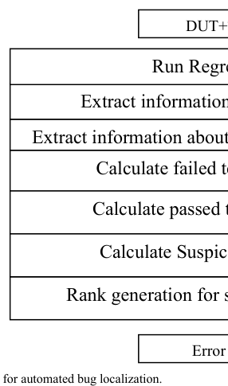
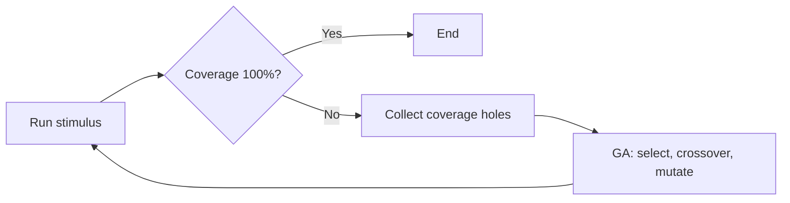

<!-- generated by yt-paper; edits will be overwritten -->
[DVCon](../dvcon/index.md) › [Europe](../dvcon/europe.md) › [2015](../dvcon/by-year.md#2015) › [Verification](../dvcon/by-topic.md#verification)

# New Trends in RTL Verification: Bug Localization, Scan-Chain-Based Methodology, GA-Based Test Generation

<figure class="rep-fig" markdown>
{ loading=lazy }
<figcaption>Fig. 1 The proposed methodology for automated bug localization. — from the original paper (Khaled Salah et al.)</figcaption>
</figure>

[:material-open-in-new: Original paper](https://dvcon-proceedings.org/wp-content/uploads/new-trends-in-rtl-verification-bug-localization-scan-chain-based-methodology-ga-based-test-generation.pdf){ .md-button .md-button--primary target=_blank }

| | |
|---|---|
| Authors | Khaled Salah (Mentor Graphics, Cairo, Egypt) |
| Venue | DVCon Europe 2015 |
| Topic | Verification |
| Type | PAPER |
| ID | `ref-20261018-0c62` |

## Summary

**The paper proposes three RTL verification techniques: a coverage-based suspiciousness ranking for bug localization, an auto-instrumented run-time scan-chain for FPGA emulation debugging, and a GA-guided stimulus feedback loop that closes functional coverage faster than random testing.**

**이 논문은 세 가지 RTL 검증 기법을 제안합니다. 커버리지 기반 의심도 랭킹을 이용한 버그 로컬라이제이션, FPGA 에뮬레이션 디버그를 위한 자동 계측 기반 run-time scan-chain, 그리고 커버리지 피드백을 사용하는 GA 기반 자극 생성입니다. GA 기법은 랜덤 테스트보다 빠르게 기능 커버리지를 닫습니다.**

## Key Insights

- Coverage-based suspiciousness ranking (failed tests executing a statement divided by passed tests executing it) localized 29 injected bugs in a >5000-line RTL design in 1–10 min, versus 1–3 h for manual debug (Table II); the method assumes a single bug and rich, correct testcases.

- 커버리지 기반 의심도 랭킹(구문을 실행한 실패 테스트 수를 같은 구문을 실행한 성공 테스트 수로 나눈 값)은 5000라인 이상 RTL 설계에 주입된 29개 버그를 1~10분에 로컬라이즈했으며, 수동 디버그는 1~3시간이 걸렸습니다(Table II). 이 방법은 버그가 하나라는 가정과 풍부하고 올바른 testcase를 전제로 합니다.

- The scan-chain utility wraps every reg with a mux and glue logic so signal values can be forced at run time on emulation without recompiling the whole design; the authors report negligible area overhead but longer compile time, with no quantitative data.

- scan-chain 유틸리티는 모든 reg를 mux와 glue logic으로 감싸 전체 설계를 재컴파일하지 않고도 에뮬레이션 중 신호 값을 강제로 바꿀 수 있게 합니다. 저자들은 면적 오버헤드가 무시할 만하다고 보고하지만 컴파일 시간은 늘어난다고 밝혔고, 정량적 데이터는 제시하지 않았습니다.

- GA-guided stimulus generation (fitness = functional coverage %, population 50, 200 generations, multi-point crossover) reached 100% coverage on 12 designs with 90–155 stimulus versus 120–215 for random, a per-design reduction of 7.7–46.7% (about 32% aggregate, derived from Table III).

- GA 기반 자극 생성(fitness = 기능 커버리지 %, population 50, 200 generations, multi-point crossover)은 12개 설계에서 100% 커버리지에 도달했으며, 자극 수는 90~155회로 랜덤의 120~215회에 비해 설계별로 7.7~46.7% 줄었습니다(Table III 기준 전체 약 32%, 표에서 계산한 값).

- Run time per design fell from 3–4 s (random) to 1–2.6 s (GA) in Table III; however, results come from a short proof-of-concept with Verilog case studies, a random-only baseline, and no variance or statistical reporting.

- Table III에서 설계당 실행 시간은 랜덤 3~4초에서 GA 1~2.6초로 줄었습니다. 다만 이 결과는 Verilog 사례 연구 기반의 짧은 proof-of-concept이며, 기준선은 랜덤뿐이고, 분산이나 통계적 보고는 없습니다.

## Detailed Summary

### Background and Problem

- Manual RTL bug localization is slow for large designs. Prior localization work is mostly gate-level and small-scale, and assertion-based formal approaches do not scale to large RTL.

- 수동 RTL 버그 로컬라이제이션은 대형 설계에서 시간이 많이 듭니다. 기존 로컬라이제이션 연구는 대부분 gate-level과 소규모 설계를 대상으로 하며, assertion 기반 형식 기법은 대형 RTL로 확장되지 않습니다.

- FPGA-based RTL emulation is fast but gives poor run-time visibility. In offline debug flows, changing an internal value requires a full recompile, which slows iteration.

- FPGA 기반 RTL 에뮬레이션은 빠르지만 run-time 가시성이 낮습니다. 오프라인 디버그 흐름에서는 내부 값을 바꾸려면 전체 설계를 재컴파일해야 하므로 반복 속도가 떨어집니다.

- Constrained-random (CRT) coverage closure needs manual analysis of coverage reports and manual constraint edits to reach 100% coverage. The paper seeks an automated feedback loop from coverage analysis to test generation.

- CRT(Constrained-Random Testing)의 커버리지 closure에는 커버리지 리포트의 수동 분석과 제약 조건의 수동 수정이 필요합니다. 이 논문은 커버리지 분석에서 테스트 생성으로 이어지는 자동 피드백 루프를 목표로 합니다.

### Architecture and Methodology

The paper covers three independent techniques.

이 논문은 서로 독립적인 세 가지 기법을 다룹니다.

**1. Coverage-based bug localization.** The full regression is run until coverage reaches 100%. For each test, the set of executed statements and its pass/fail status are recorded. The suspiciousness of a statement is defined as (number of failed tests executing it) / (number of successful tests executing it), and statements are ranked from highest to lowest. This is a heuristic borrowed from software fault localization (Tarantula and related coverage-based methods). The approach assumes a single incorrect statement and rich, correct testcases. It localizes but does not repair the bug.

**1. 커버리지 기반 버그 로컬라이제이션.** 커버리지가 100%에 도달할 때까지 전체 regression을 실행합니다. 각 테스트에 대해 실행된 구문 집합과 pass/fail 상태를 기록합니다. 구문의 의심도는 (해당 구문을 실행한 실패 테스트 수) / (해당 구문을 실행한 성공 테스트 수)로 정의하며, 높은 값부터 순위를 매깁니다. 이는 소프트웨어 결함 로컬라이제이션(Tarantula 및 관련 커버리지 기반 방법)에서 빌려온 휴리스틱입니다. 이 접근법은 잘못된 구문이 하나뿐이라는 가정과 풍부하고 올바른 testcase를 전제로 합니다. 버그를 로컬라이즈할 뿐 수정하지는 않습니다.

**2. RTL scan-chain for emulation debug.** A utility tool instruments each `reg` in the RTL with a glue block: a mux with an extra input that is controlled by an Enable_Scan signal, plus a run-time value input (C_RUNTIME in Fig. 3). Using the example `out <= (A+B)*C`, the value of C can be forced at run time without recompiling. The authors state that the area overhead is negligible relative to the performance gained, but that the instrumented design needs more compilation time.

**2. 에뮬레이션 디버그용 RTL scan-chain.** 유틸리티 도구가 RTL의 각 `reg`에 glue 블록을 삽입합니다. 이는 추가 입력을 가진 mux이며 Enable_Scan 신호로 제어되고, run-time 값 입력(Fig. 3의 C_RUNTIME)을 가집니다. `out <= (A+B)*C` 예제에서 C 값은 재컴파일 없이 run time에 강제로 바꿀 수 있습니다. 저자들은 면적 오버헤드가 얻는 성능 이득에 비해 무시할 만하다고 밝히지만, 계측된 설계는 컴파일 시간이 더 필요하다고 말합니다.

**3. GA-based test generation.** Stimulus parameters are encoded as chromosomes. Fitness is the functional coverage ratio. The operators are selection (fitness-proportional), multi-point crossover, mutation, and generational replacement. Termination occurs at a maximum number of generations (200 in the paper's figure) or when the fitness threshold is reached, with population size 50. Coverage collected in each stimulus cycle is fed back to the GA, which generates guided random stimulus aimed at coverage holes. Fig. 4 shows three options: manually generated, randomly generated, and GA-guided random stimulus.

**3. GA 기반 테스트 생성.** 자극 파라미터를 chromosome으로 인코딩합니다. Fitness는 기능 커버리지 비율입니다. 연산자는 selection(적합도 비례), multi-point crossover, mutation, 세대 교체(generational replacement)입니다. 종료 조건은 최대 세대 수(논문 그림 기준 200)이거나 fitness 임계값 도달이며, population 크기는 50입니다. 각 자극 주기에서 수집한 커버리지는 GA로 피드백되어 커버리지 hole을 겨냥한 guided random 자극을 생성합니다. Fig. 4는 수동 생성, 랜덤 생성, GA 기반 guided random 자극의 세 가지 옵션을 보여줍니다.

### Results and Conclusions

- **Bug localization:** For 29 injected bugs in a design of more than 5000 RTL lines (Table II), the proposed method took 1–10 min, while manual debug took 1–3 h. The abstract claims detection in several-thousand-line designs within minutes with a 100% success rate. The paper does not give a separate accuracy breakdown.

- **버그 로컬라이제이션:** 5000라인 이상 RTL 설계에 주입된 29개 버그(Table II)에 대해 제안 방법은 1~10분이 걸린 반면, 수동 디버그는 1~3시간이 걸렸습니다. 초록은 수천 라인 규모 설계에서 수 분 내 탐지와 100% 성공률을 주장하지만, 별도의 정확도 분석은 제시하지 않습니다.

- **Scan-chain:** The results are qualitative only. The paper reports negligible area overhead and increased compile time, with no measured values.

- **Scan-chain:** 결과는 정성적입니다. 면적 오버헤드는 무시할 만하고 컴파일 시간은 늘어난다고 보고하지만, 측정된 수치는 없습니다.

- **GA test generation (Table III, 12 designs):** Random testing needed 120–215 stimulus and 3–4 s run time. The GA approach needed 90–155 stimulus and 1–2.6 s. The per-design stimulus reduction ranged from 7.7% (design #7) to 46.7% (design #9), and the aggregate reduction is about 32% (computed from the table). The design identities and the variance across runs are not reported.

- **GA 테스트 생성(Table III, 12개 설계):** 랜덤 테스트는 120~215회 자극과 3~4초의 실행 시간이 필요했습니다. GA 접근법은 90~155회 자극과 1~2.6초가 필요했습니다. 설계별 자극 감소율은 7.7%(설계 #7)에서 46.7%(설계 #9)였으며, 전체 감소율은 표에서 계산한 약 32%입니다. 설계 식별자와 실행 간 분산은 보고되지 않았습니다.

- **Limitations:** This is a proof-of-concept paper. The case studies are Verilog designs, the only baseline is random testing, and no statistical analysis is given. Related coverage-directed methods (for example, Fine and Ziv; Benjamin et al.) are cited but not compared against.

- **한계:** 이 논문은 proof-of-concept입니다. 사례 연구는 Verilog 설계이며, 유일한 기준선은 랜덤 테스트이고, 통계 분석은 없습니다. Fine and Ziv, Benjamin et al. 등 관련 커버리지 지향 방법은 인용만 되고 비교되지 않았습니다.

- **Conclusion:** The authors position the three techniques as ways to reduce debug time, emulation debug effort, and coverage-closure effort. The evidence is preliminary and mostly from the authors' own case studies.

- **결론:** 저자들은 세 기법을 디버그 시간, 에뮬레이션 디버그 노력, 커버리지 closure 노력을 줄이는 방법으로 제시합니다. 근거는 예비적이며 대부분 저자들의 사례 연구에서 나온 것입니다.

## Videos

<iframe src="https://www.youtube-nocookie.com/embed/NCZGtajDsYc" title="[DVCON2015]New Trends in RTL Verification Bug Localization, Scan Chain Methodology, GA Test Gen" loading="lazy" allow="accelerometer; clipboard-write; encrypted-media; gyroscope; picture-in-picture; web-share" referrerpolicy="strict-origin-when-cross-origin" allowfullscreen></iframe>

**[DVCON2015]New Trends in RTL Verification Bug Localization, Scan Chain Methodology, GA Test Gen** — [Watch on YouTube](https://www.youtube.com/watch?v=NCZGtajDsYc) · [Video page](../videos/NCZGtajDsYc.md)
