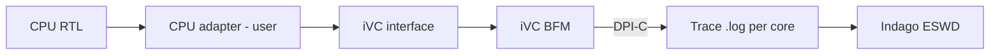

<!-- generated by yt-paper; edits will be overwritten -->
[DVCon](../dvcon/index.md) › [Europe](../dvcon/europe.md) › [2022](../dvcon/by-year.md#2022) › [Emulation](../dvcon/by-topic.md#emulation)

# Generic Core-Monitor for Hardware/Software Co-Debugging targeting Emulation Platform

<figure class="rep-fig" markdown>
{ loading=lazy }
<figcaption>Fig 2: CPU-Independent iVC Interface — from the original paper (Shreya Morgansgate et al.)</figcaption>
</figure>

[:material-open-in-new: Original paper](https://dvcon-proceedings.org/wp-content/uploads/74436.pdf){ .md-button .md-button--primary target=_blank }

| | |
|---|---|
| Authors | Shreya Morgansgate (Infineon Technologies AG), Johannes Grinschgl (Infineon Technologies AG), Djones Lettnin (Infineon Technologies AG); DVCon Europe |
| Venue | DVCon Europe 2022 |
| Topic | Emulation |
| Type | PAPER |
| ID | `ref-20261018-0efa` |

## Summary

**A CPU-independent Core-Monitor (CPU-specific adapter + reusable iVC interface/BFM + DPI-C tracer) that generates processor trace files for HW/SW co-debugging in both simulation and Synopsys ZeBu emulation, with runtime overhead comparable to or slightly better than the existing setup.**

**CPU 독립형 Core-Monitor(CPU별 SystemVerilog 어댑터 + 재사용 가능한 iVC 인터페이스/BFM + DPI-C 트레이서)로, 시뮬레이션과 Synopsys ZeBu 에뮬레이션 모두에서 HW/SW 공동 디버그용 프로세서 트레이스 파일을 생성하며, 런타임 오버헤드는 기존 방식과 비슷하거나 약간 더 낫다.**

## Key Insights

- Only a processor-specific SystemVerilog adapter (about 290 lines for the IFX core in the paper) must be written per CPU; the iVC interface, iVC BFM and DPI-C tracer are reused unchanged.

- CPU마다 작성해야 하는 것은 SystemVerilog 어댑터뿐이며(논문의 IFX 코어 기준 약 290줄), iVC 인터페이스, iVC BFM, DPI-C 트레이서는 수정 없이 재사용한다.

- The design is split into hdl_top (synthesizable, runs on the ZeBu emulator) and hvl_top (UVM testbench, runs on the simulator), communicating at transaction level over a SystemVerilog virtual interface.

- 설계는 hdl_top(합성 가능, ZeBu 에뮬레이터에서 실행)과 hvl_top(UVM 테스트벤치, 시뮬레이터에서 실행)으로 나뉘며, SystemVerilog virtual interface를 통해 트랜잭션 수준으로 통신한다.

- Trace data (PC, instruction, register, memory access, cpu_id) is dumped per core via DPI-C to eswd_coreY.log files, with processor parameters taken from a CSV configuration file, so no BFM or interface edits are needed.

- PC, 명령어, 레지스터, 메모리 접근 데이터(cpu_id 포함)는 DPI-C를 통해 코어별 eswd_coreY.log 파일로 기록되며, 프로세서 파라미터는 CSV 설정 파일에서 읽어 BFM이나 인터페이스를 수정할 필요가 없다.

- On the IFX SoC (9 cores, 5 active), emulation with eswd trace enabled took 3197.3 s versus 3635.9 s for the existing method on Testcase 1; without eswd, 160.3 s versus 239.8 s.

- 9코어 중 5개가 활성화된 IFX SoC에서 eswd 트레이스를 켠 에뮬레이션 실행 시간은 Testcase 1 기준 기존 방식 3635.9초 대비 3197.3초였고, eswd를 끈 경우에는 239.8초 대비 160.3초였다.

- The build phase for the IFX emulation design takes about 5 hours, and the paper validates the approach only on OpenRISC/RISC-V in simulation and one IFX core configuration on ZeBu.

- IFX 에뮬레이션 설계의 빌드 단계는 약 5시간이 걸리며, 논문은 OpenRISC/RISC-V(시뮬레이션)와 IFX 한 가지 구성(ZeBu)에 대해서만 검증했다.

## Detailed Summary

### Background and Problem

- Per-processor trace modules (Verilog/SV) for tracing CPU state are duplicated across multicore SoCs, costing effort and time; existing vendor tools such as ARM Tarmac/CoreSight are not reusable across CPUs.

- 멀티코어 SoC에서 CPU 상태를 추적하는 프로세서별 Verilog/SV 모듈이 중복 작성되어 工数와 시간이 많이 든다. ARM Tarmac/CoreSight 같은 벤더 도구는 다른 CPU에 재사용할 수 없다.

- Simulation becomes too slow for large SoCs (kHz range vs. MHz on emulators), but emulators need hours of compile time, and no reusable HW/SW co-debug trace platform spans both simulation and emulation.

- 대형 SoC에서 시뮬레이션은 속도가 kHz 수준으로 병목이 되고, 에뮬레이터는 MHz 속도를 내지만 컴파일에 수 시간이 걸린다. 시뮬레이션과 에뮬레이션을 모두 아우르는 재사용 가능한 HW/SW 공동 디버그 트레이스 플랫폼은 없었다.

### Architecture and Methodology

- CPU-dependent adapter (timed HDL module, user-written per processor) feeds CPU-independent components: the iVC SystemVerilog interface (standard cpu_pc, cpu_instruction, reg_data, cpu_mem_* and cpu_id signals), the iVC monitor BFM, and a DPI-C tracer.

- CPU 종속 어댑터(사용자가 프로세서마다 작성하는 타이밍 HDL 모듈)가 CPU 독립 구성요소에 신호를 전달한다. 구성요소는 표준 신호(cpu_pc, cpu_instruction, reg_data, cpu_mem_*, cpu_id)를 갖는 iVC SystemVerilog 인터페이스, iVC BFM, DPI-C 트레이서다.

- Testbench is split into hdl_top (synthesized to ZeBu) and hvl_top (UVM on the simulator), with trace output consumed by Indago for post-processing and ESWD debugging.

- 테스트벤치는 hdl_top(ZeBu에 합성)과 hvl_top(시뮬레이터의 UVM)으로 나뉘며, 트레이스 출력은 Indago의 후처리와 ESWD 디버그에 사용된다.

- Processor parameters (core count, register names) come from a configuration CSV; one adapter instance per identical core.

- 프로세서 파라미터(코어 수, 레지스터 이름)는 설정 CSV에서 읽으며, 동일한 코어마다 어댑터 인스턴스를 하나씩 둔다.

### Results and Conclusions

- Tested on OpenRISC and RISC-V in simulation and on an IFX processor (5 active cores) in ZeBu emulation.

- OpenRISC와 RISC-V는 시뮬레이션에서, IFX 프로세서(활성 5코어)는 ZeBu 에뮬레이션에서 테스트했다.

- Average of 10 runs: Testcase 1 with eswd 3197.3 s (Core-Monitor) vs. 3635.9 s (existing); without eswd 160.3 s vs. 239.8 s. Testcase 2 with eswd 889.2 s vs. 921.3 s; without eswd 34.4 s vs. 52.7 s.

- 10회 평균 기준, Testcase 1에서 eswd 사용 시 Core-Monitor 3197.3초 대비 기존 방식 3635.9초, eswd 미사용 시 160.3초 대비 239.8초였다. Testcase 2는 eswd 사용 시 889.2초 대비 921.3초, 미사용 시 34.4초 대비 52.7초였다.

- The authors conclude the approach is reusable and does not degrade performance, though the evaluation is limited (no quantified effort reduction beyond the 290-line adapter figure).

- 저자들은 이 방식이 재사용 가능하며 성능을 저하시키지 않는다고 결론짓지만, 평가는 제한적이다(어댑터 290줄 외에 작업량 감소를 정량화하지 않음).

## Videos

<iframe src="https://www.youtube-nocookie.com/embed/jfiiPcLzO3s" title="[DVCON2022_EUROPE] Generic Core-Monitor for Hardware/Software Co-Debugging targeting Emulation" loading="lazy" allow="accelerometer; clipboard-write; encrypted-media; gyroscope; picture-in-picture; web-share" referrerpolicy="strict-origin-when-cross-origin" allowfullscreen></iframe>

**[DVCON2022_EUROPE] Generic Core-Monitor for Hardware/Software Co-Debugging targeting Emulation** — [Watch on YouTube](https://www.youtube.com/watch?v=jfiiPcLzO3s) · [Video page](../videos/jfiiPcLzO3s.md)
