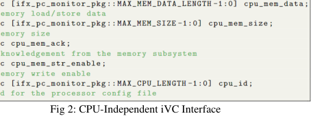

<!-- generated by yt-paper; edits will be overwritten -->
[DVCon](../dvcon/index.md) › [Europe](../dvcon/europe.md) › [2022](../dvcon/by-year.md#2022) › [Emulation](../dvcon/by-topic.md#emulation)

# Generic Core-Monitor for Hardware/Software Co-Debugging targeting Emulation Platform

<figure class="rep-fig" markdown>
{ loading=lazy }
<figcaption>Fig 2: CPU-Independent iVC Interface — from the original paper (Shreya Morgansgate et al.)</figcaption>
</figure>

[:material-open-in-new: Original paper](https://dvcon-proceedings.org/wp-content/uploads/74436.pdf){ .md-button .md-button--primary target=_blank }

| | |
|---|---|
| Authors | Shreya Morgansgate (Infineon Technologies AG), Johannes Grinschgl (Infineon Technologies AG), Djones Lettnin (Infineon Technologies AG); DVCon Europe |
| Venue | DVCon Europe 2022 |
| Topic | Emulation |
| Type | PAPER |
| ID | `ref-20261018-0efa` |

## Summary

<div class="bi" markdown>
<div class="bi-en" markdown>

**Infineon proposes a reusable, CPU-independent Core-Monitor that generates processor state trace files (PC, instructions, memory, registers) in both simulation and ZeBu emulation, requiring users to write only a small CPU-specific adapter.**

</div>
<div class="bi-ko" markdown>

**Infineon은 시뮬레이션과 ZeBu 에뮬레이션 모두에서 PC, 명령어, 메모리, 레지스터 정보를 담은 trace 파일을 생성하며, 사용자는 CPU별 어댑터만 작성하면 되는 재사용 가능한 CPU-독립 Core-Monitor를 제안한다.**

</div>
</div>

## Key Insights

<div class="bi" markdown>
<div class="bi-en" markdown>

- The architecture splits the design into a CPU-dependent adapter (the only user-written module per processor, about 290 lines of SystemVerilog for the IFX core) and CPU-independent components (iVC interface, iVC BFM, DPI-C trace block), so the reusable part stays unchanged across processors.

</div>
<div class="bi-ko" markdown>

- 구조는 CPU 종속 어댑터(프로세서마다 사용자가 작성하는 유일한 모듈, IFX 코어 기준 약 290 lines의 SystemVerilog)와 CPU 독립 구성요소(iVC interface, iVC BFM, DPI-C trace 블록)로 나뉘어, 프로세서가 바뀌어도 재사용 부분은 그대로 유지된다.

</div>
</div>

<div class="bi" markdown>
<div class="bi-en" markdown>

- The testbench is partitioned into hdl_top (synthesizable, runs on the ZeBu emulator) and hvl_top (untimed UVM, runs on the simulator), communicating at transaction level via a SystemVerilog virtual interface; the DPI-C block acts as a transactor from ZeBu to host.

</div>
<div class="bi-ko" markdown>

- 테스트벤치는 hdl_top(합성 가능, ZeBu 에뮬레이터에서 실행)과 hvl_top(untimed UVM, 시뮬레이터에서 실행)으로 분할되며, SystemVerilog virtual interface를 통해 transaction 수준으로 통신하고 DPI-C 블록이 ZeBu에서 호스트로 가는 transactor 역할을 한다.

</div>
</div>

<div class="bi" markdown>
<div class="bi-en" markdown>

- In the IFX use case, five active cores of a nine-core processor were traced; the emulation build phase took about 5 hours. Trace files feed Indago for source, assembly, and waveform synchronized HW/SW co-debugging.

</div>
<div class="bi-ko" markdown>

- IFX 사용 사례에서는 9개 코어 중 활성 5개 코어를 trace했고 에뮬레이션 build 단계는 약 5시간이 걸렸다. Trace 파일은 Indago에 입력되어 소스, 어셈블리, 파형이 동기화된 HW/SW 공동 디버깅에 쓰인다.

</div>
</div>

<div class="bi" markdown>
<div class="bi-en" markdown>

- Emulation runtime results (Table 4, averaged over ten runs): with eswd, Testcase 1 took 3197.3 s (Core-Monitor) vs 3635.9 s (existing); without eswd, 160.3 s vs 239.8 s. Testcase 2 with eswd was 889.2 s vs 921.3 s, and without eswd 34.4 s vs 52.7 s. Tracing overhead is significant, so the paper stresses keeping the monitor lightweight.

</div>
<div class="bi-ko" markdown>

- 에뮬레이션 runtime 결과(Table 4, 10회 평균): eswd 사용 시 Testcase 1은 Core-Monitor 3197.3 s 대 기존 방식 3635.9 s, Testcase 2는 889.2 s 대 921.3 s이다. eswd 미사용 시 Testcase 1은 160.3 s 대 239.8 s, Testcase 2는 34.4 s 대 52.7 s이다. Trace 오버헤드가 크므로 모니터를 가볍게 유지하는 것이 중요하다고 저자는 강조한다.

</div>
</div>

<div class="bi" markdown>
<div class="bi-en" markdown>

- Evaluation is limited: the monitor was tested on OpenRISC and RISC-V in simulation and on the IFX processor in emulation, and the paper gives no quantitative reusability metric beyond qualitative claims.

</div>
<div class="bi-ko" markdown>

- 평가 범위는 제한적이다. 모니터는 시뮬레이션에서 OpenRISC와 RISC-V, 에뮬레이션에서 IFX 프로세서로 테스트되었고, 재사용성에 대한 정량 지표 없이 정성적 주장만 제시된다.

</div>
</div>

## Detailed Summary

### Background and Problem

<div class="bi" markdown>
<div class="bi-en" markdown>

- Per-processor trace modules (Verilog/SystemVerilog) are duplicated across multicore SoCs, which is effort- and time-intensive. Vendor tools such as ARM Tarmac are ARM-specific and not reusable.

</div>
<div class="bi-ko" markdown>

- 프로세서마다 trace 모듈(Verilog/SystemVerilog)을 따로 만들면 멀티코어 SoC에서 코드가 중복되어 工数와 시간이 많이 든다. ARM Tarmac 같은 벤더 도구는 ARM 전용이라 재사용할 수 없다.

</div>
</div>

<div class="bi" markdown>
<div class="bi-en" markdown>

- HDL simulation becomes too slow for designs of tens of millions of gates (kHz range versus MHz for emulators), so HW/SW co-debugging must move to emulation. Emulators, however, have long compile times (hours) and tighten the tradeoffs on cost and setup.

</div>
<div class="bi-ko" markdown>

- HDL 시뮬레이션은 수천만 게이트 규모에서 너무 느려(kHz 대 MHz) HW/SW 공동 디버깅을 에뮬레이션으로 옮길 필요가 커졌다. 그러나 에뮬레이터는 컴파일 시간이 수 시간이며 비용과 셋업 부담이 크다.

</div>
</div>

<div class="bi" markdown>
<div class="bi-en" markdown>

- No reusable trace infrastructure existed across both simulation and emulation. The related-work survey (Table 1) notes that multicore support is common, while reusability is rare.

</div>
<div class="bi-ko" markdown>

- 시뮬레이션과 에뮬레이션 모두에서 쓸 수 있는 재사용 가능한 trace 인프라는 없었다. 관련 연구 조사(Table 1)에서는 멀티코어 지원은 흔하지만 재사용성은 드물다.

</div>
</div>

### Architecture and Methodology

<div class="bi" markdown>
<div class="bi-en" markdown>

- Core-Monitor consists of a CPU-dependent processor adapter (timed HDL module, user-written per processor), a CPU-independent iVC (interface Verification Component) SystemVerilog interface with passive modport, an iVC monitor BFM that imports DPI-C calls, and a DPI-C block (.cpp/.h) that writes per-core trace files (eswd_coreY.log).

</div>
<div class="bi-ko" markdown>

- Core-Monitor는 CPU 종속 프로세서 어댑터(사용자가 프로세서마다 작성하는 timed HDL 모듈), passive modport를 갖는 CPU 독립 iVC(interface Verification Component) SystemVerilog 인터페이스, DPI-C 호출을 가져오는 iVC monitor BFM, 코어별 trace 파일(eswd_coreY.log)을 기록하는 DPI-C 블록(.cpp/.h)으로 구성된다.

</div>
</div>

<div class="bi" markdown>
<div class="bi-en" markdown>

- Universal iVC signals include cpu_clk, cpu_reset_n, cpu_pc, cpu_instruction, cpu_pc_valid, reg_data, cpu_mem_addr/data/size/ack/str_enable, and cpu_id; PC and register counts are parameterized, and cpu_num selects the active core.

</div>
<div class="bi-ko" markdown>

- 공통 iVC 신호는 cpu_clk, cpu_reset_n, cpu_pc, cpu_instruction, cpu_pc_valid, reg_data, cpu_mem_addr/data/size/ack/str_enable, cpu_id이며, PC 및 레지스터 개수는 parameter로 정의되고 cpu_num으로 활성 코어를 선택한다.

</div>
</div>

<div class="bi" markdown>
<div class="bi-en" markdown>

- A processor_X.csv configuration file defines core count, core names, register count and names, and instruction settings, so changes are made at the top level without touching the BFM or interface.

</div>
<div class="bi-ko" markdown>

- processor_X.csv 설정 파일에 코어 수, 코어 이름, 레지스터 수와 이름, 명령어 설정을 정의하므로 최상위에서 변경하며 BFM과 인터페이스는 수정하지 않는다.

</div>
</div>

<div class="bi" markdown>
<div class="bi-en" markdown>

- The testbench is split into hdl_top (emulated) and hvl_top (UVM, simulated), using a co-emulation setup with a SystemVerilog virtual interface and DPI-C from ZeBu to host.
```mermaid
flowchart LR
  DUT[CPU RTL in hdl_top] --> AD[CPU-specific Adapter]
  AD --> IVC[iVC Interface]
  IVC --> BFM[iVC Monitor BFM]
  BFM -->|DPI-C| DPI[DPI-C Trace Block]
  DPI --> LOG[eswd_coreY.log / trace]
  CFG[processor_X.csv] --> DPI
  LOG --> IND[Indago ESWD Debug]

</div>
<div class="bi-ko" markdown>

- 테스트벤치는 hdl_top(에뮬레이션)과 hvl_top(UVM, 시뮬레이션)으로 나뉘며, co-emulation 구성에서 SystemVerilog virtual interface와 ZeBu에서 호스트로 가는 DPI-C를 사용한다.

</div>
</div>

<div class="bi" markdown>
<div class="bi-en" markdown>

```

</div>
<div class="bi-ko" markdown>

### 결과 및 결론

</div>
</div>

<div class="bi" markdown>
<div class="bi-en" markdown>

### Results and Conclusions

</div>
<div class="bi-ko" markdown>

- 사용 사례: Synopsys ZeBu 위의 IFX 프로세서(9코어 중 5개 활성). 어댑터를 5회 인스턴스화했다. 논문은 trace 예시를 보여준다(6번째 줄: core0의 레지스터 A10이 7176200 ps에 0xd0009820로 기록됨).

</div>
</div>

<div class="bi" markdown>
<div class="bi-en" markdown>

- Use case: IFX processor (nine cores, five active) on Synopsys ZeBu; the adapter is instantiated five times. The paper shows a trace sample (line 6: register A10 of core0 written to 0xd0009820 at 7176200 ps).

</div>
<div class="bi-ko" markdown>

- Table 4 에뮬레이션 runtime(10회 평균)에서 Core-Monitor는 네 가지 경우 모두 기존 방식보다 약간 빨랐다. eswd 사용 시 Testcase 1은 3197.3 s 대 3635.9 s, Testcase 2는 889.2 s 대 921.3 s이다. eswd 미사용 시 Testcase 1은 160.3 s 대 239.8 s, Testcase 2는 34.4 s 대 52.7 s이다.

</div>
</div>

<div class="bi" markdown>
<div class="bi-en" markdown>

- Table 4 emulation runtimes (average of ten runs) show the Core-Monitor is slightly faster than the existing method in all four cases. With eswd, Testcase 1 is 3197.3 s versus 3635.9 s, and Testcase 2 is 889.2 s versus 921.3 s. Without eswd, Testcase 1 is 160.3 s versus 239.8 s, and Testcase 2 is 34.4 s versus 52.7 s.

</div>
<div class="bi-ko" markdown>

- 저자들은 방법론이 프로세서 간 재사용 가능하며(시뮬레이션의 OpenRISC와 RISC-V, 에뮬레이션의 IFX), 동일한 구성요소를 수정 없이 시뮬레이션과 에뮬레이션에서 쓸 수 있고, 중복 코딩 노력을 줄인다고 결론짓는다. 정량적 재사용성 지표는 보고되지 않는다.

</div>
</div>

<div class="bi" markdown>
<div class="bi-en" markdown>

- The authors conclude the methodology is reusable across processors (OpenRISC and RISC-V in simulation, IFX in emulation), that the same components work in simulation and emulation without modification, and that it reduces redundant coding effort. Quantitative reusability metrics are not reported.

</div>
<div class="bi-ko" markdown>

- 향후 과제: 더 많은 프로세서 유형 지원, C 함수와 SV 모듈 모두에서 설정을 파싱하는 방식 개선.

</div>
</div>

<div class="bi" markdown>
<div class="bi-en" markdown>

- Future work: support more processor types and let the configuration be parsed in both C functions and SV modules.

</div>
<div class="bi-ko" markdown>

&nbsp;

</div>
</div>

## Videos

<div class="video-wrapper"><iframe src="https://www.youtube-nocookie.com/embed/jfiiPcLzO3s" title="[DVCON2022_EUROPE] Generic Core-Monitor for Hardware/Software Co-Debugging targeting Emulation" loading="lazy" allow="accelerometer; clipboard-write; encrypted-media; gyroscope; picture-in-picture; web-share" referrerpolicy="strict-origin-when-cross-origin" allowfullscreen></iframe></div>

**[DVCON2022_EUROPE] Generic Core-Monitor for Hardware/Software Co-Debugging targeting Emulation** — [Watch on YouTube](https://www.youtube.com/watch?v=jfiiPcLzO3s) · [Video page](../videos/jfiiPcLzO3s.md)
