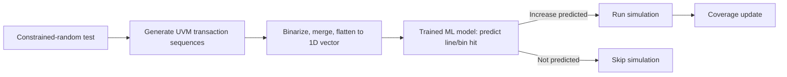

<!-- generated by yt-paper; edits will be overwritten -->
[DVCon](../dvcon/index.md) › [US](../dvcon/us.md) › [2025](../dvcon/by-year.md#2025) › [Verification](../dvcon/by-topic.md#verification)

# Accelerating Pre-Silicon Verification Coverage with Transaction Sequence Modeling

<figure class="rep-fig" markdown>
{ loading=lazy }
<figcaption>Figure 3. State transitions of a Lock DUT. State s3 is the Unlock state. — from the original paper (Jayanth Raman et al.)</figcaption>
</figure>

[:material-open-in-new: Original paper](https://dvcon-proceedings.org/wp-content/uploads/1083-2.pdf){ .md-button .md-button--primary target=_blank }

| | |
|---|---|
| Authors | Jayanth Raman, Jackson Wydra, Ximin Shan, Rahul Krishnamurthy, Michael Yan, Phyllis Hsia, Vikram Narayan, Samir Mittal (Micron, Inc., San Jose, CA) |
| Venue | DVCon US 2025 |
| Topic | Verification |
| Type | PAPER |
| ID | `ref-20261018-133d` |

## Summary

**The paper trains ML classifiers (XGBoost/LightGBM) on UVM transaction sequences to predict whether a new constrained-random test will hit an uncovered code or functional coverage item, and runs only the simulations predicted to add coverage, yielding an 18x line-coverage acceleration on a Lock DUT.**

**이 논문은 UVM 트랜잭션 시퀀스로 ML 분류기(XGBoost/LightGBM)를 학습해 새 constrained-random 테스트가 미커버 코드 또는 기능 커버리지 항목을 맞출지 예측하고, 커버리지 증가가 예상되는 시뮬레이션만 실행하여 Lock DUT에서 라인 커버리지 18배 가속을 달성했다.**

## Key Insights

- Merged write/read UVM transaction sequences, binarized and flattened into 1D vectors, act as classifier features for per-line or per-cover-bin hit prediction, so the prediction step runs before any simulation.

- 병합된 write/read UVM 트랜잭션 시퀀스를 이진화하고 1D 벡터로 평탄화하면 라인 또는 cover bin 적중 예측용 분류기 입력 특징이 되므로, 예측 단계는 시뮬레이션 이전에 수행된다.

- Lock DUT (8-bit codes, max 8 transactions): random stimulus needs about 366K simulations on average to unlock, while filtering with an XGBoost model trained on 10K random sequences (70/30 split) needed about 20K, an 18x acceleration. Uniform random odds are about 1 in 16.8M for 3 transactions and 1 in 5.8M for 4.

- Lock DUT(8비트 코드, 최대 트랜잭션 8개): 무작위 자극은 잠금 해제까지 평균 약 366K회 시뮬레이션이 필요했고, 랜덤 시퀀스 10K개(70/30 분할)로 학습한 XGBoost 모델로 필터링하면 약 20K회로 줄어 18배 가속이 되었다. 균일 랜덤 확률은 트랜잭션 3개일 때 약 1/16.8M, 4개일 때 약 1/5.8M이다.

- Cache DUT (Micron internal): per-line AUC was 1.00 for Modules 10-14 and near 0.50 for several others, with Module 9 ranging 0.50-1.00; only lines with AUC above 0.9 were selected for the next phase, and about 28% of functional cover bins showed high prediction performance. No acceleration result is reported for this DUT.

- Cache DUT(Micron 내부 설계): 모듈 10-14의 라인별 AUC는 1.00이었고 여러 모듈은 0.50 근처였으며, 모듈 9는 0.50-1.00 범위였다. AUC 0.9 초과 라인만 다음 단계로 선택되었고, 기능 cover bin의 약 28%가 높은 예측 성능을 보였다. 이 DUT에 대한 가속 결과는 보고되지 않았다.

- Only lines covered by 10%-90% of tests were modeled, since lines at 0% or near 100% coverage provide too little signal for classification. The model-retention threshold trades simulations run against the risk of missing hard-to-hit coverage.

- 테스트의 10%-90%가 커버한 라인만 모델링했다. 0% 또는 거의 100% 커버되는 라인은 분류에 쓸 신호가 부족하기 때문이다. 모델 유지 임계값은 실행 시뮬레이션 수와 어려운 커버리지 항목을 놓칠 위험 사이의 트레이드오프다.

## Detailed Summary

### Background and Problem

Simulation-based design verification (DV) consumes large amounts of machine time and engineering effort, and exhaustive testing of industrial designs is infeasible. Constrained-random testing (CRT) picks from a limited but broad set of stimuli, yet many runs add no new code or functional coverage. The authors ask whether the UVM transaction sequences that define a test, which exist before simulation, can predict whether that test will hit a target coverage item. If so, simulations predicted to add nothing can be skipped.

시뮬레이션 기반 설계 검증(DV)은 많은 머신 시간과 엔지니어링 자원을 소모하며, 산업용 설계에 대한 완전 탐색 테스트는 현실적으로 불가능하다. Constrained-random testing(CRT)은 제한적이지만 넓은 범위의 자극을 선택하지만, 많은 실행이 새로운 코드 또는 기능 커버리지를 추가하지 못한다. 저자들은 시뮬레이션 전에 이미 존재하는 테스트의 UVM 트랜잭션 시퀀스로 각 테스트가 목표 커버리지 항목을 맞출지 예측할 수 있는지 묻는다. 가능하다면 아무 것도 추가하지 못할 것으로 예측된 시뮬레이션은 건너뛸 수 있다.

### Architecture and Methodology

The method has two phases.

방법은 두 단계로 구성된다.

- **Phase 1 (Train):** Full simulations run with their UVM transaction sequences and coverage data recorded. Each test becomes one sample: the input is its transaction sequence and the label is a binary hit/miss for a specific line or cover bin. Write and read sequences are merged by timestamp, with an extra command bit (0 = write, 1 = read). Integer fields are expanded to bit vectors and categorical fields to indicator variables, then stacked and flattened row by row into one 1D vector. Fields are kept only if their variance exceeds a threshold (e.g., 80%). The task is binary classification using gradient-boosted trees (XGBoost, LightGBM) or neural networks, and the best model by AUC is retained. The retention criterion is a tunable trade-off between simulation count and the risk of missing hard-to-hit items.

- **Phase 1 (Train):** 전체 시뮬레이션을 실행하여 UVM 트랜잭션 시퀀스와 커버리지 데이터를 기록한다. 각 테스트는 하나의 샘플이 된다. 입력은 해당 트랜잭션 시퀀스이고, 레이블은 특정 라인 또는 cover bin의 적중 여부(이진값)이다. write와 read 시퀀스는 타임스탬프로 병합되며, 명령 비트(0 = write, 1 = read)가 추가된다. 정수 필드는 비트 벡터로, 범주형 필드는 지시 변수(indicator variable)로 확장된 뒤 가로로 쌓이고 행 단위로 1D 벡터로 평탄화된다. 분산이 임계값(예: 80%)을 넘는 필드만 사용한다. 과제는 이진 분류이며, 그래디언트 부스팅 트리(XGBoost, LightGBM) 또는 신경망을 사용하고 AUC 기준으로 최적 모델을 유지한다. 유지 기준은 시뮬레이션 횟수와 어려운 항목을 놓칠 위험 사이에서 조정 가능한 트레이드오프다.

- **Phase 2 (Apply):** Each new constrained-random test first generates its transaction sequences. The saved models predict coverage. Simulation runs only when an increase is predicted. With a budget of K simulations, N >> K sequences are generated and ranked. Selection strategies include top-K or bottom-K by predicted total coverage, a mix of both, selection by whether the predicted path reaches an uncovered item, or diversity selection by Hamming distance.

- **Phase 2 (Apply):** 새 constrained-random 테스트는 먼저 트랜잭션 시퀀스를 생성한다. 저장된 모델이 커버리지를 예측하고, 커버리지 증가가 예측될 때만 시뮬레이션을 실행한다. 시뮬레이션 예산이 K일 때 N >> K개의 시퀀스를 생성하여 순위를 매긴다. 선택 전략에는 예측 총 커버리지 기준 상위 K/하위 K, 두 가지 혼합, 예측 실행 경로가 미커버 항목에 도달하는지 여부, Hamming distance 기반 다양성 선택 등이 있다.

Experiments used two DUTs:

실험은 두 DUT로 수행되었다.

- **Lock DUT:** An RTL lock that unlocks only on a specific code sequence. The paper uses 8-bit codes and up to 8 transactions. An XGBoost model was trained on 10K uniformly random sequences to predict hits on state s1's line. Phase 2 generated random length-8 sequences, simulated only those predicted to reach s1, and tracked coverage toward the s3 (Unlock) line.

- **Lock DUT:** 특정 코드 시퀀스에서만 잠금이 해제되는 RTL 잠금장치. 8비트 코드, 최대 8개 트랜잭션을 사용한다. 균일 랜덤 시퀀스 10K개로 XGBoost 모델을 학습하여 상태 s1 라인의 적중을 예측했다. Phase 2에서는 길이 8의 랜덤 시퀀스를 생성하고, s1에 도달할 것으로 예측된 것만 시뮬레이션하며 s3(Unlock) 라인 커버리지를 추적했다.

- **Cache DUT:** A Micron-internal Verilog design with 14 modules, some instantiated multiple times. Each test emitted write and read sequences. Lines covered by 10%-90% of tests were modeled, and XGBoost, LightGBM, and other classifiers were compared against a DummyClassifier (AUC about 0.5). Functional coverage was modeled per cover bin, again limited to bins covered by 10%-90% of tests.

- **Cache DUT:** 14개 모듈(일부는 다중 인스턴스화)로 구성된 Micron 내부 Verilog 설계. 각 테스트는 write와 read 시퀀스를 출력했다. 테스트의 10%-90%가 커버한 라인을 모델링했으며, XGBoost, LightGBM 및 기타 분류기를 DummyClassifier(AUC 약 0.5)와 비교했다. 기능 커버리지는 cover bin 단위로 모델링했으며, 역시 10%-90% 테스트가 커버한 bin으로 제한했다.

### Results and Conclusions

- **Lock DUT:** Random simulation needed about 366K runs on average. Filtering needed about 20K, an 18x line-coverage acceleration (Fig. 4).

- **Lock DUT:** 랜덤 시뮬레이션은 평균 약 366K회가 필요했다. 필터링은 약 20K회로 줄여 라인 커버리지 18배 가속을 달성했다(Fig. 4).

- **Cache DUT, line coverage (Table I):** Modules 10-14 reached AUC 1.00. Modules 1-5 stayed near 0.50-0.51. Modules 6-9 had wide per-line ranges (for example, Module 9 at 0.50-1.00, mean 0.75). In total, 632 unique (instance, line-number) pairs were modeled.

- **Cache DUT, 라인 커버리지(Table I):** 모듈 10-14는 AUC 1.00에 도달했다. 모듈 1-5는 0.50-0.51 수준에 머물렀다. 모듈 6-9는 라인별 범위가 넓었다(예: 모듈 9는 0.50-1.00, 평균 0.75). 전체적으로 632개의 고유 (인스턴스, 라인 번호) 쌍이 모델링되었다.

- **Cache DUT, functional coverage (Table II):** Seven covergroups were evaluated. Mean AUC ranged from about 0.50 to 0.80, and about 28% of cover bins had high prediction performance. These were selected for the next phase.

- **Cache DUT, 기능 커버리지(Table II):** 7개 covergroup을 평가했다. 평균 AUC는 약 0.50-0.80 범위였고, cover bin의 약 28%가 높은 예측 성능을 보여 다음 단계로 선택되었다.

- **Conclusion:** Transaction sequences can predict code and functional coverage, and filtering simulations with these predictions accelerated coverage on the Lock DUT. The paper does not report simulation savings for the Cache DUT. Its validation set sizes and per-module sample counts are not given, so the AUC values should be read with that limitation in mind.

- **결론:** 트랜잭션 시퀀스로 코드 및 기능 커버리지를 예측할 수 있으며, 예측 기반 시뮬레이션 필터링은 Lock DUT에서 커버리지를 가속했다. Cache DUT에 대한 시뮬레이션 절감 결과는 보고되지 않았다. 검증 세트 크기와 모듈별 샘플 수가 제시되지 않았으므로 AUC 값은 이러한 한계를 고려하여 해석해야 한다.

## Videos

<iframe src="https://www.youtube-nocookie.com/embed/2on_n4tNWvg" title="[DVCON2025]Accelerating Pre-Silicon Verification Coverage with Transaction Sequence Modeling" loading="lazy" allow="accelerometer; clipboard-write; encrypted-media; gyroscope; picture-in-picture; web-share" referrerpolicy="strict-origin-when-cross-origin" allowfullscreen></iframe>

**[DVCON2025]Accelerating Pre-Silicon Verification Coverage with Transaction Sequence Modeling** — [Watch on YouTube](https://www.youtube.com/watch?v=2on_n4tNWvg) · [Video page](../videos/2on_n4tNWvg.md)
