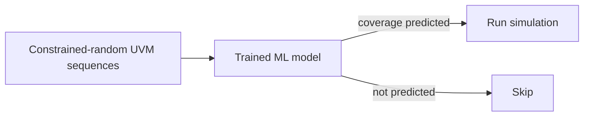

<!-- generated by yt-paper; edits will be overwritten -->
[DVCon](../dvcon/index.md) › [US](../dvcon/us.md) › [2025](../dvcon/by-year.md#2025) › [Verification](../dvcon/by-topic.md#verification)

# Accelerating Pre-Silicon Verification Coverage with Transaction Sequence Modeling

<figure class="rep-fig" markdown>
{ loading=lazy }
<figcaption>Figure 2. Phase 2 (Apply) of the Transaction Sequence Modeling Flow. — from the original paper (Jayanth Raman et al.)</figcaption>
</figure>

[:material-open-in-new: Original paper](https://dvcon-proceedings.org/wp-content/uploads/1083-2.pdf){ .md-button .md-button--primary target=_blank }

| | |
|---|---|
| Authors | Jayanth Raman, Jackson Wydra, Ximin Shan, Rahul Krishnamurthy, Michael Yan, Phyllis Hsia, Vikram Narayan, Samir Mittal (Micron, Inc.) |
| Venue | DVCon US 2025 |
| Topic | Verification |
| Type | PAPER |
| ID | `ref-20261018-133d` |

## Summary

**Trains ML classifiers on UVM transaction sequences to predict whether a test will hit a code or functional coverage item, and runs only the simulations predicted to add coverage, reaching an 18x line-coverage acceleration on a synthetic Lock DUT.**

**UVM 트랜잭션 시퀀스로 ML 분类기를 학습해 각 테스트가 코드/기능 커버리지 항목을 적중할지 예측하고, 커버리지 증가가 예상되는 시뮬레이션만 실행하여 합성 Lock DUT에서 18배 라인 커버리지 가속을 보고한다.**

## Key Insights

- On the Lock DUT (8-bit codes, up to 8 transactions), random simulation needed about 366K runs on average to unlock, while the transaction-sequence filter needed about 20K, an 18x acceleration.

- Lock DUT(8비트 코드, 최대 8 트랜잭션)에서 랜덤 시뮬레이션은 unlock까지 평균 약 366K회가 필요했지만, 트랜잭션 시퀀스 필터는 약 20K회만 필요해 18배 가속을 보였다.

- The Lock DUT model was an XGBoost classifier trained on only 10K uniformly random sequences (70/30 split), so the reported speedup comes from a single, synthetic DUT.

- Lock DUT 모델은 균등 랜덤 시퀀스 10K개로 학습한 XGBoost 분류기(70/30 분할)이며, 보고된 가속은 단일 합성 DUT에 기반한다.

- On the Cache DUT, line models in Modules 10-14 reached a mean best AUC of 1.00, while Modules 1-5 stayed near 0.50 (chance), so per-target AUC gating is necessary before a model is used to skip simulations.

- Cache DUT에서 Module 10-14의 라인 모델은 평균 최고 AUC 1.00을 달성한 반면 Module 1-5는 약 0.50(무작위 수준)에 머물러, 시뮬레이션을 건너뛰기 전에 타깃별 AUC 게이팅이 필요하다.

- Only about 28% of Cache DUT functional cover bins showed high prediction performance, and the paper reports no coverage-acceleration number for the Cache DUT.

- Cache DUT 기능 커버리지 cover bin의 약 28%만 높은 예측 성능을 보였으며, 논문은 Cache DUT의 커버리지 가속 수치를 보고하지 않는다.

- Phase 2 candidate selection (top/bottom coverage, combined, path-based, or Hamming-distance diversity) is DUT-dependent; the paper lists these options but does not compare them.

- Phase 2 후보 선택 방식(상위/하위 커버리지, 결합, 경로 기반, Hamming 거리 다양성)은 DUT에 따라 달라지며, 논문은 이 옵션들을 나열만 하고 비교하지 않는다.

## Detailed Summary

### Background and Problem

- Constrained-random DV spends most machine time on simulations that add no coverage, and exhaustive coverage is infeasible for industrial designs.

- Constrained-random DV는 커버리지를 추가하지 않는 시뮬레이션에 많은 머신 시간을 소비하며, 산업용 설계에서 exhaustive 커버리지는 현실적으로 불가능하다.

- Hard-to-hit states are extremely rare under random stimulus: for the Lock DUT with 3 transactions of 8 bits, unlocking occurs with probability about 1 in 16.8M.

- 랜덤 자극에서는 어려운 상태가 극히 드물다. Lock DUT의 경우 8비트 트랜잭션 3개에서 unlock 확률은 약 1/16.8M이다.

- Goal: predict from UVM transaction sequences alone whether a test will cover a target line or cover bin, and simulate only when a gain is predicted.

- 목표: UVM 트랜잭션 시퀀스만으로 테스트가 타깃 라인이나 cover bin을 커버할지 예측하고, 이득이 예상될 때만 시뮬레이션을 실행한다.

### Architecture and Methodology

- Phase 1 (Train): run full simulations, record sequences and per-line/bin coverage, then train XGBoost, LightGBM, or NN classifiers. Write and read sequences are merged by timestamp, bit-expanded, and flattened into one 1D binary vector. Models are kept if they pass an AUC threshold.

- Phase 1 (Train): 전체 시뮬레이션을 실행해 시퀀스와 라인/bin별 커버리지를 기록한 뒤 XGBoost, LightGBM 또는 NN 분류기를 학습한다. Write 및 read 시퀀스는 타임스탬프로 병합하고, 비트 단위로 확장한 후 하나의 1D 바이너리 벡터로 평탄화한다. AUC 임계값을 통과한 모델만 유지한다.

- Phase 2 (Apply): generate $N \gg K$ candidate sequences, predict coverage, and simulate only the $K$ selected sequences.

- Phase 2 (Apply): $N \gg K$개의 후보 시퀀스를 생성해 커버리지를 예측하고, 선택된 $K$개 시퀀스만 시뮬레이션한다.

### Results and Conclusions

- Lock DUT: about 366K random simulations versus about 20K filtered ones on average, an 18x line-coverage acceleration.

- Lock DUT: 평균 약 366K회의 랜덤 시뮬레이션 대비 필터링 후 약 20K회, 라인 커버리지 18배 가속.

- Cache DUT (Micron internal): Modules 10-14 reached mean best AUC 1.00, while Modules 1-5 stayed near 0.50; about 28% of functional cover bins predicted well.

- Cache DUT(Micron 내부): Module 10-14는 평균 최고 AUC 1.00을 달성했고, Module 1-5는 약 0.50에 머물렀다. 기능 cover bin의 약 28%가 높은 예측 성능을 보였다.

- Evidence is limited to two DUTs with one synthetic benchmark. The paper shows prediction for both DUTs but acceleration only for the Lock DUT.

- 근거는 두 DUT와 하나의 합성 벤치마크로 제한적이다. 두 DUT 모두에서 예측 성능을 보였지만, 가속은 Lock DUT에서만 보고되었다.

## Videos

<iframe src="https://www.youtube-nocookie.com/embed/2on_n4tNWvg" title="[DVCON2025]Accelerating Pre-Silicon Verification Coverage with Transaction Sequence Modeling" loading="lazy" allow="accelerometer; clipboard-write; encrypted-media; gyroscope; picture-in-picture; web-share" referrerpolicy="strict-origin-when-cross-origin" allowfullscreen></iframe>

**[DVCON2025]Accelerating Pre-Silicon Verification Coverage with Transaction Sequence Modeling** — [Watch on YouTube](https://www.youtube.com/watch?v=2on_n4tNWvg) · [Video page](../videos/2on_n4tNWvg.md)
