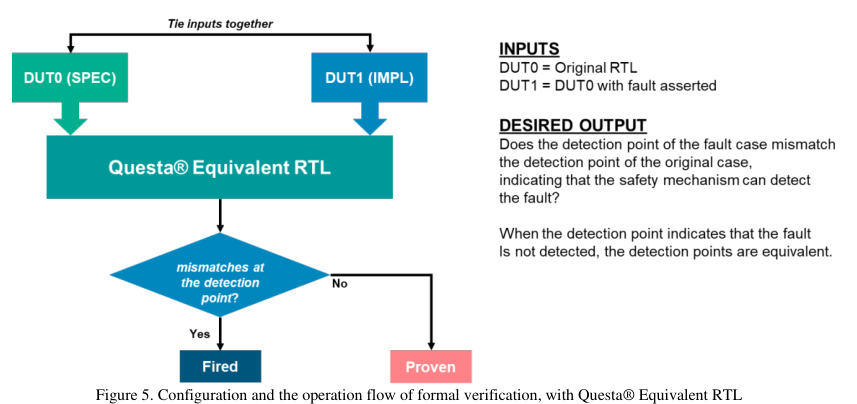
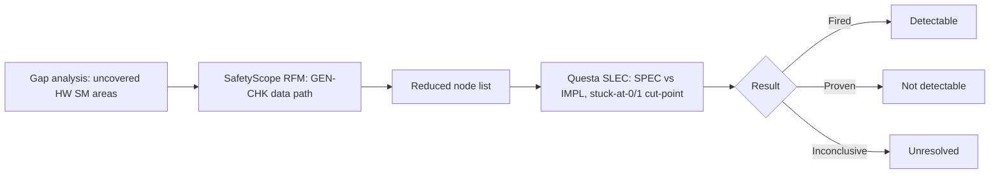

<!-- generated by yt-paper; edits will be overwritten -->
[DVCon](../dvcon/index.md) › [US](../dvcon/us.md) › [2025](../dvcon/by-year.md#2025) › [Verification](../dvcon/by-topic.md#verification)

# Static Structural Analysis and Formal Verification of SoC with Software Safety Mechanisms for Functional Safety

<figure class="rep-fig" markdown>
{ loading=lazy }
<figcaption>Figure 5. Configuration and the operation flow of formal verification, with Questa® Equivalent RTL — from the original paper (Hyunsun Ahn et al.)</figcaption>
</figure>

[:material-open-in-new: Original paper](https://dvcon-proceedings.org/wp-content/uploads/1046.pdf){ .md-button .md-button--primary target=_blank }

| | |
|---|---|
| Authors | Hyunsun Ahn (Samsung Electronics Co., Ltd.), Euisang Yoon (Siemens EDA), Namyul Cho (Siemens EDA), Arun Gogineni (Siemens EDA), Ann Keffer (Siemens EDA), Sungjin Park (Siemens EDA), Sungyun Yoo (Siemens EDA), Bumju Kim (Samsung Electronics Co., Ltd.), Junhyuk Park (Samsung Electronics Co., Ltd.), Youngsik Kim (Samsung Electronics Co., Ltd.), Seonil Brian Choi (Samsung Electronics Co., Ltd.) |
| Venue | DVCon US 2025 |
| Topic | Verification |
| Type | PAPER |
| ID | `ref-20261018-1733` |

## Summary

**Combines Siemens SafetyScope RFM data-path analysis with Questa Equivalent RTL formal fault proofs to show that software safety mechanisms cover stuck-at faults on a Samsung SoC AXI bus matrix, raising NOC diagnostic coverage in Safety Island from 66.50% to 93.62% toward ASIL-B.**

**Siemens SafetyScope의 RFM 데이터 경로 분석과 Questa Equivalent RTL 형식 검증 기반 고장 증명을 결합하여, Samsung SoC AXI 버스 매트릭스에서 소프트웨어 안전 메커니즘이 stuck-at 고장을 커버함을 보이고, ASIL-B 목표를 향해 Safety Island의 NOC 진단 커버리지를 66.50%에서 93.62%로 끌어올렸다.**

## Key Insights

- Gap analysis, static structural analysis, and formal verification were chained to close residual fault coverage without new fault simulation: NOC detected coverage in Safety Island went 65.87% (partial HW SM) -> 66.50% (full HW SM) -> 89.21% (with engineering judgement, 22.71% safe) -> 93.62% (with software SM, 4.41%).

- 갭 분석, 정적 구조 분석, 형식 검증을 연결하여 새로운 고장 시뮬레이션 없이 잔여 고장 커버리지를 닫았다. Safety Island NOC의 검출 커버리지는 65.87%(부분 HW SM) -> 66.50%(전체 HW SM) -> 89.21%(엔지니어링 판단 포함, 22.71% safe) -> 93.62%(소프트웨어 SM 4.41% 포함)로 증가했다.

- SafetyScope RFM data-path analysis (backward CHK traversal, forward GEN traversal, intersection, width-based register filtering) reduces the formal scope to a list of data-path nodes, so Questa Equivalent RTL only proves faults on that reduced set instead of the full hierarchy.

- SafetyScope RFM 데이터 경로 분석(CHK에서의 역방향 순회, GEN에서의 순방향 순회, 교집합, 폭 기반 레지스터 필터링)은 형식 검증 범위를 데이터 경로 노드 목록으로 줄여, Questa Equivalent RTL이 전체 계층이 아닌 축소된 집합의 고장만 증명하도록 한다.

- Formal fault proof is a SPEC-vs-IMPL equivalence check where the faulty point is a cut-point driven to 0 or 1; detection points come from the address map and use VALID/READY handshake conditions. Results are Fired (detectable), Proven (not detectable), or Inconclusive.

- 형식 고장 증명은 faulty 지점을 cut-point로 0 또는 1에 구동하는 SPEC 대 IMPL 동치성 검사이다. 검출 지점은 주소 맵에서 정해지며 VALID/READY 핸드셰이크 조건을 사용한다. 결과는 Fired(검출 가능), Proven(검출 불가), Inconclusive(미확정) 중 하나이다.

- Constraints determine result accuracy and runtime: QFL AXI formal assumptions, black-boxing only validated out-of-COI modules, tying unused ports to constants, and correct clock/reset at CDC bridges. Without them the tool may generate spurious packets.

- 제약 조건이 결과 정확도와 실행 시간을 결정한다. QFL AXI 형식 가정, 검증된 모듈만 black-box 처리, 미사용 포트의 상수 고정, CDC 브리지의 올바른 클럭/리셋 설정이 필요하며, 이것이 없으면 도구가 잘못된 패킷을 생성할 수 있다.

- Known limits: address-path faults cannot reach the data-port detection point (result is Proven or Inconclusive), and a Fired result on VALID/READY faults does not guarantee the faulty path is detectable. Transient faults can be modeled with sequential assumptions instead of constant forcing.

- 알려진 한계: 주소 경로 고장은 데이터 포트 검출 지점에 도달할 수 없어 Proven 또는 Inconclusive로 귀결되며, VALID/READY 고장의 Fired 결과가 해당 경로의 검출 가능성을 보장하지는 않는다. 과도(transient) 고장은 상수 강제 대신 순차 가정으로 모델링할 수 있다.

## Detailed Summary

### Background and Problem

- Fault campaigns for large automotive SoCs are costly. ISO 26262 diagnostic coverage (DC) targets must be met, here ASIL-B for a Samsung automotive project.

- 대형 차량용 SoC의 고장 캠페인은 비용이 크다. ISO 26262 진단 커버리지(DC) 목표를 충족해야 하며, 본 Samsung 차량 프로젝트에서는 ASIL-B가 목표이다.

- Software safety mechanisms (SMs), implemented as software test libraries (STLs), can be added after tape-out, help ASIL metrics for levels A through D, and save hardware area.

- 소프트웨어 안전 메커니즘(SM), 즉 소프트웨어 테스트 라이브러리(STL)로 구현된 SM은 tape-out 이후에도 추가할 수 있고, ASIL A~D 메트릭에 기여하며, 하드웨어 면적을 절약한다.

- Hardware SMs did not cover all of the AXI bus matrix. The uncovered "gray area" needs software SM coverage.

- 하드웨어 SM은 AXI 버스 매트릭스 전체를 커버하지 못했다. 커버되지 않은 "gray area"에 소프트웨어 SM 커버리지가 필요하다.

- Traditional fault simulation has difficulty preparing input stimuli for software SM coverage claims. The paper therefore proposes proving coverage by static structural analysis and formal verification.

- 기존 고장 시뮬레이션은 소프트웨어 SM 커버리지 주장에 필요한 입력 자극을 준비하기 어렵다. 따라서 본 논문은 정적 구조 분석과 형식 검증으로 커버리지를 증명하는 방법을 제안한다.

### Architecture and Methodology

The flow has three steps:

흐름은 세 단계로 구성된다.

1. **Gap analysis**: compare the target fault space with hardware SM coverage to find areas where software SMs are needed.

1. **갭 분석**: 대상 고장 공간과 하드웨어 SM 커버리지를 비교하여 소프트웨어 SM이 필요한 영역을 찾는다.

2. **Static structural analysis (Siemens SafetyScope, River Flow Mode, RFM)**: data-path coverage assigns SM coverage from a GEN point (data generation) to a CHK point (data consumption). The algorithm is:
   - traverse backward from CHK and forward from GEN, then take the intersection;
   - remove covered register/latch banks narrower than `rfm_filter_width`;
   - repeat for multi-level paths.
   The remaining logic cone is the data path. In the crossbar, a USER packet (AXI) is converted to a NOC packet and routed to the master, then converted back. The data stays intact along this path, which the algorithm needs.

2. **정적 구조 분석(Siemens SafetyScope, River Flow Mode, RFM)**: 데이터 경로 커버리지는 GEN 지점(데이터 생성)에서 CHK 지점(데이터 소비)까지의 전체 데이터 경로에 SM 커버리지를 부여한다. 알고리즘은 다음과 같다.
   - CHK에서 역방향, GEN에서 순방향으로 순회한 뒤 교집합을 취한다.
   - `rfm_filter_width`보다 폭이 좁은 커버된 레지스터/래치 뱅크를 제거한다.
   - 다단계 경로에 대해 반복한다.
   남은 로직 콘(cone)이 데이터 경로이다. 크로스바에서 USER 패킷(AXI)은 NOC 패킷으로 변환되어 마스터로 라우팅된 뒤 다시 변환된다. 알고리즘에 필요하므로 이 경로에서 데이터는 손상되지 않는다.

3. **Formal verification on the reduced space (Siemens Questa Equivalent RTL, SLEC)**: the normal RTL is compiled as SPEC and the faulty RTL as IMPL. For each fault in the list, the faulty point is set as a cut-point driven to 0 or 1 (stuck-at), the detection points are mapped, and the engine runs. Outcomes:
   - **Fired**: the fault is detectable, and a counter-example waveform shows it.
   - **Proven**: the fault is not detectable.
   - **Inconclusive**: no result within the time limit.

3. **축소된 공간에 대한 형식 검증(Siemens Questa Equivalent RTL, SLEC)**: 정상 RTL은 SPEC, 고장 주입 RTL은 IMPL로 컴파일한다. 고장 목록의 각 고장에 대해 faulty 지점을 cut-point로 설정하고 0 또는 1(stuck-at)로 구동하며, 검출 지점을 매핑하고 엔진을 실행한다. 결과는 다음과 같다.
   - **Fired**: 고장이 검출 가능하며, counter-example 파형이 이를 보여준다.
   - **Proven**: 고장이 검출 불가능하다.
   - **Inconclusive**: 제한 시간 내 결과가 없다.

Detection points are chosen per the address map. For example, a WDATA fault on the Slave 0 interface is checked at Master 0 using `Master0.WREADY && Master0.WVALID`. Read data uses Slave0 RREADY/RVALID, and address channels use AWREADY/AWVALID or ARREADY/ARVALID. Sideband signals are analyzed the same way.

검출 지점은 주소 맵에 따라 정한다. 예를 들어 Slave 0 인터페이스의 WDATA 고장은 `Master0.WREADY && Master0.WVALID`로 Master 0에서 확인한다. 읽기 데이터는 Slave0 RREADY/RVALID를, 주소 채널은 AWREADY/AWVALID 또는 ARREADY/ARVALID를 사용한다. 사이드밴드 신호도 같은 방식으로 분석한다.

Constraints used:

사용한 제약 조건은 다음과 같다.

- QFL AXI formal VIP, which forces AXI compliance (for example, stable DATA/ADDRESS while VALID is asserted, and READY behavior).

- QFL AXI 형식 VIP로 AXI 준수를 강제한다(VALID 어서트 중 DATA/ADDRESS 고정, READY 동작 등).

- Black-boxing of modules outside the cone of influence, only for validated modules.

- COI 밖 모듈을 black-box 처리하되, 검증된 모듈에만 적용한다.

- Unused master/slave ports tied to constants.

- 미사용 마스터/슬레이브 포트를 상수에 고정한다.

- Clock and reset settings at clock-domain-crossing points in asynchronous bridges.

- 비동기 브리지의 클럭 도메인 교차(CDC) 지점에 클럭과 리셋을 설정한다.

Limitations: address-path faults cannot reach the data-port detection point, so they resolve to Proven or Inconclusive. Faults on VALID/READY can change the whole transaction, so a Fired result may not mean the path is detectable. The method is limited to data-path protection and a specific sequential depth. Future work includes auto-generating formal setup from the partitioner, creating design cones for RFM, and dynamic formal analysis. Transient faults could be handled with sequential assumptions.

한계: 주소 경로 고장은 데이터 포트 검출 지점에 도달할 수 없어 Proven 또는 Inconclusive가 된다. VALID/READY 고장은 전체 트랜잭션을 바꿀 수 있어 Fired 결과가 나와도 해당 경로가 검출 가능하다는 뜻은 아닐 수 있다. 이 방법은 데이터 경로 보호와 특정 순차 깊이로 한정된다. 향후 과제로는 파티셔너에서 형식 검증 설정을 자동 생성하고, RFM용 설계 콘을 만들고, 동적 형식 분석을 탐구하는 것이 있다. 과도 고장은 순차 가정으로 처리할 수 있다.

### Results and Conclusions

Fault campaign (6000 statistically random-sampled faults, fully configured SMs, Table 2): Alarm Detected 66.50%, Residual 11.33%, No Deviation 13.57%, Not Injected 8.60%.

고장 캠페인(무작위 샘플링한 6000개 고장, 전체 구성 SM, 표 2): Alarm Detected 66.50%, Residual 11.33%, No Deviation 13.57%, Not Injected 8.60%.

- Engineering judgement covered 33.50% of the not-detected faults. Safe judgements were 6.76% (Residual) and 15.95% (No Deviation), so 22.71% in total. About 11% stayed conservatively unsafe (Table 3 lists 4.57% and 6.22%).

- 엔지니어링 판단은 미검출 고장의 33.50%를 대상으로 했다. Safe 판정은 Residual 6.76%, No Deviation 15.95%로 합계 22.71%이다. 약 11%는 보수적으로 unsafe로 남았다(표 3에는 4.57%와 6.22%로 기재).

- Gap analysis of the Not Safe faults found a 4.88% gray area that hardware SMs could not cover. The RAW (read-after-write) software SM with STL covered 4.47% in proposal. Flash-located fault paths were excluded because RAW could not be applied there. Structural analysis and formal verification confirmed 4.41%.

- Not Safe 고장에 대한 갭 분석에서 하드웨어 SM이 커버하지 못한 4.88% gray area를 찾았다. STL 기반 RAW(read-after-write) 소프트웨어 SM은 제안 기준 4.47%를 커버했다. Flash 영역에 위치한 고장 경로는 RAW를 적용할 수 없어 제외했다. 정적 구조 분석과 형식 검증으로 4.41%가 확인되었다.

- Final NOC coverage in Safety Island is 93.62% (Table 4). The ASIL-B target needed about 3% more, with a margin of error of 1.06%.

- Safety Island NOC의 최종 커버리지는 93.62%이다(표 4). ASIL-B 목표를 위해 약 3%가 더 필요했으며, 오차 한계(MOE)는 1.06%이다.

The authors conclude that combining static and dynamic analysis reaches the targeted ASIL goals, without a full traditional fault simulation for the software SM part. Future integration with Siemens functional safety tools is planned, with all static and dynamic analysis, including engineering judgement, managed in one database and automated for final metrics. The paper is a case study on one bus matrix and one SM type, so generality is not demonstrated.

저자들은 정적 분석과 동적 분석을 결합하여 소프트웨어 SM 부분에서 전통적인 전체 고장 시뮬레이션 없이도 ASIL 목표를 달성했다고 결론짓는다. 향후 Siemens 기능 안전 도구에 통합할 계획이며, 엔지니어링 판단을 포함한 모든 정적/동적 분석을 단일 데이터베이스에서 관리하고 최종 메트릭을 자동 보고하는 것이 목표이다. 본 논문은 하나의 버스 매트릭스와 하나의 SM 유형에 대한 사례 연구이므로 일반성은 입증되지 않았다.

## Videos

<iframe src="https://www.youtube-nocookie.com/embed/Wvc4rGGUGJg" title="[DVCON2025]Static Structural Analysis Formal Verification SoC Software Safety Mechanisms Functional" loading="lazy" allow="accelerometer; clipboard-write; encrypted-media; gyroscope; picture-in-picture; web-share" referrerpolicy="strict-origin-when-cross-origin" allowfullscreen></iframe>

**[DVCON2025]Static Structural Analysis Formal Verification SoC Software Safety Mechanisms Functional** — [Watch on YouTube](https://www.youtube.com/watch?v=Wvc4rGGUGJg) · [Video page](../videos/Wvc4rGGUGJg.md)
