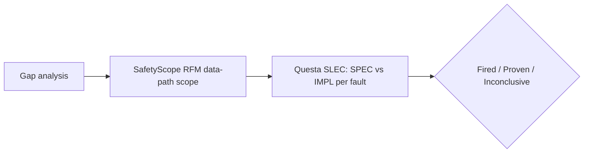

<!-- generated by yt-paper; edits will be overwritten -->
[DVCon](../dvcon/index.md) › [US](../dvcon/us.md) › [2025](../dvcon/by-year.md#2025) › [Verification](../dvcon/by-topic.md#verification)

# Static Structural Analysis and Formal Verification of SoC with Software Safety Mechanisms for Functional Safety

<figure class="rep-fig" markdown>
{ loading=lazy }
<figcaption>Figure 5. Configuration and the operation flow of formal verification, with Questa® Equivalent RTL — from the original paper (Hyunsun Ahn et al.)</figcaption>
</figure>

[:material-open-in-new: Original paper](https://dvcon-proceedings.org/wp-content/uploads/1046.pdf){ .md-button .md-button--primary target=_blank }

| | |
|---|---|
| Authors | Hyunsun Ahn (Samsung Electronics), Euisang Yoon (Siemens EDA), Namyul Cho (Siemens EDA), Arun Gogineni (Siemens EDA), Ann Keffer (Siemens EDA), Sungjin Park (Siemens EDA), Sungyun Yoo (Siemens EDA), Bumju Kim (Samsung Electronics), Junhyuk Park (Samsung Electronics), Youngsik Kim (Samsung Electronics), Seonil Brian Choi (Samsung Electronics) |
| Venue | DVCon US 2025 |
| Topic | Verification |
| Type | PAPER |
| ID | `ref-20261018-1733` |

## Summary

**The paper proposes a flow that uses SafetyScope RFM data-path analysis to scope the design and Questa Equivalent RTL formal checks to prove stuck-at-0/1 detectability, so software safety mechanism coverage can be proven without fault simulation, and applies it to a Samsung automotive NOC case that reached 93.62% diagnostic coverage.**

**이 논문은 SafetyScope RFM 데이터 경로 분석으로 설계 범위를 좁히고 Questa Equivalent RTL 형식 검증으로 stuck-at-0/1 고장의 검출 가능성을 증명하여, 시뮬레이션 없이 소프트웨어 안전 메커니즘의 커버리지를 입증하는 흐름을 제시하며, 이를 삼성 자동차 NOC 사례에 적용해 93.62%의 진단 커버리지에 도달했음을 보고합니다.**

## Key Insights

- Gap analysis, SafetyScope RFM data-path analysis, and Questa Equivalent RTL SLEC form a pipeline that proves software SM fault coverage before the full software stack exists, without simulation stimulus.

- Gap analysis, SafetyScope RFM 데이터 경로 분석, Questa Equivalent RTL SLEC로 이어지는 파이프라인은 전체 소프트웨어 스택이 준비되기 전에, 자극(stimulus) 없이 소프트웨어 SM의 고장 커버리지를 증명할 수 있게 합니다.

- In the Samsung case, diagnostic coverage for the NOC in the Safety Island rose from 66.50% (fault simulation with fully configured HW SMs) to 89.21% (with engineering judgement) and to 93.62% (with 4.41% added by software SM), against an ASIL-B target.

- 삼성 사례에서 Safety Island NOC의 진단 커버리지는 66.50%(완전 구성된 HW SM 기준 고장 시뮬레이션)에서 89.21%(엔지니어링 판단 포함)로, 소프트웨어 SM이 추가한 4.41%를 더해 93.62%로 상승했으며, 목표는 ASIL-B였습니다.

- Formal detect points are the AXI port outputs selected by address map, with VALID/READY handshake conditions; a fault is 'Fired' only if it deviates at these points.

- 형식 검증의 detect point는 주소 맵으로 선택된 AXI 포트 출력이며, VALID/READY 핸드셰이크 조건을 사용합니다. 고장은 이 지점에서 편차가 있을 때만 'Fired'로 판정됩니다.

- Known limitations: ADDRESS-path faults can only be 'Proven' or 'Inconclusive', and handshake (VALID/READY) faults may be undetectable even when reported 'Fired'; accurate results need QFL AXI assumptions, black-boxing of validated modules, tied unused ports, and CDC clock/reset setup.

- 알려진 한계: ADDRESS 경로 고장은 'Proven' 또는 'Inconclusive'만 가능하고, VALID/READY 핸드셰이크 고장은 'Fired'로 보고되더라도 검출 불가능할 수 있습니다. 정확한 결과를 위해서는 QFL AXI 가정, 검증된 모듈의 black-box 처리, 미사용 포트 고정, CDC 클록/리셋 설정이 필요합니다.

- The paper gives no formal runtime, tool comparison, or per-fault proof statistics, and has minor inconsistencies (Residual safe 6.76% in text vs 6.77% in Table 3; software SM coverage cited as 4.47% and 4.41%); transient-fault extension is proposed but not demonstrated.

- 논문은 형식 검증 런타임, 도구 비교, 고장별 증명 통계를 제시하지 않으며, 사소한 불일치가 있습니다(Residual 안전 판정이 본문 6.76% vs 표 3 6.77%, 소프트웨어 SM 커버리지가 4.47%와 4.41%로 각각 언급). 과도 고장(transient fault) 확장은 제안만 되고 시연되지 않았습니다.

## Detailed Summary

### Background and Problem

- Fault campaigns on large SoCs are costly; hardware SMs leave coverage gaps that software safety mechanisms (STLs, RAW checks) can fill, but their coverage is hard to prove by simulation when stimulus is difficult to build.

- 대형 SoC의 고장 캠페인은 비용이 크고, 하드웨어 SM은 커버리지 공백을 남깁니다. 소프트웨어 안전 메커니즘(STL, RAW 검사)이 이를 메울 수 있지만, 자극을 만들기 어려워 시뮬레이션으로 커버리지를 입증하기가 힘듭니다.

- Target: ISO 26262 ASIL-B diagnostic coverage for a Samsung automotive SoC, after 6000 randomly sampled faults were simulated.

- 목표: 삼성 자동차 SoC의 ISO 26262 ASIL-B 진단 커버리지. 6000개의 무작위 샘플링 고장을 시뮬레이션한 이후의 상황입니다.

### Architecture and Methodology

- Three steps: (1) gap analysis on the AXI bus matrix to find areas not covered by HW SMs; (2) SafetyScope RFM data-path analysis (backward/forward traversal from CHK/GEN points, filtered by rfm_filter_width) to shrink the scope to data-path nodes; (3) Questa Equivalent RTL SLEC comparing SPEC (good RTL) and IMPL (faulty RTL with a cut-point forced to 0/1).

- 세 단계: (1) AXI 버스 매트릭스에 대한 gap analysis로 HW SM이 커버하지 않는 영역 식별, (2) SafetyScope RFM 데이터 경로 분석(CHK/GEN 지점에서의 역방향/순방향 순회, rfm_filter_width 필터링)으로 데이터 경로 노드 범위 축소, (3) Questa Equivalent RTL SLEC로 SPEC(정상 RTL)과 IMPL(cut-point를 0/1로 강제한 고장 RTL) 비교.

- Results are Fired (detectable), Proven (undetectable), or Inconclusive. Detect points are AXI outputs chosen by the address map.

- 결과는 Fired(검출 가능), Proven(검출 불가), Inconclusive(판정 불가) 중 하나이며, detect point는 주소 맵으로 선택된 AXI 출력입니다.

### Results and Conclusions

- Fault simulation (66.50% detected) plus judgement (22.71% judged safe) reached 89.21%; the uncovered gray area was 4.88%, of which 4.41% was covered by RAW-based software SM, giving 93.62%.

- 고장 시뮬레이션(66.50% 검출)에 엔지니어링 판단(22.71% 안전 판정)을 더해 89.21%에 도달했고, 미해결 회색 영역 4.88% 중 RAW 기반 소프트웨어 SM이 4.41%를 커버하여 93.62%가 되었습니다.

- Flash-resident fault paths were excluded because RAW SM could not apply there.

- RAW SM을 적용할 수 없는 flash 메모리 영역의 고장 경로는 대상에서 제외되었습니다.

- The paper concludes the method enables early proof of SM coverage, but it lacks runtime data and extensions (control path, transient faults) are only proposed.

- 논문은 이 방법이 SM 커버리지를 조기에 증명할 수 있다고 결론짓지만, 런타임 데이터가 없으며 제어 경로나 과도 고장으로의 확장은 제안 수준입니다.

## Videos

<iframe src="https://www.youtube-nocookie.com/embed/Wvc4rGGUGJg" title="[DVCON2025]Static Structural Analysis Formal Verification SoC Software Safety Mechanisms Functional" loading="lazy" allow="accelerometer; clipboard-write; encrypted-media; gyroscope; picture-in-picture; web-share" referrerpolicy="strict-origin-when-cross-origin" allowfullscreen></iframe>

**[DVCON2025]Static Structural Analysis Formal Verification SoC Software Safety Mechanisms Functional** — [Watch on YouTube](https://www.youtube.com/watch?v=Wvc4rGGUGJg) · [Video page](../videos/Wvc4rGGUGJg.md)
