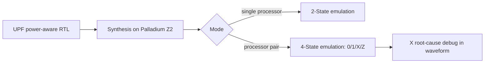

<!-- generated by yt-paper; edits will be overwritten -->
[DVCon](../dvcon/index.md) › [US](../dvcon/us.md) › [2024](../dvcon/by-year.md#2024) › [Emulation](../dvcon/by-topic.md#emulation)

# Innovative 4-State Logic Emulation for Power-aware Verification

<figure class="rep-fig" markdown>
{ loading=lazy }
<figcaption>Figure 3. Run and Compilation time — from the original paper (Kyoungmin Park et al.)</figcaption>
</figure>

[:material-open-in-new: Original paper](https://dvcon-proceedings.org/wp-content/uploads/1024-1.pdf){ .md-button .md-button--primary target=_blank }

| | |
|---|---|
| Authors | Kyoungmin Park (Samsung Electronics), Brad Budlong (Cadence Design Systems), Hyundon Kim (Samsung Electronics), Danny Yi (Cadence Design Systems), Jaehunn Lee (Samsung Electronics), Chulmin Kim (Samsung Electronics), Jaemin Choi (Samsung Electronics), Kijung Yoo (Samsung Electronics), Gibs Lee (Cadence Design Systems), Youngsik Kim (Samsung Electronics), Yogesh Goel (Cadence Design Systems), Seonil Brian Choi (Samsung Electronics) |
| Venue | DVCon US 2024 |
| Topic | Emulation |
| Type | PAPER |
| ID | `ref-20261018-1917` |

## Summary

**The paper reports a 4-State (0/1/X/Z) emulation flow on Palladium Z2 that exposes power-intent X sources missed by 2-State emulation, validated on a mobile-AP SoC with 30–115x speedup over 4-State logic simulation.**

**본 논문은 Palladium Z2 기반 4-State(0/1/X/Z) emulation 흐름을 제시하여, 2-State emulation에서는 드러나지 않던 power-intent 관련 X 소스를 노출하고, 모바일 AP SoC에서 4-State logic simulation 대비 30~115배 빠른 결과를 보고합니다.**

## Key Insights

- 4-State emulation on Palladium Z2 pairs processors to compute 0/1/X/Z, costing about 2.3x the capacity of 2-State, and about 3.2x versus 2-State without UPF when UPF is included.

- Palladium Z2에서 processor 쌍을 사용해 0/1/X/Z를 계산하는 4-State emulation은 2-State 대비 약 2.3배의 용량이 필요하며, UPF를 포함하면 UPF 없는 2-State 대비 약 3.2배입니다.

- The reported run-time speedup over 4-State logic simulation is 30–115x (115x on Design A), with compile time at 1.16–1.7x the simulator's.

- 4-State logic simulation 대비 보고된 run-time 속도 향상은 30~115배(Design A는 115배)이며, compile time은 simulator 대비 1.16~1.7배입니다.

- Two power bugs that 2-State emulation did not show were exposed by X: a ROM liberty PG-pin mismatch that lost data after power-down, and a set_port_attributes misinterpretation that made a power-switch signal X.

- 2-State emulation에서는 나타나지 않던 두 가지 power 버그(ROM liberty PG pin 불일치로 power-down 후 데이터 손실, set_port_attributes 오해석으로 power switch 신호가 X가 됨)가 4-State에서 X로 드러났습니다.

- Adoption requires synthesizable power-aware PHY models, Z-aware PAD mux coding, static RTL instead of dynamic RTL, pull-up/pull-down handling, and memory preloading to prevent X from uninitialized memory.

- 도입에는 synthesizable power-aware PHY 모델, Z를 고려한 PAD mux 코딩, dynamic RTL 대신 static RTL, pull-up/down 처리, 미초기화 memory로 인한 X를 막는 memory preloading이 필요합니다.

- The resource and performance numbers are unoptimized initial data (0.59x performance vs 2-State without UPF), and waveform dump time and power debug features were not yet evaluated.

- 용량과 성능 수치는 최적화하지 않은 초기 데이터(UPF 없는 2-State 대비 성능 0.59배)이며, waveform dump 시간과 power 디버그 기능은 아직 평가하지 않았습니다.

## Detailed Summary

### Background and Problem

- UPF-based power-aware verification is slower than standard logic verification, and emulation is faster than simulation, but traditional emulation is 2-State ('0'/'1'), so X/Z from power-down is masked and isolation bugs can be missed.

- UPF 기반 power-aware 검증은 일반 logic 검증보다 실행 시간이 길고, emulation은 simulation보다 빠르지만 기존 emulation은 2-State('0'/'1')만 지원하여 power-down에 따른 X/Z가 가려지고 isolation 버그를 놓칠 수 있습니다.

- Because of this, emulation was used only for power-sequence checks. Mobile and automotive SoCs with more power domains make simulation alone insufficient.

- 이 때문에 emulation은 power-sequence 점검에만 사용되어 왔습니다. Power domain이 늘어나는 모바일·automotive SoC에서는 simulation만으로는 부족합니다.

### Architecture and Methodology

- Palladium Z2 computes native 3-state logic. Processors work alone for 2-State or in pairs for 4-State, so 4-State needs at least 2x the 2-State resources. Z is added through compiler transformations. The zero-delay model excludes timing-violation X sources.

- Palladium Z2는 3-state 논리를 네이티브로 계산합니다. Processor를 단독으로 쓰면 2-State, 두 개를 한 쌍으로 쓰면 4-State가 되므로 4-State는 최소 2배의 2-State 자원이 필요합니다. Z는 compiler transformation으로 추가합니다. Zero-delay 모델이므로 timing violation 유래의 X는 제외됩니다.

- Table I maps X sources (power-down, propagation, uninitialized signal and memory, RTL injection, TCL force, DPI, multi-driven and undriven nets) to emulation support.

- Table I은 X 소스(power-down, propagation, uninitialized signal 및 memory, RTL injection, TCL force, DPI, multi-driven 및 undriven net)별 emulation 지원 여부를 정리합니다.

- Evaluated on a mobile-AP SoC with over 20 power domains and system power-gating. Six adoption requirements are listed: synthesizable power-aware PHY models, Z-aware PAD muxes, no dynamic RTL, pull-up/down handling, undriven-net initialization, and SRAM/ROM preloading.

- Power domain 20개 이상과 system power-gating을 가진 mobile-AP SoC에서 평가했습니다. 여섯 가지 도입 요건을 제시합니다: synthesizable power-aware PHY 모델, Z를 고려한 PAD mux, dynamic RTL 제거, pull-up/down 처리, undriven net 초기화, SRAM/ROM preloading.

### Results and Conclusions

- Design A: compile time is 16% above the simulator, and run time is 115x faster. Across designs, speedup is 30–115x and compile time is 1.16–1.7x the simulator's.

- Design A는 compile time이 simulator보다 16% 길고 run time은 115배 빠릅니다. 전체적으로 속도는 30~115배, compile time은 simulator 대비 1.16~1.7배입니다.

- Table II (unoptimized): 4-State capacity is 2.3x 2-State, and 4-State with UPF is 3.2x 2-State without UPF. Performance is 0.9x (4-State without UPF) and 0.59x (4-State with UPF) relative to 2-State without UPF.

- Table II(최적화 전): 4-State 용량은 2-State의 2.3배이고, UPF를 포함한 4-State는 UPF 없는 2-State의 3.2배입니다. 성능은 UPF 없는 2-State 대비 0.9배(4-State, UPF 없음)와 0.59배(4-State, UPF 포함)입니다.

- Two power-intent bugs were traced to ROM liberty PG-pin info and a set_port_attributes misinterpretation. Neither appeared in 2-State emulation.

- ROM liberty의 PG pin 정보와 set_port_attributes 해석 오류 두 가지 power-intent 버그를 찾았으며, 두 경우 모두 2-State emulation에서는 나타나지 않았습니다.

- Waveform dump and conversion time were not yet measured, so the authors plan further profiling and debug-feature work.

- Waveform dump 및 변환 시간은 아직 측정하지 않았으며, 저자들은 추가 profiling과 디버그 기능 연구를 계획하고 있습니다.

## Videos

<iframe src="https://www.youtube-nocookie.com/embed/WiuAknk2_SU" title="[DVCON2024] Innovative 4-State Logic Emulation for Power-aware Verification" loading="lazy" allow="accelerometer; clipboard-write; encrypted-media; gyroscope; picture-in-picture; web-share" referrerpolicy="strict-origin-when-cross-origin" allowfullscreen></iframe>

**[DVCON2024] Innovative 4-State Logic Emulation for Power-aware Verification** — [Watch on YouTube](https://www.youtube.com/watch?v=WiuAknk2_SU) · [Video page](../videos/WiuAknk2_SU.md)
