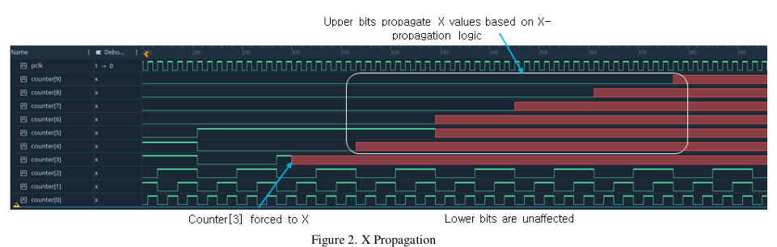

<!-- generated by yt-paper; edits will be overwritten -->
[DVCon](../dvcon/index.md) › [US](../dvcon/us.md) › [2024](../dvcon/by-year.md#2024) › [Emulation](../dvcon/by-topic.md#emulation)

# Innovative 4-State Logic Emulation for Power-aware Verification

<figure class="rep-fig" markdown>
{ loading=lazy }
<figcaption>Figure 2. X Propagation — from the original paper (Kyoungmin Park et al.)</figcaption>
</figure>

[:material-open-in-new: Original paper](https://dvcon-proceedings.org/wp-content/uploads/1024-1.pdf){ .md-button .md-button--primary target=_blank }

| | |
|---|---|
| Authors | Kyoungmin Park (Samsung Electronics, Design Verification Team, SLSI division), Brad Budlong (Cadence Design Systems), Hyundon Kim (Samsung Electronics), Danny Yi (Cadence Design Systems), Jaehunn Lee (Samsung Electronics), Chulmin Kim (Samsung Electronics), Jaemin Choi (Samsung Electronics), Kijung Yoo (Samsung Electronics), Gibs Lee (Cadence Design Systems), Youngsik Kim (Samsung Electronics), Yogesh Goel (Cadence Design Systems), Seonil Brian Choi (Samsung Electronics) |
| Venue | DVCon US 2024 |
| Topic | Emulation |
| Type | PAPER |
| ID | `ref-20261018-1917` |

## Summary

**The paper reports a native 4-state ('0', '1', 'X', 'Z') emulation flow on Palladium Z2, applied to a mobile-AP SoC with over 20 power domains, that exposes UPF power-intent bugs and X sources that 2-state emulation masks, at roughly 30–115x faster run time than 4-state logic simulation and about 2.3x the emulation capacity of 2-state emulation.**

**이 논문은 Palladium Z2에서 구현한 네이티브 4-State('0', '1', 'X', 'Z') 에뮬레이션 플로우를 20개 이상의 전원 도메인을 가진 모바일 AP SoC에 적용해, 2-State 에뮬레이션이 가리는 UPF 전력 인텐트 버그와 X 소스를 드러내고, 4-State 로직 시뮬레이션 대비 약 30~115배 빠른 실행 속도와 2-State 에뮬레이션 대비 약 2.3배의 에뮬레이터 용량을 보고합니다.**

## Key Insights

- Traditional 2-state emulation silently converts X to 0/1 after UPF power-down, so isolation and retention bugs are masked; native 4-state emulation keeps X visible in waveforms for root-cause debugging.

- 기존 2-State 에뮬레이션은 UPF 전원 차단 후 X를 0/1로 조용히 변환하여 isolation 및 retention 버그를 가립니다. 네이티브 4-State 에뮬레이션은 X를 파형에서 그대로 보여주어 근본 원인 디버그를 가능하게 합니다.

- Reported speedup over 4-state simulation is about 115x on Design A (compile time 16% longer than simulation) and 30–115x across designs and scenarios, while compile time is 1.16–1.7x that of simulation.

- 4-State 시뮬레이션 대비 속도 향상은 Design A에서 약 115배(컴파일 시간은 시뮬레이션보다 16% 김)이며, 설계와 시나리오에 따라 30~115배입니다. 컴파일 시간은 시뮬레이션의 1.16~1.7배입니다.

- Resource cost: 4-state needs about 2.3x the capacity of 2-state, at least 2x because each 4-state computation uses a processor pair on Palladium Z2; with UPF the figure is 3.2x versus the default 2-state configuration, or 2.3x versus 2-state with UPF.

- 리소스 비용: 4-State는 2-State 대비 약 2.3배의 용량이 필요하며, Palladium Z2에서 4-State 연산 한 건이 프로세서 쌍을 사용하므로 최소 2배가 필요합니다. UPF를 포함하면 기본 2-State 구성 대비 3.2배, UPF 포함 2-State 대비 2.3배입니다.

- Adoption requirements include synthesizable power-aware PHY models, PAD mux RTL that handles 'Z' (the 'ii' form), removal of dynamic RTL, pull-up/pull-down handling, initialization of undriven nets, and SRAM/ROM preloading to avoid X propagation from uninitialized memory.

- 도입 요건에는 합성 가능한 전원 인식 PHY 모델, 'Z'를 처리하는 PAD mux RTL('ii' 형태), dynamic RTL 제거, pull-up/pull-down 처리, 미구동 net 초기화, 초기화되지 않은 X 전파를 피하기 위한 SRAM/ROM 프리로딩이 포함됩니다.

- Two real power-intent bugs were caught only by 4-state emulation: a ROM with a missing liberty PG-pin definition that lost data after power down, and a power switch control signal turned to X by a misinterpreted set_port_attributes -driver_supply/-receiver_supply in UPF.

- 4-State 에뮬레이션에서만 발견된 실제 전력 인텐트 버그 두 건이 보고되었습니다. 하나는 liberty 셀의 PG 핀 정보 누락으로 전원 차단 후 데이터를 잃고 X를 출력한 ROM이고, 다른 하나는 UPF의 set_port_attributes -driver_supply/-receiver_supply 해석 오류로 전원 스위치 제어 신호가 X가 된 경우입니다.

## Detailed Summary

### Background and Problem

- Power-aware verification with UPF is slower than standard logic verification. Power-aware simulation relies on X propagation to expose missing isolation cells, enable signals that are not active, and similar faults. Root-causing X sources is a major debug cost.

- UPF 기반 전력 인식 검증은 일반 로직 검증보다 실행 시간이 깁니다. 전력 인식 시뮬레이션은 X 전파에 의존해 isolation 셀 누락, 비활성 enable 신호 등의 문제를 드러냅니다. 그러나 신호에 나타난 X의 근본 원인을 찾는 디버그 비용이 큽니다.

- Conventional emulation supports only 2-state logic, so X and Z are not represented. A missing isolation cell can therefore produce a plausible 0 or 1 instead of a visible X, which hides power-intent bugs. Engineers have used emulation mainly for power-sequence checks and still rely on simulation for full low-power verification.

- 기존 에뮬레이션은 2-State 로직만 지원하여 X와 Z를 표현하지 못합니다. 따라서 isolation 셀이 빠져도 X 대신 그럴듯한 0이나 1이 전파되어 전력 인텐트 버그가 가려집니다. 이 때문에 엔지니어들은 에뮬레이션을 주로 전원 시퀀스 점검에만 사용하고, 전체 저전력 검증은 여전히 시뮬레이션에 의존합니다.

- Mobile and automotive SoCs keep growing, development schedules keep shrinking, and power-domain counts are rising, so simulation alone is insufficient.

- 모바일 및 자동차 SoC의 규모는 커지고 개발 기간은 짧아지며, 전원 도메인 수도 늘고 있어 시뮬레이션만으로는 부족합니다.

### Architecture and Methodology

- The authors argue that 4-state hardware emulation was previously considered impractical. Native 3-state ('0', '1', 'X') computation on the Palladium Z2 processor, plus compiler transformations that add 'Z' support, makes it feasible. The compile and run flow matches 2-state emulation. Each Palladium Z2 processor can run 2-state work alone or pair with another processor for 4-state work, which is why 4-state needs at least twice the 2-state resources.

- 저자들은 과거에는 4-State 하드웨어 에뮬레이션이 비현실적이라고 여겨졌다고 설명합니다. Palladium Z2 프로세서의 네이티브 3-state('0', '1', 'X') 연산과 'Z' 지원을 위한 컴파일러 변환으로 이것이 가능해졌습니다. 컴파일 및 실행 플로우는 2-State 에뮬레이션과 동일합니다. 각 Palladium Z2 프로세서는 2-State 연산을 단독으로 수행하거나 4-State 연산을 위해 다른 프로세서와 쌍을 이룰 수 있으며, 이 때문에 4-State는 최소 2배의 자원이 필요합니다.

- Table I maps X sources between simulation and 4-state emulation. Sources include power-down events, X propagation (a localized CAT-style model), uninitialized signals and memories, RTL and TCL injection, DPI arguments, and multi-driven and undriven nets. Port X crossing the simulator/emulator boundary is supported only in emulation. Timing violations do not apply because emulation is zero-delay.

- 표 I은 시뮬레이션과 4-State 에뮬레이션의 X 소스를 대응시킵니다. 소스에는 전원 차단 이벤트, X 전파(국소화된 CAT 스타일 모델), 초기화되지 않은 신호 및 메모리, RTL 및 TCL 주입, DPI 인자, 다중 구동 및 미구동 net이 포함됩니다. 시뮬레이터/에뮬레이터 경계를 넘는 포트 X는 에뮬레이션에서만 지원됩니다. 에뮬레이션은 zero-delay 모델이므로 타이밍 위반은 해당되지 않습니다.

- Evaluation steps: (1) a small example design confirmed state corruption after UPF power down (Figure 1) and X propagation through a counter (Figure 2); (2) a full mobile-AP SoC with over 20 power domains was run on system power-gating scenarios.

- 평가 절차: (1) 작은 예제 설계로 UPF 전원 차단 후 상태 손상(그림 1)과 카운터를 통한 X 전파(그림 2)를 확인했습니다. (2) 20개 이상의 전원 도메인을 가진 모바일 AP SoC 전체를 시스템 전원 게이팅 시나리오로 실행했습니다.

- Requirements derived from the evaluation:
  1. Synthesizable power-aware PHY models that behave like the simulation models under UPF. A DRAM PHY lacking retention handling failed to access DRAM after waking from system off.
  2. PAD mux RTL must handle high-Z. The form `assign PAD = (unknown === 1'bx) ? 1'bx : PAD_i;` may fail in 4-state, so the authors recommend adding a `PAD_i === 1'bz` branch.
  3. Dynamic RTL is unsupported in 4-state, so debug monitors must move to static RTL.
  4. Pull-up/pull-down handling for Z nets.
  5. Initialization of undriven nets in the testbench and the emulation model.
  6. SRAM/ROM preloading, since uninitialized memory now yields X rather than 0/1.

- 평가에서 도출된 요건:
  1. UPF 하에서 시뮬레이션 모델과 같은 수준으로 동작하는 합성 가능한 전원 인식 PHY 모델. retention 처리가 없던 DRAM PHY 모델은 system off 후 깨어난 뒤 DRAM 접근이 불가능했습니다.
  2. PAD mux RTL은 high-Z를 처리해야 합니다. `assign PAD = (unknown === 1'bx) ? 1'bx : PAD_i;` 형태는 4-State에서 제대로 동작하지 않을 수 있으므로, 저자들은 `PAD_i === 1'bz` 분기를 추가할 것을 권장합니다.
  3. 4-State에서는 dynamic RTL이 지원되지 않으므로 디버그 모니터는 static RTL로 옮겨야 합니다.
  4. Z net에 대한 pull-up/pull-down 처리.
  5. 테스트벤치와 에뮬레이션 모델 양쪽에서 미구동 net 초기화.
  6. SRAM/ROM 프리로딩. 초기화되지 않은 메모리는 이제 0/1이 아니라 X를 출력하기 때문입니다.

### Results and Conclusions

- Performance: on Design A, emulation compile time was 16% higher than simulation, while run time was 115x faster. Design B is larger, with a more complex scenario, and shows a wider compile gap but a smaller run-time gain. The authors attribute this to hardware resources and driver clock frequency. Across designs, emulation is 30–115x faster than simulation. Full-chip power scenarios that previously took one to two days of wall-clock time are the reference point. Compile time is 1.16–1.7x that of simulation.

- 성능: Design A에서 에뮬레이션 컴파일 시간은 시뮬레이션보다 16% 길었지만, 실행 속도는 115배 빨랐습니다. Design B는 더 크고 시나리오가 복잡하여 컴파일 격차는 더 컸지만 실행 속도 향상은 작았습니다. 저자들은 이를 하드웨어 자원과 드라이버 클록 주파수 때문이라고 봅니다. 설계 전반에서 에뮬레이션은 시뮬레이션보다 30~115배 빠릅니다. 기준이 된 전체 칩 전력 시나리오는 기존에 실제 시간으로 하루에서 이틀이 걸렸습니다. 컴파일 시간은 시뮬레이션의 1.16~1.7배입니다.

- Accuracy: two real bugs were found only in 4-state. (a) A ROM that must stay powered had a missing liberty cell and wrong PG-pin connection, so it lost data and drove X. (b) A power switch control signal became X because the tool misread set_port_attributes -driver_supply/-receiver_supply in UPF. Neither appeared in 2-state emulation.

- 정확도: 4-State에서만 발견된 실제 버그가 두 건 있습니다. (a) 항상 전원이 켜져 있어야 하는 ROM이 liberty 셀 누락과 잘못된 PG 핀 연결로 전원 차단 후 데이터를 잃고 X를 출력했습니다. (b) UPF의 set_port_attributes -driver_supply/-receiver_supply를 툴이 잘못 해석하여 전원 스위치 제어 신호가 X가 되었습니다. 두 경우 모두 2-State 에뮬레이션에서는 나타나지 않았습니다.

- Resources (Table II, relative to 2-state without UPF): 4-state capacity is 2.3x, and 4-state with UPF is 3.2x (2.3x against 2-state with UPF). Compile time is 1.5x for 2-state with UPF and 2.1x for 4-state with UPF. Performance is 0.75x for 2-state with UPF, 0.9x for 4-state without UPF, and 0.59x for 4-state with UPF (0.81x against 2-state with UPF). The authors call these initial, unoptimized numbers. They suggest a hybrid mode where only the verification target is 4-state.

- 자원(표 II, 2-State w/o UPF 기준 상대값): 4-State 용량은 2.3배, UPF를 포함한 4-State는 3.2배입니다(UPF 포함 2-State 대비 2.3배). 컴파일 시간은 UPF 포함 2-State에서 1.5배, UPF 포함 4-State에서 2.1배입니다. 성능은 UPF 포함 2-State에서 0.75배, 4-State w/o UPF에서 0.9배, UPF 포함 4-State에서 0.59배입니다(UPF 포함 2-State 대비 0.81배). 저자들은 이 수치를 최적화 전의 초기 데이터라고 설명합니다. 검증 대상 블록만 4-State로 두고 나머지는 2-State로 두는 하이브리드 방식도 제안합니다.

- Open items: waveform dump and conversion time, profiling and optimization of capacity, compile time, and performance, and debug convenience features comparable to simulation. The conclusion says compile and performance analysis were not conducted, yet Table II reports them, so those figures should be read as preliminary.

- 향후 과제: 파형 덤프 및 변환 시간, 용량·컴파일 시간·성능의 프로파일링과 최적화, 시뮬레이션과 유사한 디버그 편의 기능입니다. 결론부에서는 컴파일 및 성능 분석을 아직 수행하지 않았다고 하지만 표 II에는 해당 수치가 보고되어 있으므로, 이 수치들은 예비 결과로 보는 것이 적절합니다.

## Videos

<iframe src="https://www.youtube-nocookie.com/embed/WiuAknk2_SU" title="[DVCON2024] Innovative 4-State Logic Emulation for Power-aware Verification" loading="lazy" allow="accelerometer; clipboard-write; encrypted-media; gyroscope; picture-in-picture; web-share" referrerpolicy="strict-origin-when-cross-origin" allowfullscreen></iframe>

**[DVCON2024] Innovative 4-State Logic Emulation for Power-aware Verification** — [Watch on YouTube](https://www.youtube.com/watch?v=WiuAknk2_SU) · [Video page](../videos/WiuAknk2_SU.md)
