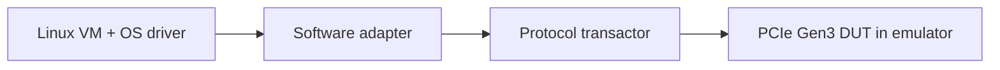

<!-- generated by yt-paper; edits will be overwritten -->
[DVCon](../dvcon/index.md) › [US](../dvcon/us.md) › [2019](../dvcon/by-year.md#2019) › [Emulation](../dvcon/by-topic.md#emulation)

# High-Speed Interface IP Validation based on Virtual Emulation Platform

<figure class="rep-fig" markdown>
{ loading=lazy }
<figcaption>Figure 4. Proposed Work: Virtual Emulation Platform — from the original paper (Jaehun Lee et al.)</figcaption>
</figure>

[:material-open-in-new: Original paper](https://dvcon-proceedings.org/wp-content/uploads/high-speed-interface-ip-validation-based-on-virtual-emulation-platform.pdf){ .md-button .md-button--primary target=_blank }

| | |
|---|---|
| Authors | Jaehun Lee (Samsung Electronics), DaeSeo Cha (Samsung Electronics), Sungwook Moon (Samsung Electronics) |
| Venue | DVCon US 2019 |
| Topic | Emulation |
| Type | PAPER |
| ID | `ref-20261018-2072` |

## Summary

**The paper proposes a Virtual Emulation Platform (VEP) that connects a hardware emulator to a Linux virtual machine via a software adapter, so PCIe Gen3 HSI IP can be validated with real OS drivers at pre-silicon, reporting 33.3% TAT reduction and coverage rising to 87.8% (from 68.1%).**

**이 논문은 하드웨어 에뮬레이터와 Linux 가상 머신을 소프트웨어 어댑터로 연결한 Virtual Emulation Platform(VEP)을 제안하여, 실리콘 이전 단계에서 실제 OS 드라이버로 PCIe Gen3 HSI IP를 검증할 수 있게 하며, TAT 33.3% 단축과 커버리지 68.1%에서 87.8%로의 향상을 보고합니다.**

## Key Insights

- Replacing the MPW PHY test chip with a synthesizable PHY model plus a virtual-interface protocol transactor lets PCIe Gen3 validation start pre-silicon, removing the roughly 10-week MPW fabrication wait.

- MPW PHY 테스트 칩을 합성 가능한 PHY 모델과 가상 인터페이스 프로토콜 트랜스액터로 대체하여, 약 10주의 MPW 제작 대기 없이 PCIe Gen3 검증을 실리콘 이전 단계에서 시작할 수 있습니다.

- A mixed-interface methodology uses the PIPE interface (250MHz, 32-bit) for early firmware and driver development, versus the 8GHz serial interface, to cut emulation run time.

- 혼합 인터페이스 방법론은 펌웨어 및 드라이버 초기 개발에 PIPE 인터페이스(250MHz, 32비트)를 사용하여 8GHz 시리얼 인터페이스 대비 에뮬레이션 실행 시간을 줄입니다.

- PIPE reduced PCIe Gen3 link-up simulation time by 31.35x versus the serial interface, though the 4096-burst VM scenario gained less because OS loading dominates.

- PIPE는 PCIe Gen3 링크업 시뮬레이션 시간을 시리얼 인터페이스 대비 31.35배 단축했으나, OS 로딩이 병목인 4096 버스트 VM 시나리오에서는 개선 폭이 작았습니다.

- Reported results are 19.7% higher functional coverage and 33.3% TAT reduction; coverage reached 87.8% versus 68.1% for the FPGA+MPW platform, with analog features (equalization, lane margining) still uncovered.

- 보고된 결과는 기능 커버리지 19.7% 향상과 TAT 33.3% 단축이며, 커버리지는 FPGA+MPW 플랫폼의 68.1%에서 87.8%로 올랐고 이퀄라이제이션, 레인 마진닝 등 아날로그 기능은 여전히 검증되지 않았습니다.

- The VEP offers full-visibility debug: TLP logs for S/W engineers, timestamped CSV transaction logs for H/W engineers, and static environments without timeout constraints.

- VEP는 S/W 엔지니어를 위한 TLP 로그, H/W 엔지니어를 위한 타임스탬프 CSV 트랜잭션 로그, 타임아웃 제약이 없는 정적 환경을 제공하는 전 가시성 디버그를 지원합니다.

## Detailed Summary

### Background and Problem

- HSI IP (e.g., PCIe Gen3) complexity and speed rise each generation, and the FPGA + MPW test-chip flow is slow: MPW fabrication takes about 10 weeks and limits functional validation and S/W development.

- HSI IP(예: PCIe Gen3)의 복잡도와 속도가 세대마다 증가하고 있으며, FPGA + MPW 테스트 칩 흐름은 느립니다. MPW 제작에 약 10주가 걸리고 기능 검증과 S/W 개발을 제약합니다.

- FPGA prototypes cannot reach at-speed operation, and back-to-back PCIe connections cannot check protocol compatibility. Simulation is too slow for long scenarios such as massive data transfer and power/aging tests.

- FPGA 프로토타입은 실속도 동작이 불가능하고, back-to-back PCIe 연결로는 프로토콜 호환성을 확인할 수 없습니다. 시뮬레이션은 대량 데이터 전송, 전력/에이징 테스트 같은 장시간 시나리오에 비해 너무 느립니다.

### Architecture and Methodology

- The VEP couples a hardware emulator (mini-SoC with PCIe Link controller, synthesizable PHY model, protocol transactor) to a Linux VM with a virtual device. A software adapter (driver adapter plus C proxy/xtor) intercepts transactions and forwards them over a virtual protocol connection.

- VEP는 하드웨어 에뮬레이터(PCIe Link 컨트롤러를 포함한 mini-SoC, 합성 가능한 PHY 모델, 프로토콜 트랜스액터)를 가상 디바이스를 가진 Linux VM과 연결합니다. 소프트웨어 어댑터(드라이버 어댑터와 C proxy/xtor)가 트랜잭션을 가로채 가상 프로토콜 연결로 전달합니다.

- Mixed-interface flow: step 1 uses the PIPE interface (parallel data, 250MHz at 32-bit vs. 8GHz serial, a 32x event reduction) for early firmware/driver work; step 2 switches to the serial PHY transactor for link equalization and aging tests.

- 혼합 인터페이스 흐름: 1단계는 초기 펌웨어/드라이버 작업에 PIPE 인터페이스(병렬 데이터, 32비트에서 250MHz, 시리얼 8GHz 대비 이벤트 32배 감소)를 사용하고, 2단계에서 이퀄라이제이션과 에이징 테스트를 위해 시리얼 PHY 트랜스액터로 전환합니다.

- Debug: TLP logs for S/W engineers (virtual JTAG), timestamped CSV transaction logs for H/W engineers to locate waveform points.

- 디버그: S/W 엔지니어는 TLP 로그(가상 JTAG)를, H/W 엔지니어는 파형 관심 지점을 찾기 위한 타임스탬프 CSV 트랜잭션 로그를 사용합니다.

### Results and Conclusions

- PIPE interface cut the PCIe Gen3 link-up simulation time by 31.35x versus serial; the 4096-burst VM case showed a smaller gain.

- PIPE 인터페이스는 PCIe Gen3 링크업 시뮬레이션 시간을 시리얼 대비 31.35배 줄였으며, 4096 버스트 VM 시나리오에서는 개선 폭이 더 작았습니다.

- Coverage rose from 68.1% (FPGA + MPW) to 87.8% (VEP), a 19.7% increase, and TAT dropped 33.3% over a 6-week VEP phase.

- 커버리지는 68.1%(FPGA + MPW)에서 87.8%(VEP)로 올라 19.7% 증가했고, 6주간의 VEP 단계로 TAT가 33.3% 감소했습니다.

- Analog features (equalization, lane margining) remain uncovered and need the FPGA/MPW platform; the authors call for EDA vendor support for analog modeling.

- 이퀄라이제이션, 레인 마진닝 같은 아날로그 기능은 여전히 검증되지 않아 FPGA/MPW 플랫폼이 필요하며, 저자들은 아날로그 모델링을 위한 EDA 벤더의 지원을 제안합니다.

## Videos

<iframe src="https://www.youtube-nocookie.com/embed/BO2BW7FTKBg" title="[DVCon2019] High-Speed Interface IP Validation based on Virtual Emulation Platform" loading="lazy" allow="accelerometer; clipboard-write; encrypted-media; gyroscope; picture-in-picture; web-share" referrerpolicy="strict-origin-when-cross-origin" allowfullscreen></iframe>

**[DVCon2019] High-Speed Interface IP Validation based on Virtual Emulation Platform** — [Watch on YouTube](https://www.youtube.com/watch?v=BO2BW7FTKBg) · [Video page](../videos/BO2BW7FTKBg.md)
