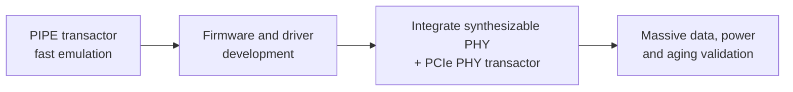

<!-- generated by yt-paper; edits will be overwritten -->
[DVCon](../dvcon/index.md) › [US](../dvcon/us.md) › [2019](../dvcon/by-year.md#2019) › [Emulation](../dvcon/by-topic.md#emulation)

# High-Speed Interface IP Validation based on Virtual Emulation Platform

<figure class="rep-fig" markdown>
{ loading=lazy }
<figcaption>Figure 4. Proposed Work: Virtual Emulation Platform — from the original paper (Jaehun Lee et al.)</figcaption>
</figure>

[:material-open-in-new: Original paper](https://dvcon-proceedings.org/wp-content/uploads/high-speed-interface-ip-validation-based-on-virtual-emulation-platform.pdf){ .md-button .md-button--primary target=_blank }

| | |
|---|---|
| Authors | Jaehun Lee (Samsung Electronics Co., Ltd.), DaeSeo Cha (Samsung Electronics Co., Ltd.), Sungwook Moon (Samsung Electronics Co., Ltd.) |
| Venue | DVCon US 2019 |
| Topic | Emulation |
| Type | PAPER |
| ID | `ref-20261018-2072` |

## Summary

**The paper proposes a Virtual Emulation Platform (VEP) that connects a hardware emulator hosting a PCIe Gen3 DUT to a Linux virtual machine with real device drivers, using a synthesizable PHY model in place of an MPW test chip, and reports 33.3% TAT reduction and coverage rising from 68.1% to 87.8%.**

**이 논문은 PCIe Gen3 DUT를 호스팅하는 하드웨어 에뮬레이터와 실제 디바이스 드라이버를 탑재한 Linux 가상 머신을 연결하는 Virtual Emulation Platform(VEP)을 제안하며, MPW 테스트 칩 대신 synthesizable PHY 모델을 사용해 TAT 33.3% 감소와 커버리지 68.1%에서 87.8%로의 향상을 보고합니다.**

## Key Insights

- VEP removes the MPW test chip dependency: a synthesizable PHY model in the emulated mini-SoC lets OS-level, real-driver validation start at pre-silicon, but analog features (link equalization, lane margining) remain uncovered and still require FPGA plus MPW.

- VEP는 MPW 테스트 칩 의존성을 제거합니다. 에뮬레이션된 mini-SoC의 synthesizable PHY 모델 덕분에 pre-silicon 단계에서 OS 수준의 실제 드라이버 검증을 시작할 수 있지만, 아날로그 기능(link equalization, lane margining)은 여전히 검증되지 않으며 FPGA와 MPW가 필요합니다.

- PIPE interface reduces emulation event capture: a serial PCIe Gen3 interface at 8 GHz captures 32x more data than a 250 MHz, 32-bit PIPE interface, and PIPE cut Gen3 link-up simulation time by 31.35x.

- PIPE 인터페이스는 에뮬레이션의 이벤트 캡처량을 줄입니다. 8 GHz 시리얼 인터페이스는 250 MHz, 32-bit PIPE 인터페이스보다 32배 많은 데이터를 캡처하며, PIPE는 Gen3 link-up 시뮬레이션 시간을 31.35배 단축했습니다.

- The mixed interface methodology uses PIPE for early firmware and driver development, then switches to the serial PHY transactor for massive-data and power/aging tests, at the cost of maintaining two emulation environments and higher engineering effort.

- Mixed interface 방법론은 초기 펌웨어와 드라이버 개발에는 PIPE를, 대용량 데이터 및 전력/에이징 테스트에는 시리얼 PHY 트랜섹터를 사용합니다. 대신 두 개의 에뮬레이션 환경을 유지해야 하며 엔지니어링 부담이 커집니다.

- Reported results on the PCIe Gen3 IP: functional coverage rose from 68.1% to 87.8% (a 19.7-point gain) and TAT dropped by 33.3%, with VEP used for about 6 weeks of S/W development and validation before FPGA plus MPW for the remaining features.

- PCIe Gen3 IP에 대한 보고 결과: 기능 커버리지가 68.1%에서 87.8%로 상승(19.7포인트 향상)했고 TAT는 33.3% 감소했습니다. VEP는 나머지 기능을 FPGA와 MPW로 검증하기 전에 약 6주간 S/W 개발 및 검증에 사용되었습니다.

- Debug support is built into the flow: TLP-level log files from the socket server for S/W debugging, virtual JTAG for connecting a software debugger, and timestamped CSV transaction logs to locate waveform points of interest for H/W debugging, all in a static environment without timeouts.

- 디버그 지원이 흐름에 포함되어 있습니다. S/W 디버깅에는 소켓 서버 측 TLP 수준 로그 파일과 virtual JTAG를, H/W 디버깅에는 파형 관심 지점을 찾기 위한 타임스탬프 CSV 트랜잭션 로그를 사용하며, 모든 과정이 타임아웃 없는 정적 환경에서 이루어집니다.

## Detailed Summary

### Background and Problem

- HSI IP (here PCIe Gen3) complexity and speed rise every generation, while project schedules stay fixed, so complete functional validation before SoC design is increasingly hard.

- HSI IP(여기서는 PCIe Gen3)의 복잡도와 속도가 세대마다 증가하는 반면 프로젝트 일정은 고정되어 있어, SoC 설계 이전에 기능 검증을 완료하기가 점점 어려워지고 있습니다.

- The conventional approach is an FPGA-based platform: a mini-SoC (ARM CPU, interconnect, memory, UART) on FPGA with the PHY in a separate MPW test chip connected over PCS/PMA. The authors list several limitations:
  - An MPW test chip takes about 10 weeks to fabricate, so functional validation with target S/W can start only after silicon is available.
  - PCIe Endpoint validation needs a back-to-back connection, which makes PCIe protocol compliance checking impossible on this platform.
  - FPGAs cannot reach full PCIe Gen3 speed, and FPGA visibility and implementation effort are limited.

- 기존 방식은 FPGA 기반 플랫폼입니다. FPGA에 mini-SoC(ARM CPU, interconnect, memory, UART)를 구성하고 PHY는 PCS/PMA 인터페이스로 연결된 별도 MPW 테스트 칩에 둡니다. 저자들이 지적한 한계는 다음과 같습니다.
  - MPW 테스트 칩 제작에 약 10주가 걸리므로, 실리콘이 준비되어야 타깃 S/W를 이용한 기능 검증을 시작할 수 있습니다.
  - PCIe Endpoint 검증에는 back-to-back 연결이 필요하여 이 플랫폼에서는 PCIe 프로토콜 호환성 검사가 불가능합니다.
  - FPGA로는 PCIe Gen3 full speed에 도달할 수 없으며, FPGA의 visibility와 구현 부담도 큽니다.

- Simulation is too slow to exercise massive data transfers, power management, and aging tests.

- 시뮬레이션은 대용량 데이터 전송, 전력 관리, 에이징 테스트를 수행하기에는 속도가 너무 느립니다.

- Firmware or day-of-use (DOU) emulation alone does not cover OS-level scenarios with the IP's real device driver.

- 펌웨어나 DOU(day-of-use) 시나리오 에뮬레이션만으로는 IP의 실제 디바이스 드라이버를 사용하는 OS 수준 시나리오를 다룰 수 없습니다.

### Architecture and Methodology

- **VEP structure**: a hardware emulator hosts the DUT (mini-SoC with PCIe Link controller and a synthesizable PHY model). A virtual machine running Linux hosts the virtual device and the proven OS driver. A software adapter bridges them:
  - The driver adapter (DEV1/DEV2 on the VM side) intercepts transactions going to the virtual device and sends them as packets.
  - The protocol transactor (DEV1/DEV2 on the hardware side, C proxy plus interface xtor) connects over the protocol to the DUT in the emulator.

- **VEP 구조**: 하드웨어 에뮬레이터에 DUT(PCIe Link controller와 synthesizable PHY 모델을 포함한 mini-SoC)를 올립니다. Linux를 실행하는 가상 머신에는 가상 디바이스와 검증된 OS 드라이버가 있습니다. 소프트웨어 어댑터가 둘을 연결합니다.
  - 드라이버 어댑터(VM 측 DEV1/DEV2)는 가상 디바이스로 향하는 트랜잭션을 가로채 패킷으로 전송합니다.
  - 프로토콜 트랜섹터(하드웨어 측 DEV1/DEV2, C proxy 및 interface xtor)는 프로토콜을 통해 에뮬레이터의 DUT와 연결됩니다.

- **Versus the previous platform**: the MPW PHY is replaced by a synthesizable PHY model. This model covers the PMA but cannot handle equalization or lane margining. A protocol transactor is added on the hardware side for the virtual interface.

- **기존 플랫폼과의 차이**: MPW PHY 대신 synthesizable PHY 모델을 사용합니다. 이 모델은 PMA를 다루지만 equalization과 lane margining은 처리할 수 없습니다. 가상 인터페이스 통신을 위해 하드웨어 측에 프로토콜 트랜섹터가 추가됩니다.

- **Claimed advantages**: (1) no MPW chip, so S/W can be developed at pre-silicon; (2) OS-level applications combined with emulation acceleration for inbound/outbound traffic, massive data, power management, and aging; (3) at-speed benchmarking, for example with IOmeter, to check effective bandwidth against PCI Express Base Spec 3.0 (8.0 GT/s). The environment is also static, with no timeout constraints, and can be replicated across projects.

- **주장하는 장점**: (1) MPW 칩이 필요 없어 pre-silicon 단계에서 S/W 개발이 가능합니다. (2) OS 수준 애플리케이션과 에뮬레이션 가속을 결합해 inbound/outbound 트래픽, 대용량 데이터, 전력 관리, 에이징을 검증합니다. (3) IOmeter 같은 벤치마크로 at-speed 성능을 측정하고, PCI Express Base Spec 3.0(8.0 GT/s)의 effective bandwidth와 비교합니다. 또한 타임아웃 제약이 없는 정적 환경이며 프로젝트 간 복제가 가능합니다.

- **Mixed interface methodology** (for S/W development):
  - Serial interface timing: the 8 GHz serial clock captures about 32x more events than the 250 MHz, 32-bit PIPE interface. This degrades emulation run time for long scenarios.
  - Step 1: integrate a PIPE transactor in place of the PCIe PHY transactor. No synthesizable PHY model is needed, so the VEP builds faster, and basic firmware and drivers can be developed.
  - Step 2: integrate the synthesizable PHY model and PCIe PHY transactor, then validate the IP with the developed S/W, including massive data and power/aging tests.
  - This requires two emulation environments, one per interface, and higher engineering effort.

- **Mixed interface 방법론**(S/W 개발용):
  - 시리얼 인터페이스 타이밍: 8 GHz 시리얼 클록은 250 MHz, 32-bit PIPE 인터페이스보다 약 32배 많은 이벤트를 캡처합니다. 이로 인해 긴 시나리오에서 에뮬레이션 실행 시간이 크게 늘어납니다.
  - 1단계: PCIe PHY 트랜섹터 대신 PIPE 트랜섹터를 통합합니다. synthesizable PHY 모델이 필요 없으므로 VEP 구축이 빠르고, 기본 펌웨어와 드라이버를 개발할 수 있습니다.
  - 2단계: synthesizable PHY 모델과 PCIe PHY 트랜섹터를 통합한 뒤, 개발된 S/W로 대용량 데이터 및 전력/에이징 테스트를 포함해 IP를 검증합니다.
  - 인터페이스별로 두 개의 에뮬레이션 환경이 필요하며 엔지니어링 부담이 커집니다.

- **Debug flows**:
  - S/W: TLP-level log files (type, address, length, data/header) from the socket on the server side, plus a software debugger attached through virtual JTAG.
  - H/W: CSV logs of configuration, read/write, address, and data transactions with timestamps, used to find points of interest and dump waveforms at those points.

- **디버그 흐름**:
  - S/W: 소켓 서버 측의 TLP 로그 파일(타입, 주소, 길이, data/header)과 virtual JTAG로 연결된 소프트웨어 디버거를 사용합니다.
  - H/W: 설정, 읽기/쓰기, 주소, 데이터 트랜잭션을 타임스탬프와 함께 CSV로 기록하여 관심 지점을 찾고 해당 지점의 파형을 덤프합니다.

### Results and Conclusions

- **Link-up performance (Table 1)**: the PIPE interface cut PCIe Gen3 link-up simulation time by a factor of 31.35 relative to the serial interface, and wall-clock time was even faster than estimated. The reduction for the 4096-burst VM-loaded scenario was smaller, which the authors attribute to OS loading as the bottleneck rather than hardware.

- **Link-up 성능(Table 1)**: PIPE 인터페이스는 시리얼 인터페이스 대비 PCIe Gen3 link-up 시뮬레이션 시간을 31.35배 단축했으며, wall-clock 시간은 예상보다 더 빨랐습니다. 4096 burst VM 시나리오의 감소폭은 더 작았는데, 저자들은 이를 하드웨어가 아니라 OS 로딩이 병목이기 때문이라고 설명합니다.

- **Coverage (Table 2)**: the previous FPGA plus MPW platform covered 68.1% of the validated space. VEP reached 87.8%, a 19.7-point gain. The remaining gap is analog behavior (link equalization, lane margining), which only the FPGA plus MPW platform can cover.

- **커버리지(Table 2)**: 기존 FPGA+MPW 플랫폼은 검증 공간의 68.1%를 커버했습니다. VEP는 87.8%에 도달해 19.7포인트 향상되었습니다. 남은 영역은 link equalization, lane margining 같은 아날로그 특성으로, FPGA+MPW 플랫폼에서만 커버할 수 있습니다.

- **TAT (Figure 9)**: the flow used simulation and simulation acceleration for initial sanity checks, then VEP for about 6 weeks of early S/W development and validation, then FPGA plus MPW for the remaining features with target S/W. The authors report a 33.3% TAT reduction.

- **TAT(Figure 9)**: 초기 sanity check에는 시뮬레이션과 시뮬레이션 가속을 사용했고, 이후 약 6주간 VEP로 초기 S/W 개발과 검증을 수행했습니다. 마지막으로 나머지 기능은 타깃 S/W와 OS 수준 시나리오로 FPGA+MPW에서 검증했습니다. 저자들은 TAT가 33.3% 감소했다고 보고합니다.

- **Limitations stated by the authors**: VEP cannot verify analog characteristics. The approach is at an early stage and is demonstrated on one IP (PCIe Gen3). The paper's own text also describes a 5 Gbps threshold for emulation slowdown and notes that the ECO and silicon debug benefits are argued qualitatively.

- **저자가 밝힌 한계**: VEP로는 아날로그 특성을 검증할 수 없습니다. 이 접근은 초기 단계이며 PCIe Gen3 한 가지 IP에 대해서만 시연되었습니다. 논문 본문에는 에뮬레이션 속도 저하가 나타나는 5 Gbps 기준도 언급되며, ECO 및 실리콘 디버그 이점은 정성적으로 논의됩니다.

- **Future work**: the authors expect coverage near 100% if EDA vendors add analog modeling or handling to emulation, and they position VEP as complementary to in-circuit emulation.

- **향후 과제**: EDA 벤더가 에뮬레이션에 아날로그 모델링이나 처리 기법을 추가한다면 커버리지를 거의 100%까지 높일 수 있다고 저자들은 예상하며, VEP를 in-circuit emulation과 상호 보완적인 방법으로 위치시킵니다.

### Results and Conclusions (summary note)

- The reported numbers are: 33.3% TAT reduction, 68.1% to 87.8% coverage, and 31.35x link-up simulation time reduction. They come from a single PCIe Gen3 IP validation case.

- 보고된 수치는 TAT 33.3% 감소, 커버리지 68.1%에서 87.8%로 향상, link-up 시뮬레이션 시간 31.35배 단축입니다. 이는 단일 PCIe Gen3 IP 검증 사례에서 나온 결과입니다.

## Videos

<iframe src="https://www.youtube-nocookie.com/embed/BO2BW7FTKBg" title="[DVCon2019] High-Speed Interface IP Validation based on Virtual Emulation Platform" loading="lazy" allow="accelerometer; clipboard-write; encrypted-media; gyroscope; picture-in-picture; web-share" referrerpolicy="strict-origin-when-cross-origin" allowfullscreen></iframe>

**[DVCon2019] High-Speed Interface IP Validation based on Virtual Emulation Platform** — [Watch on YouTube](https://www.youtube.com/watch?v=BO2BW7FTKBg) · [Video page](../videos/BO2BW7FTKBg.md)
