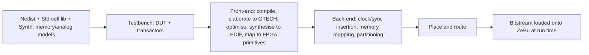

<!-- generated by yt-paper; edits will be overwritten -->
[DVCon](../dvcon/index.md) › [India](../dvcon/india.md) › [2023](../dvcon/by-year.md#2023) › [Emulation](../dvcon/by-topic.md#emulation)

# Netlist Enabled Emulation Platform for Accelerated Gate Level Verification

<figure class="rep-fig" markdown>
{ loading=lazy }
<figcaption>Figure 3. Netlist Database Generation Flow — from the original paper (Samhith Kumar Pottem et al.)</figcaption>
</figure>

[:material-open-in-new: Original paper](https://dvcon-proceedings.org/wp-content/uploads/1B1_DVCon_India_2023_Final_Paper_6285.pdf){ .md-button .md-button--primary target=_blank }

| | |
|---|---|
| Authors | Samhith Kumar Pottem, Vasudeva Reddy Ambati, Rahul S S, Sarang Kalbande, Garima Srivastava, Hyundon Kim (Samsung Semiconductor India Research (SSIR), Bangalore, India) |
| Venue | DVCon India 2023 |
| Topic | Emulation |
| Type | PAPER |
| ID | `ref-20261018-22ca` |

## Summary

**Proposes a flow to compile full billion-gate SoC netlists onto the Synopsys ZeBu emulator and validates SCANDUMP, SAIF power-estimation, and CPU boot scenarios that are impractical in Gate Level Simulation.**

**수십억 게이트급 SoC 넷리스트를 Synopsys ZeBu 에뮬레이터에 컴파일하는 흐름을 제안하고, Gate Level Simulation으로는 현실적이지 않은 SCANDUMP, SAIF 전력 추정, CPU 부팅 시나리오를 검증한다.**

## Key Insights

- Full SoC gate-level netlists (billions of gates) are compiled into an emulator database and mapped to hardware. Because SDF timing is not supported in emulation and delays are ignored, zero-delay or unit-delay netlists are used for all scenarios.

- 수십억 게이트급 SoC 전체 게이트 레벨 넷리스트를 에뮬레이터 데이터베이스로 컴파일해 하드웨어에 매핑한다. 에뮬레이션에서는 SDF 타이밍이 지원되지 않아 지연 정보가 무시되므로, 모든 시나리오는 zero-delay 또는 unit-delay 넷리스트로 검증한다.

- Table II reports GLS vs GLE for Scenario 3 (processor boot) as 12 h vs 0.25 h (about 48x by the paper's own numbers). GLS is marked 'UNREALISTIC' for Scenarios 1 and 2, where GLE takes 0.9 h (SCANDUMP) and 2.2 h (SAIF).

- Table II에서 Scenario 3(프로세서 부팅)은 GLS 12시간, GLE 0.25시간으로 보고되며, 논문 수치 기준 약 48배다. Scenario 1과 2는 GLS가 'UNREALISTIC'으로 표기되었고, GLE는 각각 0.9시간(SCANDUMP), 2.2시간(SAIF)이 걸렸다.

- Run-time optimization: D flip-flops are inserted on test signals in each SoC block and sampled by the fastest design clock. This splits timing paths and raises the driver clock frequency, which the paper cites as improving both compile time and performance.

- 런타임 최적화: 각 SoC 블록의 테스트 신호에 D flip-flop을 삽입하고 가장 빠른 설계 클록으로 샘플링한다. 이는 타이밍 경로를 분할해 driver clock 주파수를 높이며, 논문은 이것이 컴파일 시간과 성능을 함께 개선한다고 설명한다.

- Prerequisites are strict: missing standard-cell libraries cause front-end parsing to fail, and an RTL-to-Netlist (R2N) mapping report is needed to validate results and avoid signal polarity mismatches.

- 전제 조건이 엄격하다. 표준 셀 라이브러리가 없으면 front-end 파싱 단계에서 실패하며, 결과 검증과 signal polarity 불일치 방지를 위해 RTL-to-Netlist(R2N) 매핑 리포트가 필요하다.

- The abstract claims a 70-90X verification-time improvement, but the extracted text does not include the Table I or Fig. 6/7 data behind that figure. Reported absolute times on the Exynos flagship SoC are 54 min for SCANDUMP capture, 42 min for SAIF capture on a multimedia block, and 12 min for boot.

- 초록은 검증 시간 70-90배 개선을 주장하지만, 추출된 본문에는 이 수치의 근거인 Table I 및 Fig. 6/7 데이터가 없다. Exynos 플래그십 SoC의 절대 시간은 SCANDUMP 캡처 54분, 멀티미디어 블록 SAIF 캡처 42분, 부팅 12분으로 보고되었다.

## Detailed Summary

### Background and Problem

- RTL verification is fast and debug-friendly but omits delays and switching activity, which are needed for power estimation. Gate Level Simulation (GLS) captures post-synthesis behavior, but the paper reports that a single scenario can take weeks on SoC-scale netlists.

- RTL 검증은 빠르고 디버그가 쉽지만, 전력 추정에 필요한 지연 및 스위칭 액티비티 정보를 제공하지 못한다. Gate Level Simulation(GLS)은 합성 이후의 동작을 포착하지만, SoC 규모 넷리스트에서는 시나리오 하나에 수 주가 걸린다고 논문은 보고한다.

- Gate Level Emulation (GLE) runs the netlist on FPGA-based hardware at MHz-range driver clocks instead of Hz-range simulation speeds. The paper cites prior work by Intel (vector-mode GLE for MBIST/ATPG), which was limited to DFT features on SoCs of about 50M gates.

- Gate Level Emulation(GLE)은 넷리스트를 FPGA 기반 하드웨어에서 실행하며, 시뮬레이션의 Hz 대역 속도 대신 MHz 대역 driver clock으로 동작한다. 논문은 Intel의 선행 연구(MBIST/ATPG용 vector-mode GLE)를 인용하며, 이는 약 50M 게이트 규모 SoC에서 DFT 기능만 검증한 것이라고 설명한다.

- Goal: integrate the full SoC netlist into the ZeBu emulator, validate three application scenarios, and compare execution time against GLS.

- 목표: 전체 SoC 넷리스트를 ZeBu 에뮬레이터에 통합하고, 세 가지 응용 시나리오를 검증하며, 실행 시간을 GLS와 비교한다.

### Architecture and Methodology

Prerequisites: standard-cell libraries (required at front-end parsing), synthesizable gate-level memory models matched to the technology node, PHY I/O models that include scan logic, and an R2N mapping report.

사전 조건: 표준 셀 라이브러리(front-end 파싱 단계에서 필요), 공정 노드에 맞는 합성 가능한 게이트 레벨 메모리 모델, scan 로직을 포함한 PHY I/O 모델, R2N 매핑 리포트.

- Compile-time acceleration: multi-core and multi-thread compilation distributes the netlist workload in parallel.

- 컴파일 시간 가속: 멀티코어 및 멀티스레드 컴파일로 넷리스트 작업을 병렬 분산한다.

- Run-time acceleration: D flip-flops are inserted on test signals in each block and sampled by the fastest design clock. This splits long timing paths and raises the driver clock frequency.

- 런타임 가속: 각 블록의 테스트 신호에 D flip-flop을 삽입하고 가장 빠른 설계 클록으로 샘플링한다. 이를 통해 긴 타이밍 경로를 나누고 driver clock 주파수를 높인다.

- Scenario 1: SCANDUMP of one block or the whole SoC through the TOP_JTAG debug port, read by an external debugger. Blocks include Camera, CPU, and USB, each with its own DFT circuit. This is intended for diagnosing a hung SoC.

- 시나리오 1: TOP_JTAG 디버그 포트를 통해 단일 블록 또는 전체 SoC의 SCANDUMP를 외부 디버거로 읽는다. 대상 블록은 Camera, CPU, USB이며, 각각 독립적인 DFT 회로를 가진다. 멈춘(hung) SoC 진단이 목적이다.

- Scenario 2: SAIF-based power estimation, which captures per-signal toggle counts from switching activity.

- 시나리오 2: SAIF 기반 전력 추정. 신호별 토글 횟수를 수집한다.

- Scenario 3: processor boot check. Power-on reset is asserted, the CPU fetches from the reset vector, and the bootloader initializes registers, memory controllers, and caches.

- 시나리오 3: 프로세서 부팅 검증. Power-on reset을 인가한 뒤 CPU가 reset vector에서 명령을 가져오고, 부트로더가 레지스터, 메모리 컨트롤러, 캐시를 초기화한다.

- Limitation: full SDF timing is not supported in emulation, so delays are ignored and zero- or unit-delay netlists are used.

- 제약: 에뮬레이션에서는 SDF 전체 타이밍이 지원되지 않아 지연이 무시되며, zero-delay 또는 unit-delay 넷리스트를 사용한다.

### Results and Conclusions

Table II (GLS vs GLE):

Table II (GLS 대 GLE):

| Scenario | GLS (h) | GLE (h) |
|---|---|---|
| 1 (SCANDUMP) | UNREALISTIC | 0.9 |
| 2 (SAIF) | UNREALISTIC | 2.2 |
| 3 (Boot) | 12 | 0.25 |

| 시나리오 | GLS (h) | GLE (h) |
|---|---|---|
| 1 (SCANDUMP) | UNREALISTIC | 0.9 |
| 2 (SAIF) | UNREALISTIC | 2.2 |
| 3 (부팅) | 12 | 0.25 |

- Exynos flagship SoC: SCANDUMP capture in 54 min, accurate switching-activity capture for a multimedia block in 42 min, and processor boot in 12 min.

- Exynos 플래그십 SoC: SCANDUMP 캡처 54분, 멀티미디어 블록의 정확한 스위칭 액티비티 캡처 42분, 프로세서 부팅 12분.

- The abstract claims a 70-90X verification-time improvement. Only the Scenario 3 row is numeric in the extracted tables, which gives about 48X (12 h / 0.25 h). The Table I and Fig. 6/7 data (compile time and driver clock) are referenced but not present in the extracted text.

- 초록은 검증 시간 70-90배 개선을 주장한다. 추출된 표에서 수치로 확인되는 것은 Scenario 3 행뿐이며, 이는 약 48배(12 h / 0.25 h)이다. 컴파일 시간 및 driver clock에 대한 Table I과 Fig. 6/7 데이터는 본문에서 언급되지만 추출 텍스트에는 없다.

- The authors conclude that long-running gate-level scenarios can be validated in minutes to hours instead of days, which allows SoC issues to be found at pre-silicon.

- 저자들은 장시간 게이트 레벨 시나리오를 며칠이 아닌 분에서 시간 단위로 검증할 수 있으며, 이를 통해 pre-silicon 단계에서 SoC 이슈를 조기에 찾을 수 있다고 결론짓는다.

- Future work: prime-power glitch capture on the ZeBu empower platform and UPF (Unified Power Format) enablement for GLE.

- 향후 과제: ZeBu empower 플랫폼에서의 prime power glitch 캡처 및 GLE에 대한 UPF(Unified Power Format) 지원.

## Videos

<iframe src="https://www.youtube-nocookie.com/embed/oCvKZyb7hQ0" title="[DVCON2023_INDIA] Netlist Enabled Emulation Platform for Accelerated Gate Level Verification" loading="lazy" allow="accelerometer; clipboard-write; encrypted-media; gyroscope; picture-in-picture; web-share" referrerpolicy="strict-origin-when-cross-origin" allowfullscreen></iframe>

**[DVCON2023_INDIA] Netlist Enabled Emulation Platform for Accelerated Gate Level Verification** — [Watch on YouTube](https://www.youtube.com/watch?v=oCvKZyb7hQ0) · [Video page](../videos/oCvKZyb7hQ0.md)
