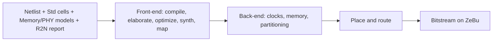

<!-- generated by yt-paper; edits will be overwritten -->
[DVCon](../dvcon/index.md) › [India](../dvcon/india.md) › [2023](../dvcon/by-year.md#2023) › [Emulation](../dvcon/by-topic.md#emulation)

# Netlist Enabled Emulation Platform for Accelerated Gate Level Verification

<figure class="rep-fig" markdown>
{ loading=lazy }
<figcaption>Figure 3. Netlist Database Generation Flow — from the original paper (Samhith Kumar Pottem et al.)</figcaption>
</figure>

[:material-open-in-new: Original paper](https://dvcon-proceedings.org/wp-content/uploads/1B1_DVCon_India_2023_Final_Paper_6285.pdf){ .md-button .md-button--primary target=_blank }

| | |
|---|---|
| Authors | Samhith Kumar Pottem, Vasudeva Reddy Ambati, Rahul S S, Sarang Kalbande, Garima Srivastava, Hyundon Kim (Samsung Semiconductor India Research (SSIR), Bangalore) |
| Venue | DVCon India 2023 |
| Topic | Emulation |
| Type | PAPER |
| ID | `ref-20261018-22ca` |

## Summary

**The paper presents a flow for compiling full post-synthesis SoC netlists onto the Synopsys ZeBu emulator and runs long gate-level scenarios (SCANDUMP, SAIF power, CPU boot) that are impractical in GLS, reporting a reported 70-90X verification-time improvement.**

**이 논문은 합성 이후(post-synthesis) 전체 SoC 넷리스트를 Synopsys ZeBu 에뮬레이터에 컴파일하는 흐름을 제시하고, GLS로는 현실적으로 어려운 장시간 게이트 레벨 시나리오(SCANDUMP, SAIF 전력 분석, CPU 부팅)를 실행하여 보고된 기준 70-90배의 검증 시간 단축을 보여준다.**

## Key Insights

- Full SoC netlists (billions of gates) can be compiled into a DUT database and run on ZeBu with standard-cell libraries, synthesizable memory/PHY models, and an R2N mapping report as mandatory inputs; missing libraries fail at front-end parsing.

- 전체 SoC 넷리스트(수십억 게이트)를 표준 셀 라이브러리, 합성 가능한 메모리/PHY 모델, R2N 매핑 리포트와 함께 DUT 데이터베이스로 컴파일해 ZeBu에서 실행할 수 있으며, 라이브러리가 누락되면 front-end 파싱 단계에서 실패한다.

- Gate-level compile is slower than RTL due to larger netlists; the paper's mitigation is multi-core/multi-thread compilation, but no numeric compile-time figures are given in the text (Table I is referenced but not extracted).

- 게이트 레벨 컴파일은 넷리스트 규모가 커서 RTL보다 오래 걸리며, 논문은 multi-core/multi-thread 컴파일로 이를 완화한다고 하지만 본문에는 수치화된 컴파일 시간이 없다(Table I은 언급만 되고 추출되지 않음).

- Scan-cell insertion degrades driver clock frequency; the paper adds D flip-flops on test signals sampled by the fastest clock to split timing paths and recover frequency.

- 스캔 셀 삽입은 driver clock 주파수를 떨어뜨리며, 논문은 테스트 신호에 D 플립플롭을 추가해 가장 빠른 클럭으로 샘플링함으로써 타이밍 경로를 분할하고 주파수를 회복한다고 제시한다.

- Measured on an Exynos flagship SoC: SCANDUMP capture 54 min, SAIF switching capture 42 min for a multimedia block, CPU boot 12 min; the boot scenario takes 12 h in GLS vs 0.25 h in GLE (~48x).

- Exynos 플래그십 SoC 기준 SCANDUMP 캡처 54분, 멀티미디어 블록 SAIF 스위칭 캡처 42분, CPU 부팅 12분이며, 부팅 시나리오는 GLS 12시간 대비 GLE 0.25시간(약 48배)이다.

- Limitations: SDF timing is not supported, so only zero- or unit-delay netlists are used; UPF-based power validation and glitch-accurate power capture are listed as future work.

- 한계: SDF 타이밍을 지원하지 않아 zero- 또는 unit-delay 넷리스트만 사용하며, UPF 기반 전력 검증과 glitch 기반 정밀 전력 캡처는 향후 과제로 제시된다.

## Detailed Summary

### Background and Problem

- RTL simulation is fast and debuggable but misses delays and switching activity needed for power estimation; GLS captures these but a single scenario can take weeks.

- RTL 시뮬레이션은 빠르고 디버깅이 쉽지만 전력 추정에 필요한 지연과 스위칭 활동을 놓치며, GLS는 이를 포착하나 시나리오 하나에 수 주가 걸릴 수 있다.

- Goal: integrate a full post-synthesis SoC netlist (billions of gates) on the ZeBu emulator so long gate-level scenarios run in minutes to hours.

- 목표: 합성 이후(post-synthesis) 전체 SoC 넷리스트(수십억 게이트)를 ZeBu 에뮬레이터에 올려, 장시간 게이트 레벨 시나리오를 분~시간 단위로 실행하는 것이다.

### Architecture and Methodology

- Inputs: netlist, standard-cell libraries, synthesizable memory and PHY I/O models, and an RTL-to-netlist (R2N) mapping report.

- 입력: 넷리스트, 표준 셀 라이브러리, 합성 가능한 메모리 및 PHY I/O 모델, RTL-to-netlist(R2N) 매핑 리포트.

- Flow: front-end (elaborate, optimize, synthesize, map to FPGA primitives) → back-end (clock and memory insertion, partitioning) → place and route → bitstream loaded at run time.

- 흐름: front-end(elaborate, optimize, synthesize, FPGA primitive 매핑) → back-end(클럭 및 메모리 삽입, partitioning) → place and route → 런타임에 bitstream 로드.

- Compile speed-up via multi-core/multi-thread compilation; run-time clock recovery by adding flip-flops on scan-related test signals to split timing paths.

- 컴파일 가속은 multi-core/multi-thread 컴파일로 수행하며, 런타임 클럭 주파수는 테스트 신호에 플립플롭을 추가해 타이밍 경로를 분할하는 방식으로 회복한다.

- Scenarios: SCANDUMP over the JTAG debug port, SAIF switching capture for power, and CPU boot after power-on reset. Only zero- or unit-delay netlists are used (no SDF).

- 시나리오: JTAG 디버그 포트를 통한 SCANDUMP, 전력 분석을 위한 SAIF 스위칭 캡처, 파워온 리셋 후 CPU 부팅. zero- 또는 unit-delay 넷리스트만 사용하며 SDF는 사용하지 않는다.

### Results and Conclusions

- Exynos flagship SoC: SCANDUMP in 54 min, SAIF capture for a multimedia block in 42 min, CPU boot in 12 min.

- Exynos 플래그십 SoC: SCANDUMP 54분, 멀티미디어 블록 SAIF 캡처 42분, CPU 부팅 12분.

- Table II: boot scenario 12 h (GLS) vs 0.25 h (GLE), about 48x; scenarios 1 and 2 are "unrealistic" in GLS (GLE 0.9 h and 2.2 h).

- Table II: 부팅 시나리오는 GLS 12시간 대비 GLE 0.25시간으로 약 48배이며, 시나리오 1과 2는 GLS에서 "unrealistic"으로 표기되고 GLE에서는 각각 0.9시간, 2.2시간이다.

- The abstract claims a 70-90X improvement; the Table I compile and clock numbers are not present in the extracted text.

- 초록은 70-90배 향상을 주장하지만, 추출된 본문에는 Table I의 컴파일 및 클럭 수치가 없다.

- Open items: SDF timing, UPF power enablement, and glitch-accurate power capture.

- 향후 과제: SDF 타이밍, UPF 전력 검증 지원, glitch 기반 정밀 전력 캡처.

## Videos

<iframe src="https://www.youtube-nocookie.com/embed/oCvKZyb7hQ0" title="[DVCON2023_INDIA] Netlist Enabled Emulation Platform for Accelerated Gate Level Verification" loading="lazy" allow="accelerometer; clipboard-write; encrypted-media; gyroscope; picture-in-picture; web-share" referrerpolicy="strict-origin-when-cross-origin" allowfullscreen></iframe>

**[DVCON2023_INDIA] Netlist Enabled Emulation Platform for Accelerated Gate Level Verification** — [Watch on YouTube](https://www.youtube.com/watch?v=oCvKZyb7hQ0) · [Video page](../videos/oCvKZyb7hQ0.md)
