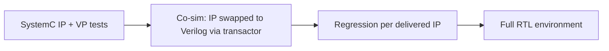

<!-- generated by yt-paper; edits will be overwritten -->
[DVCon](../dvcon/index.md) › [US](../dvcon/us.md) › [2023](../dvcon/by-year.md#2023) › [Verification](../dvcon/by-topic.md#verification)

# A Study on Virtual Prototyping based Design Verification Methodology

<figure class="rep-fig" markdown>
{ loading=lazy }
<figcaption>Figure 2. The Proposed Verification Methodology. — from the original paper (Woojoo Kim et al.)</figcaption>
</figure>

[:material-open-in-new: Original paper](https://dvcon-proceedings.org/wp-content/uploads/1040-A-Study-on-Virtual-Prototyping-based-Design-Verification-Methodology.pdf){ .md-button .md-button--primary target=_blank } [:material-presentation-play: Official talk](https://youtu.be/EgBDkUrBeOY){ .md-button target=_blank }

| | |
|---|---|
| Authors | Woojoo Kim (Samsung Electronics), Kunhyuk Kang (Samsung Electronics), Seonil Brian Choi (Samsung Electronics) |
| Venue | DVCon US 2023 |
| Topic | Verification |
| Type | PAPER |
| ID | `ref-20261018-2416` |

## Summary

**Proposes a flow that starts with SystemC/TLM virtual-prototype IP models and replaces them with Verilog IPs one at a time via a SystemC-RTL transactor, reusing the same test cases for regression and reporting a 20-21% shorter verification period on a mobile AP SoC.**

**SystemC/TLM 가상 프로토타입 IP 모델로 시작해 SystemC-RTL transactor를 통해 Verilog IP로 하나씩 교체하면서 동일한 테스트 케이스를 회귀 테스트에 재사용하는 흐름을 제안하며, 모바일 AP SoC에서 검증 기간이 20~21% 단축되었다고 보고한다.**

## Key Insights

- Swapping SystemC IP models for Verilog one at a time with the same test cases lets regression start as each IP is delivered, and a failure localizes to the most recently replaced IP.

- IP를 한 번에 하나씩 SystemC 모델에서 Verilog로 교체하고 동일한 테스트 케이스를 쓰면, 각 IP가 전달될 때마다 회귀 테스트를 시작할 수 있으며 실패는 가장 최근에 교체된 IP로 국한된다.

- SystemC-only simulation averaged 5.22x faster than RTL-only, but SystemC-RTL co-simulation averaged only 1.16x faster (Bus 1.16x, Memory Controller 1.15x), so the main gain comes from early regression rather than raw speed.

- SystemC 단독 시뮬레이션은 RTL 단독 대비 평균 5.22배 빨랐지만, SystemC-RTL co-simulation은 평균 1.16배(Bus 1.16배, Memory Controller 1.15배)에 그쳐 주된 이득은 순수 속도보다 조기 회귀 테스트에서 나온다.

- Verification period dropped from 8.1 to 6.4 months (21.0%) for the bus block and from 8 to 6.35 months (20.6%) for the memory controller; the abstract rounds this to 20%.

- 검증 기간은 bus 블록에서 8.1개월에서 6.4개월(21.0%), memory controller에서 8개월에서 6.35개월(20.6%)로 줄었으며, 초록에서는 이를 20%로 반올림해 제시한다.

- The SystemC models were built to match RTL behavior and structure, not just LT/AT approximations, which the authors say is required for test-case reuse; this requires cross-team coordination.

- SystemC 모델은 LT/AT 근사만이 아니라 RTL의 동작과 구조에 맞춰 개발되었으며, 저자들은 이것이 테스트 케이스 재사용에 필요하다고 설명하고 이는 팀 간 긴밀한 협업을 요구한다.

- Benefits assume SystemC models already exist from VP work for SW development; the paper does not report planning or test-case development time savings and excludes silicon validation from its measurements.

- 이 이점은 SW 개발용 VP에서 이미 SystemC 모델이 존재한다는 전제에 기반하며, 논문은 계획 및 테스트 케이스 개발 시간 절감을 보고하지 않고 실리콘 검증 기간은 측정에서 제외했다.

## Detailed Summary

### Background and Problem

- SoC complexity keeps rising while design schedules shrink; RTL regression typically starts late, delaying bug discovery.

- SoC 복잡도는 증가하는 반면 설계 일정은 줄어들며, RTL 회귀 테스트는 보통 늦게 시작되어 버그 발견이 지연된다.

- VP SystemC models already exist for early SW development and performance estimation, but they are usually not functionally or structurally identical to RTL, so VP test cases cannot be fully verified against RTL.

- SW 개발 및 성능 추정용 VP SystemC 모델은 이미 존재하지만 기능과 구조가 RTL과 동일하지 않은 경우가 많아, VP 테스트 케이스를 RTL 기준으로 완전히 검증하기 어렵다.

- Standard SystemC-Verilog co-simulation often needs custom DPI calls or wrappers, because RTL simulators commonly lack slave mode.

- 일반적인 SystemC-Verilog co-simulation은 RTL 시뮬레이터가 slave 모드를 지원하지 않는 경우가 많아 custom DPI 호출이나 wrapper가 필요하다.

### Architecture and Methodology

- SystemC IP models are built during architecture exploration with behavior and structure matched to RTL, and wrapped with an SFR wrapper generated from the SFR datasheet.

- SystemC IP 모델은 architecture exploration 단계에서 동작과 구조를 RTL에 맞춰 개발하며, SFR 데이터시트에서 생성한 SFR wrapper로 감싼다.

- As RTL matures, IPs are swapped one at a time from SystemC to Verilog, running the same SW or SFR-sequence test cases; the final state equals the existing RTL environment.

- RTL이 성숙함에 따라 IP를 한 번에 하나씩 SystemC에서 Verilog로 교체하고, 동일한 SW 또는 SFR 시퀀스 테스트 케이스를 실행하며, 최종 상태는 기존 RTL 검증 환경과 같아진다.

- A FSM-based transactor (SystemC/C++, READY/VALID handshake) maps TLM packets to and from AXI channel signals; a Register Information Signal Driver handles SFR access.

- FSM 기반 transactor(SystemC/C++, READY/VALID handshake)가 TLM 패킷과 AXI 채널 신호 간 변환을 수행하며, Register Information Signal Driver가 SFR 접근을 담당한다.

- Applied to a 100M G/C mobile flagship AP SoC: bus block (12 IP models) and memory controller (7 IP models).

- 100M G/C 모바일 플래그십 AP SoC에 적용했으며, bus 블록(IP 모델 12개)과 memory controller(IP 모델 7개)를 대상으로 했다.

### Results and Conclusions

- Simulation speed (Table 1): SystemC-only averaged 5.22x faster than RTL-only (Bus 6.69x, Memory 3.75x); co-sim averaged 1.16x faster (1.16x and 1.15x).

- 시뮬레이션 속도(Table 1): SystemC 단독은 RTL 단독 대비 평균 5.22배 빨랐고(Bus 6.69배, Memory 3.75배), co-sim은 평균 1.16배 빨랐다(1.16배, 1.15배).

- Verification period (Table 2): Bus 8.1 to 6.4 months (21.0%); Memory Controller 8 to 6.35 months (20.6%); regression started about a month earlier.

- 검증 기간(Table 2): Bus 8.1개월에서 6.4개월(21.0%), Memory Controller 8개월에서 6.35개월(20.6%)로 단축되었고, 회귀 테스트는 약 한 달 일찍 시작되었다.

- Limitations: a single industrial case; planning and test-case development time savings were not realized in the measured period; SystemC modeling overhead is required unless VP models already exist; silicon validation is excluded.

- 한계: 단일 산업 사례이며, 측정 기간 동안 계획 및 테스트 케이스 개발 시간 절감은 나타나지 않았고, VP 모델이 이미 없는 경우 SystemC 모델링 오버헤드가 필요하며, 실리콘 검증 기간은 제외되었다.

## Videos

<iframe src="https://www.youtube-nocookie.com/embed/RgAPcMcohTs" title="[DVCON2023]A Study on Virtual Prototyping based Design Verification Methodology" loading="lazy" allow="accelerometer; clipboard-write; encrypted-media; gyroscope; picture-in-picture; web-share" referrerpolicy="strict-origin-when-cross-origin" allowfullscreen></iframe>

**[DVCON2023]A Study on Virtual Prototyping based Design Verification Methodology** — [Watch on YouTube](https://www.youtube.com/watch?v=RgAPcMcohTs) · [Video page](../videos/RgAPcMcohTs.md)

**Official presentation:** [DVCon U.S. 2023](https://youtu.be/EgBDkUrBeOY){ target=_blank }
