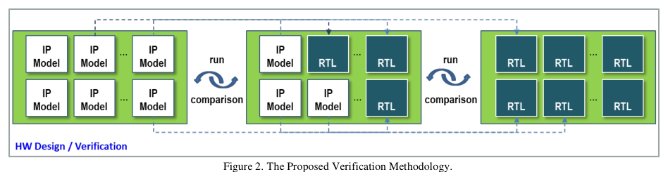
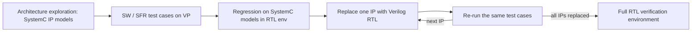

<!-- generated by yt-paper; edits will be overwritten -->
[DVCon](../dvcon/index.md) › [US](../dvcon/us.md) › [2023](../dvcon/by-year.md#2023) › [Verification](../dvcon/by-topic.md#verification)

# A Study on Virtual Prototyping based Design Verification Methodology

<figure class="rep-fig" markdown>
{ loading=lazy }
<figcaption>Figure 2. The Proposed Verification Methodology. — from the original paper (Woojoo Kim et al.)</figcaption>
</figure>

[:material-open-in-new: Original paper](https://dvcon-proceedings.org/wp-content/uploads/1040-A-Study-on-Virtual-Prototyping-based-Design-Verification-Methodology.pdf){ .md-button .md-button--primary target=_blank }

| | |
|---|---|
| Authors | Woojoo Kim (Samsung Electronics), Kunhyuk Kang (Samsung Electronics), Seonil Brian Choi (Samsung Electronics). Affiliation: Design Technology Team, Infrastructure Design Center, S.LSI Division, Samsung Electronics, Hwaseong-si, Korea. Venue not stated in the provided text. |
| Venue | DVCon US 2023 |
| Topic | Verification |
| Type | PAPER |
| ID | `ref-20261018-2416` |

## Summary

**Proposes a verification flow that reuses SystemC virtual-prototype IP models and SW/SFR test cases from architecture exploration in RTL regression, progressively replacing SystemC IPs with Verilog via SystemC-RTL co-simulation transactors, and reports a ~21% verification-period reduction on a mobile AP SOC.**

**SystemC 가상 프로토타입(VP) IP 모델과 SW/SFR 테스트 케이스를 SystemC-RTL 공동 시뮬레이션 트랜스액터를 통해 RTL 회귀 검증에 재사용하고, SystemC IP를 Verilog로 단계적으로 교체하는 검증 흐름을 제안하며, 모바일 AP SOC에서 검증 기간 약 21% 단축을 보고한다.**

## Key Insights

- Progressive SystemC-to-Verilog IP replacement, run with the same test cases, lets regression start as each IP arrives; the paper reports regression starting about one month earlier and failures localized to the most recently replaced IP.

- SystemC에서 Verilog로의 IP 단계적 교체를 동일한 테스트 케이스로 수행하면 IP가 도착할 때마다 회귀 검증을 시작할 수 있으며, 논문은 회귀 검증이 약 1개월 빨리 시작되고 실패 원인이 방금 교체된 IP로 좁혀진다고 보고한다.

- SystemC-only simulation averaged 5.22x faster than RTL-only simulation, but co-simulation averaged only 1.16x faster (bus 12 IPs: 0.84 vs 0.72 MHz; memory controller 7 IPs: 1.53 vs 1.33 MHz), so co-sim gains are modest.

- SystemC 단독 시뮬레이션은 RTL 단독 대비 평균 5.22배 빨랐지만, 공동 시뮬레이션은 평균 1.16배에 그쳤다(Bus 12 IP: 0.84 vs 0.72 MHz, Memory Controller 7 IP: 1.53 vs 1.33 MHz). 따라서 공동 시뮬레이션의 속도 이득은 제한적이다.

- Verification period dropped from 8.1 to 6.4 months (21.0%) for the bus block (12 IPs) and from 8 to 6.35 months (20.6%) for the memory controller (7 IPs); the abstract rounds this to 20%.

- 검증 기간은 Bus 블록(12 IP)에서 8.1개월에서 6.4개월로 21.0%, Memory Controller 블록(7 IP)에서 8개월에서 6.35개월로 20.6% 단축되었다. 초록은 이를 20%로 반올림해 표기한다.

- Benefit depends on model fidelity: SystemC models were built to match RTL behavior, structure, hierarchy and interfaces, with an SFR wrapper generator that parses the SFR data sheet to reduce wrapper effort.

- 효과는 모델 충실도에 의존한다. SystemC 모델은 RTL의 동작, 구조, 계층, 인터페이스와 일치하도록 만들었고, SFR 데이터시트를 파싱하는 생성기로 SFR 래퍼 작업을 줄였다.

- The main cost is SystemC modeling effort, which the authors say is largely absorbed when VP models already exist for early SW development; planning and test-case development time savings did not appear over the whole verification period.

- 주된 비용은 SystemC 모델링 공수이며, 저자들은 SW 개발용 VP 모델이 이미 있는 경우 이 비용이 상당 부분 흡수된다고 설명한다. 다만 전체 검증 기간 동안 검증 계획 및 테스트 케이스 개발 시간의 절감은 나타나지 않았다.

## Detailed Summary

### Background and Problem

- SoC complexity keeps rising while design schedules shrink. Virtual Prototyping (VP) built from SystemC models is already used early for SW development, architecture exploration, and performance/power estimation.

- SoC 복잡도는 계속 증가하는 반면 설계 일정은 줄어들고 있다. SystemC 기반 Virtual Prototyping(VP)은 SW 개발, 아키텍처 탐색, 성능/전력 추정을 위해 이미 조기에 사용되고 있다.

- Model abstraction trades accuracy for speed. The paper cites CA/AT models at about 90% timing accuracy running at KHz to MHz, and LT/FA models at 70-80% timing accuracy (or untimed) running at MHz to hundreds of MHz.

- 모델 추상화 수준은 정확도와 속도를 맞바꾼다. 논문은 약 90% 타이밍 정확도에 KHz~MHz로 동작하는 CA/AT 모델과, 70~80% 타이밍 정확도(또는 타이밍 없음)에 MHz~수백 MHz로 동작하는 LT/FA 모델을 언급한다.

- SystemC models built for SW development usually differ functionally and structurally from RTL, so test cases run on VP do not fully cover RTL behavior. RTL verification therefore starts late and test planning is repeated at each stage.

- SW 개발용으로 만든 SystemC 모델은 기능과 구조가 RTL과 다른 경우가 많아, VP에서 실행한 테스트 케이스가 RTL 동작을 충분히 커버하지 못한다. 그 결과 RTL 검증은 늦게 시작되고 단계마다 테스트 계획이 반복된다.

- Co-simulation of SystemC and Verilog is awkward because most simulators support only one of master or slave mode. Workarounds are custom DPI calls, custom wrappers, or older simulator versions.

- SystemC와 Verilog의 공동 시뮬레이션은 대부분의 시뮬레이터가 master 또는 slave 모드 중 하나만 지원하기 때문에 까다롭다. 우회 방법으로는 커스텀 DPI 호출, 커스텀 래퍼, 구버전 시뮬레이터 사용이 있다.

- The approach aligns with the intent of the Portable Stimulus Standard (PSS): describe test intent once and reuse it across abstraction levels.

- 이 접근은 Portable Stimulus Standard(PSS)의 취지, 즉 테스트 의도를 한 번 기술하고 여러 추상화 수준에서 재사용한다는 방향과 일치한다.

### Architecture and Methodology

Flow (as described in Figure 2):

흐름 (Figure 2 기준):

- **Test reuse:** Test cases (SystemVerilog, C/C++, SystemC) run on the SoC-level simple OS either as SFR sequences or as driver-level functions. Verification items are managed from the IP design stage and version-controlled with the RTL models.

- **테스트 재사용:** 테스트 케이스(SystemVerilog, C/C++, SystemC)는 SoC 수준의 간이 OS 위에서 SFR 시퀀스 또는 드라이버 수준 함수로 실행된다. 검증 항목은 IP 설계 단계부터 관리되고 RTL 모델과 함께 버전 관리된다.

- **Model fidelity:** Behavior is modeled first, then wrapped by an SFR wrapper. A generator parses the SFR data sheet to produce these wrappers. A Register Information Signal Driver handles SFR communication with Verilog modules. Interfaces correct hierarchy and protocol differences. These interfaces are merged into each transactor in the actual implementation.

- **모델 충실도:** 동작을 먼저 모델링한 뒤 SFR 래퍼로 감싼다. 생성기가 SFR 데이터시트를 파싱해 래퍼를 만든다. Register Information Signal Driver가 Verilog 모듈과의 SFR 통신을 담당하며, 인터페이스는 계층 및 프로토콜 차이를 보정한다. 실제 구현에서 이 인터페이스는 각 트랜스액터에 포함된다.

- **Transactor:** The TLM-to-signal converter (Figure 4) is an FSM written in SystemC/C++. It splits TLM packets into AXI channels and signals, drives them with READY/VALID handshaking, and converts them back to TLM in the reverse direction. The paper states that data transfer takes 0 cycles.

- **트랜스액터:** TLM-신호 변환기(Figure 4)는 SystemC/C++로 작성된 FSM이다. TLM 데이터를 AXI 채널과 신호로 분해하여 READY/VALID 핸드셰이크로 구동하고, 반대 방향에서는 다시 TLM으로 변환한다. 논문은 데이터 전송이 0 사이클에 이루어진다고 밝힌다.

- **Model accuracy:** Performance-estimation models (cycle-accurate) and SW-oriented LT TLM models were both used, and transactors were developed for each. Figure 3 contrasts signal-level and TLM read/write formats for AMBA AXI.

- **모델 정확도:** 성능 추정용(cycle-accurate) 모델과 SW용 LT TLM 모델을 모두 사용했으며, 각각에 대해 트랜스액터를 개발했다. Figure 3은 AMBA AXI의 신호 수준과 TLM 읽기/쓰기 포맷을 비교한다.

- **Target:** The flow was applied to a 100M G/C mobile flagship AP SoC, covering the bus block (12 SystemC IP models) and the memory controller block (7 SystemC IP models).

- **적용 대상:** 100M G/C급 모바일 플래그십 AP SoC에 적용했으며, 버스 블록(SystemC IP 모델 12개)과 메모리 컨트롤러 블록(SystemC IP 모델 7개)을 대상으로 했다.

- **Diagnosis:** Because each IP is swapped in individually, the regression pass or fail points to the newly replaced IP.

- **원인 분석:** IP를 하나씩 교체하므로 회귀 검증의 pass/fail은 새로 교체된 IP를 가리킨다.

### Results and Conclusions

Simulation speed (Table 1, MHz):

시뮬레이션 속도 (Table 1, MHz):

| Block | # IP | SystemC | Co-sim | RTL | SystemC vs RTL | Co-sim vs RTL |
|---|---|---|---|---|---|---|
| Bus | 12 | 4.82 | 0.84 | 0.72 | x6.69 | x1.16 |
| Memory Controller | 7 | 4.99 | 1.53 | 1.33 | x3.75 | x1.15 |
| Average | | | | | x5.22 | x1.16 |

| 블록 | IP 수 | SystemC | 공동 시뮬레이션 | RTL | SystemC 대비 RTL | 공동 시뮬레이션 대비 RTL |
|---|---|---|---|---|---|---|
| Bus | 12 | 4.82 | 0.84 | 0.72 | x6.69 | x1.16 |
| Memory Controller | 7 | 4.99 | 1.53 | 1.33 | x3.75 | x1.15 |
| 평균 | | | | | x5.22 | x1.16 |

Verification period (Table 2, months, same test-case count):

검증 기간 (Table 2, 개월, 동일 테스트 케이스 수):

- Bus (12 IPs): 8.1 existing vs 6.4 proposed, 21.0% reduction.

- Bus (IP 12개): 기존 8.1 → 제안 6.4, 21.0% 단축.

- Memory controller (7 IPs): 8 existing vs 6.35 proposed, 20.6% reduction.

- Memory Controller (IP 7개): 기존 8 → 제안 6.35, 20.6% 단축.

- The period runs from IP/block verification start to SoC verification completion and excludes silicon validation.

- 기간은 IP/블록 검증 시작부터 SoC 검증 완료까지이며, 실리콘 검증 기간은 제외된다.

Conclusions and caveats reported by the authors:

저자들이 보고한 결론 및 한계:

- Regression started more than a month earlier, allowing earlier bug finding and fewer debug activities in the SOC phase. The authors attribute the earlier verification completion to this.

- 회귀 검증이 1개월 이상 빨리 시작되어 더 이른 단계에서 버그를 발견할 수 있었고, SoC 단계의 디버그 활동이 줄었다. 저자들은 검증 완료 시점이 앞당겨진 이유로 이를 든다.

- Verification planning and test-case development time did not show a measurable reduction across the full period. The authors expect human-resource savings but do not quantify them.

- 검증 계획 및 테스트 케이스 개발 시간은 전체 기간에 걸쳐 측정 가능한 감소가 나타나지 않았다. 인력 절감은 기대되지만 정량화되지는 않았다.

- Co-simulation speed depends on the number and volume of RTL models included. The authors averaged measurements over configurations that included RTL models.

- 공동 시뮬레이션 속도는 포함된 RTL 모델의 수와 규모에 따라 달라진다. 저자들은 RTL 모델이 포함된 구성에서 측정값을 평균했다.

- The authors note that the method was applied first to functional verification. Specification verification and performance/power estimation are presented as future extensions.

- 방법은 기능 검증에 먼저 적용되었다. 스펙 검증과 성능/전력 추정은 향후 확장 대상으로 제시된다.

- The abstract reports a 20% reduction, while the body and conclusion report 21%. The paper gives no coverage metrics to confirm equal verification quality.

- 초록은 20% 감소를, 본문과 결론은 21%를 보고한다. 동등한 검증 품질을 확인할 커버리지 지표는 제시되지 않았다.

## Videos

<iframe src="https://www.youtube-nocookie.com/embed/RgAPcMcohTs" title="[DVCON2023]A Study on Virtual Prototyping based Design Verification Methodology" loading="lazy" allow="accelerometer; clipboard-write; encrypted-media; gyroscope; picture-in-picture; web-share" referrerpolicy="strict-origin-when-cross-origin" allowfullscreen></iframe>

**[DVCON2023]A Study on Virtual Prototyping based Design Verification Methodology** — [Watch on YouTube](https://www.youtube.com/watch?v=RgAPcMcohTs) · [Video page](../videos/RgAPcMcohTs.md)
