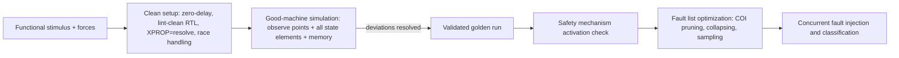

<!-- generated by yt-paper; edits will be overwritten -->
[DVCon](../dvcon/index.md) › [US](../dvcon/us.md) › [2024](../dvcon/by-year.md#2024) › [Verification](../dvcon/by-topic.md#verification)

# Are My Fault Campaigns Providing Accurate Results for ISO 26262 Certification?

<figure class="rep-fig" markdown>
{ loading=lazy }
<figcaption>Figure 5. Fault campaign methodology Active Safety Mechanism — from the original paper (Hyunsun Ahn et al.)</figcaption>
</figure>

[:material-open-in-new: Original paper](https://dvcon-proceedings.org/wp-content/uploads/1068.pdf){ .md-button .md-button--primary target=_blank }

| | |
|---|---|
| Authors | Hyunsun Ahn (Samsung Electronics Co., Ltd., Korea), James Kim (Siemens EDA, Korea), Arun Gogineni (Siemens EDA, USA), Ann Keffer (Siemens EDA, USA), MyungKyoon Yim (Samsung Electronics Co., Ltd., Korea), Soobon Kim (Samsung Electronics Co., Ltd., Korea), Youngsik Kim (Samsung Electronics Co., Ltd., Korea), Seonil Brian Choi (Samsung Electronics Co., Ltd., Korea) |
| Venue | DVCon US 2024 |
| Topic | Verification |
| Type | PAPER |
| ID | `ref-20261018-2473` |

## Summary

**Samsung and Siemens EDA present a fault-campaign quality methodology (good-quality stimulus with XPROP=resolve, force/delay/race handling, all-state good-machine checking, and fault list optimization) that reduced good-machine deviations on a Samsung design from about 15% to 4.63% to support accurate ISO 26262 fault campaign results.**

**Samsung과 Siemens EDA는 fault campaign 품질 방법론(XPROP=resolve 기반 양질의 stimulus, force/delay/race 처리, 전 state element 대상 good-machine 검사, fault list 최적화)을 제시하며, 이를 적용해 Samsung 설계에서 good-machine deviation을 약 15%에서 4.63%로 줄여 ISO 26262 fault campaign 결과의 정확성을 높였다고 보고한다.**

## Key Insights

- Stimulus quality dominates good-machine accuracy: regenerating stimulus with XPROP=resolve cut state-element deviations from about 15% (XPROP=noXprop) to 4.63%; the remaining 37,546 deviations were mainly reset-to-clock races (27,205) and RTL # delays (7,722).

- Stimulus 품질이 good-machine 정확도를 좌우한다: XPROP=resolve로 stimulus를 재생성하자 state element deviation이 약 15%(XPROP=noXprop)에서 4.63%로 감소했으며, 남은 37,546건 중 대부분은 reset-to-clock race(27,205건)와 RTL # delay(7,722건)였다.

- Checking only observe points can hide dormant state-element deviations; good-machine simulation should compare all flip-flops, latches, and memory contents against the stimulus at all times.

- Observe point만 검사하면 dormant state-element deviation을 놓칠 수 있으므로, good-machine simulation에서는 모든 flip-flop, latch, 메모리 내용을 stimulus 대비 매 시점 비교해야 한다.

- Forces must propagate across all hierarchy levels and the complete testbench force list must be passed to the fault engine; force-list and force-behavior issues caused 600+170 deviations in the Samsung case.

- Force는 모든 계층에 걸쳐 전파되어야 하며, 테스트벤치의 전체 force list를 fault engine에 전달해야 한다. Samsung 사례에서 force list 및 force 동작 문제로 600+170건의 deviation이 발생했다.

- Fault space reduction combines safety-mechanism-aware COI pruning, fault collapsing, and statistical random sampling; 4,598 sampled faults yielded 65.87% Alarm Detected, 9.86% Residual, 14.98% No Deviation, and 9.38% Not Injected.

- Fault 공간 축소는 safety mechanism 인지형 COI pruning, fault collapsing, 통계적 랜덤 샘플링을 결합한다. 4,598개 샘플 fault 결과 Alarm Detected 65.87%, Residual 9.86%, No Deviation 14.98%, Not Injected 9.38%였다.

- Safety mechanisms must be activated before injection (error-inject capability, verified alarm trigger, then clearing the injection); otherwise, the paper notes, all faults are marked undetected.

- Fault injection 전에 safety mechanism을 활성화해야 한다(error-inject 기능, alarm trigger 검증, injection 및 alarm 해제 순). 그렇지 않으면 모든 fault가 undetected로 표시된다고 논문은 지적한다.

## Detailed Summary

# Are My Fault Campaigns Providing Accurate Results for ISO 26262 Certification?

### Background and Problem

- Fault simulation에는 최소한 기준이 되는 good machine과 faulty machine 두 가지 시뮬레이션이 필요하다. 검출되지 않은 good-machine deviation(dormant deviation)이 있으면 ISO 26262 인증에 쓰이는 fault campaign 결과를 신뢰하기 어렵다.

- Fault simulation needs at least a good (reference) machine and a faulty machine. Good-machine deviations that are not caught (dormant deviations) make fault-campaign results unreliable for ISO 26262 certification.

- 저자들의 이전 논문(DVCon US 2023)은 일반적인 fault campaign 흐름을 다뤘으나, campaign의 정확성을 계획하고 검증하는 방법은 다루지 않았다. 이 논문은 campaign이 정확한가, 실제 사용 시나리오를 반영하는가, RTL stimulus 결과가 gate-level 결과와 일치하는가, 가속 기법은 무엇인가, good-machine simulation이 언제 필요한가라는 다섯 가지 질문에 답하고자 한다.

- The authors' earlier DVCon US 2023 paper covered a general fault-campaign flow but not how to plan and verify campaign accuracy. This paper targets five open questions: whether campaigns are accurate, whether they represent real use cases, whether RTL stimulus matches gate-level results, which acceleration techniques exist, and when good-machine simulation is needed.

- 자동차용 SoC의 크기와 복잡도, stimulus 품질, 방대한 fault 수 때문에 단일 기술로 전수 검증하는 것은 현실적으로 어렵다.

- Automotive SoC size and complexity, stimulus quality, and the number of faults make exhaustive analysis impractical with a single technology.

### 구조 및 방법론

### Architecture and Methodology

Stimulus 품질 체크리스트:

Stimulus quality checklist:

- **올바른 설계 setup**: 기능 stimulus 생성과 good-machine/fault campaign 시뮬레이션 사이에서 file list, define, parameter, 메모리 preload를 동일하게 유지한다.

- **Correct design setup**: identical file lists, defines, parameters, and memory preloads between functional stimulus generation and good-machine/fault simulation.

- **Force**: 기능 시뮬레이션에서 사용한 전체 force list를 fault engine에 전달해야 하며, net에 대한 force는 모든 계층에 걸쳐 전파되어야 한다(top.inst_1에서 멈추면 안 됨). 논문은 합성된 netlist는 net이 평탄화되어 있어 실리콘에 더 가깝다고 설명한다.

- **Forces**: the full force list used in functional simulation must go to the fault engine, and a force on a net must propagate across all hierarchies (not stop at top.inst_1). The paper notes synthesized netlists behave closer to silicon because nets are flattened.

- **RTL # delay 제거**: zero-delay(non-# 모델링) 시뮬레이션으로 stimulus를 생성한다. 주요 시뮬레이터는 이를 위한 설정을 제공한다.

- **No RTL # delays**: generate stimulus with zero-delay (non-# modeling) simulation; industry simulators have configuration options for this.

- **시뮬레이션 vs. 합성 불일치**: lint-clean RTL을 사용한다. 예: 클록 도메인 간 synchronizer 누락, 부적절한 모델, 데이터 배열의 인덱스 범위 초과, 주소 포인터와 데이터 크기 불일치.

- **Simulation vs. synthesis mismatches**: use lint-clean RTL. Examples include missing clock-domain synchronizers, improper models, out-of-range array indexing, and address pointer/size mismatches.

- **XPROP=resolve**: X 값을 결정적 상태로 해석하여 실리콘 동작에 근접하게 하고 RTL/gate 불일치를 드러낸다. Stimulus 생성에 이 방식을 권장한다.

- **XPROP=resolve**: resolves X values to deterministic states to approximate silicon and expose RTL/gate mismatches. The paper recommends it for stimulus generation.

- **Race 처리**: reset-to-clock race(Kaleidoscope는 active clock edge가 흡수된 후 reset이 적용되도록 지연 기능을 추가했다), data-to-clock race(데이터는 inactive edge에서 구동하거나, QuestaSim의 -deraceclockdata 스위치로 안정된 이전 데이터를 읽는다).

- **Race handling**: reset-to-clock race (Kaleidoscope was extended to delay reset until the active clock edge is absorbed); data-to-clock race (drive data on inactive edges, or use QuestaSim's -deraceclockdata switch to read stable old data).

Good-machine simulation(Kaleidoscope 방식):

Good-machine simulation (Kaleidoscope approach):

- Observe point, 모든 state element(flip-flop과 latch), 메모리 내용에 대해 deviation을 검사하여 dormant deviation을 포착한다.

- Check deviations at observe points, all state elements (flip-flops and latches), and memory contents, to catch dormant deviations.

- 완전히 검증된 golden simulation을 기준으로 fault campaign을 수행한다.

- Run fault campaigns only on a fully validated golden simulation.

Fault campaign 방법론:

Fault campaign methodology:

- **Safety mechanism 활성화**: 활성화되지 않은 safety mechanism은 모든 fault를 undetected로 만든다. Error-inject 기능을 추가하고, alarm trigger를 확인한 뒤 injection과 alarm을 해제하고, safety mechanism 활성화 여부를 detected-fault 분류와 대조한다. 논문은 self-checking 구조를 제안하며 [9]를 인용한다.

- **Active safety mechanisms**: inactive mechanisms mark all faults undetected. Add an error-inject capability, verify the alarm trigger, clear the injection and alarm, then check safety-mechanism activation against detected-fault classifications. Self-checking structures are suggested, citing [9].

- **Stimulus grading**: toggle coverage 또는 다음 state element로의 fault 전파를 기준으로 입력 stimulus들의 fault injection 잠재력을 평가하여 순위를 매긴다.

- **Stimulus grading**: rank input stimuli by fault-injection potential, using toggle coverage or fault propagation to the next state element.

- **Fault list 최적화**: safety mechanism 인지형 pruning(해당 mechanism의 cone of influence 밖의 fault 제거), fault collapsing(논리적으로 등가인 fault 통합), 명시된 신뢰수준에 따른 통계적 랜덤 샘플링.

- **Fault list optimization**: safety-mechanism-aware pruning (faults outside the mechanism's cone of influence removed), fault collapsing (logically equivalent faults), and statistical random sampling at a stated confidence level.

- 도구 맥락: Siemens EDA KaleidoScope(RTL에 pseudo-synthesis를 쓰는 concurrent fault simulator)와 SafetyScope(fault injection 전 FIT/DC 지표를 구하는 구조적 safety 분석).

- Tool context: Siemens EDA KaleidoScope (concurrent fault simulator using pseudo-synthesis for RTL) and SafetyScope (structural safety analysis for FIT/DC metrics before fault injection).

### 결과 및 결론

### Results and Conclusions

Good-machine deviation 감소(Samsung 설계):

Good-machine deviation reduction (Samsung design):

| Stimulus | Deviation |
|---|---|
| 원본, XPROP=noXprop | state element의 약 15% |
| 갱신, XPROP=resolve | 4.63% |

| Stimulus | Deviation |
|---|---|
| Original, XPROP=noXprop | ~15% of state elements |
| Updated, XPROP=resolve | 4.63% |

남은 37,546건 deviation 분류:

Breakdown of the remaining 37,546 deviations:

- Force list 및 force 동작: 600 + 170건

- Force list and force behavior: 600 + 170

- Reset-to-clock race: 27,205건(Kaleidoscope reset 지연 기능 지원 후 해결)

- Reset-to-clock race: 27,205 (fixed after Kaleidoscope reset-delay support)

- RTL # delay: 7,722건(zero-delay stimulus로 해결)

- RTL # delays: 7,722 (fixed with zero-delay stimulus)

- 시뮬레이션 vs. 합성 불일치(FIFO 인덱스 범위 초과): 1,845건

- Simulation vs. synthesis mismatch (FIFO out-of-index): 1,845

- 설계 setup 불일치(parameter): 4건

- Design setup mismatch (parameters): 4

Fault campaign: 통계적 샘플링으로 4,598개 fault를 선택했고, 샘플링된 fault의 100%를 주입했다.

Fault campaign: 4,598 faults sampled statistically, with 100% of sampled faults injected:

- Alarm Detected: 65.87%

- Alarm Detected: 65.87%

- Residual(위험 fault로 간주; 부분적으로 구성된 safety mechanism 때문에 보호되지 않은 경계 영역에 주입된 것이 대부분): 9.86%

- Residual (dangerous, mostly on unprotected boundary areas due to partially configured safety mechanisms): 9.86%

- No Deviation: 14.98%

- No Deviation: 14.98%

- Not Injected(stimulus가 주입을 허용하지 않음): 9.38%

- Not Injected (stimulus did not allow injection): 9.38%

Table 6은 NOC in Safety Island 결과가 이전 논문[4]의 Test 5 42.81%에서 본 논문의 방법 적용 후 65.87%로 갱신되었음을 보여준다.

Table 6 updates the NOC in Safety Island result from 42.81% (Test 5, previous paper [4]) to 65.87% after applying the methods described.

결론: 저자들은 stimulus 품질, 올바른 setup, race/force/delay 처리, 완전한 good-machine 검사가 ISO 26262 fault campaign 메트릭의 정확성을 위한 전제 조건이라고 주장한다. 근거는 단일 Samsung 설계이며, 논문은 도구 벤더와 공동 저술되었다. Kaleidoscope 결과가 "항상 정확하다"는 주장은 이 사례 이상으로 독립적으로 입증되지 않았다.

Conclusions: the authors argue that stimulus quality, valid setup, race/force/delay handling, and complete good-machine checking are prerequisites for accurate ISO 26262 fault-campaign metrics. The evidence is a single Samsung design, and the paper is co-authored with the tool vendor. The claim that Kaleidoscope results are "always accurate" is not independently demonstrated beyond this case.

&nbsp;

## Videos

<iframe src="https://www.youtube-nocookie.com/embed/s_005FQmF7A" title="[DVCON2024]Are My Fault Campaigns Providing Accurate Results for ISO 26262 Certification?" loading="lazy" allow="accelerometer; clipboard-write; encrypted-media; gyroscope; picture-in-picture; web-share" referrerpolicy="strict-origin-when-cross-origin" allowfullscreen></iframe>

**[DVCON2024]Are My Fault Campaigns Providing Accurate Results for ISO 26262 Certification?** — [Watch on YouTube](https://www.youtube.com/watch?v=s_005FQmF7A) · [Video page](../videos/s_005FQmF7A.md)
