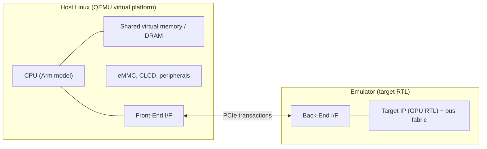

<!-- generated by yt-paper; edits will be overwritten -->
[DVCon](../dvcon/index.md) › [US](../dvcon/us.md) › [2019](../dvcon/by-year.md#2019) › [Emulation](../dvcon/by-topic.md#emulation)

# OS-aware IP Development Methodology

<figure class="rep-fig" markdown>
{ loading=lazy }
<figcaption>Figure 5 proposed methodology — from the original paper (Hyunjae Woo et al.)</figcaption>
</figure>

[:material-open-in-new: Original paper](https://dvcon-proceedings.org/wp-content/uploads/os-aware-ip-development-methodology.pdf){ .md-button .md-button--primary target=_blank }

| | |
|---|---|
| Authors | Hyunjae Woo, Woojoo Kim, Youngsik Kim, Seonil Brian Choi (Samsung Electronics Co., LTD.) |
| Venue | DVCon US 2019 |
| Topic | Emulation |
| Type | PAPER |
| ID | `ref-20261018-24f2` |

## Summary

**The paper proposes an OS-aware IP development flow that runs all non-target IPs and the CPU/memory on a QEMU virtual platform and only the target IP RTL on an emulator, connected by PCIe transactors, so Android boot completes in about 10 minutes (vs. 49 min for hybrid and 757 min for pure emulation) and IP-level SW/HW co-verification can start before full SoC integration.**

**이 논문은 대상 IP RTL만 에뮬레이터에서 실행하고 CPU, 메모리 및 나머지 IP는 QEMU 가상 플랫폼에서 실행하며, 두 측을 PCIe 트랜스액터로 연결하는 OS-aware IP 개발 방법론을 제안합니다. 이를 통해 Android 부팅이 약 10분에 완료되고(하이브리드 49분, 순수 에뮬레이션 757분 대비), 전체 SoC 통합 이전에 IP 단위 SW/HW 공동 검증을 시작할 수 있습니다.**

## Key Insights

- Partitioning: only the target IP RTL runs on the emulator; CPU, eMMC, CLCD, peripherals, bus and memory run as already-verified QEMU models on the host. Android boot takes about 10 minutes, versus 49 min for hybrid SoC emulation and 757 min for pure emulation (Table 1).

- 파티셔닝: 대상 IP RTL만 에뮬레이터에서 실행하고, CPU, eMMC, CLCD, 주변장치, 버스, 메모리는 이미 검증된 QEMU 모델로 호스트에서 실행합니다. Android 부팅은 약 10분이 걸리며, 하이브리드 SoC 에뮬레이션은 49분, 순수 에뮬레이션은 757분입니다(Table 1).

- PCIe latency, not bandwidth, is the bottleneck: the emulator clock stops during each DPI transaction. Reading 4 GB with 4-byte transactions (about 1G transactions) takes over 7 hours, while 64-byte transactions take about 10 minutes, so batching and reducing communication counts is the main optimization.

- 병목은 대역폭이 아니라 PCIe 지연입니다. 에뮬레이터 클럭은 DPI 트랜잭션마다 정지합니다. 4 바이트 읽기로 4 GB를 읽으면(약 10억 회 트랜잭션) 7시간 이상이 걸리지만, 64 바이트 읽기로는 약 10분이면 됩니다. 따라서 트랜잭션을 묶어 통신 횟수를 줄이는 것이 핵심 최적화입니다.

- Memory coherence is kept by a local copy in the emulator and synchronized only at CPU BFM and GIC BFM boundaries (DRAM prepare before target read; interrupt after target write). A timer or instruction counter sync is the fallback when target behavior breaks these assumptions.

- 메모리 일관성은 에뮬레이터 내부의 로컬 메모리 복사본으로 유지하며, CPU BFM과 GIC BFM 경계에서만 동기화합니다(대상 IP가 읽기 전 DRAM 준비, 쓰기 후 GIC BFM 인터럽트). 대상 IP 동작이 이 가정과 다르면 타이머 또는 명령어 카운터 기반 동기화를 대체로 사용합니다.

- Function models on the virtual side let SW and driver development start before RTL is ready; the model is later swapped for RTL with minimal change. The same setup is reused for PPAB evaluation of GPU configurations by swapping only the target RTL.

- 가상 측에 기능 모델을 두면 RTL이 준비되기 전에도 SW 및 드라이버 개발을 시작할 수 있으며, 이후 RTL로 원활하게 교체합니다. 같은 구성을 GPU 구성(PPAB) 평가에도 재사용하며, 이때는 대상 RTL과 벤더 드라이버만 교체합니다.

- Caveats: the validation covers a single GPU IP with GFX Benchmark Manhattan 1080p on Android Marshmallow. The simulation column (867,384 min) is an estimate, and the 5x and 15x speed-up claims rely on the authors' own hybrid-platform data [5].

- 주의사항: 검증은 Android Marshmallow에서 GFX Benchmark Manhattan 1080p를 실행한 단일 GPU IP에 대해서만 이루어졌습니다. 시뮬레이션 열(867,384 min)은 추정값이며, 5배 및 15배 속도 향상 주장은 저자들의 하이브리드 플랫폼 데이터[5]에 근거합니다.

## Detailed Summary

### Background and Problem

- Full-SoC HW/SW co-verification usually happens late, on full-chip emulation or silicon. Bugs found there cause ECO, SW workarounds, or re-spins.

- 전체 SoC 기반 HW/SW 공동 검증은 보통 설계 막바지에 전체 칩 에뮬레이션이나 실리콘에서 수행됩니다. 여기서 발견된 버그는 ECO, SW 우회 처리, 또는 re-spin으로 이어집니다.

- Simulation slows as design size grows: for several hundred million gates it drops to a few dozen kHz, about $10^6$ times slower than silicon. One second of silicon SW time becomes about 11.6 days of simulation.

- 시뮬레이션은 설계 규모가 커질수록 느려집니다. 수억 게이트 규모에서는 수십 kHz까지 떨어지며, 실리콘 대비 약 $10^6$배 느립니다. 실리콘에서 1초 동안 실행되는 SW는 시뮬레이션에서 약 11.6일이 걸립니다.

- Pure emulation (several hundred kHz to a few MHz) is about $10^3$ times slower than silicon. Booting Linux or Android takes more than ten hours, so it is only practical for bare-metal or simple Linux tests.

- 순수 에뮬레이션(수백 kHz~수 MHz)은 실리콘 대비 약 $10^3$배 느립니다. Linux나 Android 부팅에 10시간 이상 걸리므로 베어메탈이나 단순 Linux 테스트에만 현실적입니다.

- The hybrid SoC emulation flow (ARM Fast Model CPU and TLM memory on a virtual platform, other IPs on the emulator) boots Android in 49 min, about 15x faster than pure emulation [5]. However, it is only set up a few months before MTO. Immature non-target IPs cause kernel panics, lock-ups, and timeouts from mismatched time domains, which take IP teams a lot of time to debug.

- 하이브리드 SoC 에뮬레이션 흐름(가상 플랫폼의 ARM Fast Model CPU와 TLM 메모리, 에뮬레이터의 나머지 IP)은 Android를 49분에 부팅하며, 순수 에뮬레이션보다 약 15배 빠릅니다[5]. 그러나 MTO 몇 달 전에야 구축할 수 있습니다. 성숙도가 낮은 비대상 IP는 커널 패닉, 락업, 서로 다른 시간 도메인으로 인한 타임아웃을 일으키며, IP 팀이 디버깅에 많은 시간을 쓰게 됩니다.

### Architecture and Methodology

- Partitioning: CPU, eMMC, CLCD, peripherals, bus fabric, shared virtual memory, and the GIC/CPU BFM models run on a QEMU-based host Linux virtual platform. Only the target IP RTL (for example, the GPU with its bus and memory subsystem) runs on the emulator.

- 파티셔닝: CPU, eMMC, CLCD, 주변장치, 버스 패브릭, 공유 가상 메모리, GIC/CPU BFM 모델은 QEMU 기반 호스트 Linux 가상 플랫폼에서 실행됩니다. 대상 IP RTL(예: 버스 및 메모리 서브시스템을 포함한 GPU)만 에뮬레이터에서 실행됩니다.

- Transactors: the host-side Front-End I/F and the emulator-side Back-End I/F connect over PCIe. The Back-End I/F converts bit-level signals to PCIe transactions, and the Front-End I/F performs the host reads and writes. The paper uses three transactors: CPU BFM, GIC BFM, and a coherent memory interface. Additional transactors (for example, camera or sensor) can come from vendor AVIP libraries.

- 트랜스액터: 호스트 측 Front-End I/F와 에뮬레이터 측 Back-End I/F가 PCIe로 연결됩니다. Back-End I/F는 비트 레벨 신호를 PCIe 트랜잭션으로 변환하고, Front-End I/F는 호스트 읽기/쓰기를 수행합니다. 본 논문은 CPU BFM, GIC BFM, 코히런트 메모리 인터페이스의 세 가지 트랜스액터를 사용합니다. 추가 트랜스액터(예: 카메라, 센서)는 벤더 AVIP 라이브러리에서 가져올 수 있습니다.

- Memory coherence: the emulator holds a memory copy (cache, buffer, or LPDDR4-like model). Coherence is synchronized only at CPU BFM and GIC BFM operations. CPU data is prepared in DRAM before the target reads it. When the target writes, it raises an interrupt through the GIC BFM, and the CPU then reads the data. If target behavior differs, a timer or instruction counter triggers synchronization.

- 메모리 일관성: 에뮬레이터는 메모리 복사본(캐시, 버퍼, 또는 LPDDR4 유사 모델)을 보유합니다. 일관성은 CPU BFM과 GIC BFM 동작 시점에서만 동기화됩니다. CPU 데이터는 대상 IP가 읽기 전에 DRAM에 준비됩니다. 대상 IP가 쓰기를 하면 GIC BFM을 통해 인터럽트를 발생시키고, 이후 CPU가 데이터를 읽습니다. 대상 동작이 다르면 타이머 또는 명령어 카운터가 동기화를 트리거합니다.

- Latency model: the emulator user clock is halted for the duration of each DPI call. The paper gives examples: a 4-byte read takes 5–7 µs on the PCIe spec, but up to 14 µs in practice. Reading 4 GB with 4-byte transactions (1G transactions) takes over 7 hours, while 64-byte transactions take about 10 minutes.

- 지연 모델: DPI 호출 동안 에뮬레이터 사용자 클럭이 정지합니다. 논문의 예시로, 4바이트 읽기는 PCIe 사양상 5–7 µs이지만 실제로는 최대 14 µs가 걸릴 수 있습니다. 4바이트 트랜잭션으로 4 GB를 읽으면(1G 트랜잭션) 7시간 이상 걸리며, 64바이트 트랜잭션으로는 약 10분이 걸립니다.

- Use models: the virtual side can host a functional model of an IP until RTL is ready, and then it is replaced seamlessly. For PPAB evaluation of GPU configurations (shader count, L2 size, vendor), only the target RTL and vendor driver change.

- 활용 모델: 가상 측은 RTL이 준비될 때까지 IP의 기능 모델을 호스팅할 수 있으며, 이후 원활하게 교체됩니다. GPU 구성(셰이더 수, L2 크기, 벤더)의 PPAB 평가에서는 대상 RTL과 벤더 드라이버만 바꾸면 됩니다.

### Results and Conclusions

- Table 1 (consumed time; the simulation column is estimated):

- Table 1 (소요 시간; 시뮬레이션 열은 추정값):

| Stage | Simulation (est.) | Pure Emulation | Hybrid SoC | Proposed |
|---|---|---|---|---|
| Kernel boot (prompt) | 125,867 min | 96 min | 2 min | 1 min |
| Android home screen | 741,517 min | 661 min | 47 min | 9 min |
| Total | 867,384 min | 757 min | 49 min | 10 min |

| 단계 | 시뮬레이션 (추정) | 순수 에뮬레이션 | 하이브리드 SoC | 제안 방법론 |
|---|---|---|---|---|
| 커널 부팅 (prompt) | 125,867 min | 96 min | 2 min | 1 min |
| Android 홈 화면 | 741,517 min | 661 min | 47 min | 9 min |
| 합계 | 867,384 min | 757 min | 49 min | 10 min |

- The proposed flow is about 5x faster than hybrid (49 to 10 min) and about 76x faster than pure emulation (757 to 10 min). Android boot is stated to finish within 10 minutes.

- 제안 흐름은 하이브리드 대비 약 5배 빠르며(49분에서 10분), 순수 에뮬레이션 대비 약 76배 빠릅니다(757분에서 10분). Android 부팅은 10분 이내에 완료된다고 보고됩니다.

- Benchmark timing reported for GFX Benchmark 3.1.0 Manhattan 1080p (3000 ms fixed step): about 10 min to boot Android Marshmallow, 8 min for APK loading via adb (the text also mentions 7 min), and 45 min for the run. The paper reports about 1.8 min per frame on average. Figure 6 shows Manhattan and Angry Birds rendering results.

- GFX Benchmark 3.1.0 Manhattan 1080p(3000 ms 고정 스텝)의 벤치마크 시간은 Android Marshmallow 부팅 약 10분, adb를 통한 APK 로딩 8분(본문에는 7분이라고도 언급), 실행 45분입니다. 프레임당 평균 약 1.8분으로 보고됩니다. Figure 6은 Manhattan과 Angry Birds 렌더링 결과를 보여줍니다.

- Because only the target RTL is on the emulator, the emulator capacity needed is small, and compile time is shorter than for hybrid emulation.

- 대상 RTL만 에뮬레이터에 올라가므로 필요한 에뮬레이터 용량이 작고, 컴파일 시간도 하이브리드 에뮬레이션보다 짧습니다.

- The authors report that the flow found firmware/driver SW bugs and RTL bugs before full-SoC RTL integration was finished. Future work covers power analysis over Android.

- 저자들은 이 흐름이 전체 SoC RTL 통합이 끝나기 전에 펌웨어/드라이버 간 SW 버그와 RTL 버그를 찾아냈다고 보고합니다. 향후 과제는 Android 상의 전력 분석입니다.

- Limitations: the evaluation covers one GPU IP. No quantitative coherence-overhead measurement is given beyond the PCIe latency examples, and the paper's own timing figures are not independently verified.

- 한계: 평가는 하나의 GPU IP에 대해서만 이루어졌습니다. PCIe 지연 예시 외에 일관성 오버헤드에 대한 정량적 측정은 제시되지 않았으며, 논문의 자체 타이밍 수치는 독립적으로 검증되지 않았습니다.

## Videos

<iframe src="https://www.youtube-nocookie.com/embed/MmJHpC0lEYI" title="[DVCON2019] OS-aware IP Development Methodology" loading="lazy" allow="accelerometer; clipboard-write; encrypted-media; gyroscope; picture-in-picture; web-share" referrerpolicy="strict-origin-when-cross-origin" allowfullscreen></iframe>

**[DVCON2019] OS-aware IP Development Methodology** — [Watch on YouTube](https://www.youtube.com/watch?v=MmJHpC0lEYI) · [Video page](../videos/MmJHpC0lEYI.md)
