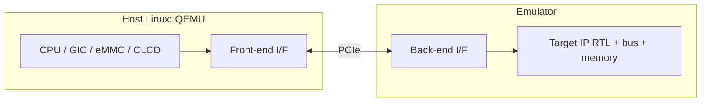

<!-- generated by yt-paper; edits will be overwritten -->
[DVCon](../dvcon/index.md) › [US](../dvcon/us.md) › [2019](../dvcon/by-year.md#2019) › [Emulation](../dvcon/by-topic.md#emulation)

# OS-aware IP Development Methodology

[:material-open-in-new: Original paper](https://dvcon-proceedings.org/wp-content/uploads/os-aware-ip-development-methodology.pdf){ .md-button .md-button--primary target=_blank }

| | |
|---|---|
| Authors | Hyunjae Woo (Samsung Electronics), Woojoo Kim (Samsung Electronics), Youngsik Kim (Samsung Electronics), Seonil Brian Choi (Samsung Electronics) |
| Venue | DVCon US 2019 |
| Topic | Emulation |
| Type | PAPER |
| ID | `ref-20261018-24f2` |

## Summary

**The paper proposes a co-emulation flow that runs CPU, GIC, and common IPs as QEMU models on a host while only the target IP RTL runs on an emulator, linked over PCIe transactors, booting Android in 10 minutes (about 5x faster than hybrid emulation).**

**이 논문은 CPU, GIC 및 공통 IP를 호스트에서 QEMU 모델로 실행하고 대상 IP RTL만 에뮬레이터에서 실행하며, PCIe 트랜스액터로 연결하는 co-emulation 흐름을 제안하고, 이를 통해 Android를 10분에 부팅하여 hybrid emulation 대비 약 5배 빠르다고 보고한다.**

## Key Insights

- Moving CPU, GIC, and common IPs to QEMU and keeping only the target IP, bus fabric, and memory in RTL reduces emulator capacity and compile time; Android total boot is 10 min vs 49 min on hybrid emulation (about 5x).

- CPU, GIC 및 공통 IP를 QEMU로 옮기고 대상 IP, 버스 패브릭, 메모리만 RTL로 유지하면 에뮬레이터 용량과 컴파일 시간이 줄어든다. Android 전체 부팅은 hybrid emulation의 49분 대비 10분으로 약 5배 빠르다.

- Per-transaction PCIe latency, not bandwidth, is the bottleneck: moving 4 GB with 4-byte reads takes over 7 hours versus about 10 minutes with 64-byte reads, so batching transactions and mirroring memory on the emulator side is essential.

- 병목은 대역폭이 아니라 트랜잭션당 PCIe 지연시간이다. 4바이트 읽기로 4 GB를 옮기면 7시간 이상, 64바이트 읽기로는 약 10분이 걸리므로 트랜잭션 묶음 처리와 에뮬레이터 측 메모리 미러링이 필수다.

- Coherence is maintained by synchronizing at CPU BFM and GIC BFM operations instead of continuous sharing; this assumes predictable target IP behavior and needs a timer or instruction-counter fallback otherwise, which is a correctness risk to review.

- 코히런스는 지속적인 공유 대신 CPU BFM 및 GIC BFM 동작 시점에 동기화하여 유지한다. 이는 대상 IP의 예측 가능한 동작을 가정하며, 그렇지 않은 경우 타이머나 명령어 카운터 대체 방식이 필요하므로 정확성 위험을 검토해야 한다.

- The flow allows SW driver and firmware development and RTL bug finding before full SoC integration, but the paper gives no quantitative defect counts.

- 이 흐름으로 SoC 통합 이전에 SW 드라이버와 펌웨어 개발 및 RTL 버그 발견이 가능하지만, 논문은 정량적인 결함 수를 제시하지 않는다.

- Several numbers are estimates and the text's breakdown (10 min boot, 8 min APK load, 45 min benchmark) conflicts with the 10-min total in Table 1, so the evidence is early and limited to one GPU IP case.

- 일부 수치는 추정치이며, 본문의 세부 시간(부팅 10분, APK 로딩 8분, 벤치마크 45분)은 Table 1의 총 10분과 맞지 않는다. 따라서 근거는 초기 단계이며 GPU IP 한 사례에 국한된다.

## Detailed Summary

### Background and Problem

- Full-SoC emulation takes over ten hours to boot Linux/Android, and RTL simulation runs about $10^6$ times slower than silicon, so neither suits OS-level SW bring-up.

- Full-SoC 에뮬레이션은 Linux/Android 부팅에 10시간 이상 걸리고, RTL 시뮬레이션은 실리콘 대비 약 $10^6$배 느려 OS 수준의 SW bring-up에 적합하지 않다.

- Hybrid emulation (ARM Fast Model CPU plus emulator) reaches about 15x over pure emulation, but it needs a nearly complete SoC and becomes usable only months before MTO. Immature IPs cause kernel panics and timeouts.

- Hybrid emulation(ARM Fast Model CPU + 에뮬레이터)은 순수 에뮬레이션 대비 약 15배 빠르지만 거의 완성된 SoC가 필요하며, MTO 몇 달 전에야 사용할 수 있다. 성숙도가 낮은 IP는 kernel panic과 timeout을 유발한다.

### Architecture and Methodology

- Host Linux runs QEMU models for CPU, GIC, eMMC, CLCD, and peripherals as an Android-ready virtual platform. Only the target IP, bus fabric, and memory subsystem run as RTL on the emulator.

- 호스트 Linux는 CPU, GIC, eMMC, CLCD 및 주변장치를 QEMU 모델로 실행하여 Android 준비된 가상 플랫폼을 구성한다. 에뮬레이터에서는 대상 IP, 버스 패브릭, 메모리 서브시스템만 RTL로 실행한다.

- Three transactors (CPU BFM, GIC BFM, coherent memory I/F) bridge the two sides over PCIe, with a front-end on the host and a back-end that converts transactions to bit signals.

- 세 개의 트랜스액터(CPU BFM, GIC BFM, coherent memory I/F)가 PCIe를 통해 양측을 연결한다. 호스트 측 front-end와 트랜잭션을 bit signal로 변환하는 back-end로 구성된다.

- Coherence is kept by minimizing PCIe round trips: memory is mirrored on the emulator side and synchronized after CPU BFM/GIC BFM operations, with a timer or instruction-counter fallback for other cases.

- 코히런스는 PCIe 왕복 횟수를 최소화하여 유지한다. 메모리를 에뮬레이터 측에 미러링하고 CPU BFM/GIC BFM 동작 후에 동기화하며, 그 외의 경우에는 타이머 또는 명령어 카운터를 대체 수단으로 사용한다.

### Results and Conclusions

- Total Android boot is 10 min with the proposed flow, versus 49 min for hybrid and 757 min for pure emulation. The kernel prompt takes 1 min (hybrid 96 min) and the home screen 9 min (hybrid 47 min).

- 제안 흐름에서 Android 전체 부팅은 10분으로, hybrid의 49분 및 순수 에뮬레이션의 757분과 비교된다. 커널 프롬프트는 1분(hybrid 96분), 홈 화면은 9분(hybrid 47분)이 걸린다.

- The paper reports about 5x over hybrid. PCIe latency dominates: 4 GB via 4-byte reads takes over 7 hours, versus about 10 minutes via 64-byte reads.

- 논문은 hybrid 대비 약 5배 향상을 보고한다. PCIe 지연시간이 지배적이어서, 4바이트 읽기로 4 GB를 옮기면 7시간 이상, 64바이트 읽기로는 약 10분이 걸린다.

- Applied to a GPU IP, the flow exposed SW/firmware and RTL bugs before full SoC integration. Simulation and pure-emulation figures are estimates, and the text's 10/8/45 min breakdown conflicts with Table 1.

- GPU IP에 적용하여 전체 SoC 통합 이전에 SW/펌웨어 및 RTL 버그를 발견했다. 시뮬레이션과 순수 에뮬레이션 수치는 추정치이며, 본문의 10/8/45분 분해는 Table 1과 일치하지 않는다.

## Videos

<iframe src="https://www.youtube-nocookie.com/embed/MmJHpC0lEYI" title="[DVCON2019] OS-aware IP Development Methodology" loading="lazy" allow="accelerometer; clipboard-write; encrypted-media; gyroscope; picture-in-picture; web-share" referrerpolicy="strict-origin-when-cross-origin" allowfullscreen></iframe>

**[DVCON2019] OS-aware IP Development Methodology** — [Watch on YouTube](https://www.youtube.com/watch?v=MmJHpC0lEYI) · [Video page](../videos/MmJHpC0lEYI.md)
