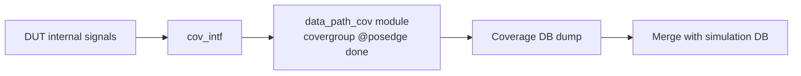

<!-- generated by yt-paper; edits will be overwritten -->
[DVCon](../dvcon/index.md) › [US](../dvcon/us.md) › [2023](../dvcon/by-year.md#2023) › [Emulation](../dvcon/by-topic.md#emulation)

# Improve emulator test quality by applying synthesizable functional coverage

<figure class="rep-fig" markdown>
{ loading=lazy }
<figcaption>Figure 2. Integration of synthesizable functional coverage module — from the original paper (Hoyeon Hwang et al.)</figcaption>
</figure>

[:material-open-in-new: Original paper](https://dvcon-proceedings.org/wp-content/uploads/1087-Improve-emulator-test-quality-by-applying-synthesizable-functional-coverage.pdf){ .md-button .md-button--primary target=_blank } [:material-presentation-play: Official talk](https://youtu.be/9kDEJjWuEyA){ .md-button target=_blank }

| | |
|---|---|
| Authors | Hoyeon Hwang (Samsung Electronics), Taeseong Kim (Samsung Electronics), Sanghyun Park (Samsung Electronics), Yong-Kwan Cho (Samsung Electronics), Dohyung Kim (Samsung Electronics), Wonil Cho (Samsung Electronics), Sanggyu Park (Samsung Electronics) |
| Venue | DVCon US 2023 |
| Topic | Emulation |
| Type | PAPER |
| ID | `ref-20261018-2686` |

## Summary

**The paper proposes seven synthesizable functional-coverage coding rules so one covergroup codebase can run on C-vendor and M-vendor emulators and in simulation, with negligible run-time overhead and two emulation case studies.**

**이 논문은 하나의 covergroup 코드베이스를 C-vendor 및 M-vendor 에뮬레이터와 시뮬레이션에서 함께 사용할 수 있도록 하는 7가지 synthesizable functional coverage 코딩 규칙을 제시하며, 런타임 오버헤드가 미미함을 두 가지 사례 연구로 보여준다.**

## Key Insights

- Functional coverage run-time overhead on emulators is small: C-vendor average went from 12min 25sec to 13min 13sec, and the M-vendor run went from 26min 31sec to 24min 27sec, with a coverage DB dump of 1–2 minutes for 191,797 bins.

- 에뮬레이터에서 functional coverage로 인한 런타임 오버헤드는 작다: C-vendor 평균 실행 시간은 12min 25sec에서 13min 13sec로, M-vendor 실행은 26min 31sec에서 24min 27sec로 측정되었으며, 191,797 bin의 coverage DB 덤프에는 1–2분이 추가되었다.

- Vendor capacity limits drive the coding rules: M-vendor allows at most 4,096 bins per coverpoint, so wide signals are split into slices and recombined with cross coverage.

- 벤더별 용량 제한이 코딩 규칙을 결정한다: M-vendor는 coverpoint당 최대 4,096 bin만 허용하므로, 넓은 신호는 slice로 나눈 뒤 cross coverage로 재조합한다.

- Replace simulation-only constructs with emulator-friendly equivalents: latch data into registers and sample on an event (e.g., @(posedge all_scn_done)) instead of sample(), use module parameters instead of covergroup arguments, and use iff guards instead of with clauses.

- 시뮬레이션 전용 구문은 에뮬레이터 친화적인 대안으로 바꾼다: sample() 대신 데이터를 래치하고 이벤트(예: @(posedge all_scn_done))에서 샘플링하며, covergroup 인자 대신 module parameter를, with 절 대신 iff 가드를 사용한다.

- For C-vendor emulators, place ignore_bins on coverpoints rather than on cross coverage, which cut internal memory from 16 to 4 in the paper's example; separate crosses that share a coverpoint into different covergroups to avoid implicit larger crosses.

- C-vendor 에뮬레이터에서는 cross coverage 대신 coverpoint에 ignore_bins를 적용하며, 논문 예시에서 내부 메모리가 16에서 4로 줄었다. 또한 coverpoint를 공유하는 cross는 별도 covergroup으로 분리하여 암묵적으로 커지는 cross를 피한다.

- Corner-case hunting with 2,632 bins took 421.12 emulator hours versus an estimated 157,920 simulation hours, though this comparison assumes one test per bin at 60 hours (simulation) and 10 minutes (emulation) and is the authors' estimate.

- 2,632 bin의 corner case 탐색은 에뮬레이터에서 421.12시간이 걸렸고, 시뮬레이션은 추정 157,920시간이었다. 다만 이는 bin당 1회 테스트를 가정하고 시뮬레이션 60시간, 에뮬레이션 10분으로 잡은 저자들의 추정치다.

## Detailed Summary

### Background and Problem

- Emulators reach low-probability corner cases and cut test turnaround time, but simulation-style functional coverage does not port directly: bin and memory capacity limits, vendor-only syntax, and non-synthesizable constructs (`sample()`, `with` clauses, covergroup arguments) block code reuse.

- 에뮬레이터는 저확률 corner case를 찾고 테스트 TAT를 줄이지만, 시뮬레이션용 functional coverage는 그대로 옮기기 어렵다. bin 및 메모리 용량 제한, 벤더 전용 구문, 비synthesizable 구문(`sample()`, `with` 절, covergroup 인자)이 코드 재사용을 막는다.

- The authors target C-vendor and M-vendor emulators and argue that one coverage codebase should serve both emulation and simulation, with merged results.

- 저자들은 C-vendor 및 M-vendor 에뮬레이터를 대상으로, 하나의 coverage 코드베이스를 에뮬레이션과 시뮬레이션에 함께 쓰고 결과를 병합해야 한다고 주장한다.

### Architecture and Methodology

- Seven coding guidelines: bin-count splitting (M-vendor ≤4,096 bins per coverpoint), `ignore_bins` on coverpoints instead of crosses (C-vendor), separate covergroups for crosses sharing coverpoints, latch-then-sample on an event instead of `sample()`, module parameters instead of covergroup arguments, `iff` guards instead of `with`, and `set_inst_name` in an initial block.

- 7가지 코딩 가이드라인: bin 수 분할(M-vendor에서 coverpoint당 4,096 bin 이하), cross 대신 coverpoint에 `ignore_bins` 적용(C-vendor), coverpoint를 공유하는 cross의 covergroup 분리, `sample()` 대신 래치 후 이벤트 샘플링, covergroup 인자 대신 module parameter 사용, `with` 대신 `iff` 가드 사용, initial 블록에서 `set_inst_name` 적용.

- Coverage is moved from the UVC scoreboard into a synthesizable module in the DUT wrapper, connected through an interface, to avoid pulling DUT signals out of the emulator.

- Coverage 코드를 UVC scoreboard에서 DUT wrapper 내의 synthesizable 모듈로 옮기고 interface로 연결한다. 이렇게 하면 DUT 신호를 에뮬레이터 밖으로 끌어내는 부담을 피할 수 있다.

### Results and Conclusions

- Run-time overhead is small: C-vendor 12m25s vs 13m13s with coverage; M-vendor 26m31s vs 24m27s; a 191,797-bin dump adds 1–2 min.

- 런타임 오버헤드는 작다: C-vendor 12m25s 대 coverage 적용 시 13m13s, M-vendor 26m31s 대 24m27s이며, 191,797 bin 덤프에 1–2분이 추가된다.

- Corner-case hunting with 2,632 bins: 421.12 emulator hours vs an estimated 157,920 simulation hours (authors' assumption of 60 h vs 10 min per bin).

- 2,632 bin corner case 탐색은 에뮬레이터 421.12시간, 시뮬레이션은 추정 157,920시간이다(저자 가정: bin당 시뮬레이션 60시간, 에뮬레이션 10분).

- A 4,846-bin full-combination model was verified exhaustively and exposed a combination-specific bug.

- 4,846 bin의 full-combination 모델을 전수 검증했고, 특정 조합에서만 발생하는 버그를 발견했다.

- Gaps: the cross-vendor merge via UCIS is future work, and the evaluation is largely qualitative and vendor-specific.

- 한계: UCIS 기반 벤더 간 병합은 향후 과제이며, 평가는 대부분 정성적이고 벤더 특화적이다.

## Videos

<iframe src="https://www.youtube-nocookie.com/embed/-DOx49XtD4M" title="[DVCON2023] Improve emulator test quality by applying synthesizable functional coverage" loading="lazy" allow="accelerometer; clipboard-write; encrypted-media; gyroscope; picture-in-picture; web-share" referrerpolicy="strict-origin-when-cross-origin" allowfullscreen></iframe>

**[DVCON2023] Improve emulator test quality by applying synthesizable functional coverage** — [Watch on YouTube](https://www.youtube.com/watch?v=-DOx49XtD4M) · [Video page](../videos/-DOx49XtD4M.md)

**Official presentation:** [DVCon U.S. 2023](https://youtu.be/9kDEJjWuEyA){ target=_blank }
