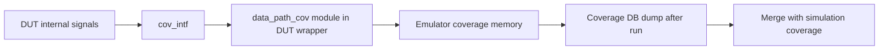

<!-- generated by yt-paper; edits will be overwritten -->
[DVCon](../dvcon/index.md) › [US](../dvcon/us.md) › [2023](../dvcon/by-year.md#2023) › [Verification](../dvcon/by-topic.md#verification)

# Improve emulator test quality by applying synthesizable functional coverage

<figure class="rep-fig" markdown>
{ loading=lazy }
<figcaption>Figure 2. Integration of synthesizable functional coverage module — from the original paper (Hoyeon Hwang et al.)</figcaption>
</figure>

[:material-open-in-new: Original paper](https://dvcon-proceedings.org/wp-content/uploads/1087-Improve-emulator-test-quality-by-applying-synthesizable-functional-coverage.pdf){ .md-button .md-button--primary target=_blank }

| | |
|---|---|
| Authors | Hoyeon Hwang (Samsung Electronics), Taeseong Kim (Samsung Electronics), Sanghyun Park (Samsung Electronics), Yong-Kwan Cho (Samsung Electronics), Dohyung Kim (Samsung Electronics), Wonil Cho (Samsung Electronics), Sanggyu Park (Samsung Electronics) |
| Venue | DVCon US 2023 |
| Topic | Verification |
| Type | PAPER |
| ID | `ref-20261018-2686` |

## Summary

**The paper proposes seven common coding guidelines for synthesizable SystemVerilog functional coverage that work across two commercial emulators (C-vendor and M-vendor) and simulation, shows how to integrate the coverage module in the DUT wrapper, and reports TAT and full-combination case studies.**

**이 논문은 두 상용 에뮬레이터(C-vendor, M-vendor)와 시뮬레이션에서 함께 쓸 수 있는 합성 가능한 SystemVerilog functional coverage 코딩 가이드라인 7개를 제시하고, DUT wrapper에 coverage 모듈을 통합하는 방법과 TAT 및 full-combination 사례 연구를 보고한다.**

## Key Insights

- M-vendor emulator limits a coverpoint to 4,096 bins; split wide coverpoints into slices (e.g., a 13-bit size as a 1-bit slice crossed with a 12-bit slice) to keep the cross equivalent while fitting the limit.

- M-vendor 에뮬레이터는 coverpoint당 4,096 bin으로 제한되므로, 넓은 coverpoint는 slice로 나누어 cross하면 제한을 지키면서 원래 coverage와 동등하게 만들 수 있다(예: 13-bit 크기를 1-bit slice와 12-bit slice의 cross로 분할).

- For C-vendor emulator, apply ignore_bins on the coverpoints rather than inside the cross. In the paper's example this reduced emulator internal memory from 16 to 4 with the same cross bin count of 4.

- C-vendor 에뮬레이터에서는 cross 내부가 아니라 coverpoint에 ignore_bins를 적용하는 편이 낫다. 논문 예시에서 cross bin 수는 4로 같았지만 에뮬레이터 내부 메모리는 16에서 4로 줄었다.

- Coverage data is collected in background memory during the run and dumped once at the end, so run-time impact is small: 191,797 bins added only 1-2 min of dump time, and average run-times changed by about +48 s (C-vendor) and -2 min (M-vendor).

- Coverage 데이터는 실행 중 배경 메모리에 저장되고 테스트 종료 후 한 번 dump되므로 실행 시간 영향이 작다. 191,797 bin에서 dump 시간은 1~2분이었고, 평균 실행 시간 변화는 C-vendor에서 약 +48초, M-vendor에서 약 -2분이었다.

- Latch the data signals and sample with an event such as @(posedge all_scn_done) because the sample() method is not synthesizable; place the coverage module in the DUT wrapper (not the UVC) to avoid pulling DUT signals across the UVC.

- sample()은 합성되지 않으므로 데이터 신호를 래치한 뒤 @(posedge all_scn_done) 같은 이벤트로 샘플링한다. Coverage 모듈은 UVC 대신 DUT wrapper에 두어 UVC로 DUT 신호를 끌어오는 성능 저하를 피한다.

- In the paper's case studies, a 2,632-bin corner-case set was estimated at 421.12 h in emulation versus 157,920 h in simulation; a 4,846-bin full-combination set exposed a bug that random testing had not confirmed. The TAT figures rest on stated per-bin assumptions.

- 사례 연구에서 2,632 bin의 corner case는 에뮬레이션 421.12 h, 시뮬레이션 157,920 h로 추정되었고, 4,846 bin의 full-combination에서는 랜덤 테스트로 확인되지 않던 특정 조합의 버그가 발견되었다. 다만 TAT 수치는 bin당 테스트 수에 대한 가정에 기반한다.

## Detailed Summary

### Background and Problem

- Emulators reach low-probability corner cases and shorten turnaround time (TAT), but verification progress is harder to quantify than in simulation. The authors want emulation to report functional coverage the way simulation does.

- 에뮬레이터는 발생 확률이 낮은 corner case를 찾고 TAT(turnaround time)를 줄이지만, 검증 진행률을 시뮬레이션만큼 정량적으로 파악하기 어렵다. 저자들은 에뮬레이션에서도 시뮬레이션과 같은 방식으로 functional coverage를 보고하고자 한다.

- Each emulator vendor (C-vendor and M-vendor in the paper, anonymized) has its own coverage solution with vendor-specific syntax. Simulation covergroups cannot be reused as-is because of synthesizability limits, `sample()` method, `with` clauses, covergroup arguments, and capacity limits.

- 각 벤더(논문에서는 C-vendor, M-vendor로 익명 처리)는 고유한 coverage 솔루션과 벤더 전용 문법을 가진다. 시뮬레이션 covergroup은 합성 불가 문법, `sample()` 메서드, `with` 절, covergroup 인자, 용량 제한 때문에 그대로 재사용하기 어렵다.

- Three design considerations are identified: capacity (M-vendor: max 4,096 bins per coverpoint, total bins bounded by board capacity; C-vendor: internal counter addressing up to 2,147,483,647), speed (coverage dump cost), and syntax support.

- 세 가지 설계 고려사항을 제시한다: 용량(M-vendor는 coverpoint당 최대 4,096 bin, 전체 bin 수는 보드 용량에 제한됨, C-vendor는 내부 카운터 주소가 최대 2,147,483,647까지), 속도(coverage dump 비용), 문법 지원 여부.

### Architecture and Methodology

The paper gives seven guideline items for writing common coverage:

논문은 공통 coverage 작성을 위한 가이드라인 7개를 제시한다:

1. Bin-count limit: split large coverpoints into slices and cross them (Table II).

1. Bin 수 제한: 큰 coverpoint를 slice로 나누어 cross한다(표 II).

2. Cross resource reduction with `ignore_bins`: put `ignore_bins` on coverpoints for C-vendor, not on the cross (Table III, 16 vs 4 internal memory units).

2. `ignore_bins`를 이용한 cross 자원 절감: C-vendor에서는 cross 내부가 아니라 coverpoint에 `ignore_bins`를 적용한다(표 III, 내부 메모리 16 → 4).

3. Separate crosses that share a coverpoint into separate covergroups to avoid implicit multi-way crosses that enlarge the counter address space (Table IV).

3. Coverpoint를 공유하는 cross가 여러 개면 covergroup을 분리하여 주소 공간이 커지는 암묵적 다중 cross를 피한다(표 IV).

4. Sampling: replace `sample()` with latched signals and an event sampling clock (`@(posedge clk)` or a completion event); Figure 1 shows the latch-then-sample timing for two asynchronous data paths.

4. 샘플링: `sample()` 대신 래치된 신호와 샘플링 이벤트(`@(posedge clk)` 또는 완료 이벤트)를 사용한다. 그림 1은 비동기 두 데이터 패스에 대한 latch 후 sample 타이밍을 보여준다.

5. Multiple instances: replace covergroup arguments with a module parameter, instantiating the wrapper module per value (Table VI, M-vendor).

5. 다중 인스턴스: covergroup 인자 대신 모듈 parameter를 사용하고 값마다 wrapper 모듈을 인스턴스화한다(표 VI, M-vendor).

6. Coverpoint guards: replace `with` bins with `iff` guards on coverpoints (Table VII).

6. Coverpoint guard: `with` bin 대신 coverpoint에 `iff` guard를 사용한다(표 VII).

7. `set_inst_name`: call it in an initial block for C-vendor when a covergroup is instantiated multiple times (Table VIII).

7. `set_inst_name`: C-vendor에서 covergroup을 여러 번 인스턴스화할 때 initial 블록에서 호출한다(표 VIII).

Reusable syntax that works in both environments (Table IX): `ignore_bins`, unsized `bins x[] = {[0:255]}`, wildcard bins, and transition bins.

양쪽 환경에서 동작하는 재사용 문법(표 IX): `ignore_bins`, unsized `bins x[] = {[0:255]}`, wildcard bins, transition bins.

Integration: the usual UVC scoreboard placement is replaced by a synthesizable coverage module in the DUT wrapper. An interface `cov_intf` carries `done` and `data_path` signals; `data_path_cov` is a module with a covergroup sampled on `posedge cov_if.done`. The authors argue this avoids the performance penalty of pulling DUT signals out to the UVC. The module can also be reused in non-UVM environments.

통합 방식: 보통 UVC scoreboard에 두던 functional coverage를 합성 가능한 coverage 모듈로 옮겨 DUT wrapper에 배치한다. 인터페이스 `cov_intf`가 `done`과 `data_path` 신호를 전달하고, `data_path_cov` 모듈의 covergroup은 `posedge cov_if.done`에서 샘플링한다. 저자들은 이 방식이 DUT 신호를 UVC로 끌어오는 성능 저하를 피하며, UVM이 아닌 환경에서도 재사용할 수 있다고 주장한다.

Merge: when simulation and emulation share coverage code and block hierarchy, databases can be merged with vendor tools. Cross-vendor merging via the UCIS API is planned as a next step.

Merge: 시뮬레이션과 에뮬레이션이 같은 coverage 코드와 블록 계층을 공유하면 벤더 도구로 데이터베이스를 병합할 수 있다. 벤더 간 병합은 UCIS API를 이용하는 것이 다음 단계 계획이다.

### Results and Conclusions

Run-time with and without functional coverage (Table I):

Coverage 적용 전후 실행 시간(표 I):

- C-vendor: 12m25s without, 13m13s with (coverage DB dump 1m2s).

- C-vendor: 미적용 12m25s, 적용 13m13s(coverage DB dump 1m2s).

- M-vendor: 26m31s without, 24m27s with (dump 1m20s).

- M-vendor: 미적용 26m31s, 적용 24m27s(dump 1m20s).

- The paper cites 191,797 bins with only 1-2 min added for the dump.

- 논문은 191,797 bin에서 dump에 1~2분만 추가되었다고 보고한다.

Case studies:

사례 연구:

- Corner-case hunting: 2,632 bins. The emulator ran all scenarios in about 2 weeks. Table XI estimates 157,920 h for simulation (2,632 × 60 h, assuming one test per bin) and 421.12 h for emulation (footnoted as 2,632 × 10 min). Note: 2,632 × 10 min is about 438.7 h, not 421.12 h, so the emulation figure does not match its stated footnote.

- Corner case 탐색: 2,632 bin. 에뮬레이터로 모든 시나리오를 약 2주에 수행했다. 표 XI은 시뮬레이션을 157,920 h(2,632 × 60 h, 테스트 1회당 bin 1개를 가정)로, 에뮬레이션을 421.12 h(각주에 2,632 × 10 min으로 표기)로 추정한다. 참고로 2,632 × 10 min은 약 438.7 h이므로, 에뮬레이션 수치는 자체 각주와 일치하지 않는다.

- Full combination: 4,846 bins. Full coverage was reached in emulation and a bug appeared only in a specific combination. Random generation had previously left it unclear whether that combination was covered.

- Full combination: 4,846 bin. 에뮬레이션에서 전체 조합 coverage를 달성했고, 특정 조합에서만 나타나는 버그를 발견했다. 랜덤 생성으로는 그 조합의 커버 여부를 알기 어려웠다.

Conclusion: the seven guidelines allow the same coverage code to run on two emulator vendors and in simulation, and the paper claims TAT reduction and full-combination coverage. Limitations: evidence is two industrial case studies, the TAT numbers depend on the per-bin test-count assumption, and the UCIS cross-vendor merge is not yet demonstrated.

결론: 7개 가이드라인으로 같은 coverage 코드를 두 에뮬레이터 벤더와 시뮬레이션에서 실행할 수 있으며, 저자들은 TAT 단축과 full-combination coverage의 효과를 주장한다. 한계: 근거는 두 개의 산업 사례 연구뿐이고, TAT 수치는 bin당 테스트 수 가정에 의존하며, UCIS 기반 벤더 간 병합은 아직 시연되지 않았다.

## Videos

<iframe src="https://www.youtube-nocookie.com/embed/-DOx49XtD4M" title="[DVCON2023] Improve emulator test quality by applying synthesizable functional coverage" loading="lazy" allow="accelerometer; clipboard-write; encrypted-media; gyroscope; picture-in-picture; web-share" referrerpolicy="strict-origin-when-cross-origin" allowfullscreen></iframe>

**[DVCON2023] Improve emulator test quality by applying synthesizable functional coverage** — [Watch on YouTube](https://www.youtube.com/watch?v=-DOx49XtD4M) · [Video page](../videos/-DOx49XtD4M.md)
