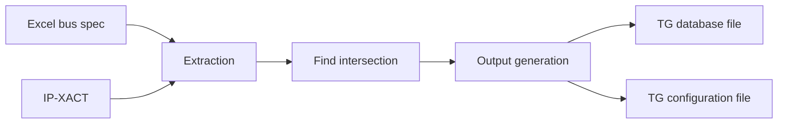

<!-- generated by yt-paper; edits will be overwritten -->
[DVCon](../dvcon/index.md) › [US](../dvcon/us.md) › [2023](../dvcon/by-year.md#2023) › [Verification](../dvcon/by-topic.md#verification)

# Automation Methodology for Bus Performance Verification using IP-XACT

<figure class="rep-fig" markdown>
{ loading=lazy }
<figcaption>Figure 6. Input and output diagram of proposing methodology — from the original paper (Taeyoung Jeon et al.)</figcaption>
</figure>

[:material-open-in-new: Original paper](https://dvcon-proceedings.org/wp-content/uploads/1055-Automation-Methodology-for-Bus-Performance-Verification-using-IP-XACT.pdf){ .md-button .md-button--primary target=_blank } [:material-presentation-play: Official talk](https://youtu.be/TdfALcZPwcs){ .md-button target=_blank }

| | |
|---|---|
| Authors | Taeyoung Jeon (Samsung Electronics), Gunseo Koo (Samsung Electronics), Youngsik Kim (Samsung Electronics), Seonil Brian Choi (Samsung Electronics) |
| Venue | DVCon US 2023 |
| Topic | Verification |
| Type | PAPER |
| ID | `ref-20261018-271b` |

## Summary

**Proposes AUTO_TGMON, a methodology that uses IP-XACT as design metadata and a bus specification spreadsheet to automatically generate TG database and configuration files for emulation-based bus performance verification, cutting TAT from 2 weeks to about 1 minute on a mobile SoC.**

**IP-XACT를 설계 메타데이터로 사용하고 bus specification 스프레드시트를 결합해 에뮬레이션 기반 bus performance verification용 TG database 및 configuration 파일을 자동 생성하는 AUTO_TGMON 방법론을 제안하며, 모바일 SoC에서 TAT를 2주에서 약 1분으로 줄였다.**

## Key Insights

- IP-XACT signal lists replace manual RTL hierarchy lookup, so TG database files for many masters can be generated from metadata rather than hand-entered signal by signal (the paper's example: 50 signals per TG x 100 TGs = 5000 entries).

- 수작업으로 RTL 계층을 찾던 과정을 IP-XACT의 신호 목록으로 대체해, 다수 마스터의 TG database 파일을 메타데이터로부터 생성할 수 있다(논문 예: TG당 50개 신호 × 100개 TG = 5000개 항목).

- The method parses an Excel bus specification and matches its ARVALID/AWVALID port hierarchy against IP-XACT, then expands matched VALID signals into full protocol signal lists.

- Excel 형식의 bus specification을 파싱하고 ARVALID/AWVALID 포트 계층을 IP-XACT와 대조한 뒤, 일치한 VALID 신호를 IP-XACT 기반의 전체 프로토콜 신호 목록으로 확장한다.

- Mismatches are classified into three cases: found in both (automatable), in spec but not IP-XACT (error, either IP without IP-XACT or stale spec), and in IP-XACT but not spec (ignored, e.g., MMU, arbiter, CDC ports).

- 불일치는 세 가지 경우로 분류된다: 양쪽에 모두 존재(자동화 가능), spec에만 존재(오류: IP-XACT 미사용 또는 stale spec), IP-XACT에만 존재(무시: MMU, arbiter, CDC 포트 등).

- On a 190-master test design the tool produced outputs in under one minute and flagged 22 errors (8 at extraction, 14 at intersection); on a mobile SoC with 155 targets it reduced TAT from 2 weeks to under 1 minute and surfaced 17 bugs.

- 마스터 190개 규모의 개발 테스트 환경에서 1분 이내에 출력을 생성했고 22개 오류를 보고했다(extraction 8개, intersection 14개). 155개 대상의 모바일 설계에서는 TAT를 2주에서 1분 미만으로 줄였고 17개 버그를 발견했다.

- The paper claims over 90% of verification targets are processed automatically, and the TG outputs are reusable by any emulation test that uses TGs, not only bus performance tests.

- 논문은 대상의 90% 이상이 자동 처리된다고 주장하며, 생성된 TG 출력은 bus performance 테스트뿐 아니라 TG를 사용하는 모든 에뮬레이션 검증 항목에 재사용 가능하다고 주장한다.

## Detailed Summary

### Background and Problem

- Bus performance verification measures per-master bandwidth, latency, and multiple-outstanding (MO) behavior under full-chip emulation, replacing each master with a traffic generator (TG) to avoid bringing up hundreds of masters.

- Bus performance verification은 full-chip 에뮬레이션에서 마스터별 bandwidth, latency, MO(Multiple Outstanding) 동작을 측정하며, 수백 개 마스터를 모두 bring-up하는 대신 각 마스터를 TG(Traffic Generator)로 대체한다.

- Preparing TG inputs is the bottleneck: the TG database file needs every protocol signal (AXI/ACE) and its hierarchy per master, done manually from a bus spec, a hand-drawn Visio diagram, and RTL. This is slow and error-prone, and errors surface only at test runtime.

- 병목은 TG 입력 준비다. TG database 파일에는 마스터마다 모든 프로토콜 신호(AXI/ACE)와 계층 정보가 필요하며, 이를 bus spec, 수작업으로 그린 Visio 다이어그램, RTL을 보고 수동으로 작성한다. 느리고 오류가 발생하기 쉬우며, 오류는 테스트 실행 중에야 드러난다.

### Architecture and Methodology

- AUTO_TGMON runs in three stages: extraction, find intersection, and output generation.

- AUTO_TGMON은 extraction, find intersection, output generation의 세 단계로 동작한다.

- Inputs: an Excel bus specification (IP name, bandwidth, clock frequency, port hierarchy down to ARVALID/AWVALID) and the IP-XACT metadata.

- 입력: Excel 형식 bus specification(IP 이름, bandwidth, clock frequency, ARVALID/AWVALID까지의 포트 계층)과 IP-XACT 메타데이터.

- Extraction parses both inputs into objects and flags empty, NaN, or out-of-range cells (e.g., 10 MHz clock).

- Extraction 단계는 두 입력을 객체로 파싱하며, 빈 셀, NaN, 범위를 벗어난 값(예: 10 MHz 클록)을 오류로 표시한다.

- Intersection compares VALID signal hierarchies. Matched targets have their signal lists restored from IP-XACT. Unmatched spec entries are errors; IP-XACT-only master ports are ignored.

- Intersection 단계는 VALID 신호 계층을 비교한다. 일치하는 대상은 IP-XACT에서 신호 목록을 복원한다. 일치하지 않는 spec 항목은 오류로 처리하며, IP-XACT에만 있는 마스터 포트는 무시한다.

- Outputs: the TG database file (signal list from IP-XACT) and the TG configuration file (bandwidth, burst size/length from the spec).

- 출력: TG database 파일(IP-XACT에서 얻은 신호 목록)과 TG configuration 파일(spec에서 얻은 bandwidth, burst size/length).

### Results and Conclusions

- On a 190-master development test environment, outputs were generated within one minute with 22 errors reported (8 at extraction, 14 at intersection).

- 마스터 190개 규모의 개발 테스트 환경에서 1분 이내에 출력을 생성했으며, 22개 오류를 보고했다(extraction 8개, intersection 14개).

- On the latest mobile device design with 155 targets, generation took under 1 minute versus 2 weeks previously, and the bus performance test found 17 bugs.

- 최신 모바일 기기 설계(대상 155개)에서는 이전 2주 대비 1분 미만에 생성했고, bus performance 테스트로 17개 버그를 발견했다.

- The authors conclude the flow is reusable for any TG-based verification item, though only the mobile-device result is given as a quantitative outcome; the "over 90% automated" claim is stated without a breakdown.

- 저자들은 이 흐름이 TG를 사용하는 모든 검증 항목에 재사용 가능하다고 결론짓는다. 다만 정량적 결과는 모바일 설계 사례에만 제시되어 있으며, "90% 이상 자동화" 주장은 세부 내역 없이 서술되어 있다.

## Videos

<iframe src="https://www.youtube-nocookie.com/embed/Sxhrm6QYo_0" title="[DVCON2023]Automation Methodology for Bus Performance Verification using IP-XACT" loading="lazy" allow="accelerometer; clipboard-write; encrypted-media; gyroscope; picture-in-picture; web-share" referrerpolicy="strict-origin-when-cross-origin" allowfullscreen></iframe>

**[DVCON2023]Automation Methodology for Bus Performance Verification using IP-XACT** — [Watch on YouTube](https://www.youtube.com/watch?v=Sxhrm6QYo_0) · [Video page](../videos/Sxhrm6QYo_0.md)

**Official presentation:** [DVCon U.S. 2023](https://youtu.be/TdfALcZPwcs){ target=_blank }
