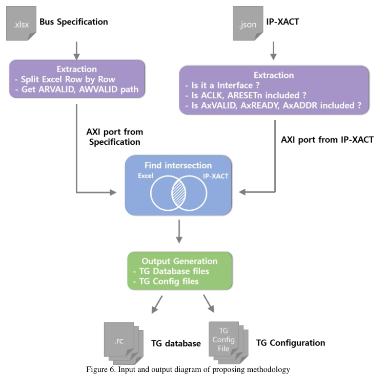
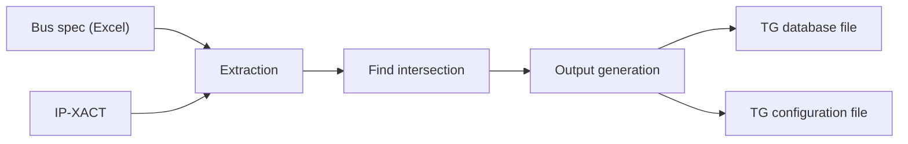

<!-- generated by yt-paper; edits will be overwritten -->
[DVCon](../dvcon/index.md) › [US](../dvcon/us.md) › [2023](../dvcon/by-year.md#2023) › [Verification](../dvcon/by-topic.md#verification)

# Automation Methodology for Bus Performance Verification using IP-XACT

<figure class="rep-fig" markdown>
{ loading=lazy }
<figcaption>Figure 6. Input and output diagram of proposing methodology — from the original paper (Taeyoung Jeon et al.)</figcaption>
</figure>

[:material-open-in-new: Original paper](https://dvcon-proceedings.org/wp-content/uploads/1055-Automation-Methodology-for-Bus-Performance-Verification-using-IP-XACT.pdf){ .md-button .md-button--primary target=_blank }

| | |
|---|---|
| Authors | Taeyoung Jeon (Samsung Electronics), Gunseo Koo (Samsung Electronics), Youngsik Kim (Samsung Electronics), Seonil Brian Choi (Samsung Electronics). Affiliation: Samsung Electronics Co., Ltd., Hwasung-si, Korea |
| Venue | DVCon US 2023 |
| Topic | Verification |
| Type | PAPER |
| ID | `ref-20261018-271b` |

## Summary

**AUTO_TGMON automates generation of TG database and TG configuration files for emulation-based bus performance verification by cross-checking an Excel bus specification against IP-XACT metadata, reducing reported TAT from about 2 weeks to under 1 minute on a mobile SoC project.**

**AUTO_TGMON은 Excel 버스 스펙과 IP-XACT 메타데이터를 교차 검증하여 에뮬레이션 기반 버스 성능 검증용 TG database 파일과 TG configuration 파일을 자동 생성하며, 모바일 SoC 프로젝트에서 보고된 TAT를 약 2주에서 1분 미만으로 줄였습니다.**

## Key Insights

- Using IP-XACT as signal-level metadata lets the flow build TG database files (full protocol signal lists) without manually reading RTL; the bus spec only needs the port hierarchy of the VALID signals (e.g., ARVALID/AWVALID), which the methodology expands to the full signal set.

- IP-XACT를 신호 수준 메타데이터로 활용하면 RTL을 수동으로 읽지 않고도 TG database 파일(전체 프로토콜 신호 목록)을 생성할 수 있습니다. 버스 스펙에는 VALID 신호(예: ARVALID/AWVALID)의 포트 계층만 있으면 되며, 이를 방법론이 전체 신호 집합으로 확장합니다.

- Cross-checking the bus spec against IP-XACT turns manual errors into categorized, early reports: on 190 masters the flow raised 22 errors (8 at extraction for empty/NaN/out-of-range cells, 14 at find-intersection for targets missing from IP-XACT or stale spec entries).

- 버스 스펙과 IP-XACT를 교차 검증하면 수작업 오류가 조기에 분류된 보고서로 바뀝니다. 190개 마스터에서 22개 오류가 발생했습니다(Extraction 단계 8개: 빈 셀, NaN, 범위 초과 값 / Find intersection 단계 14개: IP-XACT에 없는 타겟 또는 오래된 스펙 항목).

- Reported TAT for TG file preparation dropped from 2 weeks (previous project) to within 1 minute for 155 verification targets on the latest mobile device design, and the resulting bus performance test found 17 bugs.

- 최신 모바일 디바이스 설계의 155개 검증 타겟에 대해 TG 파일 준비 TAT가 이전 프로젝트의 2주에서 1분 이내로 줄었다고 보고되었으며, 이 결과로 수행된 버스 성능 테스트에서 17개 버그가 발견되었습니다.

- Automation coverage is bounded by IP-XACT availability: targets whose IP designers do not supply IP-XACT cannot be automated, and bus-spec drift from RTL remains a risk that is only caught as an error, not fixed automatically.

- 자동화 범위는 IP-XACT 제공 여부에 의해 제한됩니다. IP 설계자가 IP-XACT를 제공하지 않는 타겟은 자동화할 수 없으며, RTL과 스펙의 불일치는 자동 수정되지 않고 오류로만 검출됩니다.

- The abstract claims over 90% of verification targets are processed automatically; the body text does not give a breakdown supporting this figure, so it should be read as the authors' reported claim.

- 초록은 검증 타겟의 90% 이상이 자동으로 처리된다고 주장하지만, 본문에는 이를 뒷받침하는 세부 분석이 없으므로 저자들의 보고 주장으로 이해해야 합니다.

## Detailed Summary

### Background and Problem

- Modern SoCs integrate growing numbers of DMA masters (the paper cites over a hundred), with bus components such as MMU, bus arbiters, and CDC/async bridges on each data path. Bus performance verification measures bandwidth, latency, and multiple outstanding (MO) per master, pre-silicon, at full-chip level, because traffic runs at several GB/s and cycle-based simulation is too slow. Emulation is therefore used.

- 최신 SoC는 DMA 마스터 수가 늘어나고 있으며(논문은 100개 이상을 언급), 각 데이터 경로에는 MMU, 버스 arbiter, CDC/비동기 브리지 같은 버스 컴포넌트가 포함됩니다. 버스 성능 검증은 트래픽이 수 GB/s 수준이고 cycle 기반 시뮬레이션은 너무 느리기 때문에, 실리콘 이전 단계에서 전체 칩 수준으로 마스터별 bandwidth, latency, MO(Multiple Outstanding)를 측정합니다. 따라서 에뮬레이션을 사용합니다.

- To avoid bringing up every master, a Traffic Generator (TG) replaces each verification target. The TG needs a TG database file (signal hierarchy and bit-widths for every protocol signal, AXI/ACE) and a TG configuration file (target bandwidth, destination address range, QoS, cache hint) read at run time.

- 모든 마스터를 bring-up하지 않기 위해 각 검증 타겟을 TG(Traffic Generator)로 대체합니다. TG에는 TG database 파일(AXI/ACE 프로토콜 신호별 계층 및 비트폭)과 실행 시 읽히는 TG configuration 파일(목표 bandwidth, 목적지 주소 범위, QoS, cache hint)이 필요합니다.

- The problem is preparation effort. Example from the paper: 50 signals per TG × 100 TGs = 5,000 signal entries. Manual creation is slow and error-prone, and database errors are not caught at emulation image build; they surface later as inaccurate results.

- 문제는 준비 工数입니다. 논문 예시: TG 1개당 50개 신호 × TG 100개 = 5,000개 신호 항목. 수작업은 느리고 오류가 발생하기 쉬우며, database 오류는 emulation image build 단계에서 검출되지 않고 이후 테스트 결과가 부정확해지는 형태로 나타납니다.

- The prior manual flow was: pick a target in the bus spec, locate the master port in a hand-drawn Visio architecture diagram (which may not match current RTL), then search the RTL for the exact hierarchy. The bus spec named only the IP, not the full port hierarchy.

- 기존 수작업 절차: 버스 스펙에서 타겟을 고르고, 손으로 그린 Visio 아키텍처 다이어그램에서 마스터 포트 위치를 찾은 뒤(현재 RTL과 맞지 않을 수 있음), RTL에서 정확한 계층을 검색했습니다. 버스 스펙에는 IP 이름만 있고 전체 포트 계층은 없었습니다.

### Architecture and Methodology

- The methodology is named AUTO_TGMON. Inputs are (1) the bus specification in Excel format, read without preprocessing so users can fix errors and simply re-run, and (2) the IP-XACT of the design. Outputs are the TG database file (signal lists from IP-XACT plus port hierarchy from the spec) and the TG configuration file (bandwidth, burst size and length from the spec).

- 방법론의 이름은 AUTO_TGMON입니다. 입력은 (1) Excel 형식의 버스 스펙(전처리 없이 읽으므로 사용자가 오류를 수정하고 다시 실행하기만 하면 됨)과 (2) 설계의 IP-XACT입니다. 출력은 TG database 파일(IP-XACT의 신호 목록 + 스펙의 포트 계층)과 TG configuration 파일(스펙의 bandwidth, burst size 및 length)입니다.

- The bus spec was changed to supply the full port hierarchy rather than only the IP name; the authors say this change markedly improved automation accuracy.

- 버스 스펙은 IP 이름만 제공하던 방식에서 전체 포트 계층을 제공하도록 변경되었습니다. 저자들은 이 변경이 자동화 정확도를 크게 높였다고 설명합니다.

- **Extraction**: both inputs are parsed into object-oriented class instances, so the code changes minimally if input formats change. Empty cells, not-a-number values, and out-of-range values are reported (e.g., a 10 MHz max clock for MODEM DMA0 was flagged). Users may waive errors that do not apply, such as read-only masters with no write hierarchy.

- **Extraction**: 두 입력을 객체지향 클래스 인스턴스로 파싱하므로 입력 형식이 크게 바뀌어도 코드 수정이 최소화됩니다. 빈 셀, NaN, 범위를 벗어난 값을 보고합니다(예: MODEM DMA0의 최대 클럭 10 MHz가 오류로 표시됨). 읽기 전용 마스터처럼 해당되지 않는 오류는 사용자가 무시할 수 있습니다.

- **Find intersection**: only VALID signal hierarchy is compared, since the spec holds ARVALID/AWVALID paths. Three outcomes: (1) target found in IP-XACT, so it is automatable; (2) target in spec but not in IP-XACT, reported as an error (either the IP does not use IP-XACT, which cannot be automated, or the hand-updated spec is stale); (3) master port in IP-XACT but not in spec (MMU, arbiter, CDC), ignored because it is not a verification target.

- **Find intersection**: 스펙이 ARVALID/AWVALID 경로만 가지므로 VALID 신호 계층만 비교합니다. 결과는 세 가지입니다. (1) IP-XACT에서 타겟을 찾음 → 자동화 가능. (2) 스펙에는 있으나 IP-XACT에 없음 → 오류(IP가 IP-XACT를 사용하지 않는 경우 자동화 불가, 또는 수작업으로 갱신된 스펙이 오래된 경우). (3) IP-XACT에는 있으나 스펙에는 없는 마스터 포트(MMU, arbiter, CDC) → 검증 타겟이 아니므로 무시.

- **Output generation**: for matched targets, the ARVALID/AWVALID hierarchy is expanded to the full protocol signal list (ARADDR, ARREADY, etc.) using IP-XACT metadata. The TG configuration file takes traffic settings from the bus spec.

- **Output generation**: 매칭된 타겟의 ARVALID/AWVALID 계층은 IP-XACT 메타데이터를 이용해 전체 프로토콜 신호 목록(ARADDR, ARREADY 등)으로 확장됩니다. TG configuration 파일의 트래픽 설정은 버스 스펙에서 가져옵니다.

### Results and Conclusions

- Development test environment: 190 masters. Outputs were generated within one minute. The run produced 22 errors: 8 at extraction (fixable with small spec edits) and 14 at find-intersection (requiring design-team deliberation and spec updates; targets could change with RTL updates).

- 개발 테스트 환경: 마스터 190개. 출력 파일은 1분 이내에 생성되었습니다. 실행에서 22개 오류가 발생했습니다. Extraction 단계 8개(작은 스펙 수정으로 해결 가능), Find intersection 단계 14개(설계팀과 협의 후 스펙 수정 필요, RTL 변경에 따라 타겟이 바뀔 수 있음).

- Latest mobile device design: 155 verification targets were selected. TG database and configuration files were generated within 1 minute, versus 2 weeks of work in the previous project. The bus performance test found 17 bugs; workarounds included changing target performance metrics in the spec or adjusting burst length and clock frequency to meet requirements.

- 최신 모바일 디바이스 설계: 검증 타겟 155개 선정. TG database 및 configuration 파일이 1분 이내에 생성되었으며, 이전 프로젝트에서는 2주 작업이었습니다. 버스 성능 테스트에서 17개 버그가 발견되었고, 스펙의 목표 성능 지표를 바꾸거나 burst length와 클럭 주파수를 조정하여 요구 사항을 맞추는 방식으로 대응했습니다.

- The authors conclude that the TAT drops from 2 weeks to under 1 minute and that the methodology is applicable to any verification item using TGs, since the TG files do not depend on bus performance verification specifically. The abstract additionally claims over 90% of verification targets are processed automatically, but the body does not provide a supporting breakdown. Limitations evident from the text include the dependency on IP-XACT availability and on keeping the Excel spec synchronized with RTL.

- 저자들은 TAT가 2주에서 1분 미만으로 줄었고, TG 파일은 버스 성능 검증에 종속되지 않으므로 TG를 사용하는 모든 검증 항목에 적용 가능하다고 결론짓습니다. 초록은 추가로 검증 타겟의 90% 이상이 자동 처리된다고 주장하지만, 본문에는 이를 뒷받침하는 세부 분석이 없습니다. 본문에서 확인되는 한계는 IP-XACT 제공 여부에 대한 의존성과 Excel 스펙을 RTL과 동기화해야 한다는 점입니다.

## Videos

<iframe src="https://www.youtube-nocookie.com/embed/Sxhrm6QYo_0" title="[DVCON2023]Automation Methodology for Bus Performance Verification using IP-XACT" loading="lazy" allow="accelerometer; clipboard-write; encrypted-media; gyroscope; picture-in-picture; web-share" referrerpolicy="strict-origin-when-cross-origin" allowfullscreen></iframe>

**[DVCON2023]Automation Methodology for Bus Performance Verification using IP-XACT** — [Watch on YouTube](https://www.youtube.com/watch?v=Sxhrm6QYo_0) · [Video page](../videos/Sxhrm6QYo_0.md)
