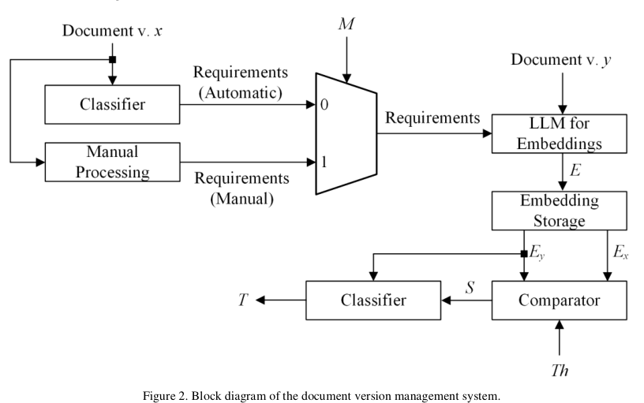
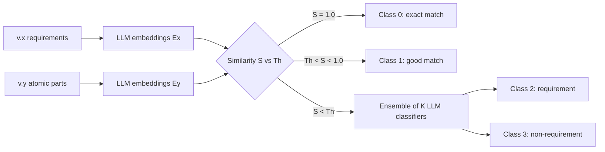

<!-- generated by yt-paper; edits will be overwritten -->
[DVCon](../dvcon/index.md) › [US](../dvcon/us.md) › [2025](../dvcon/by-year.md#2025) › [Verification](../dvcon/by-topic.md#verification)

# Technical Documents Version Management System Based on Large Language Models

<figure class="rep-fig" markdown>
{ loading=lazy }
<figcaption>Figure 2. Block diagram of the document version management system. — from the original paper (S. S. Zalivaka et al.)</figcaption>
</figure>

[:material-open-in-new: Original paper](https://dvcon-proceedings.org/wp-content/uploads/1027-2.pdf){ .md-button .md-button--primary target=_blank }

| | |
|---|---|
| Authors | S. S. Zalivaka (SK hynix memory solutions Poland) |
| Venue | DVCon US 2025 |
| Topic | Verification |
| Type | PAPER |
| ID | `ref-20261018-2740` |

## Summary

**A two-stage LLM pipeline reuses previous-version requirements via sentence-embedding similarity (Th=0.9) and classifies the residual sentences with an MLP-fused ensemble of 43 context-window Mistral-7B classifiers, reaching 90.05% requirement recall on M-PHY 6.0 versus roughly 80% for prior fixed-text classifiers.**

**두 단계 LLM 파이프라인으로, 이전 버전 요구사항은 문장 임베딩 유사도(Th=0.9)로 재사용하고 나머지 문장은 MLP로 결합한 43개 컨텍스트 윈도우 Mistral-7B 분류기 앙상블로 분류하여, M-PHY 6.0에서 요구사항 재현율 90.05%를 달성했습니다(기존 고정 텍스트 분류기 약 80% 대비).**

## Key Insights

- Version-aware reuse: comparing v.x requirements against v.y atomic parts by embedding similarity recovered 100% of inherited requirements (3 exact matches and 550 good matches with Th=0.9), so the classifier only needs to handle the residual sentences.

- 버전 인식 재사용: v.x 요구사항과 v.y의 atomic part를 임베딩 유사도로 비교한 결과 상속된 요구사항의 100%를 복구했습니다(Th=0.9에서 exact match 3건, good match 550건). 따라서 분류기는 나머지 문장만 처리하면 됩니다.

- Context-window ensemble: classifiers with S from 2 to 100 produce ceil(N/S) data points, so accuracy falls as S grows; an MLP over K classifier probabilities cut training-set errors from 8 (K=11) to 0 (K=16), and K=15 was used for inference.

- 컨텍스트 윈도우 앙상블: S가 2~100인 분류기는 ceil(N/S)개의 데이터 포인트를 생성하므로 S가 커질수록 정확도가 떨어집니다. K개 분류기 확률을 입력받는 MLP는 학습 세트 오류를 K=11일 때 8건에서 K=16일 때 0건으로 줄였고, 추론에는 K=15를 사용했습니다.

- Reported overall recall on M-PHY 6.0 is 1122/1246 requirements (90.05%), but only 569 of about 694 new requirements (~80%) were found, and the model was trained on a single 4.1 specification, so generalization is unproven.

- M-PHY 6.0에서 보고된 전체 재현율은 1246개 중 1122개(90.05%)이지만, 약 694개의 신규 요구사항 중 569개(약 80%)만 찾았고, 모델은 단일 4.1 명세로만 학습되어 일반화 성능은 입증되지 않았습니다.

- Levenshtein string matching needs no embedding model or GPU and ran in 1.9 s, but recognized only 86.27% of requirements (47 missed) because it ignores semantics; the sensitivity to Th (below 0.3 yields false positives, above 0.95 yields exact matches only) must be tuned.

- Levenshtein 문자열 매칭은 임베딩 모델이나 GPU가 필요 없고 1.9초 만에 실행되지만, 의미를 고려하지 않아 요구사항의 86.27%만 재현했고 47건을 놓쳤습니다. Th 튜닝도 중요합니다(0.3 미만이면 오탐, 0.95 초과면 exact match만 검출).

- Compute cost: embedding took about 3-5 min and ensemble classification about 15 min (923 s) on 2x H100; each Mistral classifier took about 2 h to train with 4-bit quantization. Table I's non-requirement count (1770 vs 1646 target) is not reconciled in the text.

- 연산 비용: 임베딩은 약 3~5분, 앙상블 분류는 2×H100 기준 약 15분(923초)이 걸렸습니다. Mistral 분류기 하나의 학습은 4비트 양자화 상태로 약 2시간이 걸렸습니다. 표 I의 non-requirement 수(목표 1646 대비 1770)는 본문에서 정합성이 설명되지 않았습니다.

## Detailed Summary

### Background and Problem

- Requirements are extracted manually from technical specifications (here MIPI M-PHY) by verification engineers, which is labor-intensive for long documents.

- 기술 명세(여기서는 MIPI M-PHY)의 요구사항은 검증 엔지니어가 수작업으로 추출하며, 긴 문서일수록 노동 집약적입니다.

- The authors cite prior work reporting more than 80% accuracy for requirement extraction, but these methods ignore previous document versions [4] and analyze fixed-size text units (sentence or paragraph) [2-3]. Generic LLMs perform worse without domain-specific training [3].

- 저자들은 기존 연구가 요구사항 추출에서 80% 이상의 정확도를 보고했다고 인용하지만, 이들 방법은 이전 문서 버전을 고려하지 않고([4]) 고정된 크기의 텍스트 단위(문장 또는 문단)를 분석한다고 지적합니다([2-3]). 도메인 학습 없이는 범용 LLM의 성능도 떨어집니다([3]).

- PDF parsing is error-prone. Converting to .docx with pdf2docx and parsing with Unstructured still required manual review of sentence splits, figures, tables and footnotes.

- PDF 파싱은 오류가 많습니다. pdf2docx로 .docx로 변환하고 Unstructured로 파싱해도 문장 분리, 그림, 표, 각주 처리를 위해 수작업 검토가 필요했습니다.

- Datasets: M-PHY 4.1 (219 pages, 4629 sentences; 772 requirements, 3857 non-requirements) for training, and M-PHY 6.0 (249 pages, 2892 sentences; 1246 requirements, 1646 non-requirements) for validation.

- 데이터셋: 학습용 M-PHY 4.1(219페이지, 4629문장, 요구사항 772개, 비요구사항 3857개), 검증용 M-PHY 6.0(249페이지, 2892문장, 요구사항 1246개, 비요구사항 1646개).

### Architecture and Methodology

Stage 1 compares embeddings of the v.x requirements (Ex) with the embeddings of all atomic parts of v.y (Ey). The best-matching vector gives a similarity S in [0,1], which is compared against the threshold Th.

1단계에서는 v.x 요구사항의 임베딩(Ex)과 v.y의 모든 atomic part 임베딩(Ey)을 비교합니다. 가장 가까운 벡터의 유사도 S(0~1)를 임계값 Th와 비교합니다.

- S = 1.0: class 0 (exact match).

- S = 1.0: 클래스 0(exact match)

- Th < S < 1.0: class 1 (good match), used as an extra feature for classifier training.

- Th < S < 1.0: 클래스 1(good match). 분류기 학습 시 추가 특징으로 사용합니다.

- S < Th: stage 2 is triggered. A classifier labels the sentence as class 2 (requirement) or class 3 (non-requirement).

- S < Th: 2단계 실행. 분류기가 클래스 2(요구사항) 또는 클래스 3(비요구사항)을 결정합니다.

The stage-2 classifier is a multi-label LLM with an S-sentence context window. A dataset of N sentences yields ceil(N/S) data points, and the last window is padded with a filler sentence. An ensemble uses K classifiers with windows S0 < ... < SK-1. Each produces N labels, and a small network fuses these K outputs into the final per-sentence label.

2단계 분류기는 S 문장 컨텍스트 윈도우를 갖는 multi-label LLM입니다. N개 문장의 데이터셋은 ceil(N/S)개의 데이터 포인트를 만들며, 마지막 윈도우는 채움 문장으로 패딩합니다. 앙상블은 윈도우 크기가 S0 < ... < SK-1인 K개 분류기를 사용합니다. 각 분류기는 N개의 레이블을 생성하며, 작은 신경망이 이 K개의 출력을 결합해 문장별 최종 레이블을 만듭니다.

Experimental setup:

실험 설정:

- Embeddings: Sentence Transformers with SFR-Embedding-Mistral. Three comparison backends were tested: Qdrant vector DB, Sentence Transformers semantic search, and Levenshtein distance. Th = 0.9 for all.

- 임베딩: SFR-Embedding-Mistral을 사용하는 Sentence Transformers. 비교 백엔드는 Qdrant 벡터 DB, Sentence Transformers 의미 검색, Levenshtein 거리의 세 가지를 시험했습니다. 모든 경우 Th = 0.9입니다.

- Base classifiers: Mistral v0.1 (7B) with S in {2..30, 35, 40, ..., 100}, giving 43 classifiers. Each was trained on a 70/30 split for 30 epochs with Adam (lr 1e-4, weight decay), and quantized to 4 bits.

- 기본 분류기: Mistral v0.1(7B), S ∈ {2..30, 35, 40, ..., 100}, 총 43개. 70/30 분할로 30 epoch 학습했으며 Adam(lr 1e-4, weight decay)을 사용했고 4비트로 양자화했습니다.

- Ensemble network: K inputs, then 1024, 512, 256, 128 ReLU hidden layers, and a 1-unit sigmoid output. Dropout p = 0.2, Adam lr 1e-3, 30 epochs. Training takes under one minute on CPU.

- 앙상블 네트워크: K 입력, 이후 1024, 512, 256, 128 ReLU 은닉층과 1 유닛 sigmoid 출력. Dropout p = 0.2, Adam lr 1e-3, 30 epoch. CPU에서도 1분 미만 학습입니다.

- Ensemble evaluation: 43 single classifiers were compared with 43 sequential ensembles (first 1 classifier, then 2, up to all 43), using the number of misclassified sentences as the metric.

- 앙상블 평가: 43개 단일 분류기와 43개 순차 앙상블(1개, 2개, ... 43개)을 오분류 문장 수 기준으로 비교했습니다.

### Results and Conclusions

- Single classifiers: F1 decreases as S increases, because larger S gives fewer training data points. The authors recommend S ≤ 30 so that at least about 100 data points remain. Some dips (for example S = 75) are attributed to poor text-block splitting.

- 단일 분류기: S가 커질수록 F1이 떨어지는데, S가 커지면 학습 데이터 포인트가 줄기 때문입니다. 저자들은 최소 약 100개의 데이터 포인트를 유지하기 위해 S ≤ 30을 권장합니다. S = 75 같은 일부 하락은 텍스트 블록 분할 품질 문제로 설명합니다.

- Ensemble: K = 11 gives 8 errors and K = 16 gives 0 errors on the training data. Adding more classifiers beyond that gives no significant gain. K = 15 was used for inference.

- 앙상블: 학습 데이터 기준 K = 11에서 8건, K = 16에서 0건의 오류가 나타났습니다. 그 이상 분류기를 늘려도 유의미한 향상이 없었습니다. 추론에는 K = 15를 사용했습니다.

- Transfer to M-PHY 6.0: the K = 15 ensemble recognized 100% of inherited requirements but only 80% of new requirements. The authors attribute this to limited data from a single specification.

- M-PHY 6.0 전이 성능: K = 15 앙상블은 상속된 요구사항의 100%를 인식했지만 신규 요구사항은 80%만 인식했습니다. 저자들은 단일 명세에서 얻은 데이터가 제한적이기 때문이라고 설명합니다.

- Table I (2×H100 for the vector DB and semantic search runs; Intel i7 for Levenshtein):

- 표 I(벡터 DB 및 의미 검색은 2×H100, Levenshtein은 Intel i7 사용):

| Method | Exact (T=0) | Good (T=1) | New req. (T=2) | Non-req. (T=3) | Recognized |
|---|---|---|---|---|---|
| Vector DB / semantic search | 3/3 | 550/550 | 569/694 | 1770/1646 | 90.05% |
| Levenshtein | 3/3 | 490/550 | 582/694 | 1817/1646 | 86.27% |

| 방법 | Exact (T=0) | Good (T=1) | 신규 요구사항 (T=2) | 비요구사항 (T=3) | 인식률 |
|---|---|---|---|---|---|
| 벡터 DB / 의미 검색 | 3/3 | 550/550 | 569/694 | 1770/1646 | 90.05% |
| Levenshtein | 3/3 | 490/550 | 582/694 | 1817/1646 | 86.27% |

- Compute time: embedding 248 s (vector DB) or 167 s (semantic search), plus about 923 s of classification. Levenshtein takes 1.9 s for matching.

- 계산 시간: 임베딩은 248초(벡터 DB) 또는 167초(의미 검색), 분류는 약 923초가 걸렸습니다. Levenshtein 매칭은 1.9초입니다.

- Combined result: 553 inherited plus 569 new requirements, for 1122 of 1246 (90.05%). The authors report this improves on the fixed-text classifier from [3], which was at about 80%.

- 종합 결과: 상속 553개와 신규 569개를 합쳐 1246개 중 1122개(90.05%)를 찾았습니다. 저자들은 이것이 [3]의 고정 텍스트 분류기(약 80%)보다 개선되었다고 보고합니다.

- Caveats from the paper: the threshold is sensitive (Th < 0.3 causes false positives, Th > 0.95 detects only exact matches). The approach requires full-text input and has been tested on only one or two specifications. The authors estimate that tens of thousands of labeled data points are needed for robust generalization.

- 논문이 언급한 한계: 임계값에 민감합니다(Th < 0.3이면 오탐, Th > 0.95이면 exact match만 검출). 전체 텍스트 입력이 필요하며, 한두 개 명세에서만 시험했습니다. 저자들은 견고한 일반화를 위해 수만 개 이상의 레이블 데이터가 필요하다고 추정합니다.

- Conclusion: combining embedding-based version reuse with a context-window LLM ensemble is a practical pre-screening step for engineer review. The workflow uses a dark-blue/purple highlight for inherited requirements and yellow/orange/white probability bands for new candidates, and engineers confirm or reject them before linking to test benches and checkers.

- 결론: 임베딩 기반 버전 재사용과 컨텍스트 윈도우 LLM 앙상블의 결합은 엔지니어 검토 전 단계의 실용적인 사전 스크리닝입니다. 워크플로에서는 상속 요구사항을 진한 파랑/보라색으로, 신규 후보를 확률 구간별 노랑/주황/흰색으로 강조하며, 엔지니어가 이를 확인 또는 기각한 뒤 테스트 벤치와 체커에 연결합니다.

## Videos

<iframe src="https://www.youtube-nocookie.com/embed/sW5YK1aQrZM" title="[DVCON2025]Technical Documents Version Management System Based on Large Language Models" loading="lazy" allow="accelerometer; clipboard-write; encrypted-media; gyroscope; picture-in-picture; web-share" referrerpolicy="strict-origin-when-cross-origin" allowfullscreen></iframe>

**[DVCON2025]Technical Documents Version Management System Based on Large Language Models** — [Watch on YouTube](https://www.youtube.com/watch?v=sW5YK1aQrZM) · [Video page](../videos/sW5YK1aQrZM.md)
