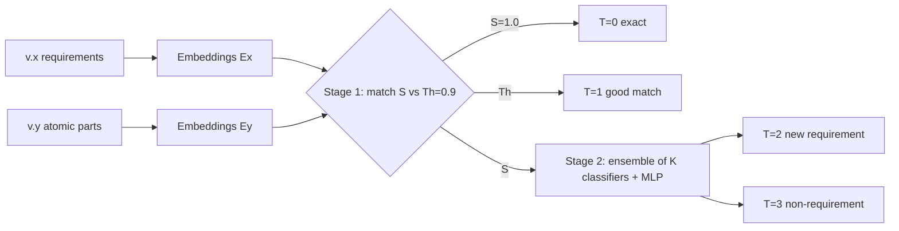

<!-- generated by yt-paper; edits will be overwritten -->
[DVCon](../dvcon/index.md) › [US](../dvcon/us.md) › [2025](../dvcon/by-year.md#2025) › [Verification](../dvcon/by-topic.md#verification)

# Technical Documents Version Management System Based on Large Language Models

<figure class="rep-fig" markdown>
{ loading=lazy }
<figcaption>Figure 2. Block diagram of the document version management system. — from the original paper (S. S. Zalivaka et al.)</figcaption>
</figure>

[:material-open-in-new: Original paper](https://dvcon-proceedings.org/wp-content/uploads/1027-2.pdf){ .md-button .md-button--primary target=_blank }

| | |
|---|---|
| Authors | S. S. Zalivaka (SK hynix memory solutions Poland) |
| Venue | DVCon US 2025 |
| Topic | Verification |
| Type | PAPER |
| ID | `ref-20261018-2740` |

## Summary

**A two-stage method that first matches requirements across specification versions with sentence embeddings and then applies an ensemble of Mistral-based context-window classifiers to new text, reaching F1 0.901 (vs 0.754 prior work) and 90.05% requirement recognition on M-PHY 6.0.**

**문서 버전 간 요구사항을 문장 임베딩으로 먼저 매칭하고, 이후 Mistral 기반 컨텍스트 윈도우 분류기 앙상블로 새 텍스트를 판별하는 2단계 방법으로, M-PHY 6.0에서 F1 0.901(기존 연구 0.754)과 90.05% 요구사항 인식률을 달성했습니다.**

## Key Insights

- Reusing previous-version requirements via embedding similarity (threshold Th=0.9) recovers 100% of inherited requirements in M-PHY 6.0 (553 of 1246), so the classifier only needs to handle unmatched text.

- 임베딩 유사도(임계값 Th=0.9)로 이전 버전 요구사항을 재사용하면 M-PHY 6.0에서 상속 요구사항 100%(1246개 중 553개)를 복원하므로, 분류기는 매칭되지 않은 텍스트만 처리하면 됩니다.

- An ensemble of K=15 context-window classifiers (chosen from 43 candidates, S=2 to 100) reached 0 erroneous sentences in the ensemble comparison, versus 8 at K=11; the 5-layer MLP combiner trains in under one minute without GPU.

- 컨텍스트 윈도우가 다른 K=15개 분류기 앙상블(후보 43개, S=2~100)은 앙상블 비교에서 오류 문장 0개를 기록했으며, K=11에서는 8개였고, 5계층 MLP 결합기는 GPU 없이 1분 미만에 학습됩니다.

- Vector database and semantic search both give 90.05% recognition, while Levenshtein distance gives 86.27% and misses 47 requirements because it ignores semantics, though it runs on CPU in 1.9 s.

- Vector DB와 semantic search는 모두 90.05% 인식률을, Levenshtein 거리는 86.27%를 보였고 의미를 고려하지 않아 47개 요구사항을 놓쳤지만 CPU에서 1.9초에 동작합니다.

- Generalization is the main bottleneck: new requirements are recognized at only about 80% on an unseen specification, and the authors attribute this to training on a single document (M-PHY 4.1).

- 일반화가 주된 병목입니다. 본 적 없는 명세서에서 신규 요구사항 인식률은 약 80%에 그쳤으며, 저자들은 이를 단일 문서(M-PHY 4.1) 학습 탓으로 봅니다.

- Threshold sensitivity matters: Th below 0.3 causes false requirement detections, while Th above 0.95 detects only exact-match-like requirements.

- 임계값 민감도가 중요합니다. Th가 0.3 미만이면 비요구사항을 잘못 검출하고, 0.95 초과이면 exact match에 가까운 요구사항만 검출합니다.

## Detailed Summary

### Background and Problem

- Manual requirement extraction from specifications (here MIPI M-PHY 4.1 and 6.0) is labor-intensive, and prior NLP methods either ignore earlier document versions or classify fixed short text spans.

- 명세서(MIPI M-PHY 4.1, 6.0)에서 요구사항을 수작업으로 추출하는 작업은 노동 집약적이며, 기존 NLP 방식은 이전 문서 버전을 무시하거나 고정된 짧은 텍스트 단위를 분류합니다.

- Training set: M-PHY 4.1 (219 pages, 4629 sentences, 772 requirements). Validation set: M-PHY 6.0 (249 pages, 2892 sentences, 1246 requirements).

- 학습 세트: M-PHY 4.1 (219쪽, 4629문장, 요구사항 772개). 검증 세트: M-PHY 6.0 (249쪽, 2892문장, 요구사항 1246개).

### Architecture and Methodology

- Stage 1: requirements from v.x and all atomic parts of v.y are embedded with SFR-Embedding-Mistral; the closest match gives similarity S.

- 1단계: v.x의 요구사항과 v.y의 모든 atomic part를 SFR-Embedding-Mistral로 임베딩하며, 가장 가까운 매칭으로 유사도 S를 구합니다. S=1.0이면 T=0, Th<S<1이면 T=1로 분류합니다.

- Stage 2: K Mistral-based multi-label classifiers (4-bit quantized, S-sentence windows, 70/30 split) feed a 5-layer MLP (1024-512-256-128-1, dropout 0.2) that combines their outputs.

- 2단계: S-문장 윈도우를 가진 K개의 Mistral 기반 multi-label 분류기(4-bit 양자화, 70/30 분할)가 5계층 MLP(1024-512-256-128-1, dropout 0.2)에 출력을 전달해 결합합니다.

### Results and Conclusions

- Vector DB and semantic search: 3 exact, 550 good matches, 569 new requirements, 90.05% recognition; Levenshtein: 86.27%.

- Vector DB와 semantic search: exact 3개, good match 550개, 신규 요구사항 569개, 인식률 90.05%; Levenshtein: 86.27%.

- Inherited requirements are fully recognized and about 80% of new ones are found; 1122 of 1246 requirements are recovered, reported as F1 0.901 vs 0.754 for prior work.

- 상속된 요구사항은 전부 인식되었고 신규 요구사항은 약 80%가 검출되었으며, 1246개 중 1122개가 복원되어 기존 연구 0.754 대비 F1 0.901로 보고되었습니다.

- Authors conclude that single-specification training data limits generalization and call for tens of thousands of labeled data points.

- 저자들은 단일 명세서 학습 데이터가 일반화를 제한한다고 결론짓고, 수만 개 규모의 라벨 데이터 확보를 제안합니다.

## Videos

<iframe src="https://www.youtube-nocookie.com/embed/sW5YK1aQrZM" title="[DVCON2025]Technical Documents Version Management System Based on Large Language Models" loading="lazy" allow="accelerometer; clipboard-write; encrypted-media; gyroscope; picture-in-picture; web-share" referrerpolicy="strict-origin-when-cross-origin" allowfullscreen></iframe>

**[DVCON2025]Technical Documents Version Management System Based on Large Language Models** — [Watch on YouTube](https://www.youtube.com/watch?v=sW5YK1aQrZM) · [Video page](../videos/sW5YK1aQrZM.md)
