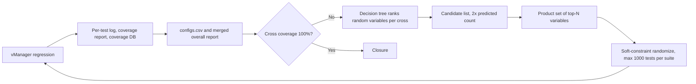

<!-- generated by yt-paper; edits will be overwritten -->
[DVCon](../dvcon/index.md) › [US](../dvcon/us.md) › [2025](../dvcon/by-year.md#2025) › [Verification](../dvcon/by-topic.md#verification)

# Reaching 100% Functional Coverage Using Machine Learning: A Journey of Persistent Efforts

<figure class="rep-fig" markdown>
{ loading=lazy }
<figcaption>Figure 4 (a) simply shows the overall workflow of the suggested approach and the inputs used in each step. In this paper, the Verisium Manager, hereafter vManager, was used to run regression tests, and the Integrated Metrics Center, hereafter IMC, was used to merge coverage results and generate a report. — from the original paper (Jaecheon Kim et al.)</figcaption>
</figure>

[:material-open-in-new: Original paper](https://dvcon-proceedings.org/wp-content/uploads/1022-2.pdf){ .md-button .md-button--primary target=_blank }

| | |
|---|---|
| Authors | Jaecheon Kim (Samsung Electronics Co., Ltd.), Taewook Nam (Samsung Electronics Co., Ltd.), Wonil Cho (Samsung Electronics Co., Ltd.) |
| Venue | DVCon US 2025 |
| Topic | Verification |
| Type | PAPER |
| ID | `ref-20261018-2c1c` |

## Summary

**A Python-based coverage agent uses decision-tree predictions over regression logs and coverage data to identify the random variables behind unfilled cross-coverage bins, then regenerates soft-constrained regression suites to close cross coverage faster than baseline random regression.**

**Python 기반 coverage agent가 regression 로그와 커버리지 데이터에 decision tree를 적용해 미충족 cross coverage bin에 영향을 주는 random variable을 찾고, soft constraint가 적용된 regression suite를 다시 생성하여 기존 랜덤 regression보다 빠르게 cross coverage를 닫는다.**

## Key Insights

- Cross coverage, not individual coverpoints, is the bottleneck: in the paper's example, coverpoints fill easily but cross_test_xy (2,688 bins) reached only 99.74% (2681/2688) after about 25,000 baseline tests, and the weighted-distribution experiment showed that 5,000 random trials leave uneven bin coverage (max 25, min 3 over 420 bins).

- 병목은 개별 coverpoint가 아니라 cross coverage다. 논문 예제에서 cross_test_xy(2,688 bins)는 기준 실험에서 약 25,000 테스트 후에도 99.74%(2681/2688)에 머물렀고, 가중치 실험에서는 420 bin 중 5,000회 randomization의 빈도 편차가 최대 25, 최소 3이었다.

- Even a uniform distribution needs many runs: cross_test_mode (720 bins) required about 6,000 to 7,000 tests to fill, and a 2:8 skew left 3 combinations unreachable in 5,000 trials (20 for 1:9).

- 균등 분포라도 많은 실행이 필요하다. cross_test_mode(720 bins)는 약 6,000~7,000 테스트가 필요했고, 2:8 편향에서는 5,000회 시도 후 3개 조합이 도달하지 않았으며 1:9에서는 20개가 도달하지 않았다.

- The coverage agent treats prediction as feature ranking: a decision tree (white-box) ranks random variables by contribution to each cross bin, the top-N variables form a product set, and a candidate list of 2x N is kept for diversity.

- coverage agent는 예측을 feature ranking으로 다룬다. white-box decision tree가 random variable을 cross bin 기여도 순으로 정렬하고, 상위 N개 변수의 product set을 만들며, 다양성을 위해 예측 개수의 2배 크기 candidate list를 유지한다.

- Failure-tolerant safeguards are required: all generated values are declared as soft constraints so illegal combinations fall back to normal randomization; predictions whose product set exceeds the bin count are rejected; and stalled crosses are rotated out after two regression cycles without change.

- 예측 실패에 대비한 안전장치가 필요하다. 생성된 모든 값은 soft constraint로 선언되어 불가능한 조합은 정상 randomization으로 대체되고, product set 크기가 bin 수를 넘는 예측은 기각되며, 두 regression cycle 동안 변화가 없는 cross 조합은 제외된다.

- On a real mobile ISP CSI IP (134 cross coverages, 14,616 bins, about 7,000 random variables), the agent reached 100% after 74,956 total tests versus a baseline that stayed below 70% after more than 100,000 runs (the baseline figure is taken from the paper's own table).

- 실제 모바일 SoC ISP 블록의 CSI IP(cross 134개, bin 14,616개, random variable 약 7,000개)에서 agent는 총 74,956 테스트 후 100%에 도달했고, 기준 regression은 100,000회 이상 실행 후에도 70%를 넘지 못했다(기준 수치는 논문 표 기준).

## Detailed Summary

### Background and Problem

- Achieving functional coverage closure with constrained random verification (CRV) is becoming harder as IP RTL grows; the authors identify cross coverage as the main source of closure delay.

- IP RTL의 복잡도가 증가하면서 constrained random verification(CRV)으로 functional coverage closure를 달성하기가 어려워지고 있으며, 저자들은 cross coverage를 closure 지연의 주요 원인으로 지목한다.

- Coverpoints fill easily as test count grows, but crosses built from their combinations stay under-filled. Engineers currently close the gap manually by analyzing reports, running related scenarios more, adjusting configuration distributions, or forcing directed values.

- Coverpoint는 테스트 수가 늘면 쉽게 채워지지만, 그 조합으로 만든 cross는 충분히 채워지지 않는다. 현재 엔지니어는 리포트를 분석하고, 관련 시나리오를 집중 실행하거나, 설정 분포를 조정하거나, directed 값을 직접 지정하는 방식으로 수동 대응한다.

- Controlled experiment (Section II): four variables with 2, 6, 5, and 7 values give a 420-bin cross. With uniform weights and 5,000 randomizations, the per-bin frequency ranged from 25 (max) to 3 (min). Skewing one variable to 2:8 left 3 bins unreached, and 1:9 left 20 unreached.

- 통제 실험(II장): 2, 6, 5, 7개 값을 가진 네 변수로 420-bin cross를 구성했다. 균등 가중치에서 5,000회 randomization 시 bin별 빈도는 최대 25, 최소 3이었다. 한 변수를 2:8로 편향시키면 3개 bin이 도달하지 않았고, 1:9에서는 20개가 도달하지 않았다.

### Architecture and Methodology

The approach is a loop in which a Python "coverage agent" watches vManager regression runs. It uses IMC for merging and reporting.

이 방법은 Python "coverage agent"가 vManager regression 실행을 감시하는 루프 구조다. 병합과 리포트 생성에는 IMC를 사용한다.

- **Inputs:** the log (constraint values printed with `uvm_field_*` macros in one line, `knobs.begin_elements = -1`), the per-test coverage report (cross name, total bins, touched bins, number of constituent coverpoints), and the per-test coverage database.

- **입력:** 로그(`uvm_field_*` 매크로로 출력된 constraint 값을 한 줄로 기록, `knobs.begin_elements = -1` 설정), 테스트별 커버리지 리포트(cross 이름, 전체 bin 수, touched bin 수, 구성 coverpoint 수), 테스트별 커버리지 DB.

- **Feature/target formulation:** features are random variables; the target is the bin index of each cross coverage (0 means untouched). The decision tree is chosen as a white-box model, so feature importance, not classification accuracy, is the actual output. Random 80/20 splits make the ranking vary between iterations.

- **Feature/target 정의:** feature는 random variable이고, target은 각 cross coverage bin의 번호다(0은 해당 테스트에서 bin이 touch되지 않았음을 뜻한다). Decision tree는 white-box 모델이므로 분류 정확도보다 feature 중요도가 실제 산출물이다. 매 반복마다 80/20 무작위 분할을 사용하므로 순위가 반복마다 달라질 수 있다.

- **Prediction use:** the number of top variables is set by the number of constituent coverpoints in the cross. Their product set is compared with the observed value combinations. Combinations not yet generated become constraints for the next suite.

- **예측 활용:** 상위 변수 개수는 해당 cross를 구성하는 coverpoint 수로 정한다. 이 변수들의 product set을 실제로 관측된 값 조합과 비교하고, 아직 생성되지 않은 조합을 다음 regression의 constraint로 사용한다.

- **Soft constraints:** all generated values are declared `soft` in `randomize() with`, so an impossible combination is silently overridden and the test still runs as a normal regression test and feeds the next training round.

- **Soft constraint:** 생성된 모든 값을 `randomize() with`에서 `soft`로 선언한다. 따라서 불가능한 조합은 무시되고 정상 randomization으로 대체되며, 해당 테스트는 일반 regression 테스트로 실행되어 다음 학습 데이터가 된다.

- **Strategies for failure cases:**
  - Case 1: too few predicted variables → select tests that touched any cross bin and re-add them.
  - Case 2: a wrong prediction whose product set is fully covered → add tests as in Case 1.
  - Case 3: product-set size greater than the bin count → reject and move to the next candidate.
  - Case 4: wrong top-ranked combination → keep the candidate list at 2x size and drop a combination after two regression cycles with no coverage change.
  - Case 5: aliased variables with identical values but different names → keep only one in the candidate list.

- **실패 상황별 전략:**
  - Case 1: 예측 변수 수가 부족한 경우 → cross bin을 하나라도 touch한 테스트를 무작위 선택해 suite에 다시 추가한다.
  - Case 2: 잘못된 예측으로 생성된 product set이 모두 커버된 경우 → Case 1과 같이 테스트를 추가한다.
  - Case 3: product set 크기가 bin 수보다 큰 경우 → 기각하고 candidate list의 다음 조합으로 넘어간다.
  - Case 4: 잘못된 상위 조합이 계속 나오는 경우 → candidate list를 2배 크기로 유지하고, 두 regression cycle 동안 커버리지 변화가 없으면 해당 조합을 제외한다.
  - Case 5: 값은 같고 이름만 다른 변수 → candidate list에 하나만 남긴다.

### Results and Conclusions

- **Simple example (13 random variables, 8 coverpoints, 2 crosses):** 4,378 tests total across 5 suites, max 1,000 per suite, starting after an initial 700-test regression. cross_test_xy rose from 57.66% to 94.78% in iteration 3 after a correct prediction, and reached 100% in iteration 5. cross_test_mode reached 100% in iteration 2.

- **단순 예제(random variable 13개, coverpoint 8개, cross 2개):** 초기 700 테스트 regression 이후 적용하여, 5개 suite에 suite당 최대 1,000개, 총 4,378 테스트를 실행했다. cross_test_xy는 iteration 3에서 올바른 예측 후 57.66%에서 94.78%로 상승했고, iteration 5에서 100%에 도달했다. cross_test_mode는 iteration 2에서 100%에 도달했다.

- **Real CSI IP in a mobile SoC ISP block:** 20,290 tests in the initial regression, then 74,956 tests total to 100% functional coverage. The baseline did not exceed 70% after more than 100,000 runs. After the first regression, 21 of 134 crosses were unfilled, covering 7,673 bins.

- **모바일 SoC ISP 블록의 실제 CSI IP:** 초기 regression에서 20,290 테스트를 실행했고, 총 74,956 테스트 후 functional coverage 100%에 도달했다. 기준 regression은 100,000회 이상 실행 후에도 70%를 넘지 못했다. 첫 regression 후 전체 134개 cross 중 21개가 미충족이었으며, 해당 bin은 7,673개였다.

- **Trajectory types (Figure 7):** cross_cov_19 closed in the next regression from first-run data alone. cross_cov_14 failed several times before succeeding. cross_cov_7 barely moved and closed only through the fallback strategies.

- **진행 양상(Figure 7):** cross_cov_19는 첫 regression 데이터만으로 다음 regression에서 닫혔다. cross_cov_14는 여러 번 예측에 실패한 뒤 성공했다. cross_cov_7은 커버리지가 거의 움직이지 않았고, 보완 전략을 통해서만 닫혔다.

- **Conclusion:** closure is achieved without extra DV effort by reusing regression outputs. The method is an all-or-nothing bet per prediction, with random regression acting as the fallback. The paper does not report results beyond these two cases, and it does not give a comparison against other ML-based test-selection methods.

- **결론:** regression 산출물을 재사용하여 추가 DV 노력 없이 closure를 달성한다. 예측 하나하나는 전부 아니면 전무(all-or-nothing) 방식이며, 실패 시 랜덤 regression이 대체 역할을 한다. 논문은 이 두 사례 이상의 결과와 다른 ML 기반 테스트 선택 기법과의 비교는 제시하지 않는다.

- **Caveat:** the method assumes coverpoints fill quickly. The paper states that performance degrades when a random variable is non-uniform and its coverpoint fills late.

- **한계:** 방법은 coverpoint가 빠르게 채워진다고 가정한다. 논문은 random variable이 비균등이고 coverpoint가 늦게 채워지는 경우 성능이 저하된다고 명시한다.

## Videos

<iframe src="https://www.youtube-nocookie.com/embed/Xzi_4Shpd7U" title="[DVCON2025]Reaching 100% Functional Coverage Using Machine Learning: A Journey of Persistent Efforts" loading="lazy" allow="accelerometer; clipboard-write; encrypted-media; gyroscope; picture-in-picture; web-share" referrerpolicy="strict-origin-when-cross-origin" allowfullscreen></iframe>

**[DVCON2025]Reaching 100% Functional Coverage Using Machine Learning: A Journey of Persistent Efforts** — [Watch on YouTube](https://www.youtube.com/watch?v=Xzi_4Shpd7U) · [Video page](../videos/Xzi_4Shpd7U.md)
