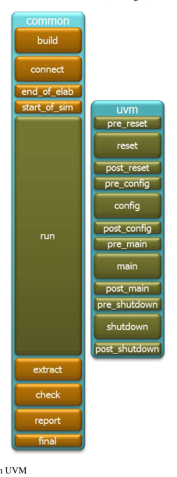
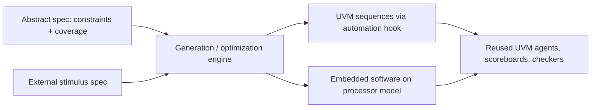

<!-- generated by yt-paper; edits will be overwritten -->
[DVCon](../dvcon/index.md) › [US](../dvcon/us.md) › [2014](../dvcon/by-year.md#2014) › [Verification](../dvcon/by-topic.md#verification)

# Of Camels and Committees: Standards Should Enable Innovation, Not Strangle It

<figure class="rep-fig" markdown>
{ loading=lazy }
<figcaption>Fig. 1. Phasing in UVM — from the original paper (Tom Fitzpatrick et al.)</figcaption>
</figure>

[:material-open-in-new: Original paper](https://dvcon-proceedings.org/wp-content/uploads/of-camels-and-committees.pdf){ .md-button .md-button--primary target=_blank }

| | |
|---|---|
| Authors | Tom Fitzpatrick (Mentor Graphics Corp., Groton, MA), Dave Rich (Mentor Graphics Corp., Fremont, CA) |
| Venue | DVCon US 2014 |
| Topic | Verification |
| Type | PAPER |
| ID | `ref-20261018-2c26` |

## Summary

**The paper argues that SystemVerilog and UVM have reached diminishing returns, so committees should stop adding features to the core standards and leave innovation to higher-level abstraction tools built on top of UVM, supported by measured UVM 1.2 overhead and SoC complexity data.**

**이 논문은 SystemVerilog와 UVM이 수익 체감 단계에 도달했다고 주장하며, 표준 위원회가 핵심 표준에 기능을 더 추가하지 말고 혁신은 UVM 위에 구축되는 상위 추상화 도구에 맡겨야 한다고 제안한다. 이 주장은 UVM 1.2 제안의 측정된 오버헤드와 SoC 복잡도 증가 데이터를 근거로 한다.**

## Key Insights

- Proposed UVM 1.2 messaging extensions add a 20% printing overhead versus UVM 1.1d even without extra tags; transaction recording slows by 65% (excluding file I/O), with overhead rising from 76% (1.1d) to 126% (1.2).

- UVM 1.2에서 제안된 다중 필드 메시징 확장은 태그를 사용하지 않아도 UVM 1.1d 대비 20%의 출력 오버헤드를 추가하며, transaction recording은 파일 I/O를 제외하고 65% 느려진다. 이 오버헤드는 1.1d의 76%에서 1.2의 126%로 증가한다.

- Runtime phasing, added in UVM 1.1, was still not fully resolved more than four years later; phase jumping is discouraged and the feature is hard to remove because users already depend on it, a cautionary case for releasing complex features before field vetting.

- UVM 1.1에서 추가된 runtime phasing은 4년 이상이 지나도 완전히 해결되지 않았다. phase jump는 권장되지 않으며, 사용자가 이미 의존하고 있어 제거하기 어렵다. 이는 현장 검증 없이 복잡한 기능을 출시하는 것의 위험을 보여주는 사례다.

- SoC complexity scaled sharply: average logic and datapath gates (excluding memories) rose from 400K (2004) to 11.1M (2012), and average embedded processors rose from 1.06 to 2.25, so constrained-random coverage plateaus on large designs.

- SoC 복잡도는 급격히 증가했다. 메모리를 제외한 로직 및 datapath 게이트 수는 평균 400K(2004년)에서 11.1M(2012년)으로 늘었고, 평균 임베디드 프로세서 수는 1.06에서 2.25로 증가했다. 이로 인해 대형 설계에서는 constrained-random 커버리지가 정체된다.

- The authors recommend a single abstract specification that unifies constraints and coverage goals, reusable both as UVM sequences and as embedded software, with tool automation layered above UVM rather than inside its core.

- 저자들은 제약 조건과 커버리지 목표를 하나로 통합한 단일 추상 명세를 제안한다. 이 명세는 UVM sequence와 임베디드 소프트웨어 양쪽에서 재사용할 수 있으며, 자동화 도구는 UVM 핵심부가 아니라 UVM 위의 계층에 구현한다.

- SystemVerilog's choice to standardize constraint syntax but not the solver algorithm created competitive tool innovation; the paper argues standards should stay bounded so tools can compete on products.

- SystemVerilog는 제약 문법은 표준화했지만 solver 알고리즘은 표준화하지 않았고, 이 선택이 도구 간 경쟁과 혁신을 이끌었다. 저자들은 표준은 범위를 제한해 도구가 제품으로 경쟁할 수 있도록 해야 한다고 주장한다.

## Detailed Summary

### Background and Problem

- Standards such as SystemVerilog and UVM give users a portable code base and let tool vendors focus on tools, but committee work tends to drift toward niche "pet features" that bloat the standard, add complexity, and break backward compatibility.

- SystemVerilog와 UVM 같은 표준은 사용자에게 이식 가능한 코드 베이스를 제공하고 도구 벤더가 도구 개발에 집중할 수 있게 하지만, 위원회 작업은 틈새 "pet feature"를 추가하는 방향으로 흐르기 쉽다. 그 결과 표준이 비대해지고 복잡도가 올라가며 하위 호환성이 깨진다.

- SystemVerilog origin: SUPERLOG (development from 1999, redesigned to be 100% Verilog-compatible) was donated to Accellera and became SystemVerilog 3.0 in 2002. It merged Verilog, Specman, and Vera features. The LRM grew from about 140 pages of Verilog enhancements to about 1400 pages. Examples of redundancy include `always_comb` vs. `always @*`, wildcard-indexed associative arrays, and program blocks, whose testbench-side races the paper says are not addressed.

- SystemVerilog의 기원: SUPERLOG(1999년 개발 시작, Verilog와 100% 호환되도록 재설계)가 Accellera에 기증되어 2002년 SystemVerilog 3.0이 되었다. Verilog, Specman, Vera의 기능을 통합했다. LRM은 Verilog 개선안 약 140페이지에서 약 1400페이지로 늘어났다. 중복 사례로는 `always_comb`와 `always @*`, wildcard 인덱스 associative array, program block이 있으며, 논문은 program block이 테스트벤치 측 race를 해결하지 못한다고 지적한다.

- UVM origin: Accellera standardized UVM on the OVM base (the OVM/VMM interoperability library was approved in 2009). UVM 1.0EA shipped in May 2010 and UVM 1.0 in February 2011. Runtime phasing was added in 1.1 and drove most of the size growth from 1.0p1 to 1.1. Its semantics were hard to agree on, and phase jumping proved unworkable, so the committee recommended using run-time phase methods only from tests to start sequences.

- UVM의 기원: Accellera는 OVM 기반으로 UVM을 표준화했다(OVM/VMM 상호운용 라이브러리는 2009년 승인). UVM 1.0EA는 2010년 5월, UVM 1.0은 2011년 2월에 출시되었다. Runtime phasing은 1.1에서 추가되었고, 1.0p1에서 1.1로의 크기 증가 대부분을 차지했다. 의미 정의에 합의하기 어려웠고 phase jump는 실용성이 없었으며, 위원회는 run-time phase 메서드를 test에서 sequence를 시작하는 용도로만 쓰도록 권고했다.

- The proposed UVM 1.2 changes include multi-field messaging (about 16 new macros for INFO/WARNING/ERROR/FATAL plus 4 "add" macros) and a backward-incompatible transaction recording API.

- 제안된 UVM 1.2 변경에는 다중 필드 메시징(INFO/WARNING/ERROR/FATAL용 약 16개 신규 매크로와 4개의 "add" 매크로)과 하위 호환성이 깨지는 transaction recording API가 포함된다.

- Changing SoC requirements: embedded processors make software a critical part of verification, and cache-coherent fabrics (e.g., ARM ACE) are now subsystems that constrained-random sequences cannot reliably cover.

- SoC 요구사항의 변화: 임베디드 프로세서로 인해 소프트웨어가 검증의 핵심 요소가 되었고, cache coherent 패브릭(예: ARM ACE)은 이제 서브시스템이어서 constrained-random sequence로 신뢰성 있게 커버할 수 없다.

### Architecture and Methodology

This is a position paper. It combines a historical review of SystemVerilog and UVM, a size analysis of UVM releases, performance measurements of proposed UVM 1.2 code against 1.1d, and an architectural proposal for the next verification layer.

이 논문은 position paper다. SystemVerilog와 UVM의 역사적 검토, UVM 릴리스의 크기 분석, 제안된 UVM 1.2 코드와 1.1d의 성능 측정, 그리고 다음 검증 계층에 대한 구조 제안을 결합한다.

- UVM size (classes / files / lines): 1.0p1 288/125/65534; 1.1 311/131/66660; 1.1d 316/133/67967; 1.2a 351/144/75070 (latest merge at time of writing).

- UVM 크기(클래스 / 파일 / 라인): 1.0p1 288/125/65534, 1.1 311/131/66660, 1.1d 316/133/67967, 1.2a 351/144/75070(집필 시점의 최신 merge 기준).

- Messaging: the paper measures about 20% extra cost for the proposed multi-field printing path versus 1.1d, with no tags used. Processing covers verbosity and ID checks, report catchers, and output.

- 메시징: 제안된 다중 필드 출력 경로는 태그를 쓰지 않은 상태에서도 1.1d 대비 약 20%의 추가 비용이 든다고 측정되었다. 처리 과정에는 verbosity 및 ID 검사, report catcher, 출력이 포함된다.

- Transaction recording: 65% slowdown versus 1.1d (file I/O excluded). Recording overhead is 76% in 1.1d and 126% in 1.2.

- Transaction recording: 파일 I/O를 제외하고 1.1d 대비 65% 느려진다. 기록 오버헤드는 1.1d에서 76%, 1.2에서 126%이다.

- Coverage and constraints: the paper uses an example bus protocol with 4 size × 2 rw × 16 waits × 100 xmit_delay = 12,800 transaction variants before address and memory-region multiplicity is considered. It argues that random generation cannot exhaust this space, and that sequential scenarios are hard to express as constraints. Coverage tends to level off (Fig. 2), and the only recourse is to rewrite constraints.

- 커버리지와 제약: 논문은 size 4 × rw 2 × waits 16 × xmit_delay 100 = 12,800가지 트랜잭션 변형이라는 예시 버스 프로토콜을 든다. 주소 및 메모리 영역의 곱셈 효과는 여기에 포함되지 않은 값이다. 랜덤 생성으로 이 공간을 소진할 수 없고, 순차적 시나리오는 제약으로 표현하기 어렵다고 주장한다. 커버리지는 정체되기 쉬우며(Fig. 2), 유일한 대응책은 제약을 다시 작성하는 것이다.

- Proposed architecture: an abstract specification that unifies constraints and coverage so generation covers the state space without repetition. Generation can target either a UVM sequence (through an automation hook) or software running on the processor model, with the rest of the UVM environment reused unchanged. Real-world external stimulus can be modeled the same way so software reacts to realistic scenarios.

- 제안 구조: 제약과 커버리지를 통합한 추상 명세로, 상태 공간을 반복 없이 커버하도록 생성한다. 생성 결과는 자동화 hook을 통한 UVM sequence이거나 프로세서 모델에서 실행되는 소프트웨어일 수 있으며, 나머지 UVM 환경은 변경 없이 재사용한다. 외부(실세계) 자극도 같은 방식으로 모델링하여 소프트웨어가 현실적인 시나리오에 반응하도록 할 수 있다.

### Results and Conclusions

- The paper finds no quantitative speedup or result for its own proposal; the evidence consists of UVM 1.2 overhead measurements and industry usage data.

- 논문은 자체 제안에 대한 정량적 속도 향상이나 결과를 제시하지 않는다. 근거는 UVM 1.2 오버헤드 측정과 업계 사용 데이터이다.

- Usage data from the 2012 Wilson Research Group study: UVM adoption grew 486% since 2010 and reached a 41% plurality, ahead of OVM (34%) and VMM (20%). The respondent pool and sponsor were blinded in the study. The paper also reports that SoC gates rose from 400K (2004) to 11.1M (2012), average processors rose from 1.06 to 2.25, and designs with one or more processors rose from 52% to 79%.

- 2012 Wilson Research Group 조사 데이터: 2010년 이후 UVM 사용은 486% 증가했으며 41%의 plurality를 차지해 OVM(34%)과 VMM(20%)을 앞섰다. 조사의 응답자 풀과 후원사는 블라인드 처리되었다. 논문은 또한 SoC 게이트 수가 400K(2004년)에서 11.1M(2012년)으로, 평균 프로세서 수가 1.06에서 2.25로 증가했으며, 하나 이상의 프로세서를 가진 설계 비율이 52%에서 79%로 늘었다고 보고한다.

- Conclusion: SystemVerilog and UVM are successful but overlapping and partly contradictory. The authors recommend a "cooling off" period that stops adding core features, which slow the library and break compatibility. Innovation should happen in tools above UVM, consistent with the standard's original decision to leave solver algorithms unstandardized.

- 결론: SystemVerilog와 UVM은 성공적이지만 중복되고 일부는 상충한다. 저자들은 핵심 기능 추가를 멈추는 "cooling off" 기간을 권고하는데, 이러한 기능 추가가 라이브러리를 느리게 하고 호환성을 깨뜨리기 때문이다. 혁신은 UVM 위의 도구에서 이루어져야 하며, 이는 solver 알고리즘을 표준화하지 않는다는 표준의 원래 결정과 일치한다.

- Caveats for the reader: the authors are employed by a simulator vendor (Mentor Graphics), the measurements apply to draft code at the time of writing, and the arguments are opinion-based.

- 독자를 위한 유의점: 저자들은 시뮬레이터 벤더(Mentor Graphics) 소속이며, 측정은 집필 시점의 초안 코드에 대한 것이고, 주장은 의견에 기반한다.

## Videos

<iframe src="https://www.youtube-nocookie.com/embed/__Vvwmx-J0M" title="[DVCON2014]Of Camels and Committees" loading="lazy" allow="accelerometer; clipboard-write; encrypted-media; gyroscope; picture-in-picture; web-share" referrerpolicy="strict-origin-when-cross-origin" allowfullscreen></iframe>

**[DVCON2014]Of Camels and Committees** — [Watch on YouTube](https://www.youtube.com/watch?v=__Vvwmx-J0M) · [Video page](../videos/__Vvwmx-J0M.md)
