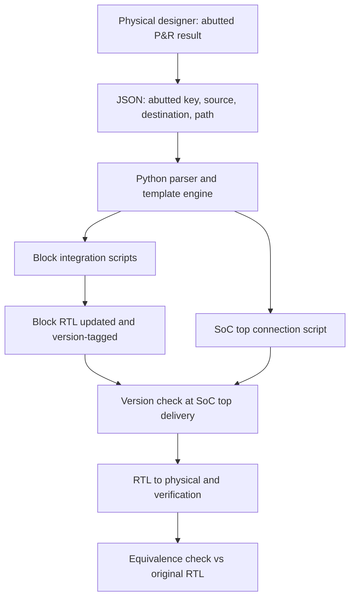

<!-- generated by yt-paper; edits will be overwritten -->
[DVCon](../dvcon/index.md) › [US](../dvcon/us.md) › [2020](../dvcon/by-year.md#2020) › [EDA](../dvcon/by-topic.md#eda)

# Automated RTL Update for Abutted Design

<figure class="rep-fig" markdown>
{ loading=lazy }
<figcaption>Fig. 7. RTL Update Automation Flow — from the original paper (Wonkyung Lee et al.)</figcaption>
</figure>

[:material-open-in-new: Original paper](https://dvcon-proceedings.org/wp-content/uploads/automated-rtl-update-for-abutted-design_paper.pdf){ .md-button .md-button--primary target=_blank }

| | |
|---|---|
| Authors | Wonkyung Lee (Samsung Electronics Co., Ltd., Seoul, Korea), Ayoung Kwon (Samsung Electronics Co., Ltd., Seoul, Korea), Soyeong Kwon (Samsung Electronics Co., Ltd., Seoul, Korea), Youngsik Kim (Samsung Electronics Co., Ltd., Seoul, Korea), Seonil Brian Choi (Samsung Electronics Co., Ltd., Seoul, Korea) |
| Venue | DVCon US 2020 |
| Topic | EDA |
| Type | PAPER |
| ID | `ref-20261018-2fe4` |

## Summary

**The paper proposes a metadata-driven flow that takes JSON-described abutted-floorplan change requests from physical designers and automatically regenerates block-level and SoC-top RTL connections via IP-XACT-based scripts, with version tags for cross-block consistency.**

**이 논문은 물리 설계자가 JSON으로 기술한 abutted floorplan 변경 요청을 받아, IP-XACT 기반 스크립트로 블록 및 SoC top RTL 연결을 자동 재생성하고, 블록 간 일관성을 버전 태그로 보장하는 메타데이터 기반 흐름을 제안한다.**

## Key Insights

- Abutted floorplan removes top-level routing channels to save area, but it forces many RTL changes late in the flow (test-mode control IP moves, feed-through routing, register slices, and split flip-flops), which must be repeated whenever P&R changes.

- Abutted floorplan은 top-level routing 채널을 제거해 면적을 줄이지만, P&R 이후 feed-through 연결, SoC top 로직의 블록 내 재배치, register slice, flip-flop 분리 등 많은 RTL 변경을 늦은 단계에 요구하며 P&R이 바뀔 때마다 반복된다.

- The approach records each abutted change request (abutted key, source, destination, and block path) in a JSON file; Python tooling with a template engine turns these into integration scripts for function blocks and SoC top.

- 변경 요청은 abutted key, source, destination, path(블록 목록)로 구성된 JSON 파일에 기록되며, Python 파서와 템플릿 엔진이 이를 블록 및 SoC top 통합 스크립트로 변환한다.

- Connection changes from the proposed flow: the test-mode control IP port connections doubled, data-communication port connections rose 7.3x, and pad test-signal port connections rose 6.9x (about 2 to 7x overall); the example data path went from 3 to 11 interface connections plus 2 register slice instances.

- 제안 흐름에서 연결 수 변화는 다음과 같다. 테스트 모드 제어 IP 포트 연결은 두 배가 되었고, 블록 간 데이터 통신 포트 연결은 7.3배, 패드 테스트 신호 포트 연결은 6.9배 증가했으며, 전체적으로 최소 2~7배 증가했다. 예시 데이터 경로는 인터페이스 연결 3개에서 11개로, register slice 인스턴스 2개가 추가되었다.

- Version tagging of every connection written by the scripts, plus a version check at block delivery, keeps all function blocks in sync when many blocks are updated in parallel.

- 스크립트가 작성하는 모든 연결에 고유 버전 태그를 붙이고 블록을 SoC top 통합에 전달할 때 이를 확인하여, 여러 블록을 병렬로 갱신할 때도 블록 간 불일치를 막는다.

- Functional verification runs on RTL without abutted information (since abutted changes are functionally neutral), and the modified connections are then compared against the original with equivalence checking.

- abutted 변경은 기능적으로 중립이므로 abutted 정보 없이 RTL에서 기능 검증을 수행하고, 이후 원본 RTL과의 연결 일치 여부를 equivalence check로 확인한다.

## Detailed Summary

### Background and Problem

- Abutted floorplan reduces chip area by eliminating top-level routing channels. Physical designers then request RTL changes after P&R: feed-through connections that pass through intermediate function blocks, and relocation of SoC-top logic into function blocks.

- Abutted floorplan은 top-level 라우팅 채널을 제거해 칩 면적을 줄인다. 그 결과 물리 설계자는 P&R 이후 중간 기능 블록을 통과하는 feed-through 연결과, SoC top 로직을 기능 블록 내부로 옮기는 RTL 변경을 요청한다.

- The SoC is split into many function blocks (about 30 in the example) because of EDA capacity limits. RTL edits must therefore be made by many block integration engineers in parallel, quickly, and without mismatch between blocks.

- EDA 툴 용량 한계 때문에 SoC는 많은 기능 블록으로 나뉘며(예시에서 약 30개), RTL 수정은 여러 블록 통합 엔지니어가 동시에, 빠르고 블록 간 불일치 없이 수행해야 한다.

- In the existing IP-XACT flow, interface connections cover about 50% of ports. The remaining ad-hoc connections number over 50,000 in a typical SoC. Manual editing of these connections is error-prone and slow.

- 기존 IP-XACT 흐름에서 인터페이스 연결은 전체 포트의 약 50%를 차지한다. 나머지 ad-hoc 연결은 일반적인 SoC에서 50,000개를 넘는다. 이를 수작업으로 수정하면 오류가 나기 쉽고 시간이 많이 든다.

- Three abutted change categories were identified: (1) relocation of the test-mode control IP (about 50 test modes), (2) register slices for inter-block data communication on top-level channels, and (3) splitting pad-to-block test flip-flops into per-block instances.

- 식별된 abutted 변경 유형은 세 가지다. (1) 테스트 모드 제어 IP 이동(테스트 모드 약 50개), (2) top-level 채널 기반 블록 간 데이터 통신용 register slice, (3) 패드-블록 간 테스트 flip-flop을 블록별로 분리하는 작업.

### Architecture and Methodology

- **IP-XACT as metadata.** Bus definitions, abstraction definitions, components, and designs are used. Components hold port, bus-interface, SFR, and file information. Designs hold instances and connections. Interface connections are made by matching logical port names. Ad-hoc connections are made by explicit port-to-port links and tie-offs (0/1).

- **메타데이터로서의 IP-XACT.** Bus definition, abstraction definition, component, design을 사용한다. Component에는 포트, bus interface, SFR, 파일 정보가 들어가고, design에는 인스턴스와 연결 정보가 들어간다. 인터페이스 연결은 논리 포트 이름 매칭으로 이루어지고, ad-hoc 연결은 명시적 포트 간 연결과 상수(0/1) 연결로 이루어진다.

- **System-level IP automation.** Specifications are entered in a dedicated editor. Scripts generate the RTL for the test-mode IP, instantiate it, and wire its ports. Block designers execute these scripts for integration.

- **시스템 레벨 IP 자동화.** 전용 편집기로 사양을 입력한다. 스크립트가 테스트 모드 IP의 RTL을 생성하고, 인스턴스화하며, 포트를 연결한다. 블록 설계자는 이 스크립트를 실행해 통합을 수행한다.

- **JSON request format.** Each abutted change is described by an abutted key (test-control IP name, register-slice data-communication IP, or pad test-signal IP), a source, a destination, and a path (ordered block list). Example: the direct C-to-E connection becomes C to E routed through H.

- **JSON 요청 형식.** 각 abutted 변경은 abutted key(테스트 제어 IP 이름, 데이터 통신용 register slice IP, 또는 패드 테스트 신호 IP), source, destination, path(순서가 있는 블록 목록)로 기술한다. 예: 직접 연결된 C-E가 H를 경유하도록 바뀐다.

- **Automation implementation.** Python libraries parse the JSON and generate integration scripts through a template engine. Block scripts run automatically at the final step of block integration. Block RTL is then released to SoC top, where the top-level connection script is run.

- **자동화 구현.** Python 라이브러리가 JSON을 파싱하고 템플릿 엔진으로 통합 스크립트를 생성한다. 블록 스크립트는 블록 통합의 마지막 단계에서 자동 실행된다. 이후 블록 RTL이 SoC top으로 전달되고, top-level 연결 스크립트가 실행된다.

- **Version tagging.** Every connection written by the scripts carries a unique version tag. The tag is checked when each block is delivered to SoC-top integration, so mismatched blocks are caught.

- **버전 태깅.** 스크립트가 작성하는 모든 연결에 고유 버전 태그를 붙인다. 블록을 SoC top 통합에 전달할 때 이 태그를 검사해 버전 불일치를 찾아낸다.

- **Verification.** Functional simulation is run on RTL without abutted information, since the change is functionally neutral. Equivalence checking then confirms that the connections in the abutted RTL match the original.

- **검증.** abutted 정보 없이 RTL에서 기능 시뮬레이션을 수행한다. 기능적 변경이 없기 때문이다. 이후 equivalence check로 abutted RTL의 연결이 원본과 일치하는지 확인한다.

### Results and Conclusions

- Port connections for the test-mode control IP doubled.

- 테스트 모드 제어 IP의 포트 연결 수가 두 배가 되었다.

- Port connections for data communication between blocks increased 7.3x, and for pad test-signal transmission 6.9x. The paper describes the overall increase as at least 2x to 7x.

- 블록 간 데이터 통신 포트 연결은 7.3배, 패드 테스트 신호 전송 포트 연결은 6.9배 증가했다. 논문은 전체 증가폭을 최소 2배에서 7배로 기술한다.

- In the data-path example (Fig. 5), the connections for the Block A to Block E path went from 3 interface connections to 11, plus 2 register slice instances in Blocks B and D.

- 데이터 경로 예시(Fig. 5)에서 Block A에서 Block E로 가는 연결은 인터페이스 연결 3개에서 11개로 늘었고, Block B와 D에 register slice 인스턴스 2개가 추가되었다.

- A bus interface connection covers 80 port connections in the data-communication case.

- 데이터 통신 사례에서 bus interface 연결 하나가 80개의 포트 연결을 담당한다.

- The paper states that all new connections are generated automatically "within thousands of seconds" and that RTL for blocks and SoC top was produced without errors. The source text does not give Table 1 values, so no further quantitative breakdown is reported.

- 논문은 신규 연결이 모두 "수천 초(within thousands of seconds)" 안에 자동 생성되고, 블록 및 SoC top RTL이 오류 없이 생성되었다고 밝힌다. 원문에는 Table 1의 수치가 없으므로 더 구체적인 정량 분석은 보고되지 않는다.

- The authors conclude that this flow lets late-stage abutted changes be applied repeatedly, with no added turnaround time (TAT) and no human-induced errors, despite the large RTL delta. The solution was validated on an actual mobile AP SoC project.

- 저자들은 이 흐름으로 늦은 단계의 abutted 변경을 반복 적용할 수 있으며, RTL 변경량이 크더라도 사람에 의한 오류 없이 TAT를 늘리지 않는다고 결론짓는다. 실제 mobile AP SoC 프로젝트에 적용해 검증했다.

- Limitations: the text reports no quantitative comparison against manual effort beyond the connection counts, and it does not describe the tool or standard versions used.

- 한계: 연결 수 외에 수작업 대비 공수에 대한 정량 비교가 없고, 사용한 툴이나 표준 버전은 설명되지 않는다.

## Videos

<iframe src="https://www.youtube-nocookie.com/embed/49BqlsA06io" title="[DVCon2020] Automated RTL Update for Abutted Design" loading="lazy" allow="accelerometer; clipboard-write; encrypted-media; gyroscope; picture-in-picture; web-share" referrerpolicy="strict-origin-when-cross-origin" allowfullscreen></iframe>

**[DVCon2020] Automated RTL Update for Abutted Design** — [Watch on YouTube](https://www.youtube.com/watch?v=49BqlsA06io) · [Video page](../videos/49BqlsA06io.md)
