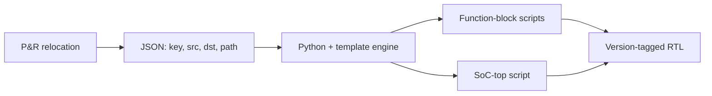

<!-- generated by yt-paper; edits will be overwritten -->
[DVCon](../dvcon/index.md) › [US](../dvcon/us.md) › [2020](../dvcon/by-year.md#2020) › [EDA](../dvcon/by-topic.md#eda)

# Automated RTL Update for Abutted Design

<figure class="rep-fig" markdown>
{ loading=lazy }
<figcaption>Fig. 7. RTL Update Automation Flow — from the original paper (Wonkyung Lee et al.)</figcaption>
</figure>

[:material-open-in-new: Original paper](https://dvcon-proceedings.org/wp-content/uploads/automated-rtl-update-for-abutted-design_paper.pdf){ .md-button .md-button--primary target=_blank }

| | |
|---|---|
| Authors | Wonkyung Lee (Samsung Electronics), Ayoung Kwon (Samsung Electronics), Soyeong Kwon (Samsung Electronics), Youngsik Kim (Samsung Electronics), Seonil Brian Choi (Samsung Electronics) |
| Venue | DVCon US 2020 |
| Topic | EDA |
| Type | PAPER |
| ID | `ref-20261018-2fe4` |

## Summary

**Proposes a JSON-driven, IP-XACT-based flow that automatically regenerates function-block and SoC-top RTL connections when P&R relocates top-level logic into abutted blocks, reporting error-free updates on a mobile AP SoC project.**

**P&R 과정에서 상위 레벨 로직이 Abutted 기능 블록으로 재배치될 때 JSON과 IP-XACT 메타데이터를 기반으로 기능 블록 및 SoC 탑 RTL 연결을 자동 갱신하는 흐름을 제안하며, 모바일 AP SoC 프로젝트에서 오류 없는 업데이트를 보고한다.**

## Key Insights

- Abutted floorplanning multiplies RTL edits: on the mobile AP project, test-mode control IP port connections doubled, data-communication port connections rose 7.3x, and pad test-signal port connections rose 6.9x.

- Abutted 플로어플랜은 RTL 수정량을 크게 늘린다. 모바일 AP 프로젝트에서 test mode 제어 IP의 포트 연결은 두 배가 되었고, 데이터 통신 포트 연결은 7.3배, pad test signal 포트 연결은 6.9배 증가했다.

- Encoding P&R relocation requests as JSON (Abutted Key, Source, Destination, Path) separates physical-design changes from manual RTL editing; Python with a template engine emits per-block and top-level integration scripts.

- P&R 재배치 요청을 JSON(Abutted Key, Source, Destination, Path)으로 표현하면 물리 설계 변경을 수동 RTL 편집에서 분리할 수 있으며, Python과 template engine이 블록별 및 탑 레벨 통합 스크립트를 생성한다.

- Tagging every abutted connection with a unique version and checking it at block delivery is the mechanism that keeps simultaneous multi-block updates consistent.

- 모든 abutted 연결에 고유 버전 태그를 붙이고 블록 전달 시 이를 검사하는 방식이 여러 블록의 동시 업데이트 일관성을 유지하는 핵심 메커니즘이다.

- Verification is staged: function simulation runs on RTL without abutted information, then equivalence checking confirms connection-level consistency with the updated RTL.

- 검증은 단계적으로 수행된다. abutted 정보 없이 RTL에서 기능 시뮬레이션을 수행한 뒤, 업데이트된 RTL과의 연결 수준 일관성을 equivalence check로 확인한다.

- Quantitative evidence is thin: the only timing figure is 'thousands of seconds' for generating new connections, and the claim of no TAT increase is qualitative, with no tool versions or per-run comparisons given.

- 정량적 근거는 제한적이다. 유일한 시간 수치는 새 연결 생성에 '수천 초'가 걸린다는 것이며, TAT 증가가 없다는 주장은 정성적이고 툴 버전이나 실행별 비교가 제시되지 않았다.

## Detailed Summary

### Background and Problem

- Abutted floorplans remove top-level routing channels to cut die area, but force RTL changes: feed-throughs, relocated test-mode control IP, register slices, and flip-flops moved out of pad-test modules.

- Abutted 플로어플랜은 상위 라우팅 채널을 제거해 die 면적을 줄이지만, feed-through, 재배치된 test mode 제어 IP, register slice, pad test 모듈에서 이동된 flip-flop 등으로 인해 RTL 변경이 필요하다.

- The SoC has about 50 test modes and about 30 function blocks, so edits are spread across many block integrators. Late P&R changes repeat them frequently, and manual editing risks errors and TAT growth.

- SoC에는 약 50개의 test mode와 약 30개의 기능 블록이 있어 수정 작업이 여러 블록 통합 담당자에게 분산된다. 후반부 P&R 변경이 잦아 수동 편집은 오류와 TAT 증가의 위험이 있다.

### Architecture and Methodology

- Builds on IP-XACT (IEEE 1685) metadata. Interface connections cover about 50% of ports; the rest are adhoc connections, which are generated from specifications and connection scripts.

- IP-XACT(IEEE 1685) 메타데이터를 기반으로 한다. Interface 연결은 전체 포트의 약 50%를 차지하며, 나머지는 명세와 연결 스크립트로 생성되는 adhoc 연결이다.

- Physical designers deliver a JSON file with Abutted Key (test control IP, register-slice data path, pad test signal), Source, Destination, and Path (block list). Example: a direct C-to-E link is rerouted through block H.

- 물리 설계 담당자는 Abutted Key(test control IP, register slice 데이터 경로, pad test signal), Source, Destination, Path(블록 목록)를 담은 JSON 파일을 전달한다. 예시로 C에서 E로 직접 가던 연결이 블록 H를 거치도록 재라우팅된다.

- Python and a template engine generate integration scripts for function blocks and SoC top. All abutted connections carry a version tag that is checked at delivery, so all blocks apply the same update set.

- Python과 template engine이 기능 블록 및 SoC 탑용 통합 스크립트를 생성한다. 모든 abutted 연결에는 버전 태그가 부여되고 전달 시 검사되어, 모든 블록이 동일한 업데이트 세트를 적용하도록 보장한다.

- Verification runs function simulation on RTL without abutted information, then uses equivalence checking on connections.

- 검증은 abutted 정보 없이 RTL에서 기능 시뮬레이션을 수행한 뒤, 연결에 대해 equivalence check를 적용한다.

### Results and Conclusions

- On a mobile AP SoC project, test-mode control IP port connections doubled, data-communication connections rose 7.3x, and pad test-signal connections rose 6.9x.

- 모바일 AP SoC 프로젝트에서 test mode 제어 IP의 포트 연결은 두 배가 되었고, 데이터 통신 연결은 7.3배, pad test signal 연결은 6.9배 증가했다.

- Data-communication paths use bus interfaces that cover 80 port connections each. The paper reports that all new connections are generated within thousands of seconds, with RTL produced without errors.

- 데이터 통신 경로는 각각 80개의 포트 연결을 커버하는 bus interface를 사용한다. 논문은 모든 새 연결이 수천 초 이내에 생성되고 RTL에 오류가 없었다고 보고한다.

- The paper gives little quantitative detail (no per-run TAT, tool versions, or baseline comparison), so the no-TAT-increase claim rests on qualitative argument.

- 논문은 정량적 세부 정보(실행별 TAT, 툴 버전, 기준선 비교)를 거의 제공하지 않아, TAT 증가가 없다는 주장은 정성적 논거에 기반한다.

## Videos

<iframe src="https://www.youtube-nocookie.com/embed/49BqlsA06io" title="[DVCon2020] Automated RTL Update for Abutted Design" loading="lazy" allow="accelerometer; clipboard-write; encrypted-media; gyroscope; picture-in-picture; web-share" referrerpolicy="strict-origin-when-cross-origin" allowfullscreen></iframe>

**[DVCon2020] Automated RTL Update for Abutted Design** — [Watch on YouTube](https://www.youtube.com/watch?v=49BqlsA06io) · [Video page](../videos/49BqlsA06io.md)
