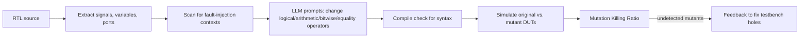

<!-- generated by yt-paper; edits will be overwritten -->
[DVCon](../dvcon/index.md) › [US](../dvcon/us.md) › [2024](../dvcon/by-year.md#2024) › [Verification](../dvcon/by-topic.md#verification)

# Large Language Model for Verification: A Review and Its Application in Data Augmentation

<figure class="rep-fig" markdown>
{ loading=lazy }
<figcaption>Figure 1 LLM Mutation-Based-Testing Framework — from the original paper (Dan Yu et al.)</figcaption>
</figure>

[:material-open-in-new: Original paper](https://dvcon-proceedings.org/wp-content/uploads/1135.pdf){ .md-button .md-button--primary target=_blank }

| | |
|---|---|
| Authors | Dan Yu (Siemens Industry Software Inc.), Eman El Mandouh (Siemens Egypt), Waseem Raslan (Siemens Egypt), Harry Foster (Siemens Industry Software Inc), Tom Fitzpatrick (Siemens Industry Software Inc) |
| Venue | DVCon US 2024 |
| Topic | Verification |
| Type | PAPER |
| ID | `ref-20261018-3545` |

## Summary

**The paper reviews LLM applications across functional verification (assertions, coverage, formal, debugging, stimulus, security, RTL code generation) and uses an open-source Code Llama 34B to automate LLM-driven mutation injection for testbench gap detection and RTL variant generation, while arguing that raw LLM outputs need quality gates and related safeguards.**

**이 논문은 어서션 생성, 커버리지 클로저, 형식 검증, 디버깅, 자극 생성, 보안, RTL 코드 생성 등 기능 검증 전반의 LLM 적용 사례를 정리하고, 오픈소스 Code Llama 34B로 LLM 기반 mutation 주입을 자동화하여 테스트벤치 공백 탐지와 RTL 변형 생성에 활용하며, LLM 원출력에는 품질 게이트 등 안전장치가 필요하다고 주장합니다.**

## Key Insights

- LLM-driven mutation injection (logical, arithmetic, bitwise, equality operator changes, followed by a compile check) on 3 in-house designs produced 79 injected changes on average; the existing testbenches killed 50.59% on average and left 49.41% undetected (per-design killing ratios 38.66%, 66.67%, 46.43%).

- LLM 기반 mutation 주입(논리·산술·비트·등가 연산자 변경 후 컴파일 검사)을 3개 사내 설계에 적용한 결과, 설계당 평균 79개의 주입 변경이 생성되었고 기존 테스트벤치는 평균 50.59%를 검출했으며 49.41%는 미검출로 남았습니다(설계별 검출률 38.66%, 66.67%, 46.43%).

- About 75% of LLM-generated RTL mutations compiled without errors, and 25% needed manual fixes, so the generation step still requires a compile filter and human review.

- LLM이 생성한 RTL mutation의 약 75%는 오류 없이 컴파일되었고 25%는 수동 수정이 필요했으므로, 생성 단계에는 컴파일 필터와 사람의 검토가 여전히 필요합니다.

- Prompt structure matters: in the assertion-generation study cited, only 9.29% of generated assertions were correct overall, but the best combinations of detailed prompt components accounted for 80% of all correct assertions.

- 프롬프트 구성이 중요합니다. 인용된 어서션 생성 연구에서 전체 생성 어서션 중 정답은 9.29%에 불과했지만, 상세 프롬프트 구성 요소의 최적 조합이 정답 어서션의 80%를 차지했습니다.

- The paper describes four quality-control paradigms for LLM outputs: a quality gate/guardrail, a feedback loop with error messages, an external agent for precise execution, and a programmatic chain-of-thought approach. The authors' experiments mainly used the chain-of-thought paradigm (d), and CodeChain reported 61.5% overall correctness versus 34.75% for GPT-4.

- 논문은 LLM 출력에 대한 4가지 품질 관리 패러다임을 제시합니다: 품질 게이트/가드레일, 오류 메시지 기반 피드백 루프, 정밀 실행을 위한 외부 에이전트, 프로그램적 chain-of-thought입니다. 저자들의 실험은 주로 패러다임 (d)를 사용했으며, CodeChain은 전체 정확도 61.5%로 GPT-4의 34.75%보다 높다고 보고했습니다.

- Underrepresentation of HDLs in training data is a stated root cause of hallucinations: in May 2022, about 39.5k GitHub projects were in Verilog/SystemVerilog/VHDL, compared with 6.8m JavaScript, 5.6m Java, and 3.4m Python projects.

- 학습 데이터에서 HDL이 과소 대표되는 것이 환각의 근본 원인으로 제시됩니다. 2022년 5월 기준 GitHub에서 Verilog/SystemVerilog/VHDL 프로젝트는 약 39.5k개인 반면, JavaScript 6.8m, Java 5.6m, Python 3.4m개였습니다.

## Detailed Summary

### Background and Problem

Functional verification handles many text artifacts (specifications, RTL, testbenches, logs, reports), so language models are a natural fit. The paper reviews LLM work in verification from the past roughly two years, covering requirements, coverage closure, formal verification, debugging, functional safety, code generation, and data augmentation. The authors argue that LLM outputs are unreliable (the Universal Approximation Theorem implies prediction errors are expected) and that raw outputs should not feed verification flows directly. Because many IP-sensitive EDA users avoid public LLMs, the experiments use the open-source Code Llama 34B, hosted locally.

기능 검증에는 사양, RTL, 테스트벤치, 로그, 보고서 등 다양한 텍스트 자산이 사용되므로 언어 모델이 자연스럽게 적합합니다. 이 논문은 최근 약 2년간의 검증 분야 LLM 연구를 요구사항, 커버리지 클로저, 형식 검증, 디버깅, 기능 안전, 코드 생성, 데이터 증강 측면에서 검토합니다. 저자들은 Universal Approximation Theorem에 따라 예측 오류가 기대되므로 LLM 원출력을 검증 흐름에 직접 사용하면 안 된다고 주장합니다. IP 유출 위험 때문에 공개 LLM을 피하는 EDA 사용자가 많으므로, 실험에는 로컬에 호스팅한 오픈소스 Code Llama 34B를 사용합니다.

Survey highlights from Section II:

섹션 II survey 요약:

- **Assertion generation:** nl2sva uses LLMs to translate specs into intermediate representations with a human in the loop (no benchmark results). A separate generator with a Syntax Fixer reported only 9.29% correct assertions.

- **어서션 생성:** nl2sva는 LLM으로 사양을 설계 문맥 기반의 중간 표현으로 변환하며 human-in-the-loop를 사용합니다(벤치마크 결과 없음). 별도의 Syntax Fixer를 가진 생성기는 정답 어서션을 9.29%만 보고했습니다.

- **Coverage closure:** a Python coverage-prediction dataset. Line-level accuracy was 20-30%; GPT-4 reached 84.47%, 90.71%, and 90.5% at statement level (zero-, one-, multi-shot).

- **커버리지 클로저:** Python 커버리지 예측 데이터셋입니다. 라인 단위 정확도는 20-30%였고, GPT-4는 statement 수준에서 zero-, one-, multi-shot에 대해 84.47%, 90.71%, 90.5%를 기록했습니다.

- **Formal verification:** Baldur (700M-parameter model with proof repair) proved 65.7% of Isabelle/HOL theorems when combined with prior tools.

- **형식 검증:** Baldur(700M 파라미터 모델과 proof repair)는 기존 도구와 결합 시 Isabelle/HOL 정리의 65.7%를 증명했습니다.

- **Debugging:** AutoFL found 40% more new bugs than the best classic approaches at acc@1. Libro reproduced 33.5% of bugs.

- **디버깅:** AutoFL은 acc@1 기준 최고의 기존 기법보다 40% 많은 새로운 버그를 찾았습니다. Libro는 버그의 33.5%를 재현했습니다.

- **Stimulus generation:** LLM4DV reached 98.94% coverage on a primitive prefetcher, but the reported drop on the Ibex decoder (86.19%, with a "5.61%" figure in the same passage that the text does not reconcile).

- **자극 생성:** LLM4DV는 primitive prefetcher에서 98.94% 커버리지를 달성했지만, Ibex 디코더에서는 86.19%로 떨어졌다고 보고했습니다. 같은 단락에 있는 "5.61%" 수치는 본문에서 서로 일치하지 않습니다.

- **Security:** DIVAS reported 40%-55% success in generating relevant CWEs with GPT-4; the final policy-fix success rate was not reported.

- **보안:** DIVAS는 GPT-4로 관련 CWE 생성 성공률 40%-55%를 보고했습니다. 최종 정책 수정의 성공률은 보고되지 않았습니다.

- **Code generation:** fine-tuned LLMs produced functionally correct Verilog 41.9% of the time, versus 35.4% for code-davinci-002.

- **코드 생성:** 파인튜닝된 LLM은 기능적으로 올바른 Verilog를 41.9%의 비율로 생성했으며, code-davinci-002는 35.4%였습니다.

### Architecture and Methodology

The main experimental method is an LLM-based mutation-testing framework (Figure 1):

주요 실험 방법은 LLM 기반 mutation 테스트 프레임워크(Figure 1)입니다:

The mutants serve as data augmentation: they expose testbench coverage holes. The framework was run on 3 in-house designs, with 12 LLM-generated versions each and 69, 63, and 105 injected changes.

mutant는 테스트벤치 커버리지 공백을 드러내는 데이터 증강 역할을 합니다. 이 프레임워크는 3개의 사내 설계에 적용되었으며, 설계마다 LLM이 생성한 12개 버전과 69, 63, 105개의 주입 변경이 사용되었습니다.

Design-creation experiments compare two strategies using prompts built from advanced prompt-engineering patterns:

설계 생성 실험은 고급 프롬프트 엔지니어링 패턴으로 만든 프롬프트를 사용해 두 전략을 비교합니다:

- **Bottom-up:** a two-stage multadd pipeline (four 8-bit inputs, 17-bit output). Prompts added a ready input and an output valid flag. The generated code compiled cleanly after one correction (wire-vs-reg output).

- **Bottom-up:** 2단계 multadd 파이프라인(4개의 8비트 입력, 17비트 출력). 프롬프트로 ready 입력과 출력 유효 플래그를 추가했습니다. 생성된 코드는 한 번의 수정(wire 대 reg 출력)으로 오류 없이 컴파일되었습니다.

- **Top-down:** a "Flipped Interaction Pattern" prompt made the LLM ask clarifying questions (word size, components, instructions, timing, addressing modes). The LLM then generated ALU, register file, control unit, and memory modules, and a 16-bit CPU top level. Its top level compiled but showed synthesis Lint violations until the submodules were added.

- **Top-down:** "Flipped Interaction Pattern" 프롬프트로 LLM이 명확화 질문을 하도록 했습니다(워드 크기, 구성 요소, 명령어, 타이밍, 주소 지정 모드). 이후 LLM은 ALU, 레지스터 파일, 제어 유닛, 메모리 모듈과 16비트 CPU 최상위 모듈을 생성했습니다. 최상위 모듈은 컴파일되었으나, 하위 모듈이 추가되기 전까지 합성 Lint 위반이 있었습니다.

A design-understanding experiment asked the LLM to render a control_operation module as a Graphviz FSM. The first attempt was nearly correct, with loop-back transitions and logic operators needing one fix prompt. Without a diagram type, the LLM defaulted to a block diagram.

설계 이해 실험에서는 control_operation 모듈을 Graphviz FSM으로 시각화하도록 요청했습니다. 첫 시도는 거의 정확했으며, 루프백 전이와 논리 연산자 수정을 위해 프롬프트 한 번이 더 필요했습니다. 다이어그램 종류를 지정하지 않으면 LLM은 블록 다이어그램을 기본으로 생성했습니다.

Section IV presents four paradigms (Figure 5): (a) a quality gate or guardrail with external knowledge, (b) a self-check feedback loop with error messages, (c) an external agent for precise execution, and (d) chain-of-thought with programmatic rules.

섹션 IV는 네 가지 패러다임(Figure 5)을 제시합니다: (a) 외부 지식을 활용한 품질 게이트 또는 가드레일, (b) 오류 메시지 기반 자기 점검 피드백 루프, (c) 정밀 실행을 위한 외부 에이전트, (d) 프로그램적 규칙을 결합한 chain-of-thought입니다.

### Results and Conclusions

- Mutation testing: the average Mutation Killing Ratio was 50.59%, with 49.41% of injected changes undetected, which the authors read as testbench gaps. Per-design killing ratios were 38.66%, 66.67%, and 46.43%. About 25% of LLM mutations needed manual fixes before use.

- Mutation 테스트: 평균 Mutation Killing Ratio는 50.59%였고, 주입 변경의 49.41%는 미검출로 남았으며 저자들은 이를 테스트벤치 공백으로 해석했습니다. 설계별 검출률은 38.66%, 66.67%, 46.43%였습니다. LLM mutation의 약 25%는 사용 전 수동 수정이 필요했습니다.

- Design creation: bottom-up and top-down flows each produced usable Verilog after a small number of corrective prompts. The authors report significant productivity gains for design creation but give no quantitative measurement.

- 설계 생성: bottom-up과 top-down 흐름 모두 소수의 수정 프롬프트 후 사용 가능한 Verilog를 생성했습니다. 저자들은 설계 생성 단계에서 생산성이 크게 향상되었다고 보고하지만 정량적 측정값은 제시하지 않습니다.

- The conclusion is that LLMs still lag classic algorithms in HDL tasks, mainly because HDLs are underrepresented in training data. The authors recommend quality gates, feedback loops, and external checkers rather than raw LLM output.

- 결론: HDL 작업에서 LLM은 여전히 고전적 알고리즘보다 뒤처지며, 주된 이유는 학습 데이터에서 HDL이 과소 대표되기 때문입니다. 저자들은 원시 LLM 출력 대신 품질 게이트, 피드백 루프, 외부 검사기를 권장합니다.

- Source inconsistencies to note: the abstract mentions three safeguarding mechanisms, but Section IV describes four paradigms. The abstract and conclusion also claim productivity and quality gains without the data to quantify them.

- 원문 불일치 참고: 초록은 세 가지 안전장치를 언급하지만 섹션 IV는 네 가지 패러다임을 설명합니다. 초록과 결론은 생산성 및 품질 향상을 주장하지만 이를 정량화할 데이터는 제시하지 않습니다.

## Videos

<iframe src="https://www.youtube-nocookie.com/embed/KKPVxcHXagQ" title="[DVCON2024]Large Language Model for Verification: A Review and Its Application in Data Augmentation" loading="lazy" allow="accelerometer; clipboard-write; encrypted-media; gyroscope; picture-in-picture; web-share" referrerpolicy="strict-origin-when-cross-origin" allowfullscreen></iframe>

**[DVCON2024]Large Language Model for Verification: A Review and Its Application in Data Augmentation** — [Watch on YouTube](https://www.youtube.com/watch?v=KKPVxcHXagQ) · [Video page](../videos/KKPVxcHXagQ.md)
