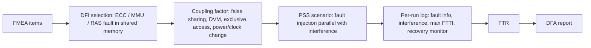

<!-- generated by yt-paper; edits will be overwritten -->
[DVCon](../dvcon/index.md) › [US](../dvcon/us.md) › [2020](../dvcon/by-year.md#2020) › [Verification](../dvcon/by-topic.md#verification)

# ISO 26262 Dependent Failure Analysis using PSS

<figure class="rep-fig" markdown>
{ loading=lazy }
<figcaption>Figure 9. False sharing with error injection and interference stimuli — from the original paper (Moonki Jang et al.)</figcaption>
</figure>

[:material-open-in-new: Original paper](https://dvcon-proceedings.org/wp-content/uploads/iso-26262-dependent-failure-analysis-using-pss.pdf){ .md-button .md-button--primary target=_blank }

| | |
|---|---|
| Authors | Moonki Jang (Samsung Electronics), Jiwoong Kim (Samsung Electronics), Dongjoo Kim (Samsung Electronics), Shai Fuss (Cadence Design Systems), Zeev Kirshenbaum (Cadence Design Systems) |
| Venue | DVCon US 2020 |
| Topic | Verification |
| Type | PAPER |
| ID | `ref-20261018-3557` |

## Summary

**The paper uses reusable, constrained-random PSS action models to generate Dependent Failure Initiator (DFI) fault injections combined with coherency coupling-factor interference on an automotive SoC, then aggregates per-scenario results into Fault Tolerance Reports (FTR) that feed the ISO 26262 Dependent Failure Analysis (DFA).**

**이 논문은 PSS의 재사용 가능한 constrained-random 액션 모델로 자동차용 SoC에서 DFI(Dependent Failure Initiator) 결함 주입과 coherency 커플링 팩터 간섭을 결합해 생성하고, 시나리오별 결과를 FTR(Fault Tolerance Report)로 집계하여 ISO 26262 DFA(Dependent Failure Analysis)에 반영하는 방법을 제시합니다.**

## Key Insights

- DFA treats faults in shared memory as DFIs (uncorrectable ECC via backdoor, MMU translation faults via page-descriptor valid-bit corruption, RAS error injection) and treats coherency traffic as coupling factors: false sharing within one 64-byte cache line, DVM broadcast, exclusive-access locking, CPU cluster power-down, and dynamic clock changes.

- DFA는 공유 메모리의 결함(ECC backdoor 손상, page descriptor의 valid 비트 손상을 통한 MMU translation fault, RAS 오류 주입)을 DFI로 보고, coherency 트래픽을 커플링 팩터로 봅니다. 대표적인 커플링 팩터는 하나의 64-byte 캐시 라인을 공유하는 false sharing, DVM broadcast, exclusive access 잠금, CPU 클러스터 power-down, 동적 clock 변경입니다.

- A PSS select with weights expresses the mixed workload: 85% read_increment_write traffic and 15% error injection, split as [5] each across RAS, MMU translation fault, and ECC error actions in the example code (the text also mentions CPU internal exception). Interference actions run in parallel with the false-sharing scenario in a repeat(10) loop.

- PSS의 가중치 select로 혼합 워크로드를 표현합니다. 예제에서는 85%는 read_increment_write 정상 트래픽, 15%는 RAS, MMU translation fault, ECC 오류 액션에 각각 [5]씩 배분한 오류 주입입니다(본문에는 CPU internal exception도 언급). 간섭 액션은 repeat(10) 루프 안에서 false-sharing 시나리오와 parallel로 실행됩니다.

- Each run prints injected fault info (type, address, injection and recovery-completion times), executed interference actions, maximum FTTI, and external recovery-monitor output. Gathering these over hundreds of generated fault conditions identifies which coupling factor delays recovery most; the FTR is then reflected in the DFA report.

- 실행마다 주입 결함 정보(종류, 주소, 주입 및 복구 완료 시각), 수행된 간섭 액션, 최대 FTTI, 외부 복구 모니터 출력이 출력됩니다. 수백 개의 생성된 결함 조건에 걸쳐 이를 모으면 복구를 가장 크게 지연시키는 커플링 팩터를 찾을 수 있으며, 그 결과가 FTR을 거쳐 DFA 보고서에 반영됩니다.

- Verification closure uses self-checking (all written data is read back), a PSS covergroup crossing processor tag, error action, and parallel traffic, and merging coverage across runs in Cadence vManager.

- 검증 종료 기준은 self-checking(기록된 모든 데이터를 나중에 읽어 검증), 처리기 태그·오류 액션·병렬 트래픽을 교차하는 PSS covergroup, 그리고 vManager에서의 다중 실행 커버리지 병합으로 구성됩니다.

- The paper reports only qualitative outcomes: simulation-level DFA was performed and safety specifications were prepared. It gives no numeric FTTI values, coverage percentages, or silicon/emulation results, so the quantitative benefit is not established.

- 논문이 보고하는 결과는 정성적입니다. 시뮬레이션 수준의 DFA를 수행하고 안전 사양을 준비했다는 내용만 있으며, 'hundreds' 외의 구체적 FTTI 값, 커버리지 비율, 실리콘이나 에뮬레이션 결과는 없어 정량적 효과는 입증되지 않았습니다.

## Detailed Summary

### Background and Problem

- ISO 26262 Part 11 defines Dependent Failure Analysis (DFA) to check whether an error in one shared resource (memory, interconnect, IO) can propagate to other elements and break independence or freedom from interference.

- ISO 26262 Part 11은 DFA(Dependent Failure Analysis)를 정의합니다. 공유 자원(메모리, 인터커넥트, IO)의 오류가 다른 요소로 전파되어 독립성이나 간섭 없음(freedom from interference)을 깨뜨리는지 확인하는 방법입니다.

- Dependent failures are classified as cascading failures (root cause, then dependent failure of other elements) and common cause failures (one event causes failure in two or more elements).

- Dependent failure는 cascading failure(근본 원인이 한 요소를 실패시키고 이어서 다른 요소의 dependent failure를 유발)와 common cause failure(단일 사건이 둘 이상의 요소를 동시에 실패시킴)로 분류됩니다.

- DFA requires generating DFIs at chosen time points and combining them with many coupling factors, which means hundreds of scenarios. Manual directed tests do not scale, so the authors adopt PSS constrained-random generation with metric-driven verification.

- DFA에서는 원하는 시점에 DFI를 여러 조건으로 생성하고 많은 커플링 팩터와 조합해야 하므로 시나리오가 수백 개 규모가 됩니다. 수동 directed test로는 확장이 어려워, 저자들은 PSS의 constrained-random 생성과 metric-driven verification(MDV)을 채택했습니다.

### Architecture and Methodology

The DFA flow in the paper has three steps: identify DFIs, find coupling factors, and confirm safety mechanisms.

논문의 DFA 흐름은 세 단계입니다. DFI 식별, 커플링 팩터 탐색, 안전 메커니즘 확인입니다.

- **DFI injection:** Uncorrectable ECC errors are created by backdoor modification of a memory data beat that no longer matches its ECC. MMU translation faults are created by corrupting the valid field of a page descriptor. RAS errors are injected into L1/L2/L3 caches to raise error interrupts; the core and cluster are then reset during recovery to observe the effect on coherency.

- **DFI 주입:** Uncorrectable ECC 오류는 backdoor로 메모리 데이터 beat를 바꿔 ECC와 불일치하게 만들어 생성합니다. MMU translation fault는 page descriptor의 valid 필드를 손상시켜 생성합니다. RAS 오류는 L1/L2/L3 캐시에 주입해 error interrupt를 발생시키며, 복구 중 코어와 클러스터를 리셋하여 coherency에 미치는 영향을 관찰합니다.

- **Coupling factors:** False sharing places data from different coherent masters in one 64-byte line, so each write triggers snoops that affect all masters. DVM requests, sent during address remapping, can hang if an MMU is in reset. An exclusive monitor lock can block other PEs indefinitely if an error occurs in the locked region. CPU cluster power-down and clock-level changes are also coupling factors.

- **커플링 팩터:** False sharing은 서로 다른 coherent master의 데이터를 하나의 64-byte 캐시 라인에 배치하여, 쓰기마다 snoop이 발생해 모든 master에 영향을 줍니다. DVM 요청은 address remapping 중에 발생하며, MMU가 리셋 상태이면 응답이 돌아오지 않을 수 있습니다. Exclusive monitor 잠금은 잠긴 영역에서 오류가 나면 다른 PE를 무기한 블록시킬 수 있습니다. CPU 클러스터 power-down과 clock level 변경도 커플링 팩터입니다.

- **PSS modeling:** Faults and coupling factors are modeled as reusable actions. The library supplies false-sharing, true-sharing, and RAS actions, along with core selection, synchronization, and memory allocation from configuration tables. Project-specific actions are layered on top.

- **PSS 모델링:** 결함과 커플링 팩터는 재사용 가능한 액션으로 모델링합니다. 라이브러리는 false-sharing, true-sharing, RAS 액션을 제공하며, 코어 선택·동기화·메모리 할당은 구성 테이블을 기반으로 처리합니다. 프로젝트 전용 액션은 그 위에 추가됩니다.

- **Scenario structure:** `activity_selection` uses a weighted `select`: `[85]` read_increment_write, plus `[5]` each for `ras_core_error_inject`, `core_remap_ttbr_error_inject`, and `ecc_memory_error_inject`. It is embedded into `cdn_coherency_ops_c::false_sharing_random_operator`. A second action runs the error-injecting false sharing in `parallel` with a `repeat (10)` loop that selects clock change, core power activity, or exclusive cache access.

- **시나리오 구조:** `activity_selection`은 가중치 `select`를 사용합니다. `[85]`는 read_increment_write이고, `ras_core_error_inject`, `core_remap_ttbr_error_inject`, `ecc_memory_error_inject`에 각각 `[5]`가 배정됩니다. 이 액션은 `cdn_coherency_ops_c::false_sharing_random_operator`에 내장됩니다. 두 번째 액션은 오류 주입 false sharing을 `parallel`로 실행하고, `repeat (10)` 루프에서 clock 변경, 코어 전원 동작, exclusive cache access 중 하나를 선택합니다.

- **Self-checking and coverage:** Written data is read back to check validity. A covergroup defines `proc_x_err_x_traffic` as a cross of error-injecting processor, error type, and parallel traffic. Coverage is merged across runs in vManager.

- **Self-checking과 커버리지:** 기록된 데이터는 테스트 중 다시 읽어 유효성을 확인합니다. Covergroup `proc_x_err_x_traffic`은 오류를 주입한 처리기, 오류 종류, 병렬 트래픽의 교차 커버리지를 정의합니다. 커버리지는 vManager에서 여러 실행에 걸쳐 병합합니다.

- **FTR generation:** Each scenario prints injected fault details, interference actions, max FTTI (time to recover from an uncontrolled state), and external recovery-monitor output for failed recoveries. Results across hundreds of conditions identify the interference stimulus that most affects recovery. The FTR is reflected in the DFA report.

- **FTR 생성:** 각 시나리오는 주입된 결함 정보, 수행된 간섭 액션, 최대 FTTI(비제어 상태에서 복구까지의 시간), 실패한 복구에 대한 외부 복구 모니터 출력을 출력합니다. 수백 개 조건의 결과를 모아 복구에 가장 큰 영향을 준 간섭 자극을 찾고, FTR을 DFA 보고서에 반영합니다.

- **Tooling:** Cadence Perspec System Verifier with the System Modeling Library (SML), and vManager for analysis. The work was done at simulation level.

- **도구:** Cadence Perspec System Verifier와 System Modeling Library(SML)를 사용했고, 분석에는 vManager를 사용했습니다. 작업은 시뮬레이션 수준에서 수행되었습니다.

### Results and Conclusions

- The authors performed a simulation-level DFA of how coherency affects the system when a fault occurs in shared memory. This let them analyze dependent failures systematically and prepare safety specifications.

- 저자들은 공유 메모리 결함 발생 시 coherency가 시스템에 미치는 영향에 대해 시뮬레이션 수준의 DFA를 수행했습니다. 이를 통해 dependent failure를 체계적으로 분석하고 안전 사양을 준비할 수 있었다고 설명합니다.

- PSS model reuse and constrained-random generation made it easy to produce tests across the conditions defined in safety requirements. The authors describe PSS as an optimized way to reproduce specific target conditions.

- PSS 모델의 재사용성과 constrained-random 테스트 생성 덕분에 안전 요구사항에 정의된 다양한 조건의 테스트를 쉽게 만들 수 있었습니다. 저자들은 PSS를 특정 목표 조건을 재현하는 데 최적화된 방법으로 평가합니다.

- The paper does not give quantitative results (no FTTI values, coverage percentages, or run counts beyond "hundreds"). The claimed benefits are qualitative.

- 논문은 정량적 결과(FTTI 값, 커버리지 비율, '수백 개' 이외의 실행 수)를 제시하지 않으며, 주장하는 이점은 정성적입니다.

- The authors suggest the requirement-analysis and verification approach can also apply to general SoC verification beyond functional safety.

- 저자들은 이 요구사항 분석 및 검증 접근법이 기능 안전 외의 일반 SoC 검증에도 적용될 수 있다고 제안합니다.

## Videos

<iframe src="https://www.youtube-nocookie.com/embed/J8PEI2rbgXM" title="[DVCON2020] ISO 26262 Dependent Failure Analysis using PSS" loading="lazy" allow="accelerometer; clipboard-write; encrypted-media; gyroscope; picture-in-picture; web-share" referrerpolicy="strict-origin-when-cross-origin" allowfullscreen></iframe>

**[DVCON2020] ISO 26262 Dependent Failure Analysis using PSS** — [Watch on YouTube](https://www.youtube.com/watch?v=J8PEI2rbgXM) · [Video page](../videos/J8PEI2rbgXM.md)
