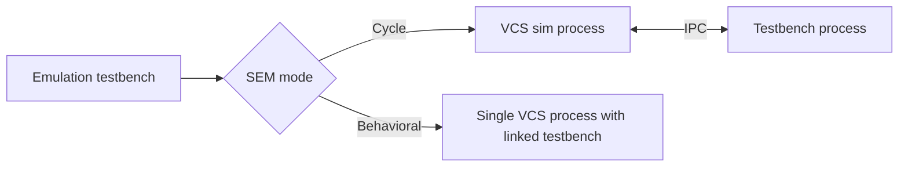

<!-- generated by yt-paper; edits will be overwritten -->
[DVCon](../dvcon/index.md) › [India](../dvcon/india.md) › [2024](../dvcon/by-year.md#2024) › [Emulation](../dvcon/by-topic.md#emulation)

# Simulated Emulation: Enabling Multiple Iterations in a Day During Early-Stage Emulation Bring-up

<figure class="rep-fig" markdown>
{ loading=lazy }
<figcaption>Fig 6: SEM-Behavioral runtime architecture — from the original paper (Shalini Maheshwari et al.)</figcaption>
</figure>

[:material-open-in-new: Original paper](https://dvcon-proceedings.org/wp-content/uploads/5B2-DVCon_India_2024_Final_Paper_6678.pdf){ .md-button .md-button--primary target=_blank }

| | |
|---|---|
| Authors | Shalini Maheshwari (Synopsys Inc), Ashok Kumar Bhatt (Synopsys Inc) |
| Venue | DVCon India 2024 |
| Topic | Emulation |
| Type | PAPER |
| ID | `ref-20261018-3821` |

## Summary

**SEM (Simulated Emulation) runs the emulation test environment on a simulator (VCS) to sanitize early-stage emulation models in the first few million cycles, cutting per-iteration turnaround from roughly one per day to multiple per day.**

**SEM(Simulated Emulation)은 에뮬레이션 테스트 환경을 시뮬레이터(VCS)에서 실행해 초기 몇 백만 사이클을 검증함으로써, early-stage 에뮬레이션 모델의 반복 주기를 하루 1회에서 하루 여러 회로 단축하는 방법론이다.**

## Key Insights

- SEM reuses the emulation test environment (RTL, transactors, compile config, runtime testbench) on a simulator, so no separate simulation testbench is needed, unlike a conventional simulation testbench flow.

- SEM은 에뮬레이션 테스트 환경(RTL, transactor, 컴파일 설정, 런타임 testbench)을 그대로 시뮬레이터에서 사용하므로, 기존 시뮬레이션 testbench를 별도로 만들 필요가 없다.

- SEM-Cycle matches emulator cycle-accurate behavior for controlled clocks by running simulator and testbench in separate IPC-synchronized processes, which enables non-blocking runs but costs performance.

- SEM-Cycle은 시뮬레이터와 testbench를 IPC로 동기화되는 별도 프로세스에서 실행해 controlled clock에 대해 cycle-accurate 동작을 맞추며, non-blocking 실행이 가능하지만 성능 비용이 있다.

- SEM-Behavioral matches functional (not cycle-accurate) emulator behavior in Timed Clock mode with native DPI in a single process, giving much faster runs but supporting only blocking runs and no controlled clocks.

- SEM-Behavioral은 Timed Clock 모드에서 native DPI를 사용해 단일 프로세스로 기능 동작을 맞추며 속도가 훨씬 빠르지만, blocking 실행만 지원하고 controlled clock은 지원하지 않는다.

- The paper gives no numeric TAT gain; it states the gain depends on design size and activity (Fig. 2 is referenced but its values are not in the text).

- 논문은 TAT 개선 수치를 제시하지 않으며, 개선폭은 설계 크기와 activity에 따라 달라진다고만 기술한다(Fig. 2 참조, 구체적 값은 본문에 없음).

- SEM is positioned as a shift-left complement to emulation for bring-up, regressions, and netlist/backout analysis, not a replacement, since simulation is far slower at runtime.

- SEM은 emulation을 대체하는 것이 아니라, bring-up, regression, netlist 및 backout 분석을 위한 shift-left 보완 수단으로 제시되며, 시뮬레이션의 런타임이 훨씬 느리기 때문이다.

## Detailed Summary

### Background and Problem

- FPGA-based emulation compile flows (netlist generation, partitioning, bitstream) take long even for small designs; during early bring-up, frequent RTL and environment changes limit teams to about one iteration per day, sometimes weeks until the model stabilizes.

- FPGA 기반 에뮬레이션 컴파일 흐름(netlist 생성, partitioning, bitstream 생성)은 작은 설계에서도 오래 걸리며, early bring-up 단계에서 RTL과 환경이 자주 바뀌어 팀당 하루 한 번 정도의 반복만 가능하고 모델이 안정화되기까지 수주가 걸릴 수 있다.

- Target: sanitize the first few million cycles of a new RTL drop (RTL connectivity, reset, clock generation, basic modeling) before full emulation.

- 목표: 새 RTL drop의 초기 수백만 사이클(RTL 연결성, reset, clock 생성, 기본 모델링)을 본격적인 에뮬레이션 전에 시뮬레이션으로 검증한다.

### Architecture and Methodology

- SEM treats emulation as a special case where RTL runs in a simulator and the simulation executable stands in for hardware; the same test environment is compiled for simulation (Fig. 3, 4).

- SEM은 RTL을 시뮬레이터에서 실행하고 시뮬레이션 실행 파일이 하드웨어를 대신하는, 에뮬레이터의 특수한 경우로 본다. 동일한 테스트 환경을 시뮬레이션용으로 컴파일한다(Fig. 3, 4).

- Emulation concepts are modeled: uncontrolled clock, controlled (user) clocks, firmware delay clocks (Timed Clock), and transactors (Xtors) via DPI compiled by the behavioral compiler.

- 에뮬레이션 개념을 모델링한다: uncontrolled clock, controlled(사용자) clock, firmware delay clock(Timed Clock), 그리고 behavioral 컴파일러가 처리하는 DPI 기반 transactor(Xtor).

- Two modes:
  - **SEM-Cycle**: cycle-accurate for controlled clocks; simulator and testbench in separate IPC-synchronized processes, allowing non-blocking runs.
  - **SEM-Behavioral**: functional match in Timed Clock mode, native DPI, single process, blocking runs only, no controlled clocks.

- 두 가지 모드:
  - **SEM-Cycle**: controlled clock에 대해 cycle-accurate 동작; 시뮬레이터와 testbench가 IPC로 동기화되는 별도 프로세스에서 실행되어 non-blocking 실행이 가능하다.
  - **SEM-Behavioral**: Timed Clock 모드에서 기능 동작을 맞추며, native DPI를 사용하고 단일 프로세스로 동작한다. blocking 실행만 가능하며 controlled clock은 지원하지 않는다.

### Results and Conclusions

- Reported benefit is faster compile and turnaround, with TAT gain (Fig. 2) that varies with design size and activity; no absolute figures appear in the text.

- 컴파일 및 turnaround 시간 단축이 보고되며, TAT 개선폭(Fig. 2)은 설계 크기와 activity에 따라 달라진다. 본문에 구체적인 수치는 없다.

- Use cases: transactor unit validation, backend netlist gate-level simulation, and 2-state (emulation-like) or 4-state (simulation-like) checking.

- 활용 사례: transactor 단위 검증, backend netlist의 gate-level 시뮬레이션, 2-state(에뮬레이션과 유사) 또는 4-state(시뮬레이션과 유사) 검증.

- Future directions: regression validation with reduced-frequency emulation runs, backout analysis, race/mismatch checks, and dynamic sim-to-emulation swap.

- 향후 방향: 에뮬레이션 실행 빈도를 줄인 regression 검증, backout 분석, race 및 mismatch 점검, 시뮬레이션-에뮬레이션 동적 전환.

- The authors state SEM does not replace emulation because simulation runtime is far slower and exact behavioral matching is hard.

- 저자들은 시뮬레이션 런타임이 훨씬 느리고 동작을 정확히 맞추기 어렵기 때문에 SEM이 에뮬레이션을 대체하지 않는다고 밝힌다.

## Videos

<iframe src="https://www.youtube-nocookie.com/embed/8P9cEMiLWCY" title="[DVCON2024_INDIA]Simulated Emulation: Enabling Multiple Iterations During Early-Stage Emulation" loading="lazy" allow="accelerometer; clipboard-write; encrypted-media; gyroscope; picture-in-picture; web-share" referrerpolicy="strict-origin-when-cross-origin" allowfullscreen></iframe>

**[DVCON2024_INDIA]Simulated Emulation: Enabling Multiple Iterations During Early-Stage Emulation** — [Watch on YouTube](https://www.youtube.com/watch?v=8P9cEMiLWCY) · [Video page](../videos/8P9cEMiLWCY.md)
