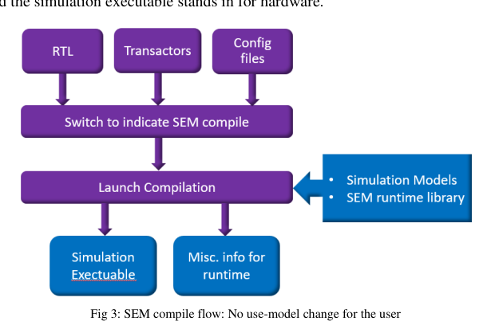
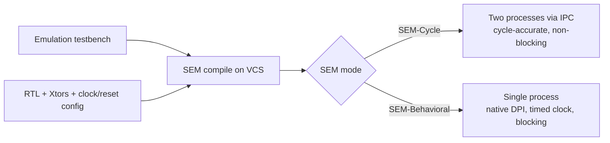

<!-- generated by yt-paper; edits will be overwritten -->
[DVCon](../dvcon/index.md) › [India](../dvcon/india.md) › [2024](../dvcon/by-year.md#2024) › [Emulation](../dvcon/by-topic.md#emulation)

# Simulated Emulation: Enabling Multiple Iterations in a Day During Early-Stage Emulation Bring-up

<figure class="rep-fig" markdown>
{ loading=lazy }
<figcaption>Fig 3: SEM compile flow: No use-model change for the user — from the original paper (Shalini Maheshwari et al.)</figcaption>
</figure>

[:material-open-in-new: Original paper](https://dvcon-proceedings.org/wp-content/uploads/5B2-DVCon_India_2024_Final_Paper_6678.pdf){ .md-button .md-button--primary target=_blank }

| | |
|---|---|
| Authors | Shalini Maheshwari (Synopsys Inc, Hyderabad, India), Ashok Kumar Bhatt (Synopsys Inc, Noida, India) |
| Venue | DVCon India 2024 |
| Topic | Emulation |
| Type | PAPER |
| ID | `ref-20261018-3821` |

## Summary

**SEM (Simulated Emulation) compiles the same emulation model and testbench for a simulator (VCS) so that RTL, transactors, clocking, and reset can be sanitized over the first few million cycles, enabling multiple bring-up iterations per day, in either a cycle-accurate (SEM-Cycle) or a functional, timed-clock (SEM-Behavioral) mode.**

**SEM(Simulated Emulation)은 동일한 에뮬레이션 모델과 테스트벤치를 시뮬레이터(VCS)용으로 컴파일하여, 처음 수백만 사이클 동안 RTL, 트랜스액터, 클럭, 리셋을 검증함으로써 초기 bring-up 단계에서 하루에 여러 번의 반복 작업을 가능하게 하며, 사이클 정확도를 유지하는 SEM-Cycle 모드와 타이밍 클럭 기반의 기능 동작 모드인 SEM-Behavioral 모드 중 선택해 사용할 수 있습니다.**

## Key Insights

- FPGA-based emulation compile (netlist generation, partitioning, bitstream) limits early bring-up to roughly one change iteration per day, and model stabilization can take days to weeks; SEM targets multiple iterations per day by moving this loop to simulation compile.

- FPGA 기반 에뮬레이션 컴파일(netlist 생성, partitioning, bitstream 생성)로 인해 초기 bring-up에서는 하루에 약 1회의 변경 반복만 가능하며, 모델 안정화에는 수일에서 수주가 걸릴 수 있습니다. SEM은 이 반복 루프를 시뮬레이션 컴파일로 옮겨 하루 여러 번의 반복을 목표로 합니다.

- SEM-Cycle preserves cycle-accurate behavior for controlled clocks, runs the simulator and testbench as two IPC-synchronized processes (allowing non-blocking run), and pays a performance cost.

- SEM-Cycle은 controlled clock에 대해 사이클 정확도를 유지하며, 시뮬레이터와 테스트벤치를 IPC로 동기화되는 두 개의 프로세스로 실행하여 non-blocking 실행을 허용하지만 성능 비용이 있습니다.

- SEM-Behavioral matches functional behavior under Timed Clock, uses native simulator DPI in a single process for much faster execution, but does not support controlled clocks or non-blocking run.

- SEM-Behavioral은 Timed Clock 기준으로 기능 동작을 일치시키고, 시뮬레이터의 native DPI를 단일 프로세스에서 사용하여 훨씬 빠르지만 controlled clock과 non-blocking 실행은 지원하지 않습니다.

- SEM reuses the emulation test environment with no use-model change in the compile flow, so transactor unit tests avoid maintaining a separate simulation testbench; the paper also reports an ongoing in-house gate-level netlist simulation effort.

- SEM은 컴파일 흐름에서 사용 모델 변경 없이 에뮬레이션 테스트 환경을 그대로 사용하므로, 트랜스액터 단위 테스트에서 별도의 시뮬레이션 테스트벤치를 유지할 필요가 없습니다. 논문은 gate-level netlist 시뮬레이션을 진행 중인 사내 과제로도 언급합니다.

- SEM is scoped to the first few million cycles and is not a replacement for emulation because simulation runtime is far slower and behavior cannot be fully matched; the paper gives no quantitative TAT numbers in the text (Fig. 2 TAT gain depends on design size and activity).

- SEM은 처음 수백만 사이클에 초점을 맞추며, 시뮬레이션 런타임이 훨씬 느리고 동작을 완전히 일치시키기 어려우므로 에뮬레이션을 대체하지 않습니다. 본문에는 정량적인 TAT 수치가 없으며, Fig. 2의 TAT 이득은 설계 크기와 activity에 따라 달라진다고 명시되어 있습니다.

## Detailed Summary

### Background and Problem

- FPGA-based emulation compile (netlist generation, partitioning, FPGA bitstream generation) is long even for small designs. During early bring-up, when the RTL and test environment change often and few runtime cycles are executed, users may complete only one iteration per day, and stabilization can take days to weeks.

- FPGA 기반 에뮬레이션 컴파일(netlist 생성, partitioning, FPGA bitstream 생성)은 작은 설계에서도 오래 걸립니다. 초기 bring-up 단계에서는 RTL과 테스트 환경이 자주 바뀌고 실행 사이클은 적어, 사용자가 하루에 한 번의 변경 반복만 수행하는 경우가 많으며 모델 안정화에 수일에서 수주가 걸릴 수 있습니다.

- Debugging on emulation hardware adds further recompile cycles. Simulation compiles much faster, offers deep debug (large signal dumps), and avoids hardware cost, but its runtime is much slower, so it is suited only to short tests.

- 에뮬레이션 하드웨어에서의 디버그는 추가적인 재컴파일을 유발합니다. 시뮬레이션은 컴파일이 훨씬 빠르고 대용량 신호 덤프 등 강력한 디버그를 제공하며 하드웨어 비용도 없지만, 런타임이 매우 느려 짧은 테스트에만 적합합니다.

- SEM targets the first few million cycles to check RTL connectivity, power-on reset, clock generation and basic modeling issues, then lets users continue on the same setup for emulation.

- SEM은 RTL 연결성, power-on reset, 클럭 생성 및 기본 모델링 문제를 확인하기 위해 처음 수백만 사이클을 대상으로 하며, 이후 동일한 환경을 그대로 에뮬레이션에 이어서 사용하도록 합니다.

### Architecture and Methodology

SEM is treated as a special case of the emulator: the RTL runs in simulation and the simulation executable replaces the hardware. It accepts the same test environment and compile flow (Fig. 3 and Fig. 4 show no use-model change). Key emulation concepts are modeled in simulation:

SEM은 에뮬레이터의 특수한 경우로 볼 수 있습니다. RTL은 시뮬레이션에서 실행되고, 시뮬레이션 실행 파일이 하드웨어를 대신합니다. 동일한 테스트 환경과 컴파일 흐름을 수용하며(Fig. 3, Fig. 4에서 사용 모델 변경 없음), 주요 에뮬레이션 개념을 시뮬레이션에서 모델링합니다.

- **Uncontrolled clock**: the emulator-derived clock is modeled, and user clocks are generated from it to keep the same functional ratios.

- **Uncontrolled clock**: 에뮬레이터가 생성하는 클럭을 모델링하고, 사용자 클럭은 이 클럭을 기준으로 동일한 기능적 비율을 유지하도록 생성합니다.

- **Controlled (user) clock**: a simulation model of the firmware clock primitive that can be instantiated and run.

- **Controlled(user) clock**: 펌웨어 클럭 primitive의 시뮬레이션 모델로, 인스턴스화하여 실행할 수 있습니다.

- **Timed clock**: the firmware `#delay` primitive is modeled using native simulation time, easing simulation-to-emulation migration and time-based comparison.

- **Timed clock**: 펌웨어의 `#delay` primitive를 네이티브 시뮬레이션 시간으로 모델링하여 시뮬레이션에서 에뮬레이션으로의 이전과 시간 기준 비교를 용이하게 합니다.

- **Xtors**: DPI Xtors are translated by the behavioral compiler into the same instrumentation used by emulation; custom Xtors can also be simulated.

- **Xtor**: DPI Xtor는 behavioral compiler에 의해 에뮬레이션과 동일한 계측(instrumentation)으로 변환되며, 사용자 정의 Xtor도 시뮬레이션할 수 있습니다.

| Aspect | SEM-Cycle | SEM-Behavioral |
|---|---|---|
| Accuracy goal | Cycle-accurate, matches emulator for controlled clocks | Functional match, not cycle-accurate |
| Clock mode | Uncontrolled clock modeled, controlled clocks supported | Timed Clock; controlled clocks not supported |
| DPI Xtors | Behavioral compiler (custom Xtors simulated) | Native simulator DPI support |
| Process model | Simulator and testbench in separate processes via IPC | Single process, testbench linked in |
| Run mode | Non-blocking supported (design runs concurrently) | Blocking only |
| Performance | Lower (synchronization cost) | Much faster |

| 항목 | SEM-Cycle | SEM-Behavioral |
|---|---|---|
| 정확도 목표 | 사이클 정확(controlled clock 기준 에뮬레이터와 일치) | 기능 일치, 사이클 정확은 아님 |
| 클럭 모드 | Uncontrolled clock 모델링, controlled clock 지원 | Timed Clock; controlled clock 미지원 |
| DPI Xtor | Behavioral compiler 사용(사용자 정의 Xtor 시뮬레이션 가능) | 시뮬레이터의 native DPI 지원 |
| 프로세스 모델 | 시뮬레이터와 테스트벤치를 IPC로 연결한 별도 프로세스 | 단일 프로세스, 테스트벤치 링크 |
| 실행 모드 | Non-blocking 지원(설계와 테스트벤치 동시 실행) | Blocking만 지원 |
| 성능 | 낮음(동기화 비용) | 훨씬 빠름 |

Use-cases described:

설명된 활용 사례:

- **Transactor validation**: fast unit tests with the same testbench used for emulation, avoiding a separate simulation testbench.

- **Transactor validation**: 에뮬레이션과 동일한 테스트벤치로 빠른 단위 테스트를 수행하여 별도의 시뮬레이션 테스트벤치가 필요 없습니다.

- **Gate-level simulation**: an ongoing in-house project simulates backend netlists to catch RTL-to-netlist translation issues before FPGA mapping and expensive emulation runs.

- **Gate-level simulation**: 사내 진행 과제로, 백엔드 netlist를 시뮬레이션하여 FPGA 매핑과 고비용 에뮬레이션 이전에 RTL-to-netlist 변환 문제를 발견합니다.

- **2-state vs 4-state**: validate in 2-state to match emulation, or in 4-state to match simulation.

- **2-state vs 4-state**: 에뮬레이션과 맞추기 위해 2-state로, 시뮬레이션 동작과 맞추기 위해 4-state로 검증할 수 있습니다.

### Results and Conclusions

- The paper reports no quantitative turnaround-time numbers in its text. Fig. 2 shows TAT gain with SEM-Behavioral in one iteration, which the authors state depends on design size and activity; the values are not given in the text.

- 본문에는 정량적인 turnaround time 수치가 없습니다. Fig. 2는 SEM-Behavioral의 한 번 반복에서의 TAT 이득을 보여주며, 저자들은 이 이득이 설계 크기와 activity에 따라 달라진다고 밝힙니다. 구체적인 값은 본문에 없습니다.

- Conclusion: SEM brings simulation's fast compile and debug into the emulation environment, reducing iteration time and optimizing emulation hardware use in the shift-left paradigm. It does not replace emulation, since simulation runtime is far slower and full behavioral matching is difficult.

- 결론: SEM은 시뮬레이션의 빠른 컴파일과 디버그를 에뮬레이션 환경에 도입하여 반복 시간을 줄이고 에뮬레이션 하드웨어 사용을 최적화하며, shift-left 패러다임에 기여합니다. 시뮬레이션 런타임이 훨씬 느리고 동작을 완전히 일치시키기 어려우므로 에뮬레이션을 대체하지는 않습니다.

- Future directions: (A) regressions, with SEM for unit and quick tests and full emulation reserved for sign-off or nightly runs; (B) backout analysis for netlist-synthesis breakages; (C) built-in checks for simulation races and mismatch-causing modeling styles (most of these overlap with Lint tools); (D) dynamic swap between simulation and emulation, e.g., running a few hundred cycles in simulation (for initial blocks) before switching to emulation while retaining simulation debug aids.

- 향후 방향: (A) 회귀 검증에서 단위 및 빠른 테스트에는 SEM을 사용하고, sign-off나 야간 실행에는 전체 에뮬레이션을 유지; (B) netlist 합성 문제에 대한 backout analysis; (C) 시뮬레이션 race 및 불일치를 유발하는 모델링 스타일에 대한 내장 검사(다수는 Lint 도구 영역과 겹침); (D) 시뮬레이션과 에뮬레이션 간 동적 전환, 예를 들어 초기 블록 처리를 위해 수백 사이클을 시뮬레이션으로 실행한 뒤 에뮬레이션으로 전환하면서 시뮬레이션 디버그 도구를 유지.

## Videos

<iframe src="https://www.youtube-nocookie.com/embed/8P9cEMiLWCY" title="[DVCON2024_INDIA]Simulated Emulation: Enabling Multiple Iterations During Early-Stage Emulation" loading="lazy" allow="accelerometer; clipboard-write; encrypted-media; gyroscope; picture-in-picture; web-share" referrerpolicy="strict-origin-when-cross-origin" allowfullscreen></iframe>

**[DVCON2024_INDIA]Simulated Emulation: Enabling Multiple Iterations During Early-Stage Emulation** — [Watch on YouTube](https://www.youtube.com/watch?v=8P9cEMiLWCY) · [Video page](../videos/8P9cEMiLWCY.md)
