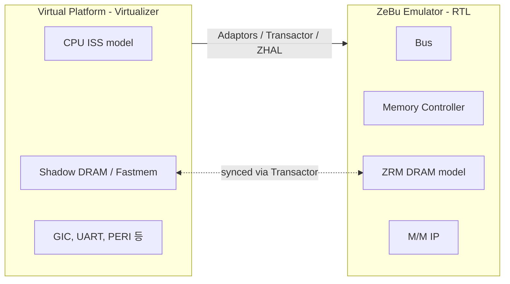

<!-- generated by yt-paper; edits will be overwritten -->
[DVCon](../dvcon/index.md) › [Europe](../dvcon/europe.md) › [2023](../dvcon/by-year.md#2023) › [Emulation](../dvcon/by-topic.md#emulation)

# Hybrid Emulation for faster Android Home screen bring up and Software Development

[:material-open-in-new: Original paper](https://dvcon-proceedings.org/wp-content/uploads/90995.pdf){ .md-button .md-button--primary target=_blank }

| | |
|---|---|
| Authors | Rinkesh Yadav, Manoj Khandelwal, Sarang Kalbande, Garima Srivastava, Hyundon Kim (DVCon Europe) |
| Venue | DVCon Europe 2023 |
| Topic | Emulation |
| Type | PAPER |
| ID | `ref-20261018-3f06` |

## Summary

**순수 에뮬레이션에서 약 4일 걸리던 Android 홈 화면 bring-up을, SystemC/TLM 가상 플랫폼(CPU·DRAM 등)과 ZeBu RTL 에뮬레이션을 결합한 하이브리드 에뮬레이션으로 약 72분까지 단축한 사례 보고.**

&nbsp;

## Key Insights

- Pure emulation(약 1MHz driver clock)에서는 Android 홈 화면 bring-up에 약 4일이 걸려 SW 반복 개발이 비현실적이며, CPU·DRAM 트래픽 병목을 가상 쪽으로 옮기는 것이 핵심 해법이다.

&nbsp;

- CPU를 ISS 기반 가상 모델로, DRAM을 Fastmem 기반 shadow memory로 두고 Transactor로 동기화하는 구조가 CPU-DRAM 트랜잭션 지연을 줄여 가속을 만든다.

&nbsp;

- 하이브리드 환경의 trade-off: cache coherency 미지원으로 캐시 일관성 비활성화가 필요하고, ARM Fast Model의 단일 코어 한계로 SMP도 꺼야 하며, 대량 trace 데이터 때문에 장시간 SW 버그의 root cause 추적이 어렵다.

&nbsp;

- 디버그 가시성은 RTL 에뮬레이션 수준을 유지하면서 SW 디버거(T32), TLM chart view, Transactor 로그, Verdi 파형을 함께 쓸 수 있다는 점이 post-silicon 대비 장점이다.

&nbsp;

- 보고된 수치(Linux 커널 약 2분, Android 로고 약 12분, 홈 화면 약 72분)는 2B gate Exynos SoC 기준이며, 제안하는 Gear shift 방식으로 CPU 벤치마크와 SMP/multi-chip 지원은 향후 과제로 남아 있다.

&nbsp;

## Detailed Summary

### 배경 및 문제 정의

&nbsp;

SoC의 소프트웨어 bring-up과 검증은 전통적으로 post-silicon 단계에서 이뤄지며, 이는 time-to-market 지연과 silicon re-spin 비용으로 이어진다. 또한 post-silicon에서는 RTL 가시성이 낮아 HW/SW 버그를 구분하기 어렵다. 따라서 silicon 확보 수개월 전에 SoC의 고속 모델이 필요하다.

&nbsp;

검증 방법별 비교는 다음과 같이 정리된다.

&nbsp;

- **Simulator**: 최신 코어 기준 약 100Hz 수준으로 OS 부팅에 부적합

&nbsp;

- **Emulator**: ZeBu Server 5 기준 약 5MHz급이나 소유 비용이 크고 OS 부팅이 여전히 느림

&nbsp;

- **FPGA**: 비용이 높고 디버그 가시성이 낮음

&nbsp;

- **Silicon**: SW 개발이 가장 늦게 이뤄지며 디버그가 어려움

&nbsp;

문서의 핵심 문제는 순수 에뮬레이션에서 driver clock이 약 1MHz일 때 Android 홈 화면 bring-up에 약 4일이 걸린다는 점이다. 이 때문에 SW 개발의 반복(iteration)이 현실적으로 불가능하다.

&nbsp;

### 핵심 아키텍처 및 방법론

&nbsp;

하이브리드 에뮬레이션은 SoC의 일부는 가상 플랫폼(SystemC/TLM, Virtualizer)에서, 나머지는 RTL 에뮬레이터(ZeBu Server 5)에서 실행하는 방식이다. 문서가 제시한 분할은 다음과 같다.

&nbsp;

- **Virtual 측(TLM, VDK)**: CPU, GIC, MCT, UART, PERI, Storage, DRAM

&nbsp;

- **Emulation 측(RTL)**: Bus, Memory Controller, 기타 M/M IP

&nbsp;

주요 구성 요소는 다음과 같다.

&nbsp;

1. **CPU 가상화**: 가상 CPU 모델이 ISS로 동작하여 gate-level 에뮬레이션보다 빠르다. ARM Fast Model을 사용한다.

&nbsp;

2. **Shared DRAM**: 에뮬레이터의 ZRM DRAM과 가상 측의 shadow memory를 두고 Transactor로 동기화하여 CPU-DRAM 트랜잭션 지연을 줄인다.

&nbsp;

3. **Adaptor/Transactor**: Virtualizer Studio에 통합된 Adaptor가 가상 컴포넌트를 에뮬레이션 testbench의 Transactor에 연결한다. ZHAL(Zebu Hybrid Adaptor Library)이 어댑터 wrapper를 제공하며, 이를 TLM 모델처럼 사용할 수 있다.

&nbsp;

4. **디버그 방법**: TLM chart view, VP disassembly 기반 SW 디버거와 T32, Transactor/Adaptor 로그 레벨, Verdi 파형 덤프 등을 지원한다.

&nbsp;

**제약 사항**: SystemC/TLM 모델은 cache coherency를 지원하지 않으므로 이를 비활성화해야 하며, ARM Fast Model은 multi-core 시뮬레이션을 지원하지 않으므로 SMP도 꺼야 한다. 또한 하이브리드 환경은 대량의 데이터를 빠르게 생성하여 수십억 명령 규모의 부팅에서는 버그 주입 지점과 관찰 지점 사이가 기록 창(약 백만 사이클)을 벗어날 수 있어 root cause 추적이 어렵다.

&nbsp;

**향후 과제(Future Scope)**:

&nbsp;

- **Gear shift 방법론**: 가상 CPU에서 Linux/Android를 부팅한 뒤 CPU 상태를 RTL CPU로 옮겨 emulator 상에서 CPU 벤치마크를 수행하는 방식

&nbsp;

- **SMP 및 cache coherency 지원**: 대안 방법 탐색 중

&nbsp;

- **Multi-chip/multi-die SoC 지원**: 진행 중

&nbsp;

### 실험 결과 및 결론

&nbsp;

대상은 약 2 billion gate 규모의 Samsung Exynos SoC다. 보고된 bring-up 시간은 다음과 같다.

&nbsp;

| 플랫폼 | 측정 결과 |
|---|---|
| Simulation | SW 개발에 비현실적(수치 원문 표에 명시된 값 없음) |
| 순수 Emulation | Android 홈 화면까지 약 4일 |
| 하이브리드 Emulation | Linux 커널 약 2분, Android 로고 약 12분, 홈 화면 약 72분 |

&nbsp;

결론적으로 하이브리드 에뮬레이션은 CPU와 DRAM 트랜잭션 병목을 가상 측으로 옮겨 순수 에뮬레이션 대비 bring-up 반복 시간을 크게 줄이며, RTL 수준의 디버그 가시성을 유지한다. 다만 cache coherency와 SMP 미지원, 장시간 SW 버그 추적의 어려움이 남아 있다. 본 문서는 발표 논문으로, 속도 향상 배수나 실험 조건(클럭, 호스트 환경)의 세부 값은 제시하지 않는다.

&nbsp;

## Videos

<iframe src="https://www.youtube-nocookie.com/embed/WbPgekc9gyE" title="[DVCON2023_EUROPE] Hybrid Emulation for faster Android Home screen bring up and Software Development" loading="lazy" allow="accelerometer; clipboard-write; encrypted-media; gyroscope; picture-in-picture; web-share" referrerpolicy="strict-origin-when-cross-origin" allowfullscreen></iframe>

**[DVCON2023_EUROPE] Hybrid Emulation for faster Android Home screen bring up and Software Development** — [Watch on YouTube](https://www.youtube.com/watch?v=WbPgekc9gyE) · [Video page](../videos/WbPgekc9gyE.md)
