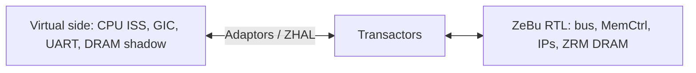

<!-- generated by yt-paper; edits will be overwritten -->
[DVCon](../dvcon/index.md) › [Europe](../dvcon/europe.md) › [2023](../dvcon/by-year.md#2023) › [Emulation](../dvcon/by-topic.md#emulation)

# Hybrid Emulation for faster Android Home screen bring up and Software Development

<figure class="rep-fig" markdown>
{ loading=lazy }
<figcaption>Figure 6. Hybrid Platform Architecture — from the original paper (Rinkesh Yadav et al.)</figcaption>
</figure>

[:material-open-in-new: Original paper](https://dvcon-proceedings.org/wp-content/uploads/90995.pdf){ .md-button .md-button--primary target=_blank }

| | |
|---|---|
| Authors | Rinkesh Yadav (Samsung Semiconductor India Research Bangalore), Manoj Khandelwal (Samsung Semiconductor India Research Bangalore), Sarang Kalbande (Samsung Semiconductor India Research Bangalore), Garima Srivastava (Samsung Semiconductor India Research Bangalore), Hyundon Kim (Samsung Electronics) |
| Venue | DVCon Europe 2023 |
| Topic | Emulation |
| Type | PAPER |
| ID | `ref-20261018-3f06` |

## Summary

**The paper moves the CPU and peripherals of a ZeBu-emulated SoC into a SystemC/TLM virtual platform (ISS-based CPU) with a shared DRAM model, cutting Android home-screen bring-up on a ~2-billion-gate Exynos SoC from about 4 days in pure emulation to about 72 minutes.**

**이 논문은 ZeBu로 에뮬레이션되는 SoC의 CPU와 주변장치를 SystemC/TLM 가상 플랫폼(ISS 기반 CPU)으로 옮기고 공유 DRAM 모델을 사용해, 약 20억 게이트 Exynos SoC에서 Android 홈 화면 bring-up 시간을 순수 에뮬레이션의 약 4일에서 약 72분으로 단축한다.**

## Key Insights

- Pure emulation at a 1 MHz driver clock takes about 4 days to reach the Android home screen, while the hybrid platform reaches it in about 72 minutes (Linux kernel ~2 min, Android logo ~12 min).

- 1 MHz 드라이버 클럭의 순수 에뮬레이션에서는 Android 홈 화면까지 약 4일이 걸리지만, 하이브리드 플랫폼은 약 72분(Linux 커널 약 2분, Android 로고 약 12분)에 도달한다.

- The partition puts CPU, GIC, MCT, UART, PERI, storage and DRAM on the virtual side (ARM Fast Model ISS) and the bus, memory controller and M/M IPs on RTL, bridged by adaptors and transactors (ZHAL).

- 파티션은 CPU, GIC, MCT, UART, PERI, 스토리지, DRAM을 가상 측(ARM Fast Model ISS)에, 버스, 메모리 컨트롤러, M/M IP를 RTL 측에 배치하며, 어댑터와 트랜스актор(ZHAL)로 두 영역을 연결한다.

- A shared DRAM model (ZRM memory on the emulator, shadow memory on the virtual side, synced by a transactor) targets the CPU-DRAM transaction bottleneck that dominates OS boot in pure emulation.

- 공유 DRAM 모델(에뮬레이터의 ZRM 메모리, 가상 측의 shadow 메모리, 트랜스액터로 동기화)은 순수 에뮬레이션에서 OS 부팅을 지배하는 CPU-DRAM 트랜잭션 병목을 겨냥한다.

- Current limits are no cache coherency and no SMP (single-core Fast Model), so both must be disabled; the ~1-million-cycle debug window is too short for bugs whose injection and observation points are billions of instructions apart.

- 현재 한계는 cache coherency와 SMP 미지원(단일 코어 Fast Model)이며, 따라서 두 기능을 비활성화해야 한다. 또한 약 100만 사이클의 디버그 윈도우는 버그 주입 시점과 관측 시점이 수십억 명령 떨어져 있는 경우에 너무 짧다.

## Detailed Summary

### Background and Problem

- SoC software bring-up usually happens post-silicon, where RTL debug visibility is poor and a silicon re-spin is costly, so pre-silicon models are needed months early.

- SoC 소프트웨어 bring-up은 보통 post-silicon 단계에서 이루어지며, RTL 디버그 가시성이 낮고 silicon re-spin 비용이 크므로 몇 달 앞선 pre-silicon 모델이 필요하다.

- Simulation (~100 Hz) is too slow for OS boot, and pure ZeBu emulation (~5 MHz peak) is costly; at a 1 MHz driver clock, bringing up the Android home screen on a ~2-billion-gate Exynos SoC takes about 4 days.

- 시뮬레이션(약 100 Hz)은 OS 부팅에 너무 느리고, 순수 ZeBu 에뮬레이션(최대 약 5 MHz)도 비용이 크다. 약 20억 게이트 Exynos SoC에서 1 MHz 드라이버 클럭으로 Android 홈 화면을 올리는 데 약 4일이 걸린다.

- FPGA prototypes offer limited debug visibility and high cost.

- FPGA 프로토타입은 디버그 가시성이 제한적이고 비용이 높다.

### Architecture and Methodology

- The SoC is partitioned: the virtual side (VDK/TLM SystemC) hosts the CPU (ARM Fast Model ISS), GIC, MCT, UART, PERI, storage and DRAM; the RTL side on ZeBu 5 hosts the bus, memory controller and M/M IPs.

- SoC를 분할한다. 가상 측(VDK/TLM SystemC)에는 CPU(ARM Fast Model ISS), GIC, MCT, UART, PERI, 스토리지, DRAM을 두고, ZeBu 5 기반 RTL 측에는 버스, 메모리 컨트롤러, M/M IP를 둔다.

- Adaptors in Virtualizer Studio and transactors in the emulation testbench connect the two domains; ZHAL wraps them as TLM models.

- Virtualizer Studio의 어댑터와 에뮬레이션 테스트벤치의 트랜스액터가 두 영역을 연결하며, ZHAL이 이를 TLM 모델로 감싼다.

- A shared DRAM model (ZRM on the emulator, shadow memory on the virtual side) is synced through a transactor to cut CPU-DRAM latency.

- 공유 DRAM 모델(에뮬레이터의 ZRM, 가상 측의 shadow 메모리)은 트랜스액터를 통해 동기화되어 CPU-DRAM 지연을 줄인다.

- Debug covers TLM chart view, VP disassembly with T32, adaptor log levels, and Verdi waveforms.

- 디버그는 TLM chart view, T32를 이용한 VP disassembly, 어댑터 로그 레벨, Verdi 파형 덤프를 포함한다.

### Results and Conclusions

- Hybrid bring-up: about 2 min to Linux kernel boot, 12 min to the Android logo, and 72 min to the Android home screen, versus about 4 days in pure emulation.

- 하이브리드 bring-up 시간은 Linux 커널 부팅 약 2분, Android 로고 12분, Android 홈 화면 72분이며, 순수 에뮬레이션의 약 4일과 비교된다.

- Limitations: no cache coherency and no SMP (the Fast Model is single-core), so both are disabled during software development.

- 한계: cache coherency와 SMP를 지원하지 않는다(Fast Model이 단일 코어). 따라서 소프트웨어 개발 중에는 두 기능을 비활성화한다.

- Future work, not yet demonstrated: a gear-shift method to move CPU state into the RTL CPU for benchmarks, plus SMP and multi-chip support. The paper reports no CPU benchmark results.

- 아직 입증되지 않은 향후 과제: 벤치마크를 위해 CPU 상태를 RTL CPU로 옮기는 gear-shift 방법론, SMP 및 multi-chip 지원. 논문은 CPU 벤치마크 결과를 보고하지 않는다.

## Videos

<iframe src="https://www.youtube-nocookie.com/embed/WbPgekc9gyE" title="[DVCON2023_EUROPE] Hybrid Emulation for faster Android Home screen bring up and Software Development" loading="lazy" allow="accelerometer; clipboard-write; encrypted-media; gyroscope; picture-in-picture; web-share" referrerpolicy="strict-origin-when-cross-origin" allowfullscreen></iframe>

**[DVCON2023_EUROPE] Hybrid Emulation for faster Android Home screen bring up and Software Development** — [Watch on YouTube](https://www.youtube.com/watch?v=WbPgekc9gyE) · [Video page](../videos/WbPgekc9gyE.md)
