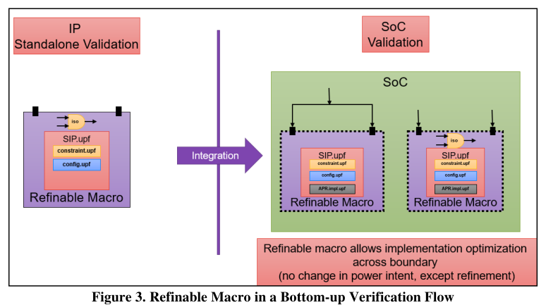
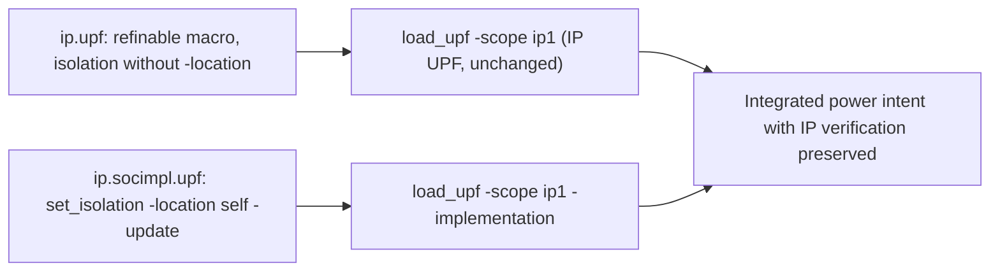

<!-- generated by yt-paper; edits will be overwritten -->
[DVCon](../dvcon/index.md) › [US](../dvcon/us.md) › [2025](../dvcon/by-year.md#2025) › [EDA](../dvcon/by-topic.md#eda)

# Refinable Macros and Terminal Boundaries in UPF 4.0: Empowering Soft IPs of the Future

<figure class="rep-fig" markdown>
{ loading=lazy }
<figcaption>Figure 3 illustrates the use of Refinable Macros in a bottom-up verification flow. — from the original paper (Amit Srivastava et al.)</figcaption>
</figure>

[:material-open-in-new: Original paper](https://dvcon-proceedings.org/wp-content/uploads/1082.pdf){ .md-button .md-button--primary target=_blank }

| | |
|---|---|
| Authors | Amit Srivastava (Synopsys Inc), John Decker (Cadence Design Systems), Lakshmanan Balasubramanian (Texas Instruments (India) Pvt. Ltd) |
| Venue | DVCon US 2025 |
| Topic | EDA |
| Type | PAPER |
| ID | `ref-20261018-3f9c` |

## Summary

**UPF 4.0 introduces Refinable Macros (UPF_is_refinable_macro TRUE) and terminal-boundary semantics so SoC integrators can add implementation-specific power intent to a pre-verified SIP via load_upf -implementation without modifying the IP's original UPF.**

**UPF 4.0은 Refinable Macro(UPF_is_refinable_macro TRUE)와 terminal boundary 의미론을 도입하여, SoC 통합자가 IP의 원본 UPF를 수정하지 않고 load_upf -implementation으로 사전 검증된 SIP의 전력 의도(power intent)에 구현 세부 사항을 추가할 수 있게 한다.**

## Key Insights

- Marking an SIP with UPF_is_refinable_macro TRUE (set_design_attributes) creates a refinable terminal boundary, so integrators can refine it through an Implementation UPF loaded with load_upf -implementation while the IP's original power intent and standalone verification stay intact.

- SIP에 UPF_is_refinable_macro TRUE를 설정(set_design_attributes)하면 refinable terminal boundary가 생성되어, 통합자는 load_upf -implementation으로 로드한 Implementation UPF를 통해 IP를 정제할 수 있으며, IP의 원본 전력 의도와 독립 검증은 그대로 유지된다.

- The Implementation UPF is restricted to an allowlist (Table 1); for example, set_isolation -update is limited to -elements, -location, -isolation_supply, -instance, and -force_isolation, and create_power_domain -update is limited to -elements, -available_supplies, -boundary_supplies, and -define_func_type.

- Implementation UPF는 허용 목록(Table 1)으로 제한된다. 예를 들어 set_isolation -update는 -elements, -location, -isolation_supply, -instance, -force_isolation으로만 제한되고, create_power_domain -update는 -elements, -available_supplies, -boundary_supplies, -define_func_type으로만 제한된다.

- Path-based isolation without terminal boundaries can cause simulation vs. synthesis mismatch: isolation cells inferred during standalone synthesis are kept in the netlist for all IP instances, while RTL simulation omits them when supplies are shorted in the SoC. Marking the IP as a macro enforces boundary semantics and keeps the two consistent.

- Terminal boundary 없이 path-based isolation을 사용하면 시뮬레이션과 합성 간 불일치가 생길 수 있다. standalone 합성에서 추론된 isolation cell은 모든 IP 인스턴스의 netlist에 남는 반면, SoC에서 supply가 단락된 경우 RTL 시뮬레이션은 이를 생략한다. IP를 macro로 표시하면 경계 의미론이 적용되어 두 결과가 일치한다.

- The paper reports no quantitative benchmarks; its benefits (reduced re-validation, faster turnaround, fewer silicon risks) are qualitative, and the example is a single IP case study with GATED/AON domains, so tool support should be validated before relying on it.

- 논문은 정량적 벤치마크를 제시하지 않는다. 재검증 감소, 개발 기간 단축, 실리콘 위험 감소 등의 효과는 정성적으로 기술되어 있으며, 사례도 GATED/AON 도메인을 가진 단일 IP에 한정되므로 툴 지원을 검증한 뒤 의존해야 한다.

- In the case study the IP omits -location on its isolation strategy so the SoC integrator can choose the isolation location for PnR; a hard-coded -location cannot be overridden by refinable macro refinement.

- 사례 연구에서 IP는 isolation 전략에 -location을 지정하지 않아, SoC 통합자가 PnR을 위해 isolation 위치를 선택할 수 있다. 하드코딩된 -location은 Refinable Macro 정제로 덮어쓸 수 없다.

## Detailed Summary

### Background and Problem

- SoCs integrate many SIPs, each with its own power management architecture and typically its own UPF file. Integrating them often requires implementation-specific additions during synthesis and place-and-route (PnR).

- SoC는 각각 고유한 전력 관리 구조와 보통 별도의 UPF 파일을 가진 여러 SIP를 통합한다. 이들을 통합하려면 합성과 place-and-route(PnR) 단계에서 구현 세부 사항을 추가해야 하는 경우가 많다.

- UPF 3.1 (IEEE 1801-2018) defines Successive Refinement (Constraint UPF → Configuration UPF → Implementation UPF). It supports bottom-up implementation flows but has no defined semantics for bottom-up verification flows involving SIPs.

- UPF 3.1(IEEE 1801-2018)은 Successive Refinement(Constraint UPF → Configuration UPF → Implementation UPF)를 정의한다. 이 방식은 bottom-up 구현 흐름을 지원하지만, SIP가 포함된 bottom-up 검증 흐름에 대한 의미론은 정의하지 않는다.

- UPF 3.1 Soft Macros are self-contained terminal boundaries, but they cannot be refined from the parent scope. Integrators are therefore pushed to edit the IP's UPF intrusively, which forces re-validation or risks silicon bugs.

- UPF 3.1의 Soft Macro는 자체 완결적인 terminal boundary이지만 부모 scope에서 정제할 수 없다. 그 결과 통합자는 IP의 UPF를 침습적으로 수정하게 되고, 이는 재검증이나 실리콘 버그 위험으로 이어진다.

- Path-based isolation (UPF 2.0) requires global design visibility. Without terminal boundaries, standalone synthesis infers isolation cells that are kept for every instance, while RTL simulation drops them when the instance's supplies are shorted (Figure 4). This can hide issues such as incorrect clamping during normal operation.

- Path-based isolation(UPF 2.0)은 전체 설계에 대한 가시성이 필요하다. Terminal boundary가 없으면 standalone 합성은 isolation cell을 추론해 모든 인스턴스에 유지하지만, RTL 시뮬레이션은 해당 인스턴스의 supply가 단락되면 이를 제거한다(Figure 4). 이로 인해 정상 동작 중 잘못된 clamping 같은 문제가 가려질 수 있다.

### Architecture and Methodology

- **Refinable Macro (UPF 4.0):** a new construct that forms a refinable terminal boundary. It is marked with either `set_design_attributes -models SIP -attribute {UPF_is_refinable_macro TRUE}` or `set_design_attributes -models {.} -is_refinable_macro`.

- **Refinable Macro(UPF 4.0):** refinable terminal boundary를 형성하는 새로운 구조다. `set_design_attributes -models SIP -attribute {UPF_is_refinable_macro TRUE}` 또는 `set_design_attributes -models {.} -is_refinable_macro`로 표시한다.

- **Implementation UPF:** refinements are loaded with `load_upf <file> -scope <IP_instance> -implementation`. Only the commands and options in Table 1 are permitted. Examples include create_power_switch, map_power_switch, map_retention_cell, use_interface_cell, set_level_shifter, set_retention -update (limited to -instance and -retention_supply), set_port_attributes, set_design_attributes, set_scope, and load_upf. Commands that change the fundamental power architecture are excluded.

- **Implementation UPF:** `load_upf <file> -scope <IP_instance> -implementation`으로 정제 내용을 로드한다. Table 1에 명시된 명령과 옵션만 허용된다. 예로 create_power_switch, map_power_switch, map_retention_cell, use_interface_cell, set_level_shifter, set_retention -update(-instance, -retention_supply로 제한), set_port_attributes, set_design_attributes, set_scope, load_upf 등이 있다. 기본 전력 구조를 바꾸는 명령은 제외된다.

- **Terminal boundary types:** Soft Macros, Hard Macros, and Refinable Macros all stop cross-domain tracing at the boundary and rely on boundary supply constraints. Benefits include bounded path analysis, partitioning for parallel processing, and consistent simulation/synthesis behavior.

- **Terminal boundary 유형:** Soft Macro, Hard Macro, Refinable Macro 모두 경계에서 도메인 간 추적을 멈추고 경계 supply 제약에 의존한다. 경계 내부로 분석이 제한되고, 설계를 분할해 병렬 처리할 수 있으며, 시뮬레이션과 합성의 동작이 일관되게 유지된다.

- **Case study:** a pre-verified IP has AON and PGD (gated) domains, with the PGD domain switched by a SoC-implemented power switch. The IP defines an isolation strategy `o_PGD_to_AON` without `-location`, so the integrator can choose the location. The SoC implementation UPF then sets `set_isolation o_PGD_to_AON -domain PGD -location self -update`. The SoC-level UPF loads the IP UPF normally and the implementation UPF with `-implementation`, so refinements are checked against UPF 4.0 rules.

- **사례 연구:** 사전 검증된 IP는 AON 및 PGD(gated) 도메인을 가지며, PGD 도메인은 SoC에 구현된 power switch로 제어된다. IP는 isolation 전략 `o_PGD_to_AON`을 `-location` 없이 정의하여 위치 선택을 통합자에게 맡긴다. 이후 SoC 구현 UPF에서 `set_isolation o_PGD_to_AON -domain PGD -location self -update`를 설정한다. SoC 레벨 UPF는 IP UPF를 일반 방식으로, 구현 UPF는 `-implementation` 옵션으로 로드하여 UPF 4.0 규칙에 따라 정제를 검사한다.

### Results and Conclusions

- The paper is a forward-looking description of UPF 4.0 features. It presents no quantitative measurements, benchmarks, or tool comparison; its benefits are stated qualitatively.

- 본 논문은 UPF 4.0 기능을 앞으로의 방향으로 기술한 것이다. 정량적 측정, 벤치마크, 툴 비교는 제시하지 않으며, 효과는 정성적으로만 서술된다.

- Claimed benefits: non-intrusive refinement, preserved IP verification integrity and avoided re-validation, system-level optimization (such as removing redundant isolation cells when supplies are connected), reduced simulation/synthesis mismatch, and tool-enforced compliance.

- 주장하는 효과: 비침습적 정제, IP 검증 무결성 유지 및 재검증 회피, 시스템 수준 최적화(예: supply가 연결된 경우 중복 isolation cell 제거), 시뮬레이션/합성 불일치 감소, 툴 기반 규정 준수 검사.

- Table 2 summarizes the three features (Refinable Macros, Terminal Boundaries, Implementation UPF) and their benefits.

- Table 2는 세 가지 기능(Refinable Macro, Terminal Boundary, Implementation UPF)과 각각의 효과를 요약한다.

- Conclusion: Refinable Macros and enhanced terminal-boundary definitions in UPF 4.0 aim to let designers integrate pre-verified SIPs more efficiently and safely without compromising verification integrity.

- 결론: UPF 4.0의 Refinable Macro와 강화된 terminal boundary 정의는 IP 검증 무결성을 해치지 않으면서 사전 검증된 SIP를 더 효율적이고 안전하게 통합하도록 하는 것을 목표로 한다.

## Videos

<iframe src="https://www.youtube-nocookie.com/embed/j-UGziu6Uj0" title="[DVCON2025]Refinable Macros and Terminal Boundariesin UPF 4.0: Empowering Soft IPs of theFuture" loading="lazy" allow="accelerometer; clipboard-write; encrypted-media; gyroscope; picture-in-picture; web-share" referrerpolicy="strict-origin-when-cross-origin" allowfullscreen></iframe>

**[DVCON2025]Refinable Macros and Terminal Boundariesin UPF 4.0: Empowering Soft IPs of theFuture** — [Watch on YouTube](https://www.youtube.com/watch?v=j-UGziu6Uj0) · [Video page](../videos/j-UGziu6Uj0.md)
