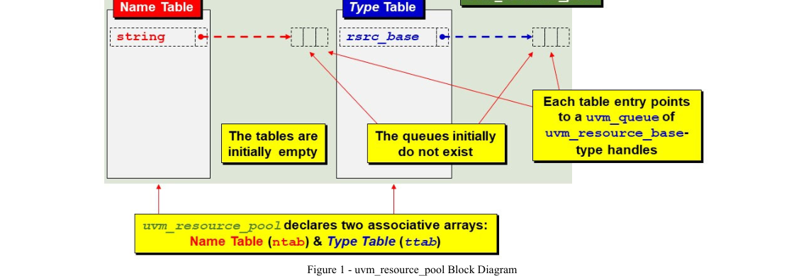
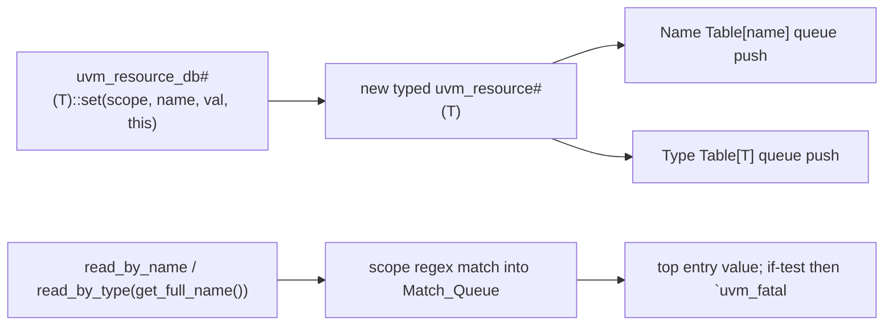

<!-- generated by yt-paper; edits will be overwritten -->
[DVCon](../dvcon/index.md) › [US](../dvcon/us.md) › [2023](../dvcon/by-year.md#2023) › [Verification](../dvcon/by-topic.md#verification)

# The Untapped Power of UVM Resources and Why Engineers Should Use the uvm_resource_db API

<figure class="rep-fig" markdown>
{ loading=lazy }
<figcaption>Figure 1 - uvm_resource_pool Block Diagram — from the original paper (Clifford E. Cummings et al.)</figcaption>
</figure>

[:material-open-in-new: Original paper](https://dvcon-proceedings.org/wp-content/uploads/1072-The-Untapped-Power-of-UVM-Resources-and-Why-Engineers-Should-Use-the-uvm_resource_db-API.pdf){ .md-button .md-button--primary target=_blank }

| | |
|---|---|
| Authors | Clifford E. Cummings (Paradigm Works, Inc.), Heath Chambers (HMC Design Verification), Mark Glasser (Elastics.cloud) |
| Venue | DVCon US 2023 |
| Topic | Verification |
| Type | PAPER |
| ID | `ref-20261018-40d8` |

## Summary

**The paper explains that UVM has a single resource database (Name Table and Type Table over a singleton uvm_resource_pool), argues that uvm_config_db is a restricted wrapper that should be replaced by the more capable uvm_resource_db API, and provides one-to-one replacement examples.**

**이 논문은 UVM이 Name Table과 Type Table을 가진 단일 리소스 데이터베이스(싱글톤 uvm_resource_pool)를 사용하며, uvm_config_db는 기능이 제한된 래퍼이므로 더 강력한 uvm_resource_db API로 대체해야 한다고 주장하고 그에 대한 1:1 대체 예제를 제시한다.**

## Key Insights

- UVM has one resource database, not two: uvm_config_db is a derived wrapper over uvm_resource_db, so anything set with uvm_config_db can be read with uvm_resource_db, but not the reverse.

- UVM에는 두 개의 리소스 데이터베이스가 아니라 하나만 존재한다. uvm_config_db는 uvm_resource_db에서 파생된 래퍼이므로 uvm_config_db로 저장한 항목은 uvm_resource_db로 읽을 수 있지만 그 반대는 성립하지 않는다.

- Each resource is referenced from two associative arrays: the Name Table (string key to queue) and the Type Table (type-handle key to queue). Read via read_by_name or read_by_type; uvm_config_db::get can only use the Name Table and has no read_by_type equivalent.

- 각 리소스는 Name Table(문자열 키 → 큐)과 Type Table(타입 핸들 키 → 큐) 두 연관 배열에서 참조된다. read_by_name 또는 read_by_type으로 읽으며, uvm_config_db::get은 Name Table만 사용할 수 있고 read_by_type에 해당하는 기능이 없다.

- uvm_resource_db scopes are plain wildcard strings, not required to match a component path, so pseudo-scopes such as "LCNT::*" let sequences and modules store and retrieve data. The same call is illegal in uvm_config_db.

- uvm_resource_db의 scope는 컴포넌트 경로와 일치할 필요가 없는 단순 와일드카드 문자열이므로, "LCNT::*"와 같은 pseudo-scope를 사용하면 시퀀스와 모듈도 데이터를 저장하고 검색할 수 있다. 동일한 호출은 uvm_config_db에서 허용되지 않는다.

- The paper's worked example: nine uvm_resource_db::set calls produce nine typed resources, eight Name Table entries, and five Type Table entries (queues shared by name or type). Every read should be guarded by an if-test that issues `uvm_fatal on failure.

- 논문의 예제에서 nine개의 uvm_resource_db::set 호출은 9개의 타입이 지정된 리소스, 8개의 Name Table 항목, 5개의 Type Table 항목을 만든다(이름 또는 타입 기준으로 큐를 공유). 모든 읽기는 실패 시 `uvm_fatal을 실행하는 if-test로 검사해야 한다.

- The authors estimate that more than 90% of UVM engineers as of DVCon 2023 use uvm_config_db, which they attribute to early UVM books and examples, and they recommend migrating to uvm_resource_db. The paper gives no measured simulation-performance data.

- 저자들은 DVCon 2023 기준으로 UVM 엔지니어의 90% 이상이 uvm_config_db를 사용한다고 추정하며, 그 원인을 초기 UVM 서적과 예제에 있다고 본다. 그리고 uvm_resource_db로의 전환을 권장한다. 논문은 측정된 시뮬레이션 성능 데이터를 제시하지 않는다.

## Detailed Summary

### Background and Problem

- OVM's set_config_*/get_config facility stored only integers, strings, and object handles, distributed across components, and was described as inefficient.

- OVM의 set_config_*/get_config 기능은 정수, 문자열, 객체 핸들만 저장할 수 있었고, 컴포넌트에 분산되어 있어 비효율적이라고 설명된다.

- UVM introduced a centralized resource database with a low-level layer (uvm_resource_pool) and a convenience layer (uvm_resource_db). It can store values of any type and be accessed from any class, including sequences and transactions.

- UVM은 저수준 계층(uvm_resource_pool)과 편의 계층(uvm_resource_db)으로 구성된 중앙 집중형 리소스 데이터베이스를 도입했다. 모든 타입의 값을 저장할 수 있고, 시퀀스와 트랜잭션을 포함한 모든 클래스에서 접근할 수 있다.

- uvm_config_db was added as a backward-compatibility "transition" layer for set_config_*. In practice it became the primary interface. Its main restriction is that only uvm_component scopes are allowed, which pushes users toward p_sequencer and virtual sequencers.

- uvm_config_db는 set_config_*와의 하위 호환을 위한 "전환(transition)" 계층으로 추가되었지만, 실제로는 기본 인터페이스가 되었다. 가장 큰 제약은 uvm_component 스코프만 허용한다는 점이며, 이로 인해 p_sequencer와 virtual sequencer 같은 구조를 사용하게 된다.

- The authors estimate that over 90% of UVM engineers used uvm_config_db as of DVCon 2023, mainly because early UVM books and examples recommended it.

- 저자들은 DVCon 2023 기준으로 UVM 엔지니어의 90% 이상이 uvm_config_db를 사용하고 있다고 추정한다. 주된 이유는 초기 UVM 서적과 예제가 이를 권장했기 때문이다.

- The paper also clarifies `this`, get_full_name(), and get_name(). `this` is a class handle, get_full_name() returns a hierarchical string, and get_name() returns the leaf name.

- 논문은 `this`, get_full_name(), get_name()의 차이도 정리한다. `this`는 클래스 핸들이고, get_full_name()은 계층 경로 문자열을 반환하며, get_name()은 말단 이름을 반환한다.

### Architecture and Methodology

- The resource pool is a singleton created at the start of a test. It holds two associative arrays: the Name Table (string key to uvm_queue) and the Type Table (type-handle key to uvm_queue). The tables store queue handles, and each queue holds uvm_resource_base handles that are downcast with $cast on retrieval.

- 리소스 풀은 테스트 시작 시 생성되는 싱글톤이다. 두 개의 연관 배열을 가지며, 하나는 Name Table(문자열 키 → uvm_queue), 다른 하나는 Type Table(타입 핸들 키 → uvm_queue)이다. 큐에는 uvm_resource_base 핸들이 들어 있고, 조회 시 $cast로 다운캐스트한다.

- Each resource stores its type, a scope regex string, and its value. A set() call creates one resource and links it into both tables. Insertion steps: look up the name, create or reuse the queue, push the handle; then repeat for the type.

- 각 리소스는 타입, scope 정규식 문자열, 값을 저장한다. set() 호출은 리소스 하나를 생성하여 두 테이블에 모두 연결한다. 삽입 순서는 이름 조회 후 큐 생성 또는 재사용, 핸들 push이며, 이후 타입 기준으로 같은 과정을 반복한다.

- Read paths: read_by_name uses the string key, and read_by_type uses the type key. Both traverse the queue, keep entries whose scope matches the caller's get_full_name() string (wildcard match), place them in a Match_Queue, and return the top entry. The optional `this` argument enables audit tracing.

- 읽기 경로: read_by_name은 문자열 키를, read_by_type은 타입 키를 사용한다. 두 경우 모두 큐를 순회하며 호출자의 get_full_name() 문자열과 와일드카드로 매칭되는 항목을 Match_Queue에 모으고, 맨 위 항목의 값을 반환한다. 선택 인자 `this`는 감사 추적(audit tracing)에 사용된다.

- uvm_config_db::set/get build a full-path scope by concatenating cntxt.get_full_name() with inst_name. The uvm_top root has an empty name, so null context maps to root. The paper argues this makes config_db slightly less efficient and blocks non-component use.

- uvm_config_db::set/get은 cntxt.get_full_name()과 inst_name을 이어 붙여 전체 경로 scope를 만든다. uvm_top 루트의 이름은 비어 있으므로 null 컨텍스트는 루트로 매핑된다. 논문은 이 구조가 config_db를 다소 비효율적으로 만들고 비컴포넌트 사용을 막는다고 주장한다.

- Migration examples show `uvm_config_db#(T)::set(this, "drv", "cfg", cfg)` replaced by `uvm_resource_db#(T)::set({get_full_name(), ".drv"}, "cfg", cfg, this)`. A top-module `set(null, "*agnt", ...)` becomes `set("*agnt", ...)`.

- 마이그레이션 예: `uvm_config_db#(T)::set(this, "drv", "cfg", cfg)`는 `uvm_resource_db#(T)::set({get_full_name(), ".drv"}, "cfg", cfg, this)`로 바뀐다. 탑 모듈의 `set(null, "*agnt", ...)`는 `set("*agnt", ...)`가 된다.

### Results and Conclusions

- Worked example: nine set() calls produce nine typed resources, eight Name Table entries (vif, env_cfg, cfg, cnt, has_cov, msg1, msg2, LCNT), and five Type Table entries (virtual dut_if, env_cfg, agnt_cfg, int, string).

- 예제: 9번의 set() 호출로 9개의 타입 리소스, 8개의 Name Table 항목(vif, env_cfg, cfg, cnt, has_cov, msg1, msg2, LCNT), 5개의 Type Table 항목(virtual dut_if, env_cfg, agnt_cfg, int, string)이 생성된다.

- Retrieval capability: uvm_resource_db reads from both tables, while uvm_config_db::get reads only the Name Table. Pseudo-scope resources set with uvm_resource_db cannot be retrieved with uvm_config_db.

- 조회 기능: uvm_resource_db는 두 테이블 모두에서 읽을 수 있지만, uvm_config_db::get은 Name Table만 읽을 수 있다. uvm_resource_db로 pseudo-scope에 저장한 리소스는 uvm_config_db로 검색할 수 없다.

- The authors conclude that uvm_resource_db is simpler and more powerful, and that engineers should stop using uvm_config_db. The paper provides no measured benchmark data, and its efficiency claims are qualitative.

- 저자들은 uvm_resource_db가 더 단순하고 강력하므로 uvm_config_db 사용을 중단해야 한다고 결론짓는다. 논문은 측정된 벤치마크 데이터를 제시하지 않으며, 효율성 관련 주장은 정성적이다.

- The document is truncated in section X (avoiding p_sequencer with uvm_resource_db). Content after that point is not summarized.

- 문서는 X절(uvm_resource_db로 p_sequencer 회피)에서 잘려 있으며, 그 이후 내용은 요약하지 않았다.

## Videos

<iframe src="https://www.youtube-nocookie.com/embed/lPtRkWNiksg" title="[DVCON2023]The Untapped Power of UVM Resources and Why Engineers Should Use the uvm_resource_db API" loading="lazy" allow="accelerometer; clipboard-write; encrypted-media; gyroscope; picture-in-picture; web-share" referrerpolicy="strict-origin-when-cross-origin" allowfullscreen></iframe>

**[DVCON2023]The Untapped Power of UVM Resources and Why Engineers Should Use the uvm_resource_db API** — [Watch on YouTube](https://www.youtube.com/watch?v=lPtRkWNiksg) · [Video page](../videos/lPtRkWNiksg.md)
