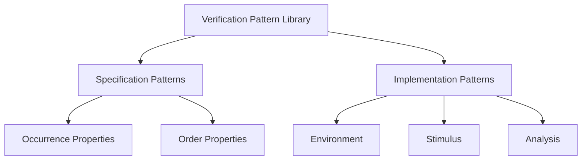

<!-- generated by yt-paper; edits will be overwritten -->
[DVCon](../dvcon/index.md) › [US](../dvcon/us.md) › [2016](../dvcon/by-year.md#2016) › [Verification](../dvcon/by-topic.md#verification)

# Verification Patterns – Taking Reuse to the Next Level

[:material-open-in-new: Original paper](https://dvcon-proceedings.org/wp-content/uploads/verification-patterns-taking-reuse-to-the-next-level.pdf){ .md-button .md-button--primary target=_blank }

| | |
|---|---|
| Authors | Harry Foster (Mentor Graphics Corporation), Michael Horn (Mentor Graphics Corporation), Bob Oden (Mentor Graphics Corporation), Pradeep Salla (Mentor Graphics Corporation), Hans van der Schoot (Mentor Graphics Corporation) |
| Venue | DVCon US 2016 |
| Topic | Verification |
| Type | PAPER |
| ID | `ref-20261018-461f` |

## Summary

**The paper proposes a systematic taxonomy (Specification vs. Implementation patterns), a documentation template, and property-scope generalization for building a searchable, cross-engine verification pattern library, illustrated with three examples and hosted on the Verification Academy.**

**이 논문은 검증 패턴 라이브러리를 구축하기 위해 체계적인 분류 체계(Specification 패턴과 Implementation 패턴), 문서화 템플릿, 그리고 property scope 기반의 일반화 방법을 제안하며, 세 가지 예제로 설명하고 Verification Academy에 공개한다.**

## Key Insights

- Verification patterns are split into Specification Patterns (Occurrence vs. Order properties, following Dwyer et al.) and Implementation Patterns (Environment, Stimulus, Analysis), so that a pattern can be located by where it sits in the flow rather than by language or engine.

- 검증 패턴은 Specification 패턴(Dwyer et al.에 따른 Occurrence 대 Order property)과 Implementation 패턴(Environment, Stimulus, Analysis)으로 나뉘며, 언어나 엔진이 아닌 설계·검증 흐름 내 위치를 기준으로 패턴을 찾을 수 있게 한다.

- Property scopes (global, before, after, between, after-until) let one base property pattern cover many variants. The paper notes that the between and after-until scopes differ only in whether the fulfilling condition R must occur after the enabling condition Q, which reduces the number of documented patterns.

- property scope(global, before, after, between, after-until)를 사용하면 하나의 기본 property 패턴으로 여러 변형을 포괄할 수 있다. 논문은 between과 after-until의 차이가 fulfilling 조건 R이 enabling 조건 Q 이후에 발생해야 하는지 여부뿐이라고 설명하며, 이로써 문서화해야 할 패턴 수를 줄인다.

- The pattern template separates Intent (one or two sentences), Motivation (a concrete problem without the solution), and Applicability (the generalized context), and requires an Example that solves the Motivation problem. This keeps the library consistent across novice and expert contributors.

- 패턴 템플릿은 Intent(한두 문장), Motivation(해결책 없이 구체적인 문제 기술), Applicability(일반화된 적용 맥락)를 구분하고, Motivation의 문제를 푸는 Example을 요구한다. 이를 통해 초보 및 숙련 기여자 모두에게 일관된 라이브러리를 유지한다.

- The BFM-Proxy Pair Pattern supports one testbench that runs in both simulation and emulation: an HVL class proxy calls time-consuming tasks on a synthesizable HDL BFM interface, and the BFM calls back into the proxy through a back-pointer to report transactions.

- BFM-Proxy Pair Pattern은 하나의 testbench가 시뮬레이션과 에뮬레이션 모두에서 실행되도록 한다. HVL 클래스 proxy가 합성 가능한 HDL BFM 인터페이스의 시간 소모 task를 호출하고, BFM은 back-pointer를 통해 proxy에 트랜잭션을 통지한다.

- The Verification Academy community (over 35,000 design and verification engineers) was chosen as the host for the library to speed up adoption and reduce infrastructure cost.

- 패턴 라이브러리는 35,000명 이상의 설계·검증 엔지니어가 참여하는 Verification Academy 커뮤니티에 호스팅되어 도입 속도를 높이고 인프라 비용을 줄였다.

## Detailed Summary

### Background and Problem

- Design patterns are a proven way to share best practices, but verification patterns are scattered across conference papers, books, and heterogeneous databases in inconsistent formats. This makes them hard to search, reference, and reuse.

- 디자인 패턴은 모범 사례를 공유하는 검증된 방법이지만, 검증 패턴은 학회 논문, 서적, 이질적인 데이터베이스에 흩어져 있고 형식도 제각각이다. 그 결과 검색, 참조, 재사용이 어렵다.

- Prior verification pattern work mostly covered the coding side of simulation testbenches. The paper argues for coverage of the full verification flow: property specification, UVM testbench construction, stimulus, analysis, and hardware-assisted acceleration.

- 기존의 검증 패턴 연구는 주로 시뮬레이션 testbench의 코딩 측면에 집중되어 있었다. 이 논문은 property specification, UVM testbench 구축, stimulus, analysis, 하드웨어 가속까지 검증 흐름 전체를 다뤄야 한다고 주장한다.

- Lineage: Alexander (1977, architecture), Beck and Cunningham (1987, programming), the GoF book (1994), Dwyer et al. (1998, property specification patterns), and Foster et al. (2004, *Assertion-Based Design*, sixteen patterns).

- 계보: Alexander(1977, 건축), Beck과 Cunningham(1987, 프로그래밍), GoF 서적(1994), Dwyer 외(1998, property specification 패턴), Foster 외(2004, *Assertion-Based Design*, 패턴 16개).

### Architecture and Methodology

The paper gives a systematic process for organizing and documenting a library that works across formal, simulation, and emulation.

논문은 formal, 시뮬레이션, 에뮬레이션 전반에서 동작하는 라이브러리를 구성하고 문서화하는 체계적 절차를 제시한다.

- **Categorization.** The top-level split follows the digital design and verification flow. Specification patterns address notation for design intent, mainly property assertions and covers. Occurrence patterns (Universality, Existence, Absence) constrain whether a state or event occurs. Order patterns (Precedence, Response) constrain how states and events are ordered. Implementation patterns cover testbench construction and are split into Environment (structure, configuration, synchronization), Stimulus (behavior and strategy), and Analysis (checking and coverage). Environment touches both analysis and stimulus, but stimulus and analysis do not depend on each other.

- **분류 체계.** 최상위 분할은 디지털 설계·검증 흐름을 따른다. Specification 패턴은 설계 의도를 표현하는 표기법, 주로 property assertion과 cover를 다룬다. Occurrence 패턴(Universality, Existence, Absence)은 상태나 이벤트가 발생하는지 여부를 제약한다. Order 패턴(Precedence, Response)은 상태와 이벤트의 순서를 제약한다. Implementation 패턴은 testbench 구축을 다루며 Environment(구조, 구성, 동기화), Stimulus(동작과 전략), Analysis(검사와 커버리지)로 나뉜다. Environment는 analysis와 stimulus 모두에 관여하지만, stimulus와 analysis는 서로 의존하지 않는다.

- **Template.** Each pattern has these sections: Pattern Name, Intent, Motivation (a concrete problem without the solution), Applicability (the generalized context), Structure (required for implementation patterns), Implementation, Example (pseudo-code or code that solves the Motivation problem), Scope (recommended for specification patterns), Consequences, Related Patterns, and Contribution.

- **템플릿.** 각 패턴은 Pattern Name, Intent, Motivation(해결책 없이 구체적인 문제 기술), Applicability(일반화된 맥락), Structure(implementation 패턴에 필수), Implementation, Example(Motivation 문제를 해결하는 의사코드 또는 코드), Scope(specification 패턴에 권장), Consequences, Related Patterns, Contribution 섹션으로 구성된다.

- **Property scopes.** Following Dwyer et al., the base property P is bounded by an enabling condition Q and a fulfilling condition R. The five scopes are:
  - Global: P holds over the entire execution.
  - Before R: P holds up to, but not including, the first R.
  - After Q: P holds from Q onward.
  - Between Q and R: P holds from Q up to R, only if R occurs after Q.
  - After-until Q–R: P holds from Q up to R, even if R never occurs.
  Scopes can apply to sub-properties (for example, the `property_expr` in `sequence_expr |-> property_expr`).

- **Property scope.** Dwyer 외의 방식을 따라 기본 property P는 enabling 조건 Q와 fulfilling 조건 R로 경계가 정해진다. 다섯 가지 scope는 다음과 같다.
  - Global: 전체 실행 구간에서 P가 성립한다.
  - Before R: 첫 번째 R 이전(R 제외)까지 P가 성립한다.
  - After Q: Q 이후 P가 성립한다.
  - Between Q and R: R이 Q 이후에 발생한 경우에만, Q부터 R 이전까지 P가 성립한다.
  - After-until Q–R: R이 발생하지 않더라도, Q부터 R 이전까지 P가 성립한다.
  Scope는 sub-property에도 적용할 수 있다(예: `sequence_expr |-> property_expr`의 `property_expr`).

- **Examples.** The paper presents three patterns.
  1. *Forbidden Sequence Property Pattern* (occurrence, a special case of Absence). It forbids a sequence such as three low-to-high transitions of T, written as `not ($rose(T)[->3])`, under each of the five scopes. It is applied to a two-client arbiter fairness check. The paper writes `( !gnt[0] throughout $rose(gnt[1])[->2] )` and the property `$rose(req[0]) |-> not(...)`, then generalizes it to a parameterized `p_arbiter_fair(i,j)` that a SystemVerilog generate can instantiate for an n-client arbiter.
  2. *BFM-Proxy Pair Pattern* (environment, simulation and emulation). The HVL class proxy (a UVM driver or monitor) calls tasks on a SystemVerilog interface BFM through a virtual interface. The BFM calls back to the proxy via a back-pointer, which carries transactions to the analysis port. Each proxy-BFM pair forms one split transactor. The pattern builds on the Dual Domain Hierarchy Pattern and resembles the GoF Proxy pattern.
  3. *Resource Sharing Pattern* (environment). Resources are stored in `uvm_config_db` under a (cntxt, inst_name, field_name) key scheme, for example "CONFIGURATIONS", "INTERFACES", and "SEQUENCERS" keyed by "INGRESS_DATA_PORT". Test writers can then access the configuration, virtual interface, and sequencer for a port without knowing the environment hierarchy.

- **예제.** 논문은 세 가지 패턴을 제시한다.
  1. *Forbidden Sequence Property Pattern*(Occurrence, Absence의 특수한 경우). T의 low-to-high 전이 세 번이 금지되는 시퀀스를 다루며, 이를 `not ($rose(T)[->3])`로 쓰고 다섯 가지 scope 각각에 대해 정리한다. 2-client arbiter의 fairness 검사에 적용하며, `( !gnt[0] throughout $rose(gnt[1])[->2] )`와 `$rose(req[0]) |-> not(...)`를 쓰고, 이를 매개변수화된 `p_arbiter_fair(i,j)`로 일반화한다. SystemVerilog generate로 n-client arbiter 전체에 인스턴스화할 수 있다.
  2. *BFM-Proxy Pair Pattern*(Environment, 시뮬레이션과 에뮬레이션). HVL 클래스 proxy(UVM driver 또는 monitor)가 virtual interface를 통해 SystemVerilog interface BFM의 task를 호출한다. BFM은 back-pointer로 proxy를 호출해 트랜잭션을 analysis port로 전달한다. 각 proxy-BFM 쌍이 하나의 split transactor를 이룬다. 이 패턴은 Dual Domain Hierarchy Pattern을 기반으로 하며 GoF의 Proxy 패턴과 유사하다.
  3. *Resource Sharing Pattern*(Environment). 자원은 (cntxt, inst_name, field_name) 키 체계로 `uvm_config_db`에 저장되며, 예를 들어 "INGRESS_DATA_PORT"를 키로 "CONFIGURATIONS", "INTERFACES", "SEQUENCERS"에 각각 저장한다. 이렇게 하면 test 작성자는 environment 계층 구조를 몰라도 특정 포트의 configuration, virtual interface, sequencer에 접근할 수 있다.

- **Library infrastructure.** The library is a web-based, freely available knowledge base on the Verification Academy (www.verificationacademy.com). Contributions follow the template. Usability goals are discoverability, referenceability, and relatability. Growth is driven by the existing community of more than 35,000 engineers.

- **라이브러리 인프라.** 라이브러리는 Verification Academy(www.verificationacademy.com)에 호스팅되는 웹 기반의 무료 지식 베이스다. 기여는 템플릿을 따른다. 사용성 목표는 발견 가능성(discoverability), 참조 가능성(referenceability), 연관성(relatability)이다. 35,000명 이상의 엔지니어로 구성된 기존 커뮤니티가 성장의 기반이다.

### Results and Conclusions

- The paper gives no quantitative evaluation of the library, such as pattern counts, adoption metrics, or user studies. Its contributions are qualitative: a taxonomy, a documentation template, a generalization method (property scopes), and three worked examples.

- 논문은 패턴 수, 채택 지표, 사용자 연구 등 라이브러리에 대한 정량적 평가를 제시하지 않는다. 기여는 분류 체계, 문서화 템플릿, 일반화 방법(property scope), 세 가지 작업 예제라는 정성적 수준이다.

- The authors argue that property scopes reduce the documentation burden. They note that Foster et al.'s sixteen patterns contained near-duplicates that differed only in boundary conditions.

- 저자들은 property scope가 문서화 부담을 줄인다고 주장한다. Foster 외의 패턴 16개 중 일부는 경계 조건만 다른 거의 중복된 패턴이었다고 설명한다.

- Stated limitations: the Before scope and the implication construct can cause performance problems, and some tools do not support `implies` between properties. The paper also notes that the global scope is usually better for sub-properties than for full properties.

- 명시된 제약: Before scope와 implication 구문은 성능 문제를 일으킬 수 있고, 일부 툴은 property 간 `implies`를 지원하지 않는다. 또한 sub-property에는 full property보다 global scope가 보통 더 적합하다고 밝힌다.

- Future work: populate the library with patterns from earlier publications, open contribution to the community, extend patterns to portable stimulus and system-level analysis, and add scopes that use regular-expression semantics, which Dwyer et al. did not consider.

- 향후 과제: 이전 발표 논문의 패턴으로 라이브러리를 채우고, 커뮤니티 기여를 열며, portable stimulus와 system-level analysis로 패턴을 확장하고, Dwyer 외가 고려하지 않은 정규 표현식 의미의 scope를 추가한다.

- Overall, the paper is a proposal for a cross-engine verification pattern catalogue that lowers the barrier to reuse, with the Verification Academy as the delivery vehicle.

- 전체적으로 이 논문은 재사용 장벽을 낮추기 위한 cross-engine 검증 패턴 카탈로그를 제안하며, Verification Academy를 전달 수단으로 삼는다.

*Note: The body text is truncated near the end; this summary covers the content present, through the references.*

*참고: 본문이 후반부에서 잘려 있으므로, 이 요약은 참고문헌까지 실제 존재하는 내용만 다룬다.*

## Videos

<iframe src="https://www.youtube-nocookie.com/embed/KAjqYgvue80" title="[DVCON2016]Verification Patterns – Taking Reuse to the Next Level" loading="lazy" allow="accelerometer; clipboard-write; encrypted-media; gyroscope; picture-in-picture; web-share" referrerpolicy="strict-origin-when-cross-origin" allowfullscreen></iframe>

**[DVCON2016]Verification Patterns – Taking Reuse to the Next Level** — [Watch on YouTube](https://www.youtube.com/watch?v=KAjqYgvue80) · [Video page](../videos/KAjqYgvue80.md)
