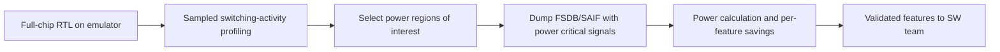

<!-- generated by yt-paper; edits will be overwritten -->
[DVCon](../dvcon/index.md) › [US](../dvcon/us.md) › [2017](../dvcon/by-year.md#2017) › [Emulation](../dvcon/by-topic.md#emulation)

# EMULATION BASED FULL CHIP LEVEL LOW POWER VALIDATION AT PRE-SILICON STAGE

<figure class="rep-fig" markdown>
{ loading=lazy }
<figcaption>Figure 2 Power feature validation flow at the pre-silicon stage — from the original paper (Kyoungmin Park et al.)</figcaption>
</figure>

[:material-open-in-new: Original paper](https://dvcon-proceedings.org/wp-content/uploads/emulation-based-full-chip-level-low-power-validation-at-pre-silicon-stage.pdf){ .md-button .md-button--primary target=_blank }

| | |
|---|---|
| Authors | Kyoungmin Park (Samsung Electronics Co., Ltd.), Jaegeun Song (Samsung Electronics Co., Ltd.), Hyundon Kim (Samsung Electronics Co., Ltd.), Seonil Brian Choi (Samsung Electronics Co., Ltd.), Suk Won Kim (Samsung Electronics Co., Ltd.) |
| Venue | DVCon US 2017 |
| Topic | Emulation |
| Type | PAPER |
| ID | `ref-20261018-466a` |

## Summary

**Samsung proposes an emulation-based full-chip RTL flow that moves mobile AP low-power feature validation and power estimation from post-silicon to pre-silicon, using sampling-ratio control and power-critical-signal dumps to cut turnaround time on multi-second OS-level scenarios.**

**삼성전자는 모바일 AP의 저전력 기능 검증과 전력 추정을 post-silicon에서 pre-silicon 단계로 옮기는 에뮬레이션 기반 full-chip RTL 흐름을 제안하며, 수 초 단위 OS 레벨 시나리오의 TAT를 줄이기 위해 sampling ratio control과 power critical signal 덤프를 사용한다.**

## Key Insights

- Sampling ratio control reduced the dump of a 100ms full-chip run from 144G / 4h47min (full cycle) to 12G / 27min (1 of 16 cycles), and to 966M / 15min at 1 of 256, while the switching-activity trend stayed highly correlated.

- Sampling ratio control은 100ms full-chip 실행의 덤프를 full cycle 기준 144G / 4h47min에서 1 of 16 사이클 기준 12G / 27min으로 줄였고, 1 of 256에서는 966M / 15min까지 줄었으며, 스위칭 액티비티 추세의 상관성은 높게 유지되었다.

- Power critical signals (about 92.5% fewer signals, 44M to 3.3M) cut FSDB generation from 10h to 1.1h and average-power calculation from 11h to 4.5h, with a power difference of -7~2.4% versus the full-signal flow.

- Power critical signal(신호 수 약 92.5% 감소, 44M에서 3.3M)은 FSDB 생성 시간을 10h에서 1.1h로, average power 계산 시간을 11h에서 4.5h로 줄였고, full-signal 흐름 대비 전력 차이는 -7~2.4%였다.

- Emulation-based RTL estimates captured per-feature savings: low power features 1+2 reduced idle power by 77.8% (120 to 26.7) and active power by 27.2% (160.8 to 116.4).

- 에뮬레이션 기반 RTL 추정으로 기능별 절감 효과를 확인했다. 저전력 기능 1+2 적용 시 idle 전력은 77.8%(120에서 26.7), active 전력은 27.2%(160.8에서 116.4) 감소했다.

- Silicon correlation was mixed: idle estimate was +18.6% and active estimate was -1.8% versus silicon. The flow excludes off-chip effects, so it is positioned for relative savings rather than absolute power.

- 실리콘 상관성은 혼재되었다. idle 추정치는 실리콘 대비 +18.6%, active 추정치는 -1.8%였다. 본 흐름은 off-chip 효과를 제외하므로 절대 전력보다 상대적 절감 효과 평가에 적합하다.

- Known gaps include PMIC/SoC co-verification, analog integration, and DVFS voltage control in emulation; the authors point to in-emulator real-time switching calculation and hybrid emulation as next steps.

- 남은 과제로 PMIC/SoC 공동 검증, 아날로그 통합, 에뮬레이션에서의 DVFS 전압 제어가 있으며, 저자들은 에뮬레이터 내 실시간 스위칭 계산과 hybrid emulation을 다음 단계로 제시한다.

## Detailed Summary

### Background and Problem

- Mobile AP power features (clock and power management) are controlled at full-chip level, so IP/block-level RTL and gate simulation cannot verify them under realistic firmware/OS scenarios that run from milliseconds to minutes.

- 모바일 AP의 전력 기능(clock 및 power management)은 full-chip 수준에서 제어되므로, IP/block 수준의 RTL 및 gate 시뮬레이션으로는 밀리초에서 분 단위에 이르는 현실적인 firmware/OS 시나리오에서 이를 검증할 수 없다.

- At post-silicon, power analysis can only drive software optimization. Hardware bugs in low-power features cannot be fixed in the current silicon, so workarounds are applied or features are disabled, and the product may miss its battery-consumption specification.

- Post-silicon 단계에서의 전력 분석은 소프트웨어 최적화에만 영향을 줄 수 있다. 저전력 기능의 하드웨어 버그는 현재 실리콘에서 수정할 수 없어 workaround를 적용하거나 기능을 비활성화하게 되며, 제품이 배터리 소모 사양을 만족하지 못할 수 있다.

- Silicon measurements include board and package effects, and internal nodes are hard to debug. The full-chip RTL environment is not kept for reproduction.

- 실리콘 측정에는 board 및 package 영향이 포함되고, 내부 노드 디버그도 어렵다. Full-chip RTL 환경이 확보되지 않아 실리콘 시나리오를 재현하기도 어렵다.

- Turnaround time (TAT) is the practical bottleneck: a full-waveform dump, switching-activity profiling, and power calculation for a realistic scenario take several days.

- 실질적인 병목은 TAT(Turn Around Time)다. 현실적인 시나리오에 대해 full waveform 덤프, switching activity profiling, 전력 계산을 수행하는 데 수 일이 걸린다.

### Architecture and Methodology

The proposed pre-silicon flow runs a full-chip RTL emulation with almost the same firmware/OS validation environment used post-silicon. Switching activity is profiled from emulation, so features such as clock gating can be checked against an activity graph. Full waveform visibility supports debug, and RTL fixes can be applied immediately. A power calculation tool then analyzes FSDB or SAIF for chosen time windows to estimate savings per feature. The validated features can then be used by the software team for system-level optimization.

제안하는 pre-silicon 흐름은 post-silicon과 거의 동일한 firmware/OS 검증 환경을 사용해 full-chip RTL을 에뮬레이션한다. 에뮬레이션에서 switching activity를 profiling하므로 clock gating 같은 기능을 activity graph로 확인할 수 있다. Full waveform 가시성으로 디버그가 가능하며, RTL 수정을 즉시 반영할 수 있다. 이후 전력 계산 도구가 선택된 시간 구간의 FSDB 또는 SAIF를 분석해 기능별 절감 효과를 추정한다. 검증된 기능은 소프트웨어 팀이 시스템 수준 최적화에 활용한다.

Two TAT-reduction techniques are proposed:

TAT 감소를 위해 두 가지 기법을 제안한다.

- **Sampling ratio control:** dump the same signals for only a subset of cycles (examples in the paper: 10 of 1000 cycles, 1 of 16, 1 of 256).

- **Sampling ratio control:** 동일한 신호를 일부 사이클만 덤프한다(논문 예시: 1000 사이클 중 10 사이클, 1 of 16, 1 of 256).

- **Power critical signal flow:** the power tool selects about 10% of signals as power critical at elaboration. Regions of interest (ROI) are picked from profiling, and FSDB or SAIF is generated only for those signals within the ROI.

- **Power critical signal flow:** 전력 도구가 elaboration 단계에서 전체 신호의 약 10%를 power critical 신호로 선택한다. Profiling 결과에서 관심 구간(ROI)을 고르고, 해당 ROI에 대해서만 이 신호들의 FSDB 또는 SAIF를 생성한다.

Setup: design of about 50M gates. The TAT tables use 100ms emulation runs. The OS-level scenario is about 5 s, and the power ROI is 10 ms, so the analyzed scenario is expanded by a factor of 500 relative to the earlier flow.

구성: 약 50M gate 규모의 설계. TAT 표는 100ms 에뮬레이션 실행 기준이다. OS 레벨 시나리오는 약 5초이며 전력 ROI는 10ms이므로, 이전 흐름 대비 분석 대상 시나리오가 500배 확장된다.

### Results and Conclusions

- **Sampling ratio (Table 1, 100ms full chip):** dump file 144G to 12G (1 of 16) and 966M (1 of 256); emulation run 4h47min to 27min and 15min. Profiled file 266G to 17G and 1.1G; profiling 22h9min to 37min and 7min. The paper reports dump file size reduced up to 150X, emulation run time up to 20X, profiled file size up to 241X, and post-processing run time up to 176X.

- **Sampling ratio (Table 1, 100ms full chip):** 덤프 파일 144G에서 12G(1 of 16), 966M(1 of 256)으로 감소했고, 에뮬레이션 실행 시간은 4h47min에서 27min, 15min으로 감소했다. Profiling 파일은 266G에서 17G, 1.1G로 줄었고, profiling 시간은 22h9min에서 37min, 7min으로 줄었다. 논문은 덤프 파일 크기 최대 150X, 에뮬레이션 실행 시간 최대 20X, profiling 파일 크기 최대 241X, 후처리 실행 시간 최대 176X 감소를 보고한다.

- **Power critical signals (Table 2, 10ms ROI):** signals reduced from 44M to 3.3M (92.5%). FSDB generation dropped from 10h to 1.1h (about 89%), and average-power calculation dropped from 11h to 4.5h (about 60%). Power difference versus full signal is -7~2.4%. Emulation run/dump and profiling times are unchanged.

- **Power critical signal (Table 2, 10ms ROI):** 신호 수가 44M에서 3.3M으로 감소했다(92.5%). FSDB 생성 시간은 10h에서 1.1h로(약 89%), average power 계산 시간은 11h에서 4.5h로(약 60%) 감소했다. Full signal 대비 전력 차이는 -7~2.4%다. 에뮬레이션 실행/덤프 및 profiling 시간은 변하지 않았다.

- **Idle power (Table 3, normalized):** low power feature 1 gives 54.2% reduction (120 to 55); features 1+2 give 77.8% (120 to 26.7).

- **Idle 전력 (Table 3, 정규화):** 저전력 기능 1은 54.2% 감소(120에서 55), 기능 1+2는 77.8% 감소(120에서 26.7)를 보였다.

- **Active power (Table 4, normalized):** feature 1 gives 26.5% reduction (160.8 to 118.2); features 1+2 give 27.2% (160.8 to 116.4). Feature 2 alone shows -2%. The authors attribute the smaller active-power gain to heavier operation.

- **Active 전력 (Table 4, 정규화):** 기능 1은 26.5% 감소(160.8에서 118.2), 기능 1+2는 27.2% 감소(160.8에서 116.4)를 보였다. 기능 2 단독은 -2%다. 저자들은 active 구간이 더 많이 동작하므로 절감 폭이 작다고 설명한다.

- **Silicon correlation (Table 5):** idle estimate 118.6% vs silicon 100% (+18.6%); active estimate 98.2% vs 100% (-1.8%). The paper notes correlation varies across samples and that the flow targets relative savings rather than absolute power.

- **실리콘 상관성 (Table 5):** idle 추정치는 실리콘 100% 대비 118.6%(+18.6%), active 추정치는 98.2%(-1.8%)였다. 논문은 샘플에 따라 상관성이 달라진다고 언급하며, 본 흐름은 절대 전력보다 상대적 절감 효과 평가를 목표로 한다고 밝힌다.

- **Average TAT:** about 15 hours for the firmware scenario without the two techniques. The authors state this is comparable to the earlier result while covering a 500x longer scenario.

- **평균 TAT:** 두 기법을 쓰지 않은 firmware 시나리오 기준 약 15시간이다. 저자들은 이전 결과와 거의 같은 TAT에서 500배 긴 시나리오를 다룰 수 있었다고 말한다.

- **Conclusion:** the flow shifts full-chip power validation left, improving early detection of hardware issues. Open items are PMIC/SoC co-verification, analog support in emulation, and DVFS voltage control. Future work includes real-time switching-activity calculation inside emulation hardware and hybrid emulation to shorten TAT further.

- **결론:** 본 흐름은 full-chip 전력 검증을 shift-left하여 하드웨어 이슈를 조기에 발견하게 한다. 남은 과제는 PMIC/SoC 공동 검증, 에뮬레이션의 아날로그 지원, DVFS 전압 제어다. 향후 과제로는 에뮬레이션 하드웨어 내부에서의 실시간 switching activity 계산과, TAT를 더 줄이기 위한 hybrid emulation이 제시된다.

## Videos

<iframe src="https://www.youtube-nocookie.com/embed/MsRDG0FVML8" title="[DVCON2017] EMULATION BASED FULL CHIP LEVEL LOW POWER VALIDATION AT PRE-SILICON STAGE" loading="lazy" allow="accelerometer; clipboard-write; encrypted-media; gyroscope; picture-in-picture; web-share" referrerpolicy="strict-origin-when-cross-origin" allowfullscreen></iframe>

**[DVCON2017] EMULATION BASED FULL CHIP LEVEL LOW POWER VALIDATION AT PRE-SILICON STAGE** — [Watch on YouTube](https://www.youtube.com/watch?v=MsRDG0FVML8) · [Video page](../videos/MsRDG0FVML8.md)
