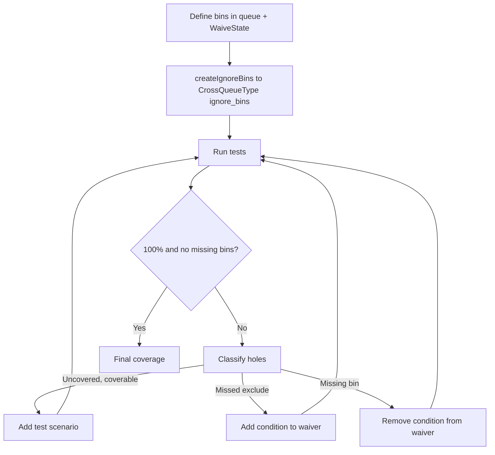

<!-- generated by yt-paper; edits will be overwritten -->
[DVCon](../dvcon/index.md) › [US](../dvcon/us.md) › [2024](../dvcon/by-year.md#2024) › [Verification](../dvcon/by-topic.md#verification)

# Tackling Missing Bins: Refining Functional Coverage in SystemVerilog for Deterministic Coverage Closure

<figure class="rep-fig" markdown>
{ loading=lazy }
<figcaption>Figure 2. Process of Refining Coverage — from the original paper (Jikjoo Lee et al.)</figcaption>
</figure>

[:material-open-in-new: Original paper](https://dvcon-proceedings.org/wp-content/uploads/1062.pdf){ .md-button .md-button--primary target=_blank }

| | |
|---|---|
| Authors | Jikjoo Lee (Samsung Electronics, Memory Division), Tony Gladvin George (Samsung Electronics, Memory Division), Kihyun Park (Samsung Electronics, Memory Division), Dongkun An (Samsung Electronics, Memory Division), Wooseong Cheong (Samsung Electronics, Memory Division), ByungChul Yoo (Samsung Electronics, Memory Division) |
| Venue | DVCon US 2024 |
| Topic | Verification |
| Type | PAPER |
| ID | `ref-20261018-4d5c` |

## Summary

**The paper proposes a pure-SystemVerilog method that stores coverable bins in a queue guarded by a waiver function, uses it to generate cross-coverage ignore_bins, and checks sampled data against the waiver before sampling, finding 36 missing bins (14.1% of 255 holes, 6.0% of 600 defined bins) on a CacheManager IP.**

**이 논문은 도달 가능한 bin을 waiver function으로 보호되는 queue에 저장하고, 이를 cross-coverage의 ignore_bins 생성과 샘플링 전 검사에 활용하는 순수 SystemVerilog 방법론을 제안하며, CacheManager IP 실험에서 255개 hole 중 36개(14.1%)의 missing bin과 정의된 600개 bin 대비 6.0%의 품질 향상을 보고한다.**

## Key Insights

- Store the coverable bins in a SystemVerilog queue (Defined Set) and gate them with a waiver function that returns an IllegalIdx. Zero means coverable; a nonzero value identifies the violated rule. The same function can be reused across coverage points and scopes.

- 도달 가능한 bin을 SystemVerilog queue(Defined Set)에 저장하고, IllegalIdx를 반환하는 waiver function으로 제어한다. 값이 0이면 도달 가능하며, 0이 아닌 값은 위반한 규칙을 가리킨다. 이 함수는 여러 coverage point와 scope에서 재사용할 수 있다.

- Pre-sampling check: feed each sampled RespState through the waiver function and emit an ERROR log line when IllegalIdx > 0. This gives a time- and test-stamped record of which excluded bin was hit, which EDA tool summaries such as vManager aggregate analysis do not provide.

- 샘플링 전 검사: 샘플링되는 RespState마다 waiver function을 통과시키고, IllegalIdx > 0이면 ERROR 로그를 출력한다. 이를 통해 제외된 bin이 어느 테스트, 어느 시점에 히트되었는지 기록할 수 있으며, vManager의 aggregate analysis 같은 EDA 도구 요약에서는 이 정보를 얻을 수 없다.

- Initial human-defined coverage was far from the ideal set: 321 of 600 defined bins (53.5%) were sampled, and only 380 of the 600 initially defined bins overlapped with the final defined set (63.3% accuracy).

- 엔지니어가 정의한 초기 coverage는 이상적인 집합과 거리가 멀었다. 600개 정의 bin 중 321개(53.5%)만 샘플링되었고, 초기 정의 bin 600개 중 380개만 최종 정의 집합과 겹쳐 정확도는 63.3%였다.

- Of 255 coverage holes, 36 were missing bins (14 + 22 = 14.1%), 35 were uncovered due to scenario gaps, and 184 were missed exclude bins. The paper reports a 6.0% quality gain (36 of 600 bins) and 7 RTL bugs related to missing bins.

- 255개 hole 중 36개(14 + 22 = 14.1%)가 missing bin이었고, 35개는 시나리오 부족으로 uncovered였으며, 184개는 missed exclude bin이었다. 논문은 600개 bin 대비 36개에 해당하는 6.0%의 품질 향상과 missing bin과 관련된 RTL 버그 7건을 보고한다.

- Self-reported overhead is under 3%, compared with about 30% for the table-based FCMS approach [2]. Judging whether a bin belongs to the Ideal Set still requires engineer intervention; automation is listed as future work.

- 논문 자체 보고에 따르면 성능 오버헤드는 3% 미만으로, 테이블 기반 FCMS [2]의 약 30%보다 훨씬 적다. 단, bin이 Ideal Set에 속하는지 판단하는 작업에는 여전히 엔지니어의 개입이 필요하며, 이 자동화는 향후 과제로 제시되었다.

## Detailed Summary

### Background and Problem

- In SystemVerilog functional coverage, human errors produce two kinds of defect. "Missing bins" are bins that testing reaches but that the coverage model excludes through oversight or over-exclusion, which can falsely signal complete verification. "Missed exclude bins" are coverable-in-principle bins wrongly excluded or non-coverable bins wrongly defined, which block 100% coverage.

- SystemVerilog functional coverage 정의에서 사람의 실수는 두 가지 결함을 만든다. "missing bin"은 테스트에서 도달되지만 실수나 과도한 제외로 인해 coverage 모델에서 빠진 bin으로, 검증이 완료되었다는 잘못된 신호를 줄 수 있다. "missed exclude bin"은 원칙적으로 커버 가능하지만 잘못 제외되었거나, 커버 불가능한데 잘못 정의된 bin으로, 100% coverage 달성을 막는다.

- The traditional mechanism, `illegal_bins`, reports uncontrolled errors. It does not indicate the timing or the rule that triggered the bin, it requires EDA tool analysis to find hits, and it can cause test failure.

- 기존 방식인 `illegal_bins`는 제어되지 않은 에러를 보고한다. 어떤 시점이나 어떤 규칙에 의해 bin이 히트되었는지 알려주지 않고, 히트 여부를 확인하려면 EDA 도구 분석이 필요하며, 테스트 실패를 유발할 수 있다.

- The table-based FCMS [2] needs a separate tool (SpecGen) and reportedly causes about a 30% performance drop. The paper claims its method degrades performance by under 3%.

- 테이블 기반 FCMS [2]는 별도 도구(SpecGen)가 필요하고 성능이 약 30% 저하된다고 알려져 있다. 본 논문은 제안 방식의 성능 저하가 3% 미만이라고 주장한다.

- EDA tools such as vManager report excluded-bin hits and scores but not which test or time produced them [3].

- vManager 같은 EDA 도구는 제외 bin의 히트 여부와 점수는 보고하지만, 어떤 테스트와 시점에서 발생했는지는 보고하지 않는다 [3].

- The paper uses four sets: Universal Set (U), Ideal Set (I), Defined Set (D), and Sampled Set (S). Bins fall into five types: covered, excluded, uncovered, missing, and missed exclude.

- 논문은 네 가지 집합을 사용한다. Universal Set(U), Ideal Set(I), Defined Set(D), Sampled Set(S)다. Bin은 covered, excluded, uncovered, missing, missed exclude의 다섯 가지 유형으로 분류된다.

### Architecture and Methodology

The method is a three-step, pure-SystemVerilog coverage writing pattern, used inside an iterative refinement loop:

본 방법은 반복적 개선 루프 안에서 사용하는 3단계 순수 SystemVerilog coverage 작성 패턴이다.

- **Step A (queue plus waiver):** A queue `StateCoverBin` stores 10-bit data. `WaiveState` takes the 10-bit state and returns `IllegalIdx`. Only states that return 0 are pushed, so the queue represents the Defined Set.

- **1단계 (queue와 waiver):** `StateCoverBin` queue가 10비트 데이터를 저장한다. `WaiveState`는 10비트 상태를 입력받아 `IllegalIdx`를 반환한다. 0을 반환한 상태만 push되므로 queue가 Defined Set을 나타낸다.

- **Step B (cross via CrossQueueType):** The queue is typed with `CrossQueueType`. `createIgnoreBins` pushes every state not in `StateCoverBin`, and these are applied as `ignore_bins` in a cross of ten 1-bit coverage points (s9 to s0).

- **2단계 (CrossQueueType을 이용한 cross):** queue를 `CrossQueueType`으로 정의한다. `createIgnoreBins`가 `StateCoverBin`에 없는 모든 상태를 push하고, 이를 1비트 coverage point 10개(s9~s0)의 cross에 `ignore_bins`로 적용한다.

- **Step C (pre-sampling report):** Each sampled `RespState` is passed through `WaiveState`. If `IllegalIdx > 0`, an ERROR statement is emitted, so the engineer can locate the test and time at which a waived bin was hit. Reporting behavior is configurable.

- **3단계 (샘플링 전 보고):** 샘플링되는 `RespState`를 `WaiveState`에 통과시킨다. `IllegalIdx > 0`이면 ERROR 문을 출력하여, 엔지니어가 waive된 bin이 히트된 테스트와 시점을 찾을 수 있게 한다. 보고 방식은 설정에 따라 바꿀 수 있다.

Refinement loop (Figure 2):

Uncovered bins that cannot be covered go into the waiver, and any impossibility may point to a design or environment issue.

개선 루프(Figure 2):

Experimental setup: the DUT is a CacheManager (CM) IP. Each cache entry has a 10-bit state. Two deterministic StateMachines operate on it. `StateMachine_curr` updates the current cache, and `StateMachine_infl` updates the influenced neighbor (it is inactive if the neighbor does not exist). Each machine takes `ReqState`, `CmdInput`, and a state-transition table, and outputs `RespState` and `CmdOutput`. Because command order depends on external modules and on both machines, the ideal set cannot be predicted up front, so coverage was first defined for simple scenarios and then refined.

커버 불가능한 uncovered bin은 waiver에 넣으며, 이것이 불가능하다면 설계 또는 검증 환경의 문제를 점검해야 한다.

### Results and Conclusions

실험 환경: DUT는 CacheManager(CM) IP다. 각 cache entry는 10비트 상태를 가진다. 두 개의 결정적 StateMachine이 이 상태를 조작한다. `StateMachine_curr`는 현재 cache를 갱신하고, `StateMachine_infl`은 영향을 받는 이웃 cache를 갱신한다(이웃이 없으면 동작하지 않는다). 각 machine은 `ReqState`, `CmdInput`, 상태 전이 테이블을 입력받아 `RespState`와 `CmdOutput`을 출력한다. 명령 순서는 외부 모듈과 두 machine 모두에 의존하므로 Ideal Set을 사전에 예측할 수 없었다. 따라서 coverage는 단순한 시나리오에 대해 먼저 정의한 뒤 반복적으로 개선했다.

- **Initial coverage:** 202 of 304 defined bins for `RespState_curr` and 119 of 296 for `RespState_infl` were sampled. Combined, that is 321 of 600 bins, or 53.5%.

### 결과 및 결론

- **Final coverage:** 100%, with 228 bins for `RespState_curr` and 165 for `RespState_infl`. The final defined and final sampled sets were identical, and were treated as the Ideal Set. The cross-coverage covers 2048 total states, per the paper.

- **초기 coverage:** `RespState_curr`는 정의된 304개 중 202개, `RespState_infl`은 296개 중 119개가 샘플링되었다. 합계는 600개 중 321개로 53.5%다.

- **Accuracy of initial definition:** 380 bins overlapped with the final defined set, giving 63.3% of the 600 initially defined bins.

- **최종 coverage:** 100%이며, `RespState_curr`는 228개, `RespState_infl`은 165개 bin이다. 최종 정의 집합과 최종 샘플링 집합이 동일했으므로 이를 Ideal Set으로 간주했다. 논문에 따르면 cross coverage는 총 2048개 상태를 포함한다.

- **Hole classification (Table 3):** 255 holes in total. 36 were missing bins (14 + 22, reported as 14.1%), 35 were uncovered because of scenario gaps, and 184 were missed exclude bins.

- **초기 정의의 정확도:** 초기 정의 bin 600개 중 380개가 최종 정의 집합과 겹쳐 63.3%다.

- **Quality gain:** The paper reports 36 missing bins out of 600 defined bins, a 6.0% enhancement in functional coverage quality. It also reports 7 RTL bugs related to missing bins.

- **hole 분류(Table 3):** hole 총 255개. 이 중 36개는 missing bin(14 + 22, 14.1%로 보고됨), 35개는 시나리오 부족으로 uncovered, 184개는 missed exclude bin이다.

- **Overhead:** Under 3%, versus about 30% for FCMS. The paper says this is roughly ten times less.

- **품질 향상:** 정의된 bin 600개 중 36개가 missing bin이었으며, 이는 functional coverage 품질의 6.0% 향상으로 보고된다. missing bin과 관련된 RTL 버그 7건도 발견되었다고 보고한다.

- **Limitations (stated by authors):** Engineer judgment is still needed to decide whether a bin belongs to the Ideal Set. Simpler coverage points can use conventional methods. Automation via scripts is planned future work. The approach also extends to transition bins and object-oriented data, but the paper gives no quantitative evidence for these.

- **오버헤드:** 3% 미만으로, FCMS의 약 30%와 비교된다. 논문은 이를 약 10배 적은 수치라고 설명한다.

- **Conclusion:** A zero-dependency SystemVerilog pattern that exposes missing bins with timed logs, and that closes coverage deterministically once the waiver is refined.

- **저자가 밝힌 한계:** bin이 Ideal Set에 속하는지 판단하는 데 여전히 엔지니어의 판단이 필요하다. 단순한 coverage point에는 기존 방식을 사용해도 된다. 스크립트를 통한 자동화는 향후 과제다. 본 방법은 transition bin이나 객체 지향 데이터에도 확장 가능하다고 설명하지만, 이에 대한 정량적 근거는 제시되지 않았다.

- **결론:** 시간 정보가 포함된 로그로 missing bin을 드러내는, 외부 의존성이 없는 SystemVerilog 패턴이다. waiver를 정제하면 coverage를 결정적으로 수렴시킬 수 있다.

## Videos

<iframe src="https://www.youtube-nocookie.com/embed/k6SKMWnJP-g" title="[DVCON2024]Tackling Missing Bins Refining Functional Coverage SystemVerilog Deterministic Coverage" loading="lazy" allow="accelerometer; clipboard-write; encrypted-media; gyroscope; picture-in-picture; web-share" referrerpolicy="strict-origin-when-cross-origin" allowfullscreen></iframe>

**[DVCON2024]Tackling Missing Bins Refining Functional Coverage SystemVerilog Deterministic Coverage** — [Watch on YouTube](https://www.youtube.com/watch?v=k6SKMWnJP-g) · [Video page](../videos/k6SKMWnJP-g.md)
