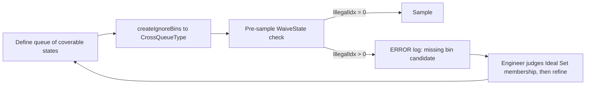

<!-- generated by yt-paper; edits will be overwritten -->
[DVCon](../dvcon/index.md) › [US](../dvcon/us.md) › [2024](../dvcon/by-year.md#2024) › [Verification](../dvcon/by-topic.md#verification)

# Tackling Missing Bins: Refining Functional Coverage in SystemVerilog for Deterministic Coverage Closure

<figure class="rep-fig" markdown>
{ loading=lazy }
<figcaption>Figure 2. Process of Refining Coverage — from the original paper (Jikjoo Lee et al.)</figcaption>
</figure>

[:material-open-in-new: Original paper](https://dvcon-proceedings.org/wp-content/uploads/1062.pdf){ .md-button .md-button--primary target=_blank }

| | |
|---|---|
| Authors | Jikjoo Lee (Samsung Electronics, Memory Division), Tony Gladvin George (Samsung Electronics, Memory Division), Kihyun Park (Samsung Electronics, Memory Division), Dongkun An (Samsung Electronics, Memory Division), Wooseong Cheong (Samsung Electronics, Memory Division), ByungChul Yoo (Samsung Electronics, Memory Division) |
| Venue | DVCon US 2024 |
| Topic | Verification |
| Type | PAPER |
| ID | `ref-20261018-4d5c` |

## Summary

**The paper proposes a pure-SystemVerilog method that stores coverable states in a queue, derives cross ignore_bins from it, and checks each sampled value against a waiver function before sampling, so over-excluded "missing bins" are reported in the log; on a 10-bit-state CacheManager it found 36 of 255 coverage holes (14.1%) and raised bin-level coverage quality by 6.0%.**

**이 논문은 도달 가능한 상태를 queue에 저장하고 이로부터 cross의 ignore_bins를 생성하며, 샘플링 전에 waiver function으로 각 값을 검사해 과도하게 제외된 "missing bins"를 로그에 보고하는 순수 SystemVerilog 방법을 제안한다. 10비트 상태를 가진 CacheManager 실험에서 255개 coverage hole 중 36개(14.1%)의 missing bins를 찾았고, bin 기준 coverage 품질을 6.0% 개선했다.**

## Key Insights

- Evaluating a waiver function before sampling and calling ERROR on nonzero IllegalIdx turns silent over-exclusion into a log entry with the rule that excluded it, using only standard SystemVerilog syntax (no illegal_bins).

- 샘플링 전에 waiver function을 평가하고 nonzero IllegalIdx일 때 ERROR를 호출하면, illegal_bins 없이 표준 SystemVerilog 문법만으로 조용히 일어나던 과도한 제외를 제외 규칙이 함께 기록된 로그 항목으로 바꿀 수 있다.

- Keeping the valid-state queue as the single source for both the defined set and the CrossQueueType ignore list (via createIgnoreBins) avoids keeping two exclusion definitions in sync.

- 도달 가능한 상태 queue를 정의된 집합과 CrossQueueType ignore 목록(createIgnoreBins 경유)의 단일 원천으로 유지하면 두 제외 정의를 따로 관리해 동기화할 필요가 없다.

- On the 600-bin CacheManager model, 36 of 255 coverage holes (14.1%) were missing bins, which the paper reports as a 6.0% improvement (36/600) and as the source of 7 RTL bugs.

- 600개 bin의 CacheManager 모델에서 255개 coverage hole 중 36개(14.1%)가 missing bins였으며, 논문은 이를 36/600으로 계산해 6.0% 개선으로 보고하고 7개의 RTL 버그와 연결했다.

- Initial coverage definitions covered only 53.5% of the 600 bins (321/600), and only 63.3% of the initially defined bins matched the final Ideal Set, which quantifies how error-prone hand-written coverage is.

- 초기 coverage 정의는 600개 bin 중 53.5%(321/600)만 커버했고, 초기 정의 bin 중 최종 Ideal Set과 일치한 비율은 63.3%에 그쳐 수작업 coverage 정의의 오류 가능성을 정량적으로 보여준다.

- The reported overhead is under 3% versus about 30% for the FCMS table-based flow [2], but the paper gives no detailed benchmark setup, and the Ideal Set membership of each bin still needs manual engineering judgment.

- 보고된 오버헤드는 3% 미만으로, FCMS 흐름[2]의 약 30%와 비교된다. 다만 논문은 상세한 벤치마크 설정을 제시하지 않으며, 각 bin이 Ideal Set에 속하는지는 여전히 엔지니어의 수작업 판단이 필요하다.

## Detailed Summary

### Background and Problem

- Hand-written SystemVerilog functional coverage often contains human errors: "missing bins" (reachable bins wrongly excluded by over-exclusion) and "missed exclude bins" (non-coverable bins wrongly defined).

- 수작업으로 작성한 SystemVerilog functional coverage에는 human error가 많다. 도달 가능한 bin이 과도한 제외로 빠지는 "missing bins"와, 도달 불가능해야 할 bin이 잘못 정의되는 "missed exclude bins"가 대표적이다.

- `illegal_bins` raises errors with no timing or rule context, and vManager-style EDA reports do not show which test hit excluded bins [1][3].

- `illegal_bins`는 시점이나 규칙 정보 없이 error를 발생시키며, vManager 같은 EDA 리포트는 어떤 테스트가 제외된 bin을 맞혔는지 보여주지 않는다[1][3].

- FCMS [2] generates coverage from tables but needs SpecGen and reportedly costs about 30% performance.

- FCMS[2]는 table로부터 coverage를 생성하지만 SpecGen 도구가 필요하고 성능 저하가 약 30%라고 알려져 있다.

### Architecture and Methodology

- Step A: a `WaiveState` function returns `IllegalIdx` (0 = coverable). Only coverable states are pushed into `StateCoverBin`, which forms the Defined Set.

- Step A: `WaiveState` 함수가 `IllegalIdx`를 반환한다(0 = 도달 가능). 도달 가능한 상태만 `StateCoverBin`에 push하며, 이것이 정의된 집합(Defined Set)을 이룬다.

- Step B: `createIgnoreBins` converts the queue into a `CrossQueueType` and emits the non-included states as `ignore_bins` in a 10-cross of 1-bit points.

- Step B: `createIgnoreBins`가 queue를 `CrossQueueType`으로 변환하고, 1비트 point 10개로 이루어진 cross에 포함되지 않은 상태를 `ignore_bins`로 내보낸다.

- Step C: before sampling, `RespState` goes through `WaiveState`; a nonzero `IllegalIdx` triggers an ERROR that names the excluded case.

- Step C: 샘플링 전에 `RespState`를 `WaiveState`에 통과시키며, `IllegalIdx`가 0이 아니면 해당 제외 케이스를 명시하는 ERROR를 출력한다.

- Target DUT: CacheManager, with 10-bit per-entry states driven by two deterministic StateMachines (curr/infl). Two crosses give 2048 total states.

- 대상 DUT: 엔트리마다 10비트 상태를 가지며 두 개의 결정론적 StateMachine(curr/infl)이 구동하는 CacheManager다. 두 cross로 총 2048개 상태가 된다.

### Results and Conclusions

- Initial sampled sets covered 202/304 bins (RespState_curr) and 119/296 (RespState_infl), i.e., 53.5% of 600. Final defined sets reached 228 and 165 bins at 100% coverage.

- 초기 샘플링 집합은 RespState_curr에서 304개 중 202개, RespState_infl에서 296개 중 119개를 커버했으며, 이는 600개 기준 53.5%다. 최종 정의 집합은 100% coverage 기준 각각 228개와 165개 bin이다.

- Of 255 holes: 36 were missing bins (14.1%), 35 were uncovered (scenario gaps), and 184 were missed exclude bins.

- 255개 hole 중 36개(14.1%)가 missing bins였고, 35개는 uncovered(시나리오 부족), 184개는 missed exclude bins였다.

- 36 missing bins out of 600 bins gives the paper's 6.0% improvement; the paper also reports 7 RTL bugs tied to missing bins.

- 600개 bin 중 missing bins 36개는 논문이 보고한 6.0% 개선에 해당하며, 논문은 missing bins와 관련된 RTL 버그 7개도 보고한다.

- Limitations: single IP, the Ideal Set is set by manual judgment, and the overhead claim (under 3%) lacks a detailed setup.

- 한계: 단일 IP 실험이며, Ideal Set은 수작업 판단에 의존하고, 오버헤드(3% 미만) 주장은 상세한 측정 설정이 부족하다.

## Videos

<iframe src="https://www.youtube-nocookie.com/embed/k6SKMWnJP-g" title="[DVCON2024]Tackling Missing Bins Refining Functional Coverage SystemVerilog Deterministic Coverage" loading="lazy" allow="accelerometer; clipboard-write; encrypted-media; gyroscope; picture-in-picture; web-share" referrerpolicy="strict-origin-when-cross-origin" allowfullscreen></iframe>

**[DVCON2024]Tackling Missing Bins Refining Functional Coverage SystemVerilog Deterministic Coverage** — [Watch on YouTube](https://www.youtube.com/watch?v=k6SKMWnJP-g) · [Video page](../videos/k6SKMWnJP-g.md)
