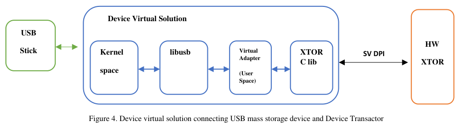

<!-- generated by yt-paper; edits will be overwritten -->
[DVCon](../dvcon/index.md) › [US](../dvcon/us.md) › [2025](../dvcon/by-year.md#2025) › [Verification](../dvcon/by-topic.md#verification)

# Leverage Real USB Devices for USB Host DUT verification

<figure class="rep-fig" markdown>
{ loading=lazy }
<figcaption>Figure 4. Device virtual solution connecting USB mass storage device and Device Transactor — from the original paper (Suchir Gupta et al.)</figcaption>
</figure>

[:material-open-in-new: Original paper](https://dvcon-proceedings.org/wp-content/uploads/1120.pdf){ .md-button .md-button--primary target=_blank }

| | |
|---|---|
| Authors | Suchir Gupta (Synopsys Inc), Amit Sharma (Synopsys Inc) |
| Venue | DVCon US 2025 |
| Topic | Verification |
| Type | PAPER |
| ID | `ref-20261018-5443` |

## Summary

**A user-space Virtual Adapter built on Linux usbfs and libusb forwards USB Device Transactor requests to a real USB mass storage device, so USB Host DUTs can be verified in emulation or simulation without writing a device-side testbench.**

**Linux usbfs와 libusb 기반의 user-space Virtual Adapter가 USB Device Transactor의 요청을 실제 USB mass storage 장치로 전달하여, 장치 측 testbench를 작성하지 않고도 emulation 또는 simulation에서 USB Host DUT를 검증할 수 있게 한다.**

## Key Insights

- The Virtual Adapter (VA) bridges the Device XTOR C library (reached via SV DPI) and libusb; control and bulk responses come from the real device, so the device testbench only needs initialization and a service loop.

- Virtual Adapter(VA)는 Device XTOR C library(SV DPI 경유)와 libusb를 연결하며, control 및 bulk 응답이 실제 장치에서 나오므로 장치 측 testbench는 초기화와 service loop만 필요하다.

- The same HW/SW split over SV DPI runs in both domains: the HS test took 5702 s in simulation vs 23 s in emulation (~248x), and the SS test took 4815 s vs 16 s (~301x).

- HW/SW 분할을 SV DPI로 구현한 동일한 구조가 두 도메인 모두에서 동작한다. HS 테스트는 simulation 5702 s, emulation 23 s(약 248배)였고, SS 테스트는 simulation 4815 s, emulation 16 s(약 301배)였다.

- Bulk transfers use libusb's asynchronous interface; if a transfer does not complete within the timeout, the VA cancels it and returns a STALL to the Host DUT.

- Bulk 전송은 libusb의 비동기 인터페이스를 사용하며, 제한 시간 내에 완료되지 않으면 VA가 전송을 취소하고 Host DUT에 STALL을 반환한다.

- Only a BBB mass storage device (full SCSI transparent command set) was demonstrated; the other USB device classes, timeout tuning for slow simulation, and broader coverage are listed as future work.

- 시연된 것은 BBB mass storage 장치(전체 SCSI transparent 명령 집합)뿐이며, 다른 USB device class, 느린 simulation을 위한 timeout 조정, 더 넓은 커버리지는 향후 과제로 남아 있다.

- The adapter pattern is reusable: the libusb side stays fixed, while the BFM-facing side can be swapped for other protocol transactors (e.g., user BFMs) and real-world peripherals.

- Adapter 구조는 재사용 가능하다. libusb 측은 그대로 두고 BFM 측 인터페이스만 다른 protocol transactor(예: 사용자 BFM)나 실제 주변장치에 맞게 교체할 수 있다.

## Detailed Summary

### Background and Problem

- Transactors expose BFM-level interfaces, but user-level software testbenches are still needed to generate realistic protocol traffic. For complex protocols such as USB and PCIe this is costly.

- Transactor는 BFM 수준 인터페이스를 제공하지만, 현실적인 프로토콜 트래픽을 생성하려면 여전히 사용자 수준 소프트웨어 testbench가 필요하다. USB나 PCIe 같은 복잡한 프로토콜에서는 이 작업의 비용이 크다.

- USB Host DUT verification requires a device model for each peripheral class/subclass/protocol (USB defines 21 device classes per the paper), and implementing full device behavior for every use case is a heavy task.

- USB Host DUT 검증에는 장치 class/subclass/protocol별 device 모델이 필요하며(논문에 따르면 USB는 21개 device class를 정의), 모든 사용 사례에 대해 완전한 장치 동작을 구현하는 것은 부담이 크다.

- Goal: let a real USB device supply the device-side responses to a USB Device Transactor, so the Host DUT sees real-world stimulus with minimal testbench code, in both emulation and simulation.

- 목표: 실제 USB 장치가 USB Device Transactor에 장치 측 응답을 제공하도록 하여, 최소한의 testbench 코드로 Host DUT가 실제 환경의 자극을 받도록 하는 것이다. emulation과 simulation 모두에서 가능해야 한다.

### Architecture and Methodology

The Device Transactor has a synthesizable SystemVerilog hardware part and a C/C++ software part (C library plus device testbench). The HW–SW boundary is at transaction level via SV DPI, which makes the transactor portable across simulation and emulation. Control requests are handed up to the C library, which invokes registered user callbacks.

Device Transactor는 합성 가능한 SystemVerilog HW 부분과 C/C++ SW 부분(C library와 device testbench)으로 구성된다. HW–SW 경계는 SV DPI를 통한 transaction 수준이며, 이로 인해 transactor가 simulation과 emulation 양쪽에서 동작한다. Control 요청은 C library로 전달되고, C library는 등록된 사용자 callback을 호출한다.

The Device Virtual Solution inserts a Virtual Adapter (user-space device driver) between the transactor C library and libusb:

Device Virtual Solution은 transactor C library와 libusb 사이에 Virtual Adapter(user-space device driver)를 삽입한다. 앞의 Mermaid 다이어그램을 참조한다(한국어 버전에서는 반복하지 않음).

VA lifecycle:

VA 수명 주기:

1. **Initialization**: `libusb_init()`, then `libusb_open_device_with_vid_pid()` using VID/PID obtained from `lsusb`.

1. **초기화**: `libusb_init()` 호출 후, `lsusb`로 얻은 VID/PID를 사용해 `libusb_open_device_with_vid_pid()` 호출.

2. **Enumeration**: descriptor requests from the Host DUT are answered by libusb descriptor APIs (device, BOS, and others). On SET CONFIGURATION, the VA calls `libusb_set_configuration()` and `libusb_claim_interface()`.

2. **Enumeration**: Host DUT의 descriptor 요청은 libusb descriptor API(device, BOS 등)로 응답한다. SET CONFIGURATION 시 VA는 `libusb_set_configuration()`과 `libusb_claim_interface()`를 호출한다.

3. **Transfers**: the asynchronous libusb path has five stages (callback creation, transfer allocation, fill with `libusb_fill_bulk_transfer()`, submit, completion callback). OUT data is stored on the real device; IN data is fetched from it. On timeout, the VA cancels the transfer and issues STALL.

3. **전송**: 비동기 libusb 경로는 5단계(callback 생성, transfer 할당, `libusb_fill_bulk_transfer()`로 채우기, submit, 완료 callback)로 구성된다. OUT 데이터는 실제 장치에 저장되고, IN 데이터는 실제 장치에서 가져온다. Timeout 시 VA는 전송을 취소하고 STALL을 발행한다.

4. **Destruction**: `libusb_close()`.

4. **소멸**: `libusb_close()` 호출.

Testbench flow for the Device side: create the `virtual_usb_device_svs` object, call `USBPlug()` to connect the device, then run `Loop()` continuously until `tbDone` is set. Each loop iteration checks whether the HW raised an interrupt and, if so, services it through libusb.

Device 측 testbench 흐름: `virtual_usb_device_svs` 객체를 생성하고, `USBPlug()`로 장치를 연결한 뒤, `tbDone`이 설정될 때까지 `Loop()`를 계속 실행한다. 각 loop 반복에서 HW가 interrupt를 발생시켰는지 확인하고, 발생했다면 libusb를 통해 처리한다.

Deployment modes:

배포 모드:

- **Emulation**: Host DUT and Device XTOR HW are synthesized on the emulator, their SW runs on the host PC, and the real USB device is attached to that PC.

- **Emulation**: Host DUT와 Device XTOR HW는 emulator에서 합성되고, 그 SW는 host PC에서 실행되며, 실제 USB 장치는 해당 PC에 연결된다.

- **Simulation**: HW and SW for both sides run on the host PC, with the real device attached.

- **Simulation**: 양쪽의 HW와 SW가 모두 host PC에서 실행되며, 실제 장치가 연결된다.

For the demonstration, the Host DUT was replaced by a Host Transactor (XTOR).

시연에서는 Host DUT 대신 Host Transactor(XTOR)를 사용했다.

### Results and Conclusions

- **HS (high speed) mass storage**: the Host XTOR initialized and enumerated the device, ran several SCSI commands, and transferred/received 1800K bytes. All control and bulk responses came from the real device. Simulation took 5702 s and emulation 23 s (~248x).

- **HS(high speed) mass storage**: Host XTOR가 장치를 초기화하고 enumeration한 뒤 여러 SCSI 명령을 실행하여 1800K bytes를 송수신했다. 모든 control 및 bulk 응답은 실제 장치에서 왔다. Simulation은 5702 s, emulation은 23 s가 걸려 약 248배 차이가 났다.

- **SS (super speed)**: the same flow with an SS device transferred 3600K bytes. Simulation took 4815 s and emulation 16 s (~301x).

- **SS(super speed)**: SS 장치로 동일한 흐름을 수행하여 3600K bytes를 전송했다. Simulation은 4815 s, emulation은 16 s가 걸려 약 301배 차이가 났다.

- The device testbench needed no response-generation logic beyond initialization and the service loop.

- 장치 측 testbench는 초기화와 service loop 이외에 응답 생성 로직이 필요하지 않았다.

- Stated limitations and future work: only the BBB mass storage protocol is implemented; other device classes could be covered via the same libusb-based approach; timers may need adjustment for slow simulation and timeouts. The paper does not report functional coverage or bug-detection results.

- 명시된 한계 및 향후 과제: 현재 BBB mass storage 프로토콜만 구현되었으며, 동일한 libusb 기반 접근으로 다른 device class를 확장할 수 있다. 느린 simulation과 timeout을 위해 timer 조정이 필요할 수 있다. 논문은 기능 커버리지나 버그 검출 결과를 보고하지 않는다.

- The authors position this as a complement to traditional verification: once basic Host DUT functionality is verified, the approach covers system-level and real-world use cases with less testbench effort.

- 저자들은 이 방식을 기존 검증의 보완으로 제시한다. Host DUT의 기본 기능이 전통적인 방법으로 검증된 후, 이 접근으로 더 적은 testbench 작업량으로 시스템 수준 및 실제 환경 사용 사례를 커버할 수 있다고 주장한다.

## Videos

<iframe src="https://www.youtube-nocookie.com/embed/iFhYhIOoQYQ" title="[DVCON2025]Leverage Real USB Devices for USB Host DUT verification" loading="lazy" allow="accelerometer; clipboard-write; encrypted-media; gyroscope; picture-in-picture; web-share" referrerpolicy="strict-origin-when-cross-origin" allowfullscreen></iframe>

**[DVCON2025]Leverage Real USB Devices for USB Host DUT verification** — [Watch on YouTube](https://www.youtube.com/watch?v=iFhYhIOoQYQ) · [Video page](../videos/iFhYhIOoQYQ.md)
