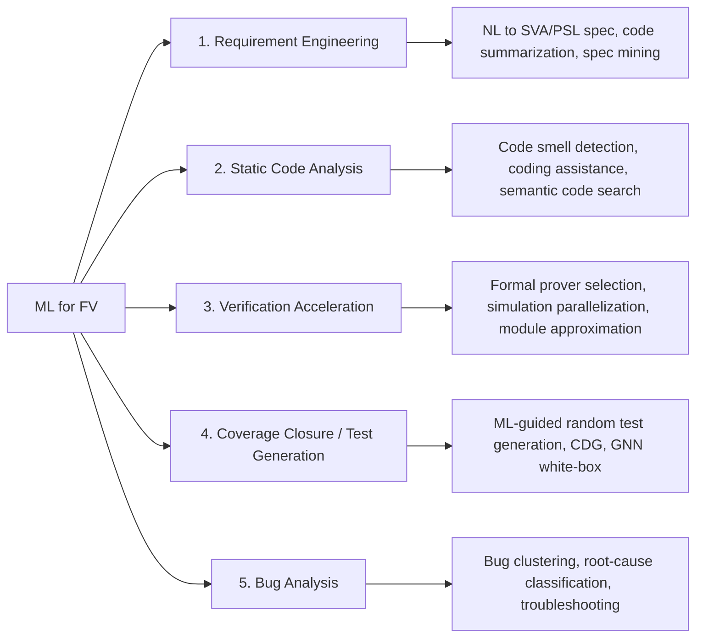

<!-- generated by yt-paper; edits will be overwritten -->
[DVCon](../dvcon/index.md) › [US](../dvcon/us.md) › [2023](../dvcon/by-year.md#2023) › [Verification](../dvcon/by-topic.md#verification)

# A Survey of Machine Learning Applications in Functional Verification

[:material-open-in-new: Original paper](https://dvcon-proceedings.org/wp-content/uploads/1135-A-Survey-of-Machine-Learning-Applications-in-Functional-Verification.pdf){ .md-button .md-button--primary target=_blank }

| | |
|---|---|
| Authors | Dan Yu (Siemens), Harry Foster (Siemens), Tom Fitzpatrick (Siemens) |
| Venue | DVCon US 2023 |
| Topic | Verification |
| Type | PAPER |
| ID | `ref-20261018-58d3` |

## Summary

**This survey maps machine learning (ML) techniques onto functional verification (FV) tasks spanning requirements, code analysis, formal/simulation acceleration, coverage closure, and bug analysis, and argues that the lack of open, high-quality verification datasets is the main barrier to progress.**

**이 서베이는 요구사항, 코드 분석, 형식/시뮬레이션 가속, 커버리지 클로저, 버그 분석에 걸친 FV(기능 검증) 과제에 ML 기법을 매핑하고, 고품질 검증 데이터셋의 부재가 진전을 가로막는 핵심 장벽이라고 주장합니다.**

## Key Insights

- Formal orchestration with an AdaBoost decision-tree classifier raised the solved-instance ratio from 95% to 97% (average speedup 1.85), and multiple linear regression predicted formal resource needs with a 32% average error.

- AdaBoost 결정트리 분류기 기반 형식 검증 오케스트레이션은 해결 인스턴스 비율을 95%에서 97%로 높였고(평균 speedup 1.85), 다중 선형 회귀는 형식 검증 리소스 요구량을 평균 32% 오차로 예측했습니다.

- ML-guided coverage closure reached 100% coverage with 3x to 5x fewer tests than baseline, and FSM and non-FSM designs saw 69% and 72% test reductions versus directed sequence generation; a white-box GNN on CDFGs predicted coverage with 74%, 73%, and 90% accuracy on IBEX v1, IBEX v2, and TPU.

- ML 기반 커버리지 클로저는 기준선 대비 3~5배 적은 테스트로 100% 커버리지를 달성했으며, FSM 및 non-FSM 설계에서 directed sequence 생성 대비 각각 69%, 72%의 테스트 감소를 보였습니다. CDFG 기반 white-box GNN은 IBEX v1, IBEX v2, TPU에서 커버리지 예측 정확도 74%, 73%, 90%를 보였습니다.

- Bug clustering from simulation logs reached only AMI 0.543 (K-means/agglomerative) and 0.593 (DBSCAN), while random forest root-cause classification reached 90.7% accuracy and 0.913 F1; none of the surveyed work addresses automated fix suggestion.

- 시뮬레이션 로그 기반 버그 클러스터링은 AMI 0.543(K-means/agglomerative), 0.593(DBSCAN)에 그쳤고, 랜덤 포레스트 root-cause 분류는 정확도 90.7%, F1 0.913을 기록했습니다. 자동 수정 제안에 대한 연구 결과는 없습니다.

- Training data scarcity is the dominant bottleneck: the largest NL-to-formal-spec dataset has about 100 sentence pairs, and GitHub/RISC-V/OpenCores hold only about 10 million lines of design and verification code with very little verification data.

- 학습 데이터 부족이 가장 큰 병목입니다. NL-to-형식 스펙 데이터셋은 약 100개 문장 쌍에 불과하며, GitHub/RISC-V/OpenCores의 설계 및 검증 코드는 약 1,000만 라인 수준이고 검증 데이터는 매우 적습니다.

- Industrial adoption hinges on generalizability, scalability, and data governance, since tool developers, data owners, and users may sit in different organizations with different compute and MLOps capacity.

- 산업 적용의 핵심은 일반화 능력, 확장성, 데이터 거버넌스입니다. 데이터 소유자, 툴 개발자, 툴 사용자가 서로 다른 조직에 속할 수 있고 컴퓨팅 및 MLOps 역량도 다를 수 있기 때문입니다.

## Detailed Summary

### Background and Problem

- Functional verification is cited as consuming about half of design engineers' time, with functional and logic errors as the leading cause of respins (about 50% of ASIC respins per the cited Wilson Research Group surveys [1][2]).

- 기능 검증(FV)은 설계 엔지니어 업무 시간의 약 절반을 차지하며, 기능 및 논리 오류가 respin의 주요 원인이라고 인용됩니다(ASIC respin의 약 50%, Wilson Research Group 서베이 [1][2] 인용).

- The paper positions FV as computation- and data-intensive, hence a natural ML target, and aims to (a) identify FV problems addressable by ML, (b) list emerging ML techniques, (c) give an industrial perspective, and (d) discuss data unavailability.

- 본 논문은 FV를 계산 및 데이터 집약적 문제로 규정해 ML 적용 대상으로 보고, (a) ML로 해결 가능한 FV 과제 식별, (b) 신규 ML 기법 정리, (c) 산업 관점 제시, (d) 데이터 부재 논의를 목표로 합니다.

- Prior surveys [6][7][8] were said to cover only subsets of the problem space (e.g., test-set redundancy, formal engine selection, root-cause analysis, code generation). This paper claims a broader topic list.

- 기존 서베이 [6][7][8]는 문제 공간의 일부(예: 테스트 세트 중복 제거, 형식 엔진 선택, root-cause 분석, 코드 생성)만 다뤘다고 평가하며, 본 논문은 더 넓은 주제 목록을 제시한다고 주장합니다.

- Central thesis: the scarcity of verification datasets is what keeps ML in FV at primitive techniques trained on hundreds of samples.

- 핵심 주장: 검증 데이터셋 부족으로 인해 ML의 FV 적용이 수백 개 샘플로 학습하는 기초적 기법에 머물러 있습니다.

### Architecture and Methodology

The work is a literature-based survey, not an experiment. Its taxonomy (Table I) groups FV-ML topics into five areas, each with subtopics:

본 연구는 실험이 아닌 문헌 기반 서베이입니다. 분류 체계(Table I)는 FV-ML 주제를 5개 영역과 하위 주제로 묶습니다:

- Section III reviews emerging techniques: transformer-based large language models (applied to code tasks) and graph neural networks (GNNs) over code/data-flow graphs.

- III장은 신규 기법을 검토합니다: 코드 작업에 적용된 트랜스포머 기반 대규모 언어 모델과, 코드/데이터 흐름 그래프에 적용된 그래프 신경망(GNN).

- Section IV covers open datasets. The authors searched GitHub, RISC-V, and OpenCores in May 2022 and counted projects by HDL (for example, 19,861 VHDL projects on GitHub, 470 Verilog and 467 SystemVerilog on OpenCores, 59 VHDL and 11 Verilog on RISC-V) and estimated about 10 million lines of code and comments.

- IV장은 공개 데이터셋을 다룹니다. 저자들은 2022년 5월 GitHub, RISC-V, OpenCores를 검색해 HDL별 프로젝트 수를 집계했고(예: GitHub VHDL 19,861개, OpenCores Verilog 470개 및 SystemVerilog 467개, RISC-V VHDL 59개 및 Verilog 11개), 코드 및 주석이 약 1,000만 라인이라고 추정했습니다.

- Section V discusses industrial constraints: generalization across design types and coding styles, scalability to billion-gate multi-team RTL, and data governance across the dataset owner, tool developer, and tool user.

- V장은 산업 제약을 논의합니다: 설계 유형 및 코딩 스타일 간 일반화, 수십억 게이트 규모 다팀 RTL로의 확장성, 데이터 소유자·툴 개발자·툴 사용자 간 데이터 거버넌스.

- Key method notes by topic:
  - Requirements: constrained natural language (CNL) with template engines versus NLP extraction; end-to-end NL-to-SVA translation is not yet production-ready.
  - Code summarization and smell detection: IR-based and heuristic approaches; the paper says no IC-design code summarization work has been reported.
  - Specification mining: mining recurring patterns from simulation traces, with rare patterns flagged as anomalies.
  - Formal acceleration: ML predicts solver time and resource use to schedule solvers.
  - Simulation acceleration: MLP (Universal Approximation) and RNN models used as surrogates for IC modules.
  - Coverage closure: black-box approaches (RL on FIFO depth, SVM/random forest/DNN with a ternary classifier) versus a white-box GNN over CDFGs with gradient-based search.
  - Bug analysis: log-based feature extraction (616 features) for clustering and classification; commit-based gradient boosting (100+ features reduced to 36).

- 주제별 방법 요약:
  - 요구사항: 제약된 자연어(CNL)와 템플릿 엔진 방식 대 NLP 기반 추출. 종단간 NL-to-SVA 변환은 아직 실사용 수준이 아닙니다.
  - 코드 요약 및 smell 탐지: IR 기반 및 휴리스틱 접근. 본 논문은 IC 설계 코드 요약 연구가 보고된 바 없다고 설명합니다.
  - 스펙 마이닝: 시뮬레이션 트레이스에서 반복 패턴을 채굴하고, 희귀 패턴은 이상으로 간주합니다.
  - 형식 가속: ML로 솔버 시간 및 리소스 사용량을 예측해 솔버를 스케줄링합니다.
  - 시뮬레이션 가속: 모듈의 대리 모델로 MLP(Universal Approximation)와 RNN을 사용합니다.
  - 커버리지 클로저: 블랙박스 접근(FIFO depth 보상 RL, SVM/랜덤 포레스트/DNN과 ternary classifier)과 CDFG 기반 white-box GNN + gradient 기반 탐색을 비교합니다.
  - 버그 분석: 로그 기반 특징 616개 추출로 클러스터링·분류를 수행하며, 커밋 기반 gradient boosting은 100개 이상의 특징 중 36개를 선택했습니다.

### Results and Conclusions

Reported results (as cited in the paper):

인용된 결과는 다음과 같습니다:

- Formal orchestration: AdaBoost raised solved ratio from 95% to 97%, average speedup 1.85; resource prediction error 32% on average.

- 형식 오케스트레이션: AdaBoost로 해결 비율이 95%에서 97%로 상승, 평균 speedup 1.85. 리소스 예측 평균 오차 32%.

- Coverage-directed test generation: 100% coverage with 3x to 5x fewer tests; FSM and non-FSM reductions of 69% and 72%; GNN coverage-prediction accuracy of 74% (IBEX v1), 73% (IBEX v2), and 90% (TPU), trained with 50% of cover points.

- 커버리지 지향 테스트 생성: 3~5배 적은 테스트로 100% 커버리지. FSM 및 non-FSM에서 각각 69%, 72% 감소. GNN 커버리지 예측 정확도는 IBEX v1 74%, IBEX v2 73%, TPU 90%(cover point의 50%로 학습).

- Bug clustering: AMI 0.543 (K-means and agglomerative) and 0.593 (DBSCAN), described as far from the ideal 1.0. Random forest root-cause classification: 90.7% accuracy, 0.913 F1.

- 버그 클러스터링: AMI 0.543(K-means 및 agglomerative), 0.593(DBSCAN)으로 이상값 1.0과 거리가 멀다고 평가됩니다. 랜덤 포레스트 root-cause 분류: 정확도 90.7%, F1 0.913.

- Semantic code search: best model's Mean Reciprocal Rank around 70%.

- 시맨틱 코드 검색: 최고 모델의 Mean Reciprocal Rank 약 70%.

- Dataset scale: NL-to-formal-spec pairs about 100; ImageNet at 14,197,122 images in 21,841 categories (August 2022) is the contrast point. An internal survey reports up to 70% of ML project time on data preparation.

- 데이터 규모: NL-to-형식 스펙 쌍 약 100개. 대조로 ImageNet은 2022년 8월 기준 21,841개 카테고리에 14,197,122개 이미지를 보유합니다. 내부 서베이에 따르면 ML 프로젝트 시간의 최대 70%가 데이터 준비에 쓰입니다.

Conclusions:

결론:

- ML in FV is in early stages, with most work using primitive techniques restricted by training-data scale.

- FV에서의 ML은 초기 단계이며, 대부분 기초적 기법을 사용하고 학습 데이터 규모에 제약을 받습니다.

- Coverage closure has the most mature results; bug-fix suggestion has no published results.

- 커버리지 클로저가 가장 성숙한 결과를 보이며, 버그 수정 제안에 대한 발표된 결과는 없습니다.

- The authors call for standardized verification data formats and community-contributed open datasets, and note that Siemens is working with consortia and partners toward this.

- 저자들은 표준화된 검증 데이터 포맷과 커뮤니티 기여 기반 공개 데이터셋을 요구하며, Siemens가 컨소시엄 및 파트너와 이를 추진 중이라고 밝힙니다.

- Generalizability, scalability, and data governance are named as the three main industrial challenges.

- 산업 적용의 3대 과제로 일반화 가능성, 확장성, 데이터 거버넌스를 꼽습니다.

Limitations to note: the paper gives no new experimental results, and several cited numbers come from undisclosed or single designs. Some in-text citation numbers do not match the reference list (e.g., [28] is cited for coverage experiments, but [28] is Cybenko's universal approximation paper).

한계: 본 논문은 새로운 실험 결과를 제시하지 않으며, 인용된 수치 중 일부는 비공개 또는 단일 설계에서 나왔습니다. 본문 인용 번호 일부가 참고문헌 목록과 맞지 않습니다(예: 커버리지 실험에 [28]이 인용되었으나 [28]은 Cybenko의 universal approximation 논문).

## Videos

<iframe src="https://www.youtube-nocookie.com/embed/SgZYDJHGSkg" title="[DVCON2023] A Survey of Machine Learning Applications in Functional Verification" loading="lazy" allow="accelerometer; clipboard-write; encrypted-media; gyroscope; picture-in-picture; web-share" referrerpolicy="strict-origin-when-cross-origin" allowfullscreen></iframe>

**[DVCON2023] A Survey of Machine Learning Applications in Functional Verification** · 📝 [Previous reading (2024-06-27)](https://youtu.be/BdxT57DYNA8) — [Watch on YouTube](https://www.youtube.com/watch?v=SgZYDJHGSkg) · [Video page](../videos/SgZYDJHGSkg.md)
