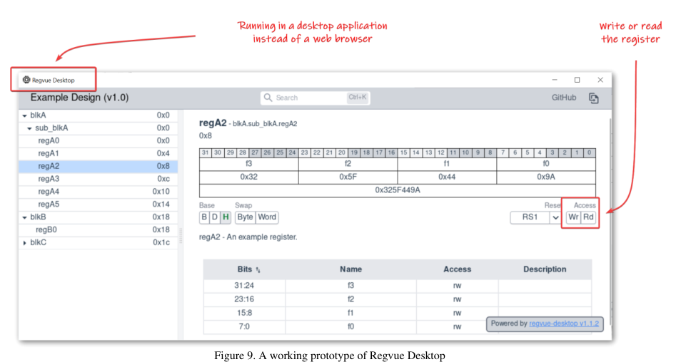

<!-- generated by yt-paper; edits will be overwritten -->
[DVCon](../dvcon/index.md) › [US](../dvcon/us.md) › [2023](../dvcon/by-year.md#2023) › [EDA](../dvcon/by-topic.md#eda)

# Regvue Modern Hardware/Software Interface (HSI) Documentation

<figure class="rep-fig" markdown>
{ loading=lazy }
<figcaption>Figure 9. A working prototype of Regvue Desktop — from the original paper (Rob Donnelly et al.)</figcaption>
</figure>

[:material-open-in-new: Original paper](https://dvcon-proceedings.org/wp-content/uploads/1136-Regvue-Modern-HardwareSoftware-Interface-HSI-Documentation.pdf){ .md-button .md-button--primary target=_blank }

| | |
|---|---|
| Authors | Rob Donnelly (Jet Propulsion Laboratory, California Institute of Technology), Josh Geden (Jet Propulsion Laboratory, California Institute of Technology) |
| Venue | DVCon US 2023 |
| Topic | EDA |
| Type | PAPER |
| ID | `ref-20261018-5ce8` |

## Summary

**Regvue is a design-agnostic, web-based register documentation tool driven by a JSON-based Register Description Format (RDF), built with TypeScript and Vue and deployed as static files, which replaces static Word/PDF/HTML register docs with searchable, encode/decode-capable, permalinked views and was used on the NASA Europa Clipper mission.**

**Regvue는 JSON 기반 Register Description Format(RDF)으로 구동되는 설계 독립형 웹 레지스터 문서화 도구로, TypeScript와 Vue로 구현되고 정적 파일로 배포되며, 검색, 인코드/디코드, 퍼머링크 기능으로 기존의 Word/PDF/HTML 레지스터 문서를 대체하고 NASA Europa Clipper 미션에 사용되었습니다.**

## Key Insights

- Static Word/PDF/HTML register docs cannot decode register values or share a precise section; Regvue addresses this with live field encode/decode, incremental fuzzy search, and direct permalinks to blocks, registers, and fields.

- 기존 Word/PDF/HTML 레지스터 문서는 레지스터 값을 필드로 디코드하거나 특정 섹션을 정확히 공유할 수 없습니다. Regvue는 실시간 필드 인코드/디코드, 증분형 퍼지 검색, 블록·레지스터·필드에 대한 직접 퍼머링크로 이 문제를 해결합니다.

- RDF is a JSON schema (JSON Schema standard, versioned) chosen over CMSIS-SVD/IP-XACT XML to minimize post-processing: parsing reduces to a single JSON.parse() call, and RDF files can include other RDF files to build system-, chip-, and module-level views.

- RDF는 버전이 관리되는 JSON Schema 기반 형식으로, CMSIS-SVD/IP-XACT XML 대신 후처리를 최소화하도록 설계되었습니다. 파싱은 단일 JSON.parse() 호출로 끝나며, RDF 파일은 다른 RDF 파일을 include하여 시스템·칩·모듈 수준 뷰를 구성할 수 있습니다.

- Hosting is minimal: the app is a static bundle (GitHub Pages, GitLab Pages, or localhost via Python). Hosting RDF JSON in GitHub Enterprise gives free versioning (via Git URLs) and access control, but the Fetch API's same-origin policy forces the app to be hosted on GitHub too, since GitHub raw links do not offer CORS relief.

- 호스팅 요구사항은 최소입니다. 앱은 정적 번들(GitHub Pages, GitLab Pages, Python 로컬 서버)로 배포됩니다. GitHub Enterprise에 RDF JSON을 호스팅하면 Git URL을 통한 버전 관리와 접근 제어를 무료로 얻지만, Fetch API의 동일 출처 정책 때문에 GitHub raw 링크가 CORS 완화를 제공하지 않아 앱도 GitHub에 함께 호스팅해야 합니다.

- On Europa Clipper, an existing tool (Register Translator) was extended to auto-generate RDF JSON for most FPGA designs; two designs needed ad hoc Python parsers and a shell script composed the top-level Europa Compute Element RDF JSON from FPGA-level files.

- Europa Clipper에서는 기존 도구인 Register Translator를 확장하여 대부분의 FPGA 설계에 대한 RDF JSON을 자동 생성했습니다. 두 설계는 임시 Python 파서가 필요했고, 최상위 Europa Compute Element RDF JSON은 셸 스크립트가 FPGA 수준 파일을 조합해 만들었습니다.

- Architecturally, the team dropped a Python/Tk Register Explorer and the cefpython embedded-browser approach because of packaging and support problems; for desktop delivery, Tauri (OS web view) is preferred over Electron, which they note ships a 100+ MB Chromium per app, with Tauri described as 1–2 orders of magnitude smaller. A Regvue Desktop prototype reads/writes registers over a UART serial console.

- 구조적으로 팀은 Python/Tk 기반 Register Explorer와 cefpython 내장 브라우저 방식을 패키징 및 지원 문제로 포기했습니다. 데스크톱 배포에는 Electron(Chromium 포함으로 앱당 100+ MB) 대신 OS 웹 뷰를 쓰는 Tauri가 선호되며, 설명에 따르면 1~2 자릿수 더 작습니다. Regvue Desktop 프로토타입은 UART 시리얼 콘솔로 레지스터를 읽고 쓸 수 있습니다.

## Detailed Summary

### Background and Problem

- Register documentation is usually delivered as Word, PDF, or static HTML. These formats cannot decode a register read value into fields, and sharing a specific part requires the document, the section number, and the heading, which the colleague must then navigate to manually.

- 레지스터 문서는 보통 Word, PDF 또는 정적 HTML로 제공됩니다. 이 형식들은 레지스터 읽기 값을 필드로 디코드할 수 없고, 특정 부분을 공유하려면 문서, 섹션 번호, 제목을 모두 전달해야 하며 수신자는 이를 수동으로 찾아가야 합니다.

- The authors (JPL) wanted an interactive register documentation tool and an earlier concept, Register Explorer (live-hardware register peek/poke GUI), motivated the work.

- 저자들(JPL)은 대화형 레지스터 문서 도구를 원했으며, 실제 하드웨어 레지스터를 조회·기록하는 GUI인 Register Explorer라는 이전 개념이 이 작업의 출발점이었습니다.

### Architecture and Methodology

- **Input format:** Design-specific data is loaded from JSON files that follow the Register Description Format (RDF), a schema created for Regvue and loosely inspired by CMSIS-SVD. JSON was chosen because JavaScript parses it natively with `JSON.parse()`, whereas XML formats (CMSIS-SVD, IP-XACT) need DOMParser-based handling. RDF files support `include`s, so system-level views can compose chip-level and module-level RDF files.

- **입력 형식:** 설계별 데이터는 Register Description Format(RDF) 를 따르는 JSON 파일로 로드됩니다. RDF는 Regvue를 위해 만든 스키마이며 CMSIS-SVD에서 일부 영감을 얻었습니다. JSON은 JavaScript가 `JSON.parse()`로 기본 파싱하므로 선택되었고, XML 형식(CMSIS-SVD, IP-XACT)은 DOMParser 기반 처리가 필요합니다. RDF는 `include`를 지원하므로 시스템 수준 뷰가 칩 수준과 모듈 수준 RDF 파일을 조합할 수 있습니다.

- **Schema validation:** RDF is described with JSON Schema (draft 2020-12). Regvue validates documents and reports errors to the user; schema versioning is embedded in each document so that breaking changes can be supported alongside older versions.

- **스키마 검증:** RDF는 JSON Schema(draft 2020-12)로 기술됩니다. Regvue는 문서를 검증하고 오류를 사용자에게 보고하며, 각 문서에 스키마 버전 정보가 포함되어 호환성을 깨는 변경을 이전 버전과 함께 지원할 수 있습니다.

- **Features:** incremental fuzzy search over names, descriptions, and offsets of blocks, registers, and fields; real-time bidirectional field/register encode/decode; byte-swap toggling for endianness mismatches between hardware and software; enumerated values mapping raw values to symbols (e.g., 0x0 to IDLE); binary/decimal/hex display; multiple resets per field, with unaffected resets shown as "?"; and permalinks that never change.

- **기능:** 블록, 레지스터, 필드의 이름·설명·오프셋을 대상으로 한 증분형 퍼지 검색, 실시간 양방향 필드/레지스터 인코드·디코드, 하드웨어와 소프트웨어 간 엔디언 불일치를 위한 바이트 스왑 토글, 원시 값을 기호 값으로 매핑하는 열거형 값(예: 0x0 → IDLE), 2진/10진/16진 표시, 필드마다 여러 리셋 지원(영향을 받지 않는 리셋은 "?"로 표시), 변하지 않는 퍼머링크를 제공합니다.

- **Web app and hosting:** The app is a static deployment; one instance can serve any number of designs via URL. Loading via URL is preferred over the filesystem because only URL loading supports includes. At JPL, the app runs on GitHub Pages and RDF JSON files are stored in GitHub Enterprise repositories, which provides versioning (through the Git URL) and access control. The constraint is that Fetch obeys the same-origin policy, so the app must be co-hosted with the data on GitHub, because GitHub raw links do not provide CORS relaxation.

- **웹 앱 및 호스팅:** 정적 배포 방식이며, 하나의 인스턴스가 URL을 통해 임의 개수의 설계를 제공할 수 있습니다. URL 로드가 파일시스템 로드보다 선호되는데, include를 지원하는 것은 URL 로드뿐이기 때문입니다. JPL에서는 앱을 GitHub Pages에서 실행하고 RDF JSON 파일은 GitHub Enterprise 저장소에 보관하여 버전 관리(Git URL 기반)와 접근 제어를 얻습니다. 제약은 Fetch가 동일 출처 정책을 따르므로, GitHub raw 링크가 CORS 완화를 제공하지 않는 한 앱과 데이터를 GitHub에 함께 호스팅해야 한다는 점입니다.

- **Implementation:** TypeScript (compile-time type checking) and the Vue component framework, where features such as search and the register layout are components.

- **구현:** 컴파일 시점 타입 검사를 위한 TypeScript와 Vue 컴포넌트 프레임워크를 사용하며, 검색과 레지스터 레이아웃 등이 컴포넌트로 구현됩니다.

- **Europa Clipper usage:** An in-house tool, Register Translator, was updated to emit RDF JSON and generated it for most FPGA designs. Two designs needed ad hoc Python scripts. The top-level Europa Compute Element (ECE) RDF JSON is produced by a simple shell script that includes the FPGA-level files.

- **Europa Clipper 사용:** 기존 사내 도구인 Register Translator를 RDF JSON을 출력하도록 갱신했고, 대부분의 FPGA 설계에 대해 이를 생성했습니다. 두 설계는 임시 Python 스크립트가 필요했습니다. 최상위 Europa Compute Element(ECE) RDF JSON은 FPGA 수준 파일을 include하는 간단한 셸 스크립트로 만들어졌습니다.

- **Design history:** A Tk-based Register Explorer proved too hard to implement, especially the register layout view. An HTML/CSS/JS prototype worked well, and embedding it in Tk via cefpython worked, but packaging for three operating systems and cefpython's uneven support were problems. The team therefore moved to a web app.

- **설계 이력:** Tk 기반 Register Explorer는 특히 레지스터 레이아웃 뷰 구현이 어려웠습니다. HTML/CSS/JS 프로토타입은 잘 동작했고, cefpython으로 Tk에 내장하는 방식도 동작했지만 세 가지 운영체제용 패키징과 cefpython의 불안정한 지원이 문제였습니다. 이에 팀은 웹 앱으로 방향을 전환했습니다.

### Results and Conclusions

- Regvue is deployed for Europa Clipper and is being prepared for open-source release under Apache 2.0 and/or MIT, under the NASA-JPL GitHub organization. Release status is described as in progress.

- Regvue는 Europa Clipper에 배포되었으며, NASA-JPL GitHub 조직을 통해 Apache 2.0 및/또는 MIT 라이선스 오픈소스 공개가 진행 중입니다. 공개 상태는 진행 중으로 기술되어 있습니다.

- Future work targets a desktop version. Electron was rejected because each app ships a full Chromium (100+ MB). Tauri, which uses the OS web view, is described as 1 to 2 orders of magnitude smaller. A working Regvue Desktop prototype reads and writes registers over a UART serial console, but deployment is not yet ready.

- 향후 과제는 데스크톱 버전입니다. Electron은 앱마다 전체 Chromium을 포함해 100+ MB가 되어 제외되었습니다. OS 웹 뷰를 사용하는 Tauri는 1~2 자릿수 더 작다고 설명됩니다. Regvue Desktop 프로토타입은 UART 시리얼 콘솔로 레지스터를 읽고 쓸 수 있으나, 배포 준비는 아직 완료되지 않았습니다.

- The paper does not report quantitative evaluation (no user study or benchmark numbers).

- 본 논문은 정량적 평가(사용자 연구나 벤치마크 수치)를 보고하지 않습니다.

- Truncation note: none; the full document text was provided.

- 잘림 여부: 없음. 전체 문서 본문이 제공되었습니다.

## Videos

<iframe src="https://www.youtube-nocookie.com/embed/gVr4LtO7M2c" title="[DVCON2023]Regvue Modern Hardware/Software Interface (HSI) Documentation" loading="lazy" allow="accelerometer; clipboard-write; encrypted-media; gyroscope; picture-in-picture; web-share" referrerpolicy="strict-origin-when-cross-origin" allowfullscreen></iframe>

**[DVCON2023]Regvue Modern Hardware/Software Interface (HSI) Documentation** — [Watch on YouTube](https://www.youtube.com/watch?v=gVr4LtO7M2c) · [Video page](../videos/gVr4LtO7M2c.md)
